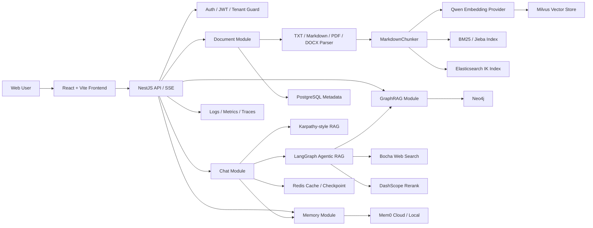
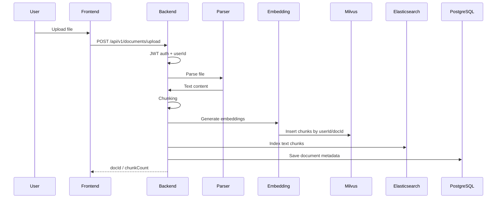
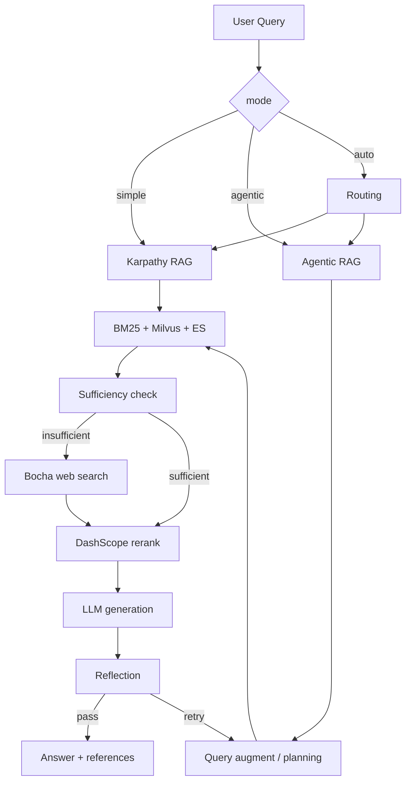

# ARCHITECTURE

> 企业级 RAG 知识库系统架构设计文档。本文描述当前代码真实架构，进度与缺口以 `ROADMAP.md` 为准。

## 1. 架构目标

本项目是面向企业知识问答场景的 Agentic RAG + Karpathy-style RAG Web 应用，目标是在可控成本下提供：

- 多租户隔离的知识库问答能力
- simple / agentic / auto 三种问答路径
- 文档上传、解析、索引、删除的闭环管理
- 向量检索、全文检索、BM25、联网搜索、Rerank、GraphRAG 的可组合检索能力
- JWT 鉴权、结构化日志、指标、追踪、评测和容器化部署能力

## 2. 总体架构



## 3. 运行时组件

| 组件 | 技术 | 职责 |
|---|---|---|
| Frontend | React 18 + Vite | 登录、文档管理、聊天、SSE 展示、Debug 面板、语音输入和朗读 |
| Backend | NestJS + TypeScript | API、鉴权、业务编排、RAG 管线、Provider 管理 |
| PostgreSQL | pgvector/pgvector:pg16 | 用户、会话、消息、文档元数据、任务等关系数据 |
| Redis | redis:7-alpine | 缓存、短期记忆、LangGraph checkpoint |
| Milvus | milvusdb/milvus:v2.4.4 | 主向量数据库，存储文档 chunk embedding 和对话 embedding |
| Elasticsearch | 8.13.0 | 全文检索与中文 IK 分词检索 |
| Neo4j | 5-community | GraphRAG 图谱实体与关系存储 |
| MinIO / etcd | Milvus 依赖 | Milvus 对象存储和元数据依赖 |
| Mem0 | cloud / local | 长期记忆搜索与写入 |

## 4. 后端模块划分

```text
backend/src
├── common/        # Guards / filters / interceptors / decorators / logger / filesystem policy
├── config/        # 环境变量解析和配置映射
├── modules/       # auth / document / chat / memory / graph / jobs / skills / metrics / tracing 等业务模块
├── providers/     # llm / embedding / speech / vector-store / db / redis / elasticsearch / mem0 / neo4j / mcp
├── rag/           # karpathy / agentic / agents / prompts / router
├── tools/         # RAG 工具与 Graph search 工具
└── migrations/    # TypeORM migration
```

关键边界：

- `modules/*` 负责业务入口和用例编排。
- `providers/*` 负责外部系统或可替换能力封装。
- `rag/karpathy` 保持透明、可调试的简单 RAG 管线。
- `rag/agentic` 负责 LangGraph 工作流和多步骤 Agentic RAG。
- `common` 放横切能力，不承载业务规则。

## 5. 核心链路

### 5.1 文档入库链路



索引策略：

- Milvus 存储 dense vector，主 collection 默认 HNSW。
- Elasticsearch 存储全文检索索引。
- 内存 BM25 索引用于快速关键词召回和降级。
- 文档删除会删除元数据、BM25 索引、ES 索引和 Milvus 向量；Milvus 删除失败会进入进程内退避重试。

### 5.2 问答链路



模式策略：

- `simple`：低延迟、透明、可调试，优先用于简单知识库问答。
- `agentic`：多步检索、查询扩展、联网兜底、Rerank、反思评估。
- `auto`：根据问题复杂度和上下文自动选择路径。

### 5.3 GraphRAG 链路

GraphRAG 默认可配置开启。当前 Neo4j 已在 dev / staging / prod compose 中支持：

- dev：`docker compose -f docker/docker-compose.dev.yml --profile graphrag up -d neo4j`
- staging：`docker compose -f docker/docker-compose.staging.yml --profile graphrag up -d`
- prod：`docker compose -f docker/docker-compose.prod.yml --profile graphrag up -d`

后端容器内必须使用：

```env
NEO4J_URL=bolt://neo4j:7687
```

本机开发时使用：

```env
NEO4J_URL=bolt://localhost:7687
```

## 6. 数据与隔离设计

系统以 `userId` 作为多租户隔离边界：

- PostgreSQL 查询按 `userId` 过滤。
- Redis key 包含用户或会话隔离维度。
- Milvus chunk metadata 包含 `userId`、`docId`，检索时过滤。
- BM25 索引按用户文档有效集合过滤。
- GraphRAG 查询按 `userId` 过滤图谱数据。
- SSE token 支持 query 参数鉴权，兼容浏览器原生 EventSource。

## 7. Provider 设计

项目通过 Provider 屏蔽外部能力差异：

| Provider | 当前实现 | 可替换方向 |
|---|---|---|
| LLMProvider | Qwen OpenAI-compatible | OpenAI / Anthropic / Ollama |
| EmbeddingProvider | Qwen text-embedding-v3 | OpenAI embeddings / local embeddings |
| SpeechProvider | Tencent ASR/TTS | 其它云服务或本地语音模型 |
| VectorStoreProvider | Milvus | pgvector |
| RelationalDBProvider | PostgreSQL | MySQL |
| Mem0Provider | Mem0 cloud/local | 关闭或本地部署 |
| Neo4jProvider | Neo4j driver | 关闭或独立图数据库 |
| McpProvider | MultiServerMCPClient | 多 MCP server |

设计约束：

- Provider 不应把外部异常扩散为核心问答不可用，除非该能力是当前请求的硬依赖。
- 可选能力缺 key 或服务不可达时应明确降级或返回可解释错误。
- 密钥只从 `.env` / 环境变量读取，不写入代码和日志。

## 8. 部署架构

### 8.1 本地开发

```bash
docker compose -f docker/docker-compose.dev.yml up -d
docker compose -f docker/docker-compose.dev.yml --profile graphrag up -d neo4j
cd backend && npm run start:dev
cd frontend && npm run dev
```

### 8.2 生产部署

默认不启用 GraphRAG：

```bash
docker compose -f docker/docker-compose.prod.yml up -d
```

启用 GraphRAG：

```bash
docker compose -f docker/docker-compose.prod.yml --profile graphrag up -d
```

生产 compose 中 backend 使用 Docker 网络服务名连接基础设施：

| 能力 | 容器内地址 |
|---|---|
| PostgreSQL | `postgres:5432` |
| Redis | `redis:6379` |
| Milvus | `milvus:19530` |
| Neo4j | `neo4j:7687` |

## 9. 可观测与质量门禁

已实现：

- pino JSON 结构化日志
- HTTP QPS / 延迟 / Node 默认指标
- RAG 业务指标：检索命中、LLM 调用次数、LLM 调用耗时、输入/输出 token 估算
- W3C `traceparent` 兼容的 in-memory tracing
- Debug chunks 分数面板
- Agentic workflow Mermaid 导出
- RAG eval / E2E / perf 脚本
- RAG 质量闸门：query normalize、低相关拒答、逐句 claim-level 引用支撑校验、多版本冲突提醒
- 结构化事实治理：`document_chunks` 保存父子 chunk、source span、section/clause/table metadata、doc version、生效期、来源权威；`fact_conflicts` 保存第一版事实冲突记录
- 可选来源权威排序：`RAG_SOURCE_AUTHORITY_RULES` 按 docId / chunk 内容匹配来源权威权重
- LLM-as-Judge 质量门禁：`npm run eval:rag:quality` 默认不消耗 Judge key，`EVAL_RAG_JUDGE_REQUIRED=true` 时强制 Qwen 判断 claim 为 supported / contradicted / not_mentioned
- 专项 smoke 脚本：MCP、GraphRAG、Speech、外部工具、Redis Checkpointer、Hybrid retrieval

待确认：

- 正式 CI/CD 接入属于红线，需单独确认后再改 workflow。
- 已提供 120 条内置业务场景回归评测集，覆盖多部门问题、标准答案、expectedClaims、引用要求和拒答要求；若要升级为真实私有业务评测集，仍需真实业务问题和标准答案输入。
- 真实生产发布仍需目标机器、域名、证书、备份和密钥注入策略。
- OTLP exporter 接入仍是后续增强，不影响当前本地可观测。

## 10. 已知风险

| 风险 | 当前处理 |
|---|---|
| Milvus search 偶发 timeout | search/delete/warmup/circuit 超时可通过环境变量配置，主检索快速失败并短期熔断，降级 BM25 |
| Milvus 删除偶发 timeout | 删除失败进入进程内退避重试，active docId 过滤避免残留命中进入答案 |
| GraphRAG 图谱为空 | 已提供 `smoke:graph` 和种子数据，并完成 Docker/Neo4j 真实运行时验证；真实业务图谱仍需业务数据源 |
| MCP 缺真实 server | 已提供本地 stdio smoke server；业务 MCP server 可追加到 `workspace/mcp-servers.yaml` |
| 外部 key 不完整 | Qwen Judge 与腾讯云语音直连已验证；Bocha / Rerank 缺 key 时脚本输出 skipped |
| Docker daemon 不可用 | 2026-06-21 已恢复并完成 GraphRAG / Hybrid / backend Speech / Redis smoke；后续若 Docker 关闭，对应 smoke 会失败或 skipped |
| 评测集规模偏小 | 已新增 120 条内置业务评测集；真实私有业务样本仍需主人提供 |

## 11. 文档关系

- `ARCHITECTURE.md`：技术架构与设计约束。
- `PRD.md`：产品需求与验收标准。
- `ROADMAP.md`：真实进度源。
- `CLAUDE.md`：项目规则。
- `rag-plan.md`：早期计划和技术路线。
- `SUMMARY.md`：`agent-course/` 参考能力总结。
