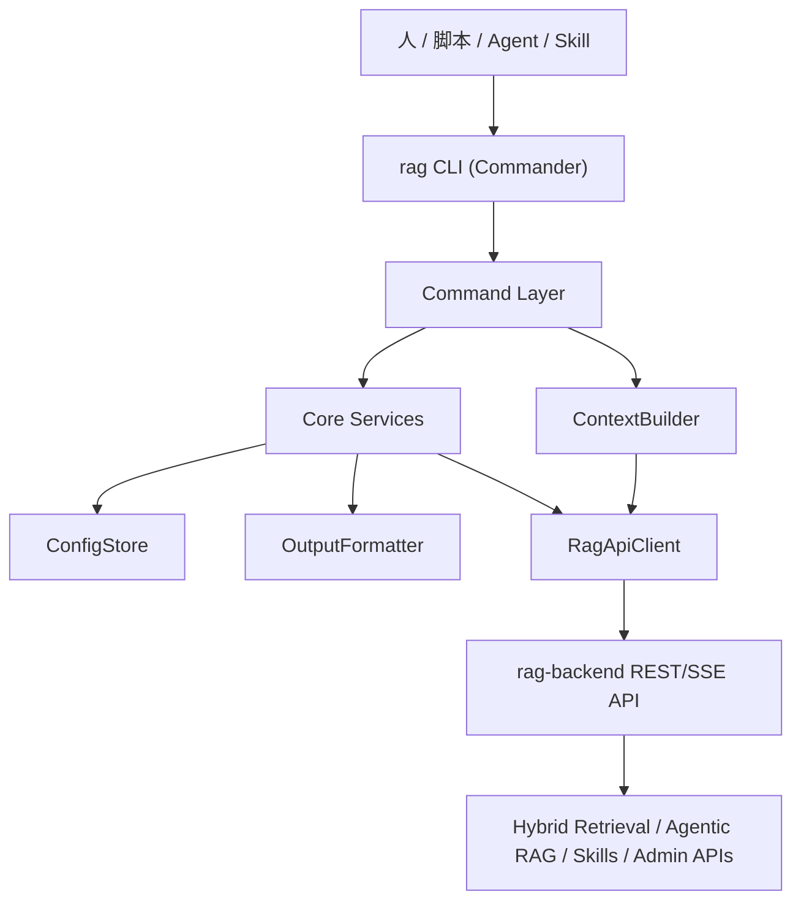

# RAG CLI 架构设计

> 本文基于 `CLI_PRD.md` 设计 RAG CLI 的技术架构、框架选型、模块边界、命令分层和实施计划。实施进度以 `ROADMAP.md` 为准。

## 1. 结论

第一版选择 **Commander.js** 作为 CLI 框架。

原因：

- `commander.js` 当前 GitHub star 最高，生态成熟，API 稳定，足够支撑 `rag auth/search/ask/context/doctor` 这类多子命令。
- 本项目 CLI 是 RAG 服务的命令行网关，不是 Heroku/Salesforce 那种插件化 CLI 平台；`oclif` 的生成器、插件、发布链路能力当前用不上。
- Commander 更轻，和当前 NestJS/TypeScript 后端共用 Node.js 技术栈，后续开发成本低。
- CLI 的复杂度应该放在 `RagApiClient`、输出协议、错误归一化和上下文组装上，而不是放在框架层。

技术组合：

| 层级 | 选择 |
|---|---|
| CLI 框架 | `commander` |
| 运行时 | Node.js 20+ |
| 语言 | TypeScript |
| HTTP 客户端 | Node 内置 `fetch`，必要时再引入 `undici` |
| 参数校验 | `zod`，复用后端已有依赖思路 |
| 输出格式 | JSON / Markdown / table |
| 本地配置 | 用户目录配置文件，不写项目 `.env` |
| 测试 | Node test 或 Jest，按仓库最终包结构统一 |

## 2. 开源框架调研

调研时间：2026-06-24。

数据来源：GitHub 仓库页面和 GitHub API 快照。

| 框架 | GitHub 仓库 | stars | 最近活跃 | 语言 | 判断 |
|---|---|---:|---|---|---|
| Commander.js | `tj/commander.js` | 28,283 | 2026-06-22 | JavaScript + typings | star 最高，稳定成熟，适合本项目 |
| yargs | `yargs/yargs` | 11,496 | 2026-06-19 | JavaScript | 解析能力强，但 issue 较多，API 风格偏命令解析器 |
| oclif | `oclif/oclif` | 9,551 | 2026-06-23 | TypeScript | 大型 CLI 平台能力强，但对 MVP 偏重 |
| cac | `cacjs/cac` | 3,098 | 2026-06-16 | TypeScript | 轻量好用，但生态和长期稳定性不如 Commander |
| stricli | `bloomberg/stricli` | 1,054 | 2026-06-21 | TypeScript | 类型安全强，但社区规模小 |

### 2.1 为什么不选 oclif

`oclif` 很适合下面场景：

- 需要插件机制。
- 需要生成器、manifest、pack、upload、跨平台发布包。
- CLI 本身就是一个独立产品平台。

当前 RAG CLI 的第一目标是本地命令行网关：登录、查询、问答、生成上下文包和诊断。过早引入 oclif 会带来生成结构、打包流程和插件边界，反而增加第一版实现成本。

### 2.2 为什么不选 yargs / cac / stricli

- `yargs` 成熟，但更偏参数解析和命令声明，工程组织需要自己补。
- `cac` 非常轻，但社区规模小，不适合作为长期企业项目默认选型。
- `stricli` 类型安全很好，但 star 和生态规模明显小，当前不是主流稳妥方案。

### 2.3 为什么选 Commander

`commander` 的定位很贴合这个项目：

- 子命令清晰，适合 `rag auth login`、`rag search`、`rag context`。
- 自动 help、option、argument、unknown option 错误都成熟。
- TypeScript 使用简单，不强迫项目接受框架生成结构。
- 和“少抽象、先跑通一条链路”的项目纪律一致。

## 3. 架构目标

CLI 只做三件事：

1. 把用户命令解析为稳定的应用层调用。
2. 调用 RAG 后端 API，统一鉴权、错误、超时和输出。
3. 生成适合人类、脚本、Agent、Skill 消费的上下文包。

CLI 不做：

- 不直接访问 PostgreSQL、Milvus、Elasticsearch、Redis、Neo4j。
- 不读取或修改 `.env`。
- 不绕过 JWT / service token / 多租户隔离。
- 不自动修改代码、commit、push、部署。
- 不把 Skill 作为必要前提；Skill 只是调用方之一。

## 4. 目录结构

实现前必须先创建 `cli/CLAUDE.md`，明确 CLI 子项目规则，然后再写代码。

建议结构：

```text
cli/
├── CLAUDE.md
├── package.json
├── tsconfig.json
├── src/
│   ├── bin.ts
│   ├── commands/
│   │   ├── auth.ts
│   │   ├── search.ts
│   │   ├── ask.ts
│   │   ├── context.ts
│   │   ├── skill.ts
│   │   ├── doc.ts
│   │   ├── doctor.ts
│   │   └── config.ts
│   ├── core/
│   │   ├── api-client.ts
│   │   ├── config-store.ts
│   │   ├── errors.ts
│   │   ├── output.ts
│   │   ├── exit-code.ts
│   │   └── schemas.ts
│   └── context/
│       ├── context-builder.ts
│       ├── guidance-builder.ts
│       └── citation-normalizer.ts
└── test/
    ├── commands/
    └── core/
```

边界：

- `commands/` 只做参数解析和调用编排。
- `core/api-client.ts` 只负责 HTTP 请求、鉴权、超时、错误归一化。
- `core/output.ts` 只负责 JSON/Markdown/table 输出。
- `context/` 负责把 search、skill match、roadmap/doc 元数据合成上下文包。
- 任何命令不得直接 `fetch` 后端；必须走 `RagApiClient`。

## 5. 分层设计



## 6. 命令架构

### 6.1 P0 命令

| 命令 | 调用模块 | 后端接口 |
|---|---|---|
| `rag auth login` | `AuthCommand` | `POST /api/auth/login` |
| `rag auth status` | `AuthCommand` | `GET /api/auth/profile` |
| `rag search` | `SearchCommand` | MVP 可用 `GET /api/debug/chunks`，Phase 2 改正式 search API |
| `rag ask` | `AskCommand` | `POST /api/chat` / `GET /api/chat/stream` |
| `rag context` | `ContextCommand` | 组合 search、skill match、profile，后续迁到 `POST /api/rag/context` |
| `rag skill match` | `SkillCommand` | `GET /api/skills/match` |
| `rag doctor` | `DoctorCommand` | health/profile/skills/search 探测 |

### 6.2 命令注册方式

入口只注册命令，不写业务逻辑：

```ts
const program = new Command();

program
  .name('rag')
  .description('RAG knowledge CLI')
  .version(version);

registerAuthCommand(program, deps);
registerSearchCommand(program, deps);
registerAskCommand(program, deps);
registerContextCommand(program, deps);
registerSkillCommand(program, deps);
registerDoctorCommand(program, deps);

await program.parseAsync(process.argv);
```

## 7. 核心模块设计

### 7.1 `RagApiClient`

职责：

- 注入 `baseUrl`、`token`、`timeoutMs`。
- 统一拼接 `/api` 路径。
- 自动附加 `Authorization: Bearer <token>`。
- 统一处理 401、403、404、5xx、网络超时。
- 支持 SSE 流式读取。
- 不输出 token。

方法草案：

```ts
interface RagApiClient {
  login(input: LoginInput): Promise<LoginResult>;
  profile(): Promise<ProfileResult>;
  health(): Promise<HealthResult>;
  search(input: SearchInput): Promise<SearchResult>;
  ask(input: AskInput): Promise<AskResult>;
  askStream(input: AskInput, onEvent: (event: RagSseEvent) => void): Promise<void>;
  matchSkills(input: SkillMatchInput): Promise<SkillMatchResult>;
  listDocs(): Promise<DocumentListResult>;
}
```

### 7.2 `ConfigStore`

职责：

- 读取命令行参数、环境变量、用户级配置。
- 保存 base URL 和 token。
- 不保存密码。
- 不写项目 `.env`。

配置优先级：

1. CLI 参数。
2. 环境变量：`RAG_BASE_URL`、`RAG_TOKEN`。
3. 用户级配置文件。
4. 默认值：`http://localhost:3000/api`。

建议用户级路径：

```text
~/.config/rag-cli/config.json
```

token 存储第一版使用用户级配置文件，文件权限需要限制为当前用户可读写。macOS Keychain 等系统钥匙串属于 P2 增强，不作为 MVP 前置。

### 7.3 `OutputFormatter`

职责：

- 支持 `json`、`markdown`、`table`。
- JSON 输出必须稳定，适合脚本和 Agent 消费。
- Markdown 输出适合人读。
- table 输出只用于短列表，不用于长上下文。

统一结果：

```ts
type CliStatus = 'ok' | 'insufficient_context' | 'error';

interface CliEnvelope<T> {
  status: CliStatus;
  data?: T;
  error?: CliError;
  meta?: {
    requestId?: string;
    elapsedMs: number;
    baseUrl: string;
  };
}
```

### 7.4 `ContextBuilder`

职责：

- 接收任务描述、paths、limit、maxTokens、matchSkill 等参数。
- 调用 search 获取知识片段。
- 可选调用 skill match。
- 生成 `codingGuidance`。
- 输出 `citations`。
- 无足够上下文时返回 `insufficient_context`。

MVP 不在本地跑 LLM，不做“智能总结”。上下文包应优先保持可追溯事实，避免 CLI 自己产生幻觉。

## 8. 错误与退出码

| 场景 | code | exit |
|---|---|---:|
| 成功 | `ok` | 0 |
| 无足够上下文 | `insufficient_context` | 1 |
| 参数错误 | `invalid_args` | 2 |
| 未登录 / token 失效 | `unauthorized` | 3 |
| 权限不足 | `forbidden` | 3 |
| 服务不可达 | `service_unavailable` | 1 |
| 服务端错误 | `server_error` | 4 |

错误输出示例：

```json
{
  "status": "error",
  "error": {
    "code": "unauthorized",
    "message": "token expired, please run rag auth login",
    "recoverable": true
  }
}
```

## 9. 安全设计

- 密码只从 stdin 读取，不允许通过参数直接传入。
- token 不进入 stdout 的 verbose 日志。
- `rag doctor --verbose` 也只能显示 token 来源，不显示 token 值。
- CLI 不读取 `.env`。
- CLI 不直接访问数据库、向量库、缓存或图数据库。
- 普通命令只使用 JWT；运营命令需要显式 service token。
- `rag context` 不输出敏感配置和密钥。

## 10. 与后端 API 的关系

MVP 复用现有 API：

| CLI 能力 | 当前可用接口 |
|---|---|
| 登录 | `POST /api/auth/login` |
| profile | `GET /api/auth/profile` |
| 文档列表 | `GET /api/documents` |
| 问答 | `POST /api/chat` |
| 流式问答 | `GET /api/chat/stream` |
| Debug 检索 | `GET /api/debug/chunks` |
| Skill 列表 | `GET /api/skills` |
| Skill 匹配 | `GET /api/skills/match` |
| 健康检查 | `GET /api/health` |

Phase 2 建议新增正式 API：

| 接口 | 价值 |
|---|---|
| `POST /api/rag/search` | 避免长期依赖 debug API，返回正式 citation/search schema |
| `POST /api/rag/context` | 后端统一聚合检索、Skill、文档、引用和上下文规则 |

新增 API 不应改变数据库 schema。若后续为了持久化 CLI 请求日志而需要 schema 变更，必须先单独确认。

## 11. 实施计划

### Phase 0：规则与骨架

- 创建 `cli/CLAUDE.md`。
- 创建 `cli/package.json`、`tsconfig.json`、`src/bin.ts`。
- 引入 `commander`。
- 接好 `rag --help`、`rag --version`。

验证：

```bash
cd cli && npm run build
node dist/bin.js --help
```

### Phase 1：P0 可用闭环

- `rag auth login/status`
- `rag search`
- `rag ask`
- `rag skill match`
- `rag context`
- `rag doctor`

验证：

```bash
cd cli && npm run build
cd cli && npm test
node dist/bin.js doctor
node dist/bin.js context "这个项目改完代码后要跑什么验证" --format json
```

### Phase 2：正式 API 与体验增强

- 后端新增 `POST /api/rag/search`。
- 后端新增 `POST /api/rag/context`。
- CLI 从 debug API 切到正式 API。
- 增加 `rag config`、`rag doc list/show`。

验证：

```bash
cd backend && npm run build
cd backend && npm test -- --runInBand
cd cli && npm run build
cd cli && npm test
```

### Phase 3：运营闭环

- `rag admin search popular/no-result/recall-issues`
- `rag graph query`
- `rag eval run`

验证：

```bash
cd backend && npm run eval:rag:quality
cd cli && npm test
```

## 12. 风险与约束

- 新增 `commander` 是新依赖，正式编码前需要在任务说明中明确它来自本文选型。
- 如果创建 `cli/` 子项目，必须先写 `cli/CLAUDE.md`。
- 第一版不要做 npm publish；发布属于红线，必须单独确认。
- 第一版不要接 CI/CD；CI/CD 配置属于红线，必须单独确认。
- 第一版不要做数据库 schema 变更。
- 不要为了做 CLI 把后端鉴权放松。

## 13. 最终选择

最终选择：

```text
Commander.js + TypeScript + Node fetch + zod
```

开发策略：

- 先用 Commander 快速实现稳定命令面。
- API 调用、输出格式、错误码全部自己控制。
- 等 `rag context` 被真实使用后，再决定是否需要迁移到 oclif 或增加插件机制。

