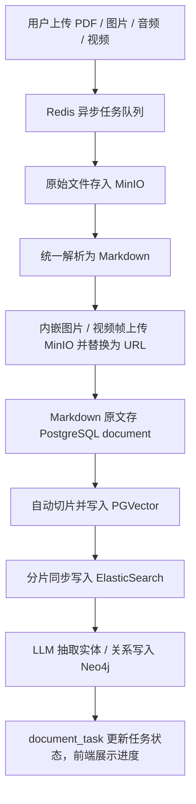
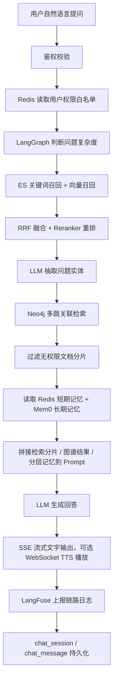

# 多模态 RAG 蓝图对照与缺口清单

> 来源：`/Users/monster/Downloads/企业级知识库项目：项目介绍、多模态 RAG 流程梳理.pdf`
> 目的：把 PDF 里读到的蓝图固化下来，后续实现时直接对照本文件，不再重复扫描 PDF。
> 最近整理：2026-06-30

## 一、PDF 核心内容

### 1. 项目定位

- 企业内部知识分散在文档、经验、流程、问题解决方案中，传统人工翻找和关键词检索效率低。
- 企业级知识库核心能力是文档管理、AI 问答、全文搜索、知识图谱、权限控制、数据统计。
- AI 知识库需要支持语义检索、AI 一键问答、权限内资料召回和复杂业务问题推理。

### 2. 文档权限要求

- 文档需要做权限管理。
- 只有当前用户有权限访问的文档，才能进入检索结果并用于生成回答。
- 权限白名单可以理解为当前登录用户可访问的文件夹、文档 ID 集合，缓存到 Redis。
- 检索后还要再次过滤无权限文档，避免内部涉密资料泄露。

### 3. 支持的文档类型

- 文本类：`PDF`、`DOCX`、`DOC`、`XLSX`、`XLS`、`PPTX`、`PPT`、`TXT`、`MD`、`CSV`、`JSON`。
- URL：输入网页 URL 后自动抓取页面正文，导入知识库并归档检索。
- 图片：`JPG`、`PNG`，上传后通过视觉嵌入模型提取图像特征，并调用大模型 OCR / 图像理解生成图片描述文本。
- 音频：`MP3`、`WAV`、`M4A`，上传后执行 ASR 语音转文字，转录文本归档并参与检索。
- 视频：`MP4`，通过视频理解模型解析音频和画面视觉信息，生成完整文本内容和视频多模态向量，支持跨模态检索。

### 4. 简历级技术栈

- RAG / Agent：`LangChain`、`LangGraph`、`DeepAgents`、`Vercel AI SDK`。
- 后端与基础服务：`Nest`、`Redis`、`PostgreSQL`、`ElasticSearch`、`Neo4j`、`MinIO`、`Docker Compose`。
- 记忆与观测：`Mem0`、`LangSmith`、`LangFuse`。

### 5. 项目亮点

- 混合检索：向量检索 + 关键词检索，PDF 中用 `PGVector + ElasticSearch`，通过 `RRF` 融合和 `Reranker` 重排提升准确率。
- 知识图谱：LLM 自动抽取文档实体和关系写入 Neo4j；用户问题也抽取实体，做多跳图谱检索，再与 RAG 结果一起进入 Prompt。
- 多模态解析：PDF、Word、TXT、图片、音频、视频统一解析为 Markdown；文档内图片上传到 MinIO，并在 Markdown 中替换为 URL。
- 记忆：Redis 做短期记忆，包含滑动窗口和摘要；Mem0 做长期记忆，包含用户级和会话级记忆。
- 权限：RBAC 覆盖页面、菜单、按钮三级权限；检索阶段按角色过滤文档池，实现功能权限和数据权限双隔离。
- Agentic RAG：LangGraph Agent 判断问题复杂度，简单问题走混合检索，复杂问题动态调用图谱推理等工具。
- 语音交互：ASR + 流式 TTS；SSE 推送文字；WebSocket + 流式 TTS 做语音同步播放。
- 可观测与评估：本地用 LangSmith 调试，线上用 LangFuse 记录检索耗时、LLM 成本、召回来源、异常日志，并做自动化效果评估。

### 6. 存储组件分工

- PostgreSQL / PGVector：结构化业务数据、用户角色权限、文档、分片、问答会话、分片向量。
- ElasticSearch：文档分片全文索引，负责关键词召回和全文模糊检索。
- Neo4j：实体、关系、多跳图谱推理。
- Redis：缓存、临时数据、短期记忆、权限白名单、热门文档排行。
- MinIO：原始上传文件、解析后的内嵌图片、视频帧等静态资源。
- Mem0：用户级长期记忆、会话级长期记忆。

### 7. 多媒体上传解析流程

关键点：

- 上传后的处理耗时高，需要放入 Redis 任务队列异步消费。
- 需要任务表记录处理进度，前端轮询或订阅任务状态。
- 文本直接提取内容转 Markdown。
- 图片走视觉嵌入 + OCR / 图像理解。
- 音频走 ASR。
- 视频走分片 + 音频转写 + 关键帧理解 + 视频理解模型。

### 8. Agent 问答流程

### 9. 与 Dify 的差异点

- Dify 支持递归分块、向量 + 全文检索 + 重排。
- PDF 认为 Dify 的不足是：
  - 不支持知识图谱自动抽取实体关系和多跳推理。
  - 缺少分级数据权限管控，不能按部门、岗位隔离文档。
  - 不支持完整多模态解析与检索链路。
  - 底层封装度高，难以深度对接自定义 Agent。

## 二、当前项目对照结论

### 已基本具备

- 文档上传、解析、切分、Embedding、Milvus 向量检索；Milvus provider 已补运行时状态、连续失败计数、熔断/半开状态和 ops/admin 状态回显。
- BM25 / ElasticSearch 关键词检索和 Rerank 能力。
- 标准 RRF 排名融合已接入混合检索，命中同一分片的多路召回会优先排序。
- 文本类入库已覆盖 `MD/TXT/PDF/DOCX/DOC/XLS/XLSX/PPT/PPTX/CSV/JSON/HTML`；URL 入库入口已支持抓取 `HTML/JSON/CSV/plain text` 并归一化为 Markdown / 文本，HTML 会抽正文、标题、描述、抓取时间和最终 URL，并保存原始响应快照。
- 文档入库底座已补对象存储、原始文件资源记录、`document_tasks` 任务进度、同步上传任务状态和异步上传入口。
- 图片、音频、视频文件已进入统一上传入口：图片/视频生成可检索 Markdown 元数据；音频会优先调用 ASR 生成 transcript，未配置 ASR 时降级为媒体元数据。
- 文档级 ACL 已落表，上传者自动拥有读取权限；运营 API 可更新文档权限，并通过 Redis 缓存权限白名单。
- admin Documents 页面已提供文档权限配置入口，可保存 `user/role/department/public` 可读主体到文档 ACL；用户/角色主体已接入 admin-backend 真实列表，部门主体已接入脱敏组织树接口。
- LangFuse 可选 provider 已接入 ChatService 非流式主链路和 AG-UI 流式完成结果；已补阶段级 span、事件摘要、token/cost 估算，未配置 key 时自动跳过。
- TTS WebSocket 入口已挂载在 `/api/v1/speech/tts/ws`，用于按 chunk 推送 base64 WAV；admin AI 问答回答卡已支持播放。
- Agentic RAG 主链路：routing、query augment、retrieval、sufficiency、web search、rerank、generate、citation、reflection、final。
- GraphRAG 基础能力：Neo4j provider、实体关系抽取、schema/entities/relationships/search 运营接口。
- 管理后台 GraphOps 页面和 RAG 运营页面。
- 多模态评测脚手架已补充：`eval:rag:multimodal` 会校验数据集结构、标记 placeholder 样本，并可在 CI 中通过 `MULTIMODAL_EVAL_REQUIRE_ASSETS=true` 强制真实素材；脱敏私有多模态样本包已覆盖文本、表格、结构化、HTML、音频、图片、视频。
- 私有脱敏数据包已补齐：50 条业务毒题集、7 个多模态样本文件、5 条 GraphRAG 业务图谱种子、4 个部门/岗位组织权限样本，均可通过脚本严格校验。
- 多租户基础隔离和后台 RBAC 基础能力。
- ASR / TTS 基础接口。
- Mem0 provider、Redis checkpointer、Prometheus / traceparent / 查询日志等基础可观测。

### 仍缺或不足

#### P0：多模态入库主链路

- 图片 OCR / 图像理解仍依赖真实视觉模型接入；当前已能存储原始文件并生成元数据 Markdown，但不声称本地无 key 可完成真实 OCR。
- 视频理解仍依赖真实视频模型或 `ffmpeg`/关键帧工具链；当前已能入库视频资源和元数据，不声称完成真实画面理解。
- URL 入库已补正文抽取、抓取元数据、大小/超时限制和原始响应快照；复杂反爬和动态渲染页面仍需要真实站点样本继续增强。
- 异步上传入口已完成；当前是进程内异步队列，生产级跨进程 Redis/BullMQ 队列仍可作为增强项。

#### P1：权限、融合和图谱增强

- 文档级 ACL 已有基础表、运营 API 和 admin 前端配置入口；用户/角色/部门主体选择已联通 admin-backend，仍缺企业真实部门/岗位数据源，以及分片级继承策略可视化。
- Redis 权限白名单已可缓存文档可读集合；还缺复杂部门/岗位组织树和权限回显的企业真实数据联调。
- PGVector 与 PDF 不一致：项目当前主向量库是 Milvus，PGVector 是备选；这不是硬缺口，但简历/面试口径不能直接声称主链路是 PGVector。
- 真实业务图谱不足：图谱链路和脱敏种子有了，但还缺企业真实实体类型、关系类型、别名规则和初始业务数据。

#### P2：记忆、语音和观测

- 短期记忆产品化不足：需要明确 Redis 滑动窗口、摘要生成、摘要更新和上下文注入策略。
- 长期记忆产品化不足：Mem0 已接入，但用户级、会话级记忆的管理、审计、开关和后台可视化还不完整。
- WebSocket + 流式 TTS 后端入口和 admin 问答播放 UI 已完成；后续可增强逐字同步、播放状态和失败提示。
- LangFuse provider 已接入非流式 ChatService 与 AG-UI 完成结果，并记录 retrieval/span/token/cost 估算；真实 key 环境还需要线上 trace 校验。
- 多模态评测已有结构脚手架和脱敏私有样本包；真实公司图片、音频、视频、URL 原件替换后，才能得到真实业务召回准确率、权限过滤和引用支撑评测。

## 三、后续实现优先级

### 第一阶段：先把多模态入库底座补齐

- 目标：让“上传文件 -> 异步任务 -> 对象存储 -> Markdown -> 分片 -> 检索索引 -> 图谱抽取 -> 进度展示”成为统一链路。
- 当前状态：已补对象存储抽象、`document_tasks`、`document_resources`、异步上传入口、同步上传进度记录。
- 后续增强：生产级 Redis/BullMQ 跨进程队列、失败重试策略和后台任务进度 UI。

### 第二阶段：补图片、音频、URL 增强

- 图片：OCR / 图像理解生成描述文本，先入文本检索；视觉向量和以图搜图后置。
- 音频：复用 ASR provider，把转录文本作为 Markdown 入库。
- URL：基础抓取已完成；后续补更稳的正文抽取、资源归档、抓取元数据和失败重试。

### 第三阶段：补视频和跨模态检索

- 视频：音频 ASR + 关键帧抽取 + 视频理解模型生成结构化 Markdown。
- 跨模态：补视觉向量、图片/视频资源索引、文本搜图和以图搜图。

### 第四阶段：补权限、观测和评测闭环

- 文档 ACL、Redis 权限白名单、检索后强过滤。
- admin 权限配置入口已完成，用户/角色/部门选择已接 admin-backend；后续接企业真实组织树、岗位继承和权限回显。
- 脱敏业务图谱数据已完成；后续替换企业真实业务图谱数据。
- LangFuse 线上链路校验和真实成本单价配置。
- 脱敏多模态权限召回评测集已完成；后续替换企业真实原件。

## 四、面试口径注意

- 可以说项目已经实现了 Milvus + ES/BM25 + 标准 RRF + Rerank 的混合检索、Agentic RAG、GraphRAG 基础链路和后台运营能力；Milvus 支持超时保护、熔断降级、状态回显和 BM25 fallback。
- 可以说当前已支持 Office/CSV/JSON/HTML/URL 基础入库、对象存储、任务进度、ACL 基础能力和音频 ASR 入库接入。
- 可以说本地已经完成图片/音频/视频脱敏样本、转写 sidecar、评测门禁和 readiness smoke；不要说已经完成真实图片 OCR、视频理解、以图搜图，这些依赖真实多模态模型和素材继续联调。
- 不要说当前主链路是 PGVector；当前主向量库是 Milvus，PGVector 只能作为备选方案或 PDF 蓝图中的参考实现。
- 权限可以说已有 RBAC、多租户隔离、文档级 ACL、Redis 权限白名单和管理后台权限配置入口。
- 语音可以说已有 ASR/TTS 基础接口、音频入库转写接入、TTS WebSocket 后端入口和 admin 回答播放按钮；逐字同步和播放状态还可继续增强。
- URL 入库可以说已有正文抽取、抓取元数据和快照归档；动态渲染/反爬页面需要真实站点继续联调。
