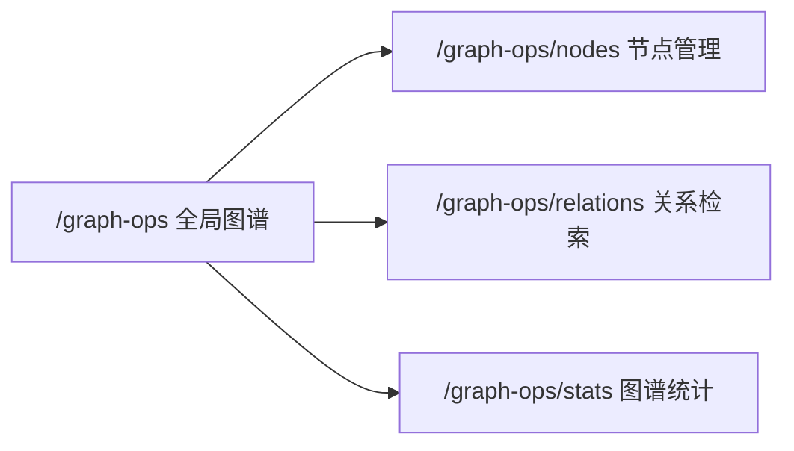

# Graph Ops 三菜单实施计划

> 目标路径：`/graph-ops`。本文是后续编码的执行源，先画 UI 图和接口契约，再按 checklist 实现。

## 结论

本次只实现截图红框内三个二级菜单：

- `节点管理`：节点列表、筛选、详情抽屉、关联关系预览。
- `关系检索`：按实体/关系类型/关键词检索关系链路，展示关系表和局部图谱。
- `图谱统计`：节点/关系总览、类型分布、孤立节点、冲突关系和基础趋势占位。

不重做 `全局图谱`。现有 D3 图谱画布继续作为全局入口，三个菜单复用同一套 `graph-ops` service 和 admin-backend 接口。

## 当前事实

- 前端入口已存在：`admin/src/pages/graph-ops/index.tsx`。
- 前端 service 已存在：`admin/src/pages/graph-ops/service.ts`，已有 `stats/schema/nodes/search`。
- 左侧菜单已存在：`AdminShell.graphNav` 有 `global/nodes/relations/stats`，但 `nodes/relations/stats` 没有 `path`，当前只能显示在侧栏，不能切换页面。
- admin-backend 已存在：`admin-backend/src/modules/graph-ops/*`。
- RAG 后端运营接口已有图谱入口，但 `GET /rag/admin/graph/schema` 当前代码实际调用了 `getGraphEntities()`，需要修正为真正 schema。
- 真实 Neo4j 为空或不可用时，admin-backend 当前会 fallback mock。后续页面必须明确标识 demo/mock，不静默冒充真实数据。

## 设计定位

### 四个定位问题

- 叙事角色：后台运维工具，不是营销页；优先让管理员快速定位节点、关系和异常。
- 查看距离：桌面端 10cm-80cm，信息密度可以高，但不能挤压表格可读性。
- 视觉温度：冷静、工程化、可扫描；沿用现有蓝白后台风格。
- 容量检查：三个菜单都采用筛选栏 + 主表/图 + 右侧摘要的稳定结构，避免每页重新发明布局。

### Design Decisions

- Anchor / recipe: 现有 `admin` 后台视觉系统。
- Color palette: 主色 `#1677ff`，背景 `#f5f7fb`，面板白色，状态色沿用 antd token。
- Typography: 继续使用项目默认字体；标题 16-20px，表格/筛选 14px。
- Spacing system: 8px 栅格；页面内容 `16px/24px`，面板内边距 `16px/20px`。
- Border-radius strategy: 统一 6-8px，不使用大圆角卡片。
- Shadow hierarchy: 继续使用 `.rag-panel` 的轻阴影，只保留一层面板层级。
- Motion style: 表格 loading、抽屉打开、图谱 zoom/drag 使用现有 antd/D3 行为，不额外做装饰动画。

## UI 图

### 导航结构



### 节点管理

```text
┌─────────────────────────────────────────────────────────────────────┐
│ 搜索节点名称/别名  节点类型  业务分类  是否孤立  更新时间   重置 搜索 │
├─────────────────────────────────────────────────────────────────────┤
│ 节点表格                                                           │
│ 名称 | 类型 | 关联关系数 | 来源文档 | 置信度 | 最近更新 | 操作      │
│ LangChain | Framework | 6 | 3 | 0.92 | 2026-06-24 | 详情       │
├─────────────────────────────────────────────────────────────────────┤
│ 右侧/抽屉：节点详情、properties、相邻节点、相关关系                 │
└─────────────────────────────────────────────────────────────────────┘
```

页面行为：

- 默认加载第一页节点。
- 点击节点名称或 `详情` 打开抽屉。
- 抽屉内展示节点属性、来源、相邻关系和局部图谱。
- 第一版不做节点删除；删除真实图谱数据属于高风险写操作，单独确认后再加。

### 关系检索

```text
┌─────────────────────────────────────────────────────────────────────┐
│ 起点/终点/关键词  关系类型  节点类型  路径深度  仅冲突关系  搜索      │
├───────────────────────────────┬─────────────────────────────────────┤
│ 关系结果表                    │ 局部图谱                            │
│ 来源 | 关系 | 目标 | 置信度   │ 搜索命中的节点和边                  │
│ NestJS | 使用 | Redis | 0.90  │                                     │
├───────────────────────────────┴─────────────────────────────────────┤
│ 命中摘要：节点数、关系数、冲突数、孤立节点数                         │
└─────────────────────────────────────────────────────────────────────┘
```

页面行为：

- 搜索关键词为空时展示最近/热门关系或全量前 50 条。
- 输入关键词后调用 `GET /api/admin/graph-ops/relations/search`。
- 表格行 hover/点击时高亮局部图谱中的边。

### 图谱统计

```text
┌─────────────────────────────────────────────────────────────────────┐
│ 节点总数 | 关系总数 | 孤立节点 | 冲突关系 | 类型数量 | 最近更新       │
├───────────────────────────────┬─────────────────────────────────────┤
│ 节点类型分布                  │ 关系类型分布                        │
├───────────────────────────────┼─────────────────────────────────────┤
│ 热门节点 Top 10               │ 异常治理：孤立节点 / 冲突关系       │
└───────────────────────────────┴─────────────────────────────────────┘
```

页面行为：

- 统计页优先展示真实统计。
- 无 Neo4j 或无数据时展示 `disabled/empty/demo` 明确状态。
- 趋势图第一版只放接口字段和空态，不伪造历史趋势。

## 接口契约

### admin 前端调用 admin-backend

```text
GET /api/admin/graph-ops/stats
GET /api/admin/graph-ops/schema
GET /api/admin/graph-ops/nodes
GET /api/admin/graph-ops/nodes/:id
GET /api/admin/graph-ops/relations
GET /api/admin/graph-ops/relations/search
GET /api/admin/graph-ops/search
```

`nodes` 查询参数：

```text
keyword?: string
type?: string
category?: string
orphan?: boolean
page?: number
pageSize?: number
```

`relations/search` 查询参数：

```text
query?: string
source?: string
target?: string
relationType?: string
nodeType?: string
depth?: 1 | 2
conflictOnly?: boolean
limit?: number
```

统一返回形态：

```json
{
  "data": {},
  "meta": {
    "available": true,
    "source": "rag-backend",
    "demo": false,
    "message": ""
  }
}
```

### admin-backend 调用 rag-backend

```text
GET /rag/admin/graph/schema
GET /rag/admin/graph/entities
GET /rag/admin/graph/entities/:id
GET /rag/admin/graph/relationships
GET /rag/admin/graph/search
GET /rag/admin/graph/orphans
GET /rag/admin/graph/conflicts
```

需要先修正：

- `backend/src/modules/rag-admin/rag-admin.controller.ts` 的 `graph/schema` 必须调用真正 schema service。
- `rag-backend` 需要提供可列表化的 entities/relationships 数据；只返回 schema summary 不够支撑节点管理和关系检索。

## 编码 checklist

> 2026-06-25 实施记录：功能代码已完成，接口链路已联调。真实 Neo4j 图谱当前为空，admin-backend 返回 `meta.demo=true` 的演示数据兜底；这不是静默 mock，页面会显示演示提示。

### Step 1: 前端路由与菜单

- [x] `config/routes.ts` 增加 `/graph-ops/nodes`、`/graph-ops/relations`、`/graph-ops/stats`。
- [x] `graphNav` 为三个菜单补 `path`。
- [x] 保持 `/graph-ops` 为全局图谱。
- 验证：`curl http://localhost:8000/graph-ops/nodes|relations|stats` 均返回 200 HTML；未做浏览器截图验证。

### Step 2: 前端页面骨架

- [x] 拆分 `graph-ops` 页面：同页按路由渲染 `global/nodes/relations/stats` 视图。
- [x] 节点管理页：筛选栏、表格、详情抽屉。
- [x] 关系检索页：筛选栏、关系表、局部图谱。
- [x] 图谱统计页：统计卡片、类型分布、异常列表。
- 验证：`pnpm run lint` 通过；`pnpm run build` 被当前 8000 dev server 持有的 `.turbopack/lock` 阻塞，未停止用户进程；未做 Playwright/Puppeteer 截图检查。

### Step 3: 前端 service

- [x] 补充 `getGraphNodeDetail`。
- [x] 补充 `getGraphRelations`。
- [x] 补充 `searchGraphRelations`。
- [x] 为 `stats/schema/nodes/search` 补齐 `meta/demo/available` 类型。
- 验证：`pnpm run lint` 通过，页面代码已区分 loading/empty/error/demo。

### Step 4: admin-backend 接口

- [x] `GraphOpsController` 增加 `GET nodes/:id`。
- [x] `GraphOpsController` 增加 `GET relations`。
- [x] `GraphOpsController` 增加 `GET relations/search`。
- [x] `GraphOpsMockService` 补 detail、relations、relation search。
- [x] 保留 mock 但返回 `meta.demo=true`，页面显式标识。
- 验证：`pnpm run build`、`pnpm run lint`、`pnpm exec jest --runInBand`、`pnpm run migration:check` 通过；`npm run verify` 被既有 Jest 参数传递问题阻塞。

### Step 5: rag-backend 运营 API

- [x] 修正 `GET /rag/admin/graph/schema`。
- [x] 增加 entities 列表真实数据或明确 empty。
- [x] 增加 relationships 列表真实数据或明确 empty。
- [x] 增加 graph search 真实接口。
- 验证：`npm run build`、graph 相关 eslint、`npm test -- graph.service.spec.ts --runInBand` 通过；真实联调确认 RAG 上游 graph endpoints 返回 200。完整 `npm run lint` 仍被既有 unrelated lint 问题阻塞。

### Step 6: 联调与文档同步

- [x] 启动 rag-backend、admin-backend、admin。
- [x] 验证 `http://localhost:8000/graph-ops` 三个新增菜单路径返回 200 HTML。
- [x] 更新 `admin/ROADMAP.md`、`admin-backend/ROADMAP.md`、根 `ROADMAP.md` 的真实状态。
- [x] 真实 Neo4j 图谱为空，已保留 demo meta 和 ROADMAP 记录，不把演示数据伪装为真实数据。

## 红线与暂缓项

- 不修改 `.env`、token、CI/CD、生产部署配置。
- 不执行数据库 schema 变更或 migration。
- 不做真实图谱节点/关系删除；如果要做删除，需要主人单独确认数据治理策略。
- 不在 admin-backend 直接访问 Neo4j；仍通过 rag-backend 运营 API。

## 验收标准

- `节点管理`、`关系检索`、`图谱统计` 三个菜单可点击、可刷新、可空态、可错误态。
- 页面不静默使用 mock；demo 数据必须显式标识。
- 接口通过 admin-backend 代理，不绕过服务边界。
- 前端 `pnpm run lint`、`pnpm run build` 通过。
- admin-backend `npm run verify` 通过。
- backend 至少通过图谱相关 build/lint/测试；真实 Neo4j smoke 如本机服务不可用则记录阻塞。
