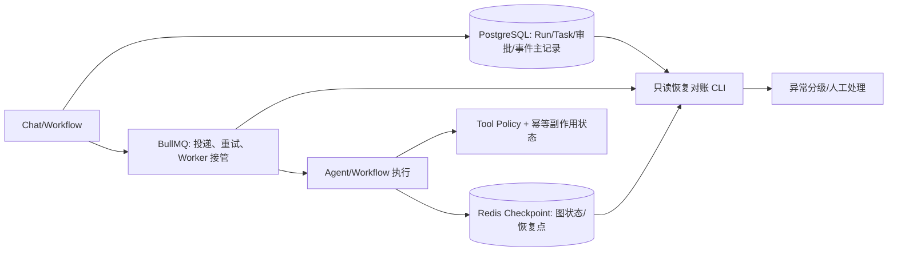

# Agent 状态可靠性与真实 Golden Dataset — 2026-11-01 补强

> 面向高级 AI Agent / AI 应用开发的工程验证。补丁只修正明确识别出的状态持久化缺口，复用现有 PostgreSQL Run、BullMQ、LangGraph、Redis、AgentEval 和 RAG live E2E。**不等于生产环境交付认证。**

## 1. 明确职责（不再并列多个真相源）



- PostgreSQL：业务 Run/Task/审批/事件的事实源；更新与 Redis/BullMQ **不具备跨服务事务**。
- Redis：LangGraph checkpoint、pending writes、取消标记和工具执行防重状态。**同一个 checkpoint 的正文、元数据、索引和 latest 指针由单条 Lua 脚本一次提交**；长期 checkpoint TTL=0 不再意外过期。旧 checkpoint 存量不自动重建。
- BullMQ：任务派发、租约与失败重试；只能在已验证工具幂等边界内重试，不能将 unknown 副作用当成失败重放。
- `scripts/audit-agent-recovery.mjs`：只读检查 PostgreSQL 活动/待取消 Run、Redis 恢复指针和 BullMQ 队列水位，**不会改状态、不会调用工具或替代人工审批**。最多扫描 500 个活动 Run，达到上限标记 `limited`。

### 1.1 修正的真实问题

1. `RedisCheckpointer.put` 原来是四次分离 Redis 命令。中途故障可能最新指针指向没完全索引的数据。补丁将 checkpoint、metadata、ZSET、latest 合并为**同一原子 Lua 操作**，旧时间戳的异步写不能倒退最新指针；ZSET 同时正确设置 7 天 TTL 或无限期持久保存。
2. `putWrites` 原来按 pending write 一条条写，可能写一半中断。现在**同一 task 的 writes 单条 Lua 命令原子写入**。不同 task 之间仍需靠 LangGraph/队列重试协议处理，不承诺跨 task 事务。
3. `getPendingWrites` 的 `KEYS` 全库扫描改用 `SCAN`；`deleteThread` 清理该 thread 的遗留 pending writes。**调用方必须先停止该 thread 的并发写入**，否则清理与写入仍可能竞争。
4. 新增只读恢复审计。对于运行超过阈值、需要审批但没有 Redis checkpoint、取消信号尚未投递等场景产生可处理的异常结论。发现 unknown 时绝不隐式重做副作用。

### 1.2 仍无法由本地补丁证明的边界

- PostgreSQL 与 Redis/BullMQ 不支持透明的 exactly-once 跨服务提交。要进一步保证提交与派发一致，应在已有 Outbox/状态机内用 durable intent + 投递对账闭环，不能仅靠写更多 Redis key。
- 已经写到外部服务但没记录执行结果的工具属于 unknown，必须先查询外部副作用或人工接管；不能自动重试。
- 多 Worker、网络分区、Redis 重启、PG failover、队列积压、取消与审批竞态需要在隔离目标环境做故障注入。该包不会为了测试对生产数据库/Redis 写入。
- 生产 Redis Cluster 多 Key Lua 涉及 hash slot；当前项目 RedisProvider 为单节点客户端。使用 Cluster 前需独立改 key hash-tag/脚本契约，不可直接迁移。

## 2. 本地安装与验证

在 RAG 根目录运行安装脚本后：

```bash
pnpm --filter backend build
pnpm --filter backend exec jest --runInBand redis-checkpointer.atomic.spec.ts
pnpm --dir apps/rag-api run test:hardening
```

在**独立的可清空 Redis** 中运行原子性与跨调用验证（不会自动跳过）：

```bash
cd apps/rag-api
export REDIS_URL='redis://127.0.0.1:6379/15' # 替换成你明确隔离的测试 Redis
export REDIS_CHECKPOINT_TEST_ISOLATED=I_ACKNOWLEDGE_ISOLATED_REDIS
pnpm run build
pnpm run smoke:checkpoint:atomic
```

使用 PostgreSQL + Redis + BullMQ 真实服务执行**只读**状态审计，连接信息从环境获取（勿打印凭据）：

```bash
cd apps/rag-api
POSTGRES_URL='...' REDIS_URL='...' pnpm run audit:agent:recovery
# 输出 JSON，包含 critical、warnings、BullMQ 水位及 hashed run reference
```

`critical > 0`、审计超过 500 活动 Run 或 BullMQ 尚有 failed job，严格模式退出非 0；数据库/Redis 不可达退出 2，不伪报通过。失败作业不盲目重放，按任务对应的运行状态和外部副作用收口。

## 3. Golden Dataset 数据模型与准入

**不能从现有合成 Fixture 自动伪造真实 Golden Dataset。** `independent-golden.dataset.json` 和这次的示例都只用于测试数据契约。生产集应当由实际获得授权的业务资料、独立人工审核的问答标准和真实 Run 结果构成；涉及敏感资料时存放在库外受控位置。严格发布时还要求 observation 绑定精确数据集哈希，防止将旧运行结果套到新标签集上。该哈希为对解析后 JSON 进行 `JSON.stringify` 得到的字节串执行 SHA-256，不是文件原始字节哈希。

数据集最少包含：`datasetId`、`version`、`synthetic:false`、`cases[]`。每个 case：

- `id`、`kind: rag|agent`、`split: development|holdout`、`scenario`、`question`；
- `sourceUri`、`sourceHash`（来源快照 SHA-256），`review`（人工审核人、批准状态、审核日期、来源版本）；
- RAG：`expectedDocIds`、`forbiddenDocIds`、`expectedClaims`、`expectRefusal`；真实发布中可回答案例还必须有独立标注的 `expectedChunkIds`，版本类场景需要 `expectedVersions`；
- Agent：`expectedEvents`、`forbiddenEvents`；所有 ID 来自实际运行和持久记录，不用人为拼造。

实测结果单独保存 `observations.datasetHash`（精确审核集 JSON 的 SHA-256）与 `observations.runs[]`：

- `caseId`、真实 `runId`、`status`、`durationMs`、`retrievedDocIds`、`citedDocIds`、`refused`；真实 RAG 回放还要求 `retrievedChunkIds`，版本类应提供 `retrievedVersions`；
- Agent 增加有序真实 `events`；
- 独立人工复核 `humanReview:{approved,reviewerId,reviewedAt,correct,citationsSupported}`。没有这些字段不能声明答案正确。**这些标注是组织流程约定，代码无法认证 reviewer 身份或来源文件真伪，仍需审计。**

度量：文档级 `Recall@K`、`MRR`、`nDCG`；有 chunk 相关性人工标注时另计算 `chunkRecall@K` 与 `ContextPrecision@K`（此处为相关 chunk 占前 K 召回片段的比例，而非 LLM 语义裁判的指标）；人工复核后的整例通过率、引用有效性、拒答、ACL 漏读、Agent 期望事件顺序/禁止事件、p95 延时。文档级指标不是 chunk 级指标；chunk 相关性标签应随索引版本更新。没有标注就返回 null，不应用关键词伪造精准度。

## 4. 命令与发布门禁

```bash
cd apps/rag-api
node scripts/eval-reviewed-golden.mjs --dataset eval/reviewed-golden.example.json
# 示例数据应只得到 contractValid，不产生真实质量评测结果。

# 示例实际观测（仅测试逻辑，绝非生产质量证明）
node scripts/eval-reviewed-golden.mjs --dataset eval/reviewed-golden.example.json --observations eval/reviewed-golden.observations.example.json

# 真实发布：本地私有 50+ 人工审核样本，至少 20 个 holdout，不能混入 synthetic
REVIEWED_GOLDEN_DATASET=/secure/real-golden.json \
REVIEWED_GOLDEN_OBSERVATIONS=/secure/live-runs.json \
  node scripts/eval-reviewed-golden.mjs --release --out .tmp/evidence/reviewed-golden.json
```

默认门禁：最少 50 个真实案例、至少 20 个 holdout，覆盖 direct/cross_document/version/acl/refusal/tool_failure/checkpoint_resume 七类；holdout 全例通过率 >= 90%、文档级 Recall@5 >= 80%、ACL 泄漏为 0、p95 <= 30 秒。以上为**初始示例门槛，必须根据业务 SLA 调整**，不是声称现有项目已达到。

`pnpm run eval:rag:release` 已追加严格的真实 Reviewed Golden 门禁：缺真实数据或报告时**发布流程失败而不是默认放行**。若需只验证原来的测试，执行 `eval:rag:quality`；新 Agent 专项通过 `eval:golden:release`。

## 5. 真实验收最小集

1. 两进程共享 Redis 的 checkpoint smoke，以及对乱序 Checkpoint 的最新指针验证。
2. Redis 断连前后写入中断、BullMQ stalled worker 接管、同一 job 重试、unknown 工具副作用不可重放。
3. PG/Redis/BullMQ 审计在有异常时有明确非 0 退出码且不更改任何运行状态。
4. 真实游戏规则版本/权限、跨文件、多跳问答；实际开发集/holdout 分离，不把调参样本混入留存集。
5. 逐条链接 trace/run、证据文档、人工标签；发布报告可复算，失败可定位到解析、检索、Agent、工具或生成，而不只是一个总分。

**结论：** 代码补丁提供可靠性内核、只读诊断、审核式评测和 fail-closed release gate；真实生产数据、审批流程、基础设施故障注入仍必须由拥有数据和目标环境的操作者执行，不能凭源码或合成样本声称完成。
