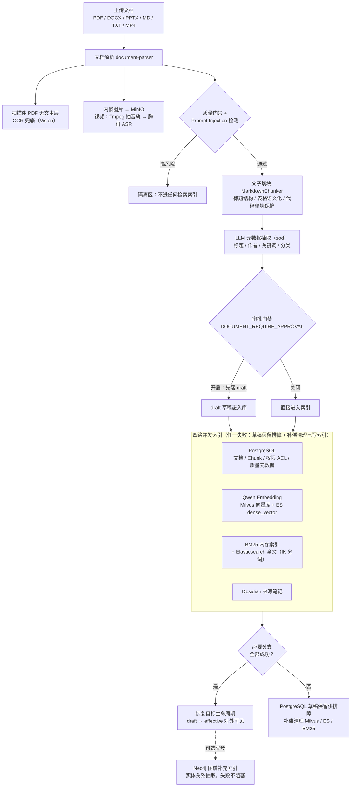
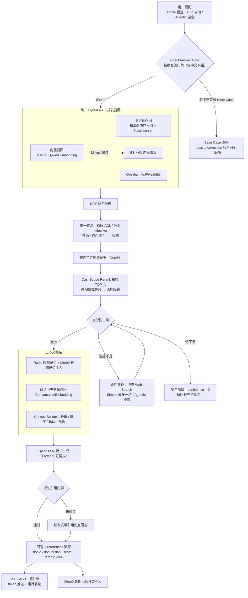

# 课程配图 · 数据写入与在线问答 Pipeline（Mermaid）

> 两张图均取自仓库真实链路（非示意）：入库四路并发、混合检索 + Rerank + 充分性门禁、Direct Answer Gate、引用溯源。
> 教学对应：图 1 → 第 2-3 课（文档管线 / 向量库）；图 2 → 第 4-6 课（混合检索 / Karpathy 链路 / Agentic 编排）。
> 语法兼容 GitHub / Typora / Notion（保守子集：flowchart + subgraph + 引号标签 + 标准/虚线箭头）。

## 图 1 · 数据写入 / 索引 Pipeline

核心教学点：**高风险内容在并发前隔离**（Prompt Injection 不进任何索引）；**四路并发、任一失败补偿清理**；Neo4j 图谱是可选异步补充，失败不阻塞。

## 图 2 · 在线问答 / 检索 Pipeline

核心教学点：**Direct Answer Gate 先于一切检索**（已审核 Base Case 直达回答）；**RRF 融合 → 统一过滤 → Rerank** 的顺序不可颠倒（先过滤后精排，Rerank 才不会把无权限内容排上来）；充分性不足走**联网补证 → 再门禁 → 安全降级**，绝不无证据硬答。

## 与三模式的关系（图 2 的差异点）

| 模式 | 走到哪 |
|---|---|
| Simple 极速 | Gate → Hybrid RAG → 最多一次联网补证，不拆题、不循环 |
| Auto 自动 | Gate → Fast Path → 按充分性与复杂度决定升级 Agentic |
| Agentic 深度 | 不走直答捷径；查询增强 → 子问题并发检索 → 按需图谱/工具补证 → 受预算约束的反思重试 |
