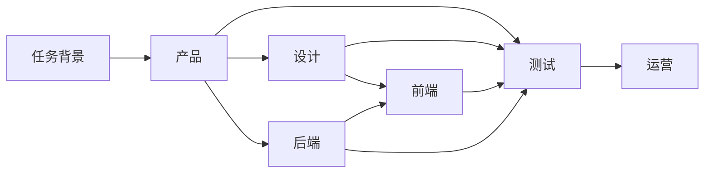

# 六岗位产研运工作流使用说明

更新时间：2026-08-03

## 一、功能定位

产研运工作流提供六个可独立、可组合的岗位节点：

| 岗位 | 主要处理内容                                                   |
| ---- | -------------------------------------------------------------- |
| 产品 | 目标、范围、活动规则、用户流程、边界条件、地区版本和验收口径   |
| 设计 | 页面状态、交互闭环、素材规格、多端布局和多语言适配             |
| 前端 | 组件拆分、接口依赖、状态管理、埋点、性能、兼容和异常降级       |
| 后端 | 领域模型、接口契约、资格校验、幂等、库存、发奖、补偿和可观测性 |
| 测试 | 测试范围、边界用例、异常恢复、兼容、回归和上线门禁             |
| 运营 | 发布计划、活动配置、渠道、灰度、监控、应急预案和复盘指标       |

使用方式分为三类：

1. 单岗位独立处理：只选择一个岗位，适合局部审查或专项任务。
2. 多岗位协作：选择两个或更多岗位，系统按产研依赖顺序执行。
3. 六岗位完整链路：默认选择全部岗位，适合完整项目审查。

## 二、岗位如何协作

岗位采用有依赖的 DAG 协作，不是六个 Agent 同时自由讨论。没有依赖冲突的岗位并行执行，有前置依赖的岗位只在上游完成后启动。



每个岗位会输出：

- `summary`：本岗位审查结论。
- `deliverables`：真实 Markdown 交付物，包含类型、标题和正文，可继续生成 Word、Excel、图片等分享产物。
- `claims`：本岗位作出的关键事实声明及其证据 ID，分为已支撑和待确认。
- `evidence`：岗位专用知识检索返回的文档片段、来源和相关度。
- `evidenceCoverage`：声明的证据覆盖率；没有可靠证据的事实不能伪装成确定结论。
- `issues`：当前发现的问题和缺失项。
- `downstreamRisks`：可能影响后续岗位的风险。
- `riskLevel`：本岗位结果的风险等级。
- `toolExecutions`：实际工具调用、耗时、成功／降级状态。
- `generatedArtifact`：提交到产物中心的异步生成任务。
- `readyForApproval`：交付物完整且事实声明通过证据门禁后，才具备审核条件。

后续岗位只读取自己的依赖结果。例如完整六岗位执行批次为：

1. 第一批：产品。
2. 第二批：设计、后端并行。
3. 第三批：前端读取设计与后端的结构化结果。
4. 第四批：测试读取产品、设计、前端和后端结果。
5. 第五批：运营读取全部产研测试结果。

调用方即使传入 `qa、product、backend`，服务端也会规范为 `product → backend → qa`，防止执行顺序破坏业务依赖。

## 三、审批策略

岗位组合和审批策略可以独立选择。

| 审批策略         | 参数                         | 行为                                        | 适用场景                       |
| ---------------- | ---------------------------- | ------------------------------------------- | ------------------------------ |
| 普通任务自动流转 | `approvalMode: "auto"`       | 所有批次自动执行                            | 日常检查、方案草稿、低风险任务 |
| 全流程人工审批   | `approvalMode: "required"`   | 每个执行批次完成后暂停                      | 强监管流程、正式评审演示       |
| 按风险／岗位审批 | `approvalMode: "risk_based"` | 命中风险阈值或 `approvalRoles` 的岗位才暂停 | 正式项目默认推荐               |

审批批次被驳回后，可以用 `rerunRoles` 只重跑有问题的岗位。例如设计与后端并行完成后，只驳回后端，就保留设计结果并仅重跑后端。驳回意见会成为重跑节点的明确输入。

Redis Checkpointer 会保存暂停状态 30 天，`threadId` 用于继续同一个工作流；状态按任务所有者隔离。`maxSteps` 会限制最大执行次数，防止反复驳回形成死循环。

## 四、管理后台使用

入口：[http://localhost:8000/agent-ops](http://localhost:8000/agent-ops)

1. 打开“产研运工作流”页签。
2. 填写项目／活动 ID，例如 `anniversary-2026`。
3. 在“参与岗位”中选择一个、多个或全部岗位。
4. 选择审批策略；正式项目优先按风险审批，并按需指定后端、测试等关键岗位。
5. 填写需求背景。背景应包含目标、范围、当前方案、地区／渠道、约束和希望检查的问题。
6. 点击“启动工作流”。
7. 启动接口会立即返回 `running` 和 `threadId`，页面每 2 秒查询一次状态，不会因真实模型耗时阻塞浏览器请求。
8. 页面会显示 DAG 批次、证据覆盖率、待确认声明、工具降级、真实 Markdown 和产物任务；驳回时可选择局部重跑岗位。

推荐的需求背景写法：

```text
项目：东南亚服周年庆抽奖 H5
目标：提高回流用户参与率，并完成新角色曝光
范围：产品规则、H5 页面、抽奖接口、埋点、测试和上线运营
地区：泰国、越南、新加坡
约束：三种语言；活动高峰 5 万 QPS；奖励库存有限；必须支持发奖补偿
当前状态：已有初版 PRD，接口和异常流程尚未评审
本次目标：找出跨岗位缺失项、依赖和上线风险
```

## 五、常见组合

| 组合                   | 适用任务                       | 交接关系                                   |
| ---------------------- | ------------------------------ | ------------------------------------------ |
| 产品                   | 单独检查 PRD 完整性            | 无前序岗位，直接根据任务背景审查           |
| 设计                   | 单独检查页面状态、素材和适配   | 任务背景需要包含已确定的玩法与页面目标     |
| 前端                   | 单独做前端技术审查             | 任务背景需要提供页面、接口和交互约束       |
| 后端                   | 单独审查接口和活动服务         | 任务背景需要提供业务规则、容量和一致性要求 |
| 测试                   | 单独补充测试矩阵               | 任务背景需要提供规则、接口和预期结果       |
| 产品＋设计             | 从玩法规则推进到页面与素材方案 | 产品结果传给设计                           |
| 产品＋前端＋后端       | 需求到技术方案                 | 产品结果同时成为前后端审查依据             |
| 前端＋后端＋测试       | 技术联调和质量验收             | 开发结论传给测试                           |
| 产品＋后端＋测试＋运营 | 强规则活动的上线审查           | 规则、服务、验证和发布逐级交接             |
| 全部六岗位             | 完整活动或官网项目             | 覆盖需求、体验、研发、验证和上线           |

如果跳过某个岗位，系统不会伪造该岗位结论。例如只选产品和测试时，测试可以读取产品规则，但设计状态和接口实现仍可能被标记为缺失或风险。

## 六、API 使用

RAG 后端默认地址为 `http://localhost:3000`，接口需要 JWT。

### 1. 单岗位自动执行

```bash
curl -X POST 'http://localhost:3000/api/v1/workflows/production' \
  -H "Authorization: Bearer $ACCESS_TOKEN" \
  -H 'Content-Type: application/json' \
  -d '{
    "projectId": "frontend-review",
    "brief": "单独审查周年庆 H5 的组件拆分、状态管理、埋点和异常降级方案。",
    "roles": ["frontend"],
    "approvalMode": "auto",
    "maxSteps": 18
  }'
```

### 2. 多岗位协作

```bash
curl -X POST 'http://localhost:3000/api/v1/workflows/production' \
  -H "Authorization: Bearer $ACCESS_TOKEN" \
  -H 'Content-Type: application/json' \
  -d '{
    "projectId": "anniversary-2026",
    "brief": "审查周年庆抽奖活动的规则、服务端实现、测试覆盖和上线运营风险。",
    "roles": ["product", "backend", "qa", "operations"],
    "approvalMode": "auto"
  }'
```

不传 `roles` 时默认执行全部六个岗位；不传 `approvalMode` 时默认 `auto`。

### 3. 启动选择性审批任务

```bash
curl -X POST 'http://localhost:3000/api/v1/workflows/production' \
  -H "Authorization: Bearer $ACCESS_TOKEN" \
  -H 'Content-Type: application/json' \
  -d '{
    "projectId": "critical-launch",
    "brief": "正式上线前审查产品规则、前后端实现和测试门禁，任何缺失项都不能跳过。",
    "roles": ["product", "frontend", "backend", "qa"],
    "approvalMode": "risk_based",
    "approvalRoles": ["backend", "qa"],
    "riskApprovalThreshold": "high"
  }'
```

启动和审批接口都是异步命令接口，通常会先返回 `status: "running"`。调用方应保存 `threadId`，通过状态接口轮询到 `pending_approval`、`completed` 或 `failed`。进入稳定状态后的关键字段如下：

```json
{
  "threadId": "工作流线程 ID",
  "selectedRoles": ["product", "frontend", "backend", "qa"],
  "executionBatches": [["product"], ["backend"], ["frontend"], ["qa"]],
  "currentBatch": ["product"],
  "completedRoles": ["product"],
  "pendingApprovalRoles": ["product"],
  "stageIndex": 0,
  "status": "pending_approval",
  "approvalMode": "required",
  "requiresApproval": true,
  "results": {
    "product": {
      "summary": "产品审查结论",
      "deliverables": [
        { "type": "prd", "title": "产品审查", "markdown": "# 产品审查\n..." }
      ],
      "claims": [
        {
          "statement": "活动规则已确认",
          "evidenceIds": ["doc-1"],
          "status": "supported"
        }
      ],
      "evidence": [
        {
          "id": "doc-1",
          "title": "周年庆规则",
          "source": "knowledge-base",
          "content": "...",
          "score": 0.91
        }
      ],
      "evidenceCoverage": 1,
      "issues": [],
      "downstreamRisks": [],
      "riskLevel": "medium",
      "readyForApproval": true,
      "completedAt": "2026-08-03T00:00:00.000Z"
    }
  }
}
```

### 4. 批准或驳回

批准当前岗位：

```bash
curl -X POST "http://localhost:3000/api/v1/workflows/production/$THREAD_ID/resume" \
  -H "Authorization: Bearer $ACCESS_TOKEN" \
  -H 'Content-Type: application/json' \
  -d '{"approval":"approved"}'
```

驳回并只重跑当前批次中的后端：

```bash
curl -X POST "http://localhost:3000/api/v1/workflows/production/$THREAD_ID/resume" \
  -H "Authorization: Bearer $ACCESS_TOKEN" \
  -H 'Content-Type: application/json' \
  -d '{
    "approval": "rejected",
    "feedback": "缺少库存耗尽和发奖失败补偿说明。",
    "rerunRoles": ["backend"]
  }'
```

### 5. 查询状态

```bash
curl "http://localhost:3000/api/v1/workflows/production/$THREAD_ID" \
  -H "Authorization: Bearer $ACCESS_TOKEN"
```

前端或调用脚本建议每 2 秒查询一次。服务重启后，状态接口会从 Redis Checkpointer 读取 `running` checkpoint，并继续尚未完成的批次；同一进程内会按 `threadId` 去重后台执行。

## 七、使用原则

- 只做局部审查时选单岗位，避免不必要的模型调用。
- 需要上下游交接时选多岗位，不要把所有问题塞给一个岗位。
- 正式上线和高风险变更使用人工审批，日常草稿使用自动流转。
- 审批是风险控制手段，不是所有岗位的固定关卡；六岗位可以独立使用，也可以按 DAG 协作。
- 事实结论必须关联证据；没有证据时应标为待确认，而不是让模型补齐看似合理的细节。
- 每个岗位只能使用自己的检索工具，单节点最多调用一次，超时后降级但不阻塞整个工作流。
- 任务背景越明确，岗位输出越可执行；不要只输入“帮我看看活动方案”。
- 工作流结果是结构化审查与协作输入，不替代真实负责人最终签字。
- 具体规则、概率、奖励、接口字段和地区口径仍必须由当前生效知识证据支撑。

## 八、当前边界

- 当前岗位组合采用固定业务依赖 DAG，不支持用户任意拖拽改依赖。
- 当前协作是结构化结果传递，不是岗位间开放式多轮辩论。
- 工作流会生成可传播的文档产物，但不会直接替团队修改业务代码或第三方设计稿。
- 生产环境仍需接入企业真实项目权限、通知渠道和正式审批责任人。

## 九、真实演示与回归

```bash
cd backend
ACCESS_TOKEN="$ACCESS_TOKEN" npm run demo:production-workflow -- single
ACCESS_TOKEN="$ACCESS_TOKEN" npm run demo:production-workflow -- dag
ACCESS_TOKEN="$ACCESS_TOKEN" npm run demo:production-workflow -- approval
npm run eval:production-workflow
```

专项评测覆盖任务成功率、依赖正确率、交付完整率、证据门禁准确率、产物生成率、局部重跑正确率和工具预算合规率。

2026-08-03 本地真实联调结果：

- 单岗位异步启动 9ms 返回 `running`，真实 Qwen 完成前端节点，证据覆盖率 100%。
- 必审后端任务 4ms 返回 `running`，进入 `pending_approval` 后审批接口 11ms 返回，随后真实 Qwen 调用成功并完成任务。
- 六岗位完整 DAG 能按 `产品 → 设计／后端并行 → 前端 → 测试 → 运营` 完成并创建六个产物任务。早期 Qwen Provider 默认 20 秒超时低于岗位结构化输出真实耗时，曾出现 1／6 模型成功；将 Provider 超时调整为 60 秒、岗位预算调整为 75 秒，并限制输出、降低温度、增加退避后，独立 Node 22 实例连续三次完整 DAG 共 18／18 模型调用成功、0 降级，总耗时约 136.9～161.0 秒。工作流完成率和模型成功率仍保持分开统计。
- Milvus `2.4.19` 与 Node SDK `2.4.10` 下，Bad Case 临时数据已完成插入、flush、向量命中、标量读回和清理。

## 十、面试讲解

本工作流只是项目七项核心难点中的第一项。其余快慢路径、混合检索与结构切片、分层记忆、Agent Evals、Bad Case 数据飞轮和节点级可观测性的背景、方案对比、实现、验证结果及面试口述稿，统一见：

[七个 Agent／RAG 技术难点面试讲解稿](interview/SEVEN_DIFFICULTIES_INTERVIEW_GUIDE.md)
