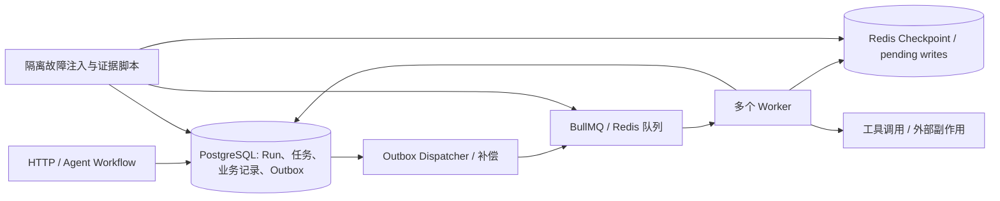
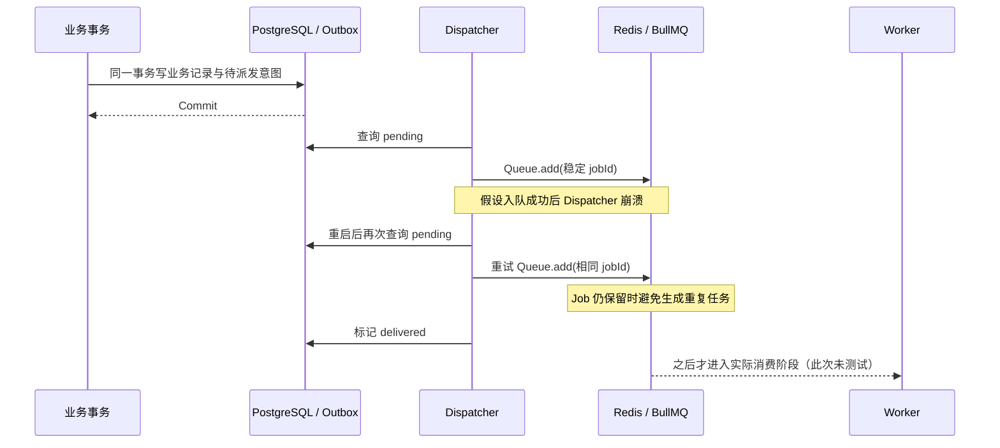

# RAG / Agent 平台：Redis、Worker、跨存储恢复与评测工作留档

> 日期：2026-11-01  
> 仓库：<https://github.com/monstereatai/RAG>  
> 基于：本次对话中用户实际运行日志、已上传的 PostgreSQL/Milvus 导出，以及 GitHub `main` 提交 `9748f01530e96ca20956a6ddf634fe05f29d67c9`（`feat：测试代码`）中的脚本和文档。  
> 目的：保存已验证事实、未完成工作和下次优化入口。**本文件是历史验收记录，不是生产认证，不自动代表当前代码最新状态。**

## 一、结论速览

| 模块 | 结果 | 实际证明 | 尚未证明 |
|---|---|---|---|
| Redis Checkpoint 断连/重启恢复 | **实测通过** | 隔离 Docker Redis 停机后拒绝写入；重启后 checkpoint、pending writes 保留；可继续写入和清理 | Redis Cluster/主从故障切换、网络分区、真实外部工具状态恢复 |
| BullMQ 多 Worker 并发、宕机接管 | **实测通过** | 3 个 Worker、每个并发 4；杀死已产生模拟副作用但尚未确认的 Worker 后，stalled job 接管；101 个任务完成、0 失败、唯一副作用 101 | 外部 API 的幂等、跨机/跨 Redis 集群 HA、完整 LLM 工作流吞吐 |
| PostgreSQL ↔ Outbox ↔ BullMQ 跨存储 | **实测通过** | 事务回滚、PG 重启、Dispatcher 缺席/入队后崩溃、Redis 停机及恢复；8 项检查全部通过 | BullMQ Job 实际执行完成、真实外部副作用 exactly-once、网络分区、多节点 HA |
| PostgreSQL / Milvus 数据对账 | **实测通过（索引存在性）** | 第一批 3/3、第二批 9/9 Chunk 在 Milvus `rag_chunks` 找到，无 docId 错配 | 真正检索 Recall@K、排序精度、ACL、回答质量 |
| 真实业务 Golden 发布 | **未通过/未完成** | 100 条候选数据及真实来源导出探索已启动 | 真实来源证据、独立人工审核、真实 RAG/Agent Run、100 条正式门禁 |
| 31 条来源关联开发草稿 | **文件交付/路径出现问题** | 脚本存在；部分测试包目录被提交；本地多次报数据文件 `ENOENT` | 未收到这 31 条在用户本机最终通过的确认；不属于正式 Golden 评测 |
| `verify:platform:all-evidence` 四项汇总 | **未通过** | 三项基础设施证据已获得，第四项缺少 `.tmp/evidence/private-golden-release.json` | 四项全部通过的总报告 |

**最重要的区分：**“代码写了”、“隔离故障测试通过”、“真实业务问答评测通过”、“生产可用”是四个不同层级。前三项基础设施演练为隔离环境实测通过；**不能推导成生产系统完整验收。**

## 二、技术架构与状态职责



- **PostgreSQL：**持久化业务事实与事务 Outbox；跨 PG/Redis 没有透明的分布式事务。
- **Redis Checkpoint：**持久化 LangGraph 恢复状态与 pending writes。已有补强设计将 checkpoint 主体、元数据、索引、latest 指针用 Lua 原子写入；同一 task 的 pending writes 也原子提交。真实停机重启检查独立进行。
- **BullMQ：**负责持久队列、Worker 并发消费、stalled 接管和重试；去重依赖稳定 jobId 与 Job 保留边界，不等于第三方系统 exactly-once。
- **Outbox：**在 PG 事务中记录待派发意图；Dispatcher 重试，解决“业务记录提交但队列未写入”的可靠派发问题。
- **外部工具：**需要业务幂等键、执行前/执行后状态、必要时 fencing/对账；发生 unknown 结果时不得盲目重放。

## 三、Redis Checkpoint 断连与恢复（已通过）

**脚本：**`apps/rag-api/scripts/verify-real-redis-recovery.mjs`  
**package 命令：**`pnpm run verify:redis:recovery`  
**证据路径：**`apps/rag-api/.tmp/evidence/platform-redis-recovery.json`

### 测试过程
1. 创建独立、可销毁的 Redis Docker 容器；写入 checkpoint 和 2 条 pending writes。
2. 真实 `docker stop`，验证要求持久化的写入失败，而不是静默回退为进程内存状态。
3. `docker start`，重新检测宿主机映射端口并重连。
4. 验证旧 checkpoint、2 条 pending writes 均恢复；继续写新 checkpoint，删除测试 thread 并检查清理。

**用户实际结果：**

```json
{
  "passed": true,
  "checkpointSurvivedRestart": true,
  "pendingWritesSurvivedRestart": true,
  "postRestartWriteWorked": true,
  "cleanupWorked": true
}
```

额外说明：故障注入是 Docker stop/start，不是 Redis Sentinel/Cluster 自动切换，也没有模拟所有网络半开连接与跨机故障。

## 四、BullMQ 多 Worker 并发与故障接管（已通过）

**脚本：**`apps/rag-api/scripts/verify-multi-worker-failover.mjs`  
**子进程：**`apps/rag-api/scripts/platform-validation-worker.mjs`  
**package 命令：**`pnpm run verify:workers:chaos`  
**证据路径：**`apps/rag-api/.tmp/evidence/platform-multi-worker.json`

### 机制与用例
- 独立 Redis 容器与测试队列；启动 3 个独立 Worker 进程、每 Worker 并发 4。
- 专门的混沌任务在模拟幂等副作用已提交、确认之前杀死 Worker；其余 Worker 接管 stalled job。
- 另进行 30 次重复提交，验证固定 Job ID 下不会重复产生模拟副作用。
- 统计完成数量、失败数量、吞吐量和 p50/p95/p99。

**用户实际结果：**

| 项 | 数值 |
|---|---:|
| Worker 实例 / 每实例并发 | 3 / 4 |
| 总任务（含混沌任务） | 101 |
| 重复提交 | 30 |
| 完成 / 失败 | 101 / 0 |
| 唯一模拟副作用 | 101 |
| 吞吐量 | 32.59 jobs/s |
| p50 / p95 / p99 | 228 / 356 / 397 ms |

**解释：**这里的幂等副作用是 **Redis 支撑的模拟工具效果**，不能写成“飞书/企微/支付 API 的 Exactly-once 已验证”；吞吐也不是实际 LLM/Agent 推理吞吐。

## 五、PostgreSQL + Outbox + BullMQ 跨存储故障恢复（已通过）

**脚本：**`apps/rag-api/scripts/verify-cross-store-recovery.mjs`  
**package 命令：**`pnpm run verify:cross-store:recovery`  
**证据路径：**`apps/rag-api/.tmp/evidence/platform-cross-store-recovery.json`

**用户实测：**约 35 秒、8 项检查均为 true。

| 检查字段 | 说明 | 结果 |
|---|---|---|
| `businessTransactionRollbackAtomic` | 业务表与 Outbox 在同一 PG 事务回滚 | 通过 |
| `postgresRestartPreservedCommittedIntent` | PG 重启后已提交意图依然存在 | 通过 |
| `outboxRecoveryAfterDispatcherAbsence` | Dispatcher 缺席后补偿入队 | 通过 |
| `workerDispatchCrashAfterEnqueueRecovered` | 队列写入后、Outbox ACK 前进程崩溃，再恢复补偿 | 通过 |
| `stableBullmqJobIdRetained` | 稳定 Job ID 保留 | 通过 |
| `redisOutageKeptOutboxPending` | Redis 不可用时 Outbox 仍 pending | 通过 |
| `redisRecoveryDispatchedPending` | Redis 恢复后 pending 重新投递 | 通过 |
| `noDuplicateBullmqJobsWhileRetained` | 补偿投递时无新增的重复 BullMQ Job | 通过 |

实际观察：**3 个 Job 在 BullMQ 等待队列中，`completed=0`**。这是刻意验证**入队可靠性**，**没有**证明这 3 个 Job 执行完成，更没有证明外部工具幂等性。

### 可解释的恢复链路



测试容器由脚本创建、清理，不应连接真实生产 Redis/PostgreSQL；需设置隔离测试环境确认变量，见下文。

## 六、RAG 来源与 Milvus 索引核对（已验证部分）

**脚本：**`apps/rag-api/scripts/export_rag_golden_sources.mjs`  
**输出：**`apps/rag-api/.tmp/golden-export/knowledge-sample.json`

### 第一批：技术简介
- 3 份文档、3 个 Chunk：NestJS、LangChain.js、Milvus 简介。
- PostgreSQL 导出成功；连接恢复后指定 `--milvus` 的结果为 `indexedLeafCount=3`、`missingLeafCount=0`、`mismatchedDocCount=0`。

### 第二批：差旅制度
- 3 份数据库记录、9 个 Chunk：均为《2026 差旅与报销制度》，实际内容相同，每份 3 个切片。
- `--milvus` 检查：`indexedLeafCount=9`、`missingLeafCount=0`、`mismatchedDocCount=0`。
- **状态冲突：**数据库 `lifecycleStatus=draft`，`reviewStatus=approved`，`effectiveAt=null`；而正文自称“2026-01-01 生效”。不能依正文直接认定已正式发布。
- 此批导出 `tenantScoped=false`、`sourceUri=null`、`sourceSnapshotAttested=false`：不能据此宣称 ACL 或原始文档来源审计通过。

**已确认只有索引 ID 成员存在，不是向量检索效果、版本过滤、回答正确性或权限正确性的证据。**

## 七、Golden Dataset / 31 条开发测试：现状与卡点

### 已做工作
- 曾创建 100 条候选题（RAG 70 + Agent 30，其中 Holdout 25）；只是候选，不是已审核真实业务 Golden。
- `finalize-private-golden-dataset.mjs` 对来源缺失、真实文件快照缺失、人工审核缺失等严格拒绝：用户尝试时出现约 **1037 项校验错误**。这表明真实来源字段尚未提供，不能通过填占位值伪造。
- 根据两批真实 PG 导出整理过 **31 条开发候选题**（技术文档 12 条 + 差旅制度 19 条），但很多问题依赖少量重复文本；**31 不是 31 个独立业务事实**，且不是正式 Golden。
- `verify-source-grounded-dev-candidates.mjs` 在仓库中存在，但之前读取 `.tmp/private-golden/source_grounded_31_dev_candidates.json` 时，本地多次报 `ENOENT`。

### 安装失败根因与教训
1. 测试包多次以 ZIP、MJS、独立目录不同形式交付，导致相对目录层次混淆，`apps/rag-api/scripts` 和嵌套 `golden31_ready/apps/...` 同时存在。
2. 原验证脚本依赖 `.tmp/private-golden`；仓库根 `.gitignore` 忽略 `.tmp/`，GitHub 上有脚本，不等于本地/新克隆环境有其数据依赖。
3. GitHub `main` 曾包含 `golden31_ready/`、`rag_policy_golden_31_dev_draft/` 等重复解压目录，建议**后续单独梳理**，此留档不做删除/修改。
4. 多次看到 `MODULE_NOT_FOUND` 后变为 `ENOENT`，说明脚本文件问题与数据缺失是先后不同问题；不应该继续盲目重跑。
5. **没有收到用户本机运行 31 条验证脚本成功的最终日志**；即使离线结构校验通过，也只能证明引用/快照关系，并非真实 RAG 质量评测。

### 正式发布缺少的材料
- 同领域足够丰富、获授权、可追溯的原始业务资料与源文件快照/哈希、版本及有效期。
- 标准答案、预期 Doc/Chunk、拒答和 ACL/版本期望的**独立人工标注与复核**。
- 真实 RAG 检索/生成调用与 Agent Run 的 `runId`、执行事件、引用 ID、错误与副作用记录。
- 至少 100 条真正审核的正式案例和至少 20 条 Holdout（以当前四项总门禁要求为准），两类场景均覆盖。
- 可复算的失败案例和质量指标。**不能把源数据导出或演示性测试宣称为生产 Golden 通过。**

### 四项证据门禁

| 证据文件（位于 `apps/rag-api/.tmp/evidence/`） | 观察状态 |
|---|---|
| `platform-redis-recovery.json` | 已实测通过 |
| `platform-multi-worker.json` | 已实测通过 |
| `platform-cross-store-recovery.json` | 已实测通过 |
| `private-golden-release.json` | 未生成有效的已复核真实业务发布报告 |

因此：`pnpm run verify:platform:all-evidence` **未通过是预期的 fail-closed 结果**，不应通过伪造文件、跳过审查或把 31 条静态题改名解决。

## 八、留档用命令（以后需要时再执行；本次不必重跑）

```bash
# 位于 RAG 项目根目录；构建真实验证脚本依赖的 dist 代码
cd ~/Documents/GitHub/code/RAG
pnpm --filter backend build

# 进入后端工作目录
cd apps/rag-api

# 脚本会创建/停止/清理一次性 Docker Redis、PostgreSQL 容器
# 使用前确认 Docker Desktop 已运行，绝不能对生产容器执行破坏性测试
export PLATFORM_VALIDATION_ISOLATED=I_ACKNOWLEDGE_DISPOSABLE_TEST_ENV

pnpm run verify:redis:recovery
pnpm run verify:workers:chaos
pnpm run verify:cross-store:recovery

# 聚合历史证据（没有真实 Golden 发布报告时预期失败）
pnpm run verify:platform:all-evidence
```

**备注：**
- Docker 验证依赖镜像可用及本机资源；再次运行会生成新的报告、覆盖原输出并产生新的一次测试，不是在“读取既往结论”。
- `--milvus` 是可选的索引存在性验证：若 `ECONNREFUSED 127.0.0.1:19530`，先检查 Milvus 服务/端口；之前已有成功日志，无需重复检查。
- `.tmp/` 被 Git 忽略，想永久留证据时，应将**脱敏后的报告摘要**另外保存到受控文档/制品系统，敏感源内容、凭据、原始答复不要公开提交。

## 九、后续优化计划（建议优先级）

| 优先级 | 后续工作 | 完成判据 |
|---|---|---|
| **P0** | **冻结与整理已有可靠性证据** | 保存三项通过日志/证据哈希、代码提交 SHA、环境/日期；避免后续覆盖后无法追溯 |
| **P0** | **清理测试资产目录与脚本相对路径** | 仅保留唯一安装/运行位置；公开 Fixture 脱敏后归档、私有数据独立管理；新克隆项目仅用说明可验证，缺依赖时给可读错误 |
| **P0** | **完成真实业务 Golden 的小批量闭环** | 先收集真实领域资料，制作少量独立人工审核的标注，捕获真实 RAG/Agent Run，区分开发集与 Holdout；逐步扩至 100 条 |
| **P0** | **补真实 Worker 外部副作用幂等与 unknown 场景** | 工具在“执行成功但 ACK 丢失”时不重复业务操作；unknown 走查询/对账/人工而非盲重试 |
| **P1** | **补完整 Workflow 端到端恢复** | 从入队、消费、Checkpoint、工具、Outbox/PG 状态回写到最终 Run 状态全链路故障注入，证明不会丢任务/重复副作用 |
| **P1** | **压力测试与 SLO** | 真实 LLM/工具在并发 2/5/10 等档位的成功率、P95、队列积压、费用与降级；与本次模拟 32.59 jobs/s 分开统计 |
| **P1** | **版本/有效期/草稿/ACL 过滤** | `draft` 不误引用；多版本、日期查询正确；不同租户/身份不能读取越权 Chunk；有真实集回归证据 |
| **P2** | **分布式 HA 演练** | Redis/PG 主从切换、网络分区、多机 Worker、并发取消/审批与幂等边界验证；隔离/预发环境实施 |
| **P2** | **证据自动化与 CI 门禁** | 区分 unit/smoke/chaos/live golden；真实依赖不可达时明确 failed/skipped，绝不自动伪绿 |

建议后续主线：**保留已经通过的基础设施故障演练，不再为这些绿灯反复折腾；从真实业务数据、外部副作用幂等、完整 Workflow 端到端验证三个缺口推进。**

## 十、仓库中的对应入口（便于后续定位）

- `apps/rag-api/scripts/verify-real-redis-recovery.mjs`
- `apps/rag-api/scripts/verify-multi-worker-failover.mjs`
- `apps/rag-api/scripts/platform-validation-worker.mjs`
- `apps/rag-api/scripts/verify-cross-store-recovery.mjs`
- `apps/rag-api/scripts/verify-platform-9-evidence.mjs`
- `apps/rag-api/scripts/export_rag_golden_sources.mjs`
- `apps/rag-api/scripts/verify-source-grounded-dev-candidates.mjs`（历史开发候选脚本，数据依赖未在本地得到确认）
- `apps/rag-api/scripts/finalize-private-golden-dataset.mjs`
- `apps/rag-api/scripts/capture-reviewed-golden-real.mjs`
- `apps/rag-api/scripts/prepare-human-golden-review.mjs`
- `apps/rag-api/scripts/finalize-human-golden-review.mjs`
- `apps/rag-api/scripts/verify-reviewed-golden-business.mjs`
- `docs/AGENT_PLATFORM_PHASE3_REAL_EVIDENCE.md`
- `docs/AGENT_STATE_RECOVERY_AND_GOLDEN.md`
- `docs/GOLDEN_100_REAL_DATA_GUIDE.md`

---

**留档状态：**已经整理，**未修改、提交或推送用户 GitHub 代码**。后续继续工作时，优先读取本文件并以新的真实日志更新，不得将“隔离演练通过”直接升级为“生产已通过”。
