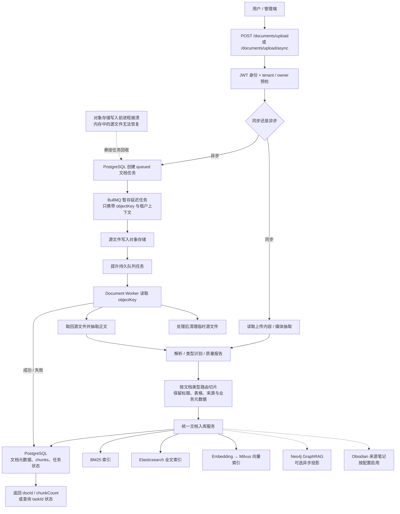
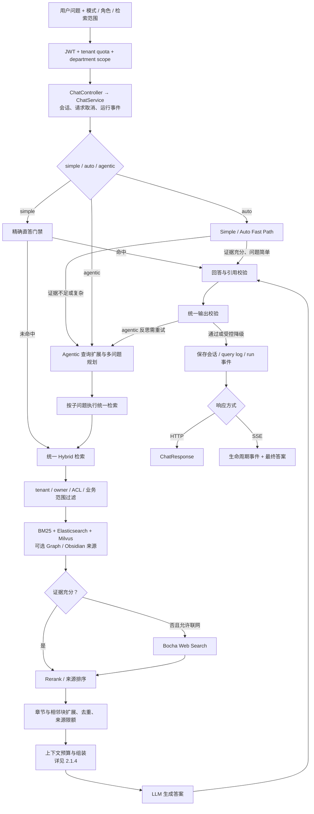
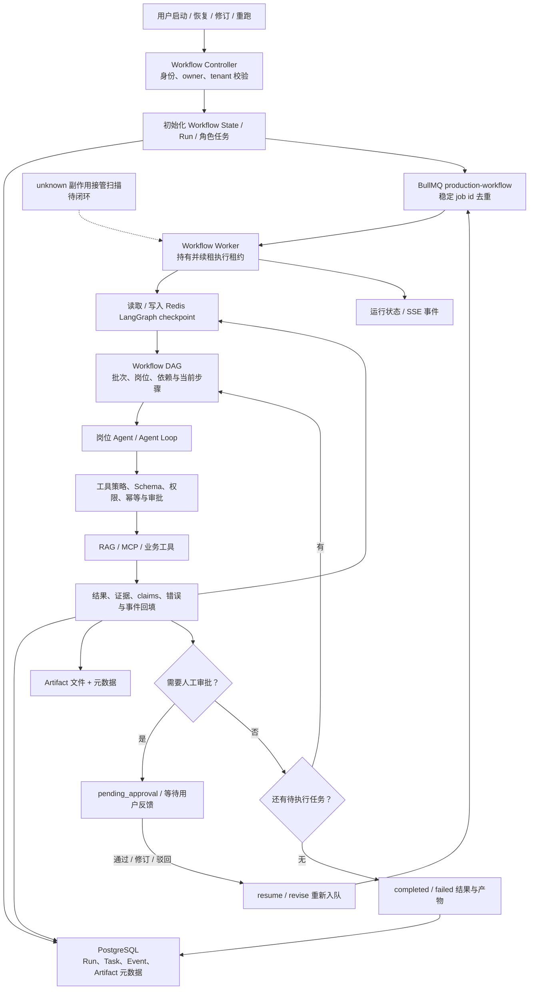
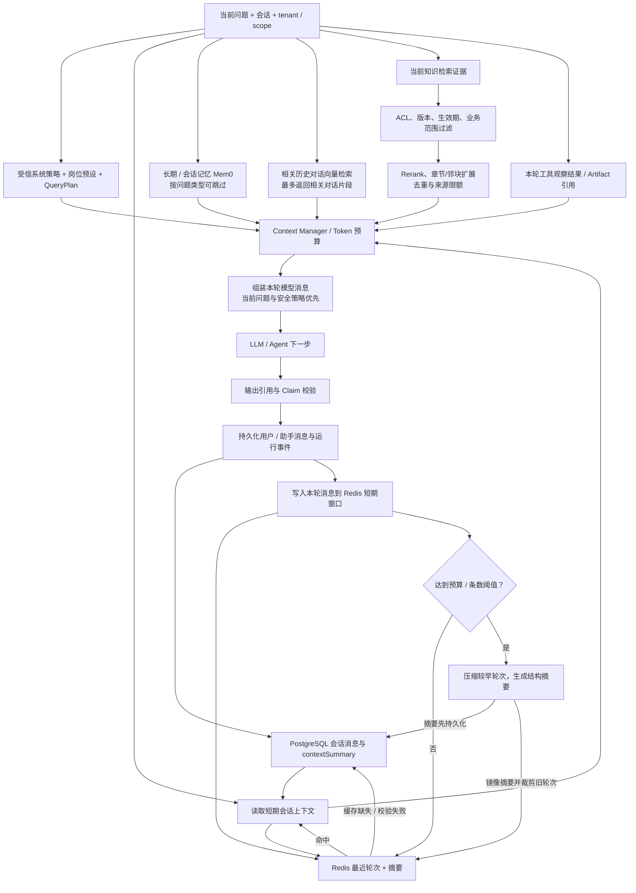
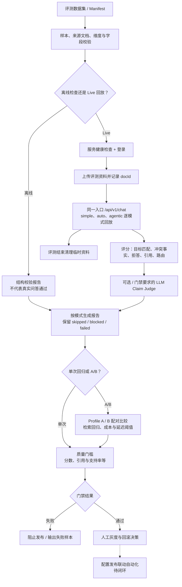
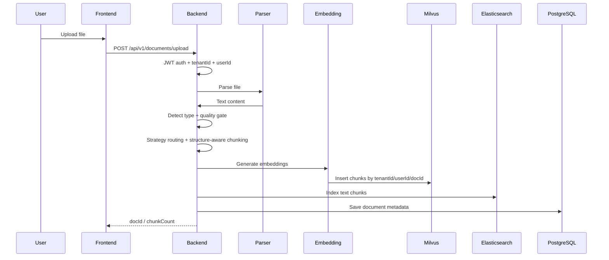
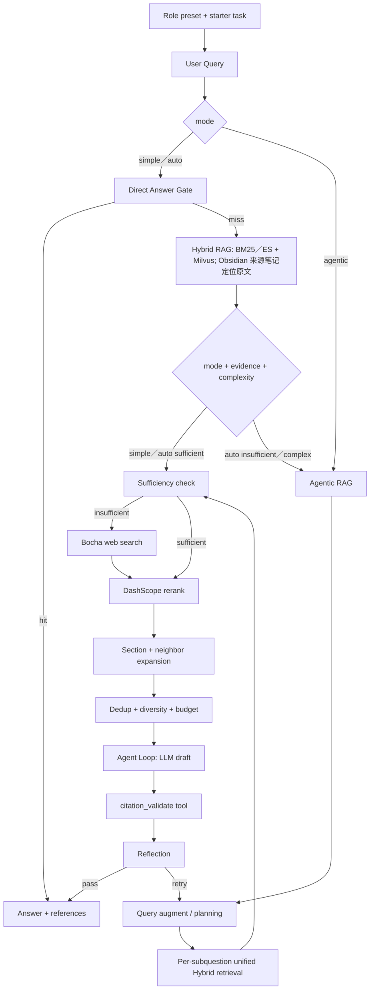

# ARCHITECTURE

> 企业级 RAG 知识库系统架构设计文档。本文描述当前代码真实架构，进度与缺口以 `ROADMAP.md` 为准。

## 1. 架构目标

本项目是面向企业知识问答场景的统一 Hybrid RAG（混合检索增强生成）与 Agentic RAG（智能体式检索增强生成）Web 应用，目标是在可控成本下提供：

- 多租户隔离的知识库问答能力
- simple / agentic / auto 三种问答路径
- 文档上传、解析、索引、删除的闭环管理
- 向量检索、全文检索、BM25、联网搜索、Rerank、GraphRAG 的可组合检索能力
- JWT 鉴权、结构化日志、指标、追踪、评测和容器化部署能力

## 2. 总体架构

```mermaid
flowchart TB
  subgraph L1["L1 接入、身份与控制面"]
    direction LR
    Client["React 用户端 / Admin / API / MCP"]
    Gateway["NestJS API Gateway<br/>JWT · IAM · tenant ACL · quotas"]
    RunApi["Chat / Run / Document API<br/>问答 · 任务 · 入库 · SSE / AG-UI"]
    ConfigPlane["配置与治理<br/>Prompt / Tool Registry · 检索配置 · 发布门禁"]
    RunSnapshot["Run 配置快照 v1<br/>queryHash · Profile · Prompt 标签<br/>模型 / 策略完整指纹待补"]
    Client --> Gateway --> RunApi
    RunApi --> RunSnapshot
    ConfigPlane --> RunSnapshot
  end

  subgraph L2["L2 编排与路由"]
    direction LR
    ChatRouter["Chat Router<br/>Simple / Auto / Agentic"]
    FastPath["Simple / Auto Fast Path<br/>直答门禁 + Hybrid RAG"]
    AgenticFlow["Agentic RAG<br/>LangGraph Planner / QueryPlan"]
    TaskDag["产研运 Workflow DAG<br/>岗位协作 · 审批 · 修订 · 局部重跑"]
    ChatRouter --> FastPath
    ChatRouter --> AgenticFlow
    FastPath -->|证据不足 / 复杂| AgenticFlow
  end

  subgraph L3["L3 Agent Runtime：模型与工具受控执行"]
    direction LR
    AgentLoop["Agent Loop / Workflow Runtime<br/>步数 · 工具数 · deadline · cancel"]
    ContextManager["Context Manager<br/>证据 · 历史 · Memory · Token 预算"]
    LlmGateway["LLM Gateway<br/>Provider 路由 · fallback · usage / cost"]
    ToolRuntime["Tool Runtime<br/>Registry · Schema · ACL · 审批 · 幂等 · MCP"]
    OutputGate["Output Validator<br/>结构化校验 · 引用 / Claim 证据门禁"]
    AgentLoop --> ContextManager --> LlmGateway --> OutputGate
    LlmGateway -->|tool call| ToolRuntime
    ToolRuntime -.->|工具观察结果回填| ContextManager
  end

  subgraph L6["L6 知识、记忆与产物"]
    direction LR
    Ingest["文档入库<br/>解析 · 质量门禁 · 结构切片 · Embedding"]
    Retrieval["统一检索<br/>QueryPlan · ACL · Hybrid · 融合 / 扩展"]
    Evidence["Evidence Bundle<br/>去重 · 来源 / 版本 · Token 排序"]
    Indexes["检索索引<br/>Milvus · Elasticsearch · BM25"]
    Graph["GraphRAG<br/>Neo4j"]
    ExternalSources["可选证据源<br/>Obsidian · Web Search · Rerank"]
    SessionMemory["会话与长期记忆<br/>PostgreSQL / Redis · Mem0 · 对话向量"]
    ArtifactStore["Artifact<br/>PostgreSQL 元数据 · 对象存储文件"]
    Ingest --> Indexes
    Ingest --> Graph
    Retrieval --> Indexes
    Retrieval --> Graph
    Retrieval --> ExternalSources
    Retrieval --> Evidence
  end

  subgraph DURABLE["Durable Execution：状态与恢复"]
    direction LR
    Postgres["PostgreSQL<br/>Run / Event / Task / Outbox<br/>文档元数据 · 会话历史"]
    Redis["Redis<br/>Checkpoint · 短期上下文 · 锁 / 取消标记"]
    Queue["BullMQ Queue / Scheduler"]
    Workers["Worker 执行<br/>文档 · Workflow · Artifact"]
    RunApi --> Postgres
    RunApi -->|异步任务| Queue --> Workers
    Workers --> Postgres
    Workers --> Redis
    Workers --> ArtifactStore
  end

  subgraph L7["L7 分布式运行与容量控制"]
    direction LR
    RateControl["租户 / 用户配额<br/>请求限流 · 日成本预算"]
    ModelBudget["模型调用预算<br/>RPM / TPM · 超时 · 有界重试"]
    ProductionProof["目标环境验收<br/>并发 · 队列积压 · 故障恢复 · P95 / 成本"]
    OutcomeReconciler["unknown 副作用恢复扫描<br/>租约过期对账 / 人工接管"]
    RateControl --> ModelBudget
  end

  subgraph CROSSCUT["横切治理：安全、观测与质量发布"]
    direction LR
    Security["Security & Policy<br/>API scope / tenant ACL · Injection 防护 · 脱敏审计"]
    Observability["Observability<br/>pino · Prometheus / Grafana · Langfuse"]
    EvalRelease["Evals & Release Gate<br/>三模式回归 · 引用 / 拒答 · 离线 A/B"]
    Rollout["人工灰度 / 回滚<br/>自动联动待补"]
  end

  RunApi --> ChatRouter
  RunApi --> Ingest
  RunApi --> TaskDag --> AgentLoop
  FastPath --> ContextManager
  AgenticFlow --> AgentLoop
  ContextManager --> Retrieval
  Evidence --> ContextManager
  SessionMemory --> ContextManager
  ContextManager --> SessionMemory
  ToolRuntime --> ArtifactStore
  Ingest --> Postgres
  AgentLoop --> Postgres
  AgentLoop --> Redis
  RunSnapshot --> Postgres
  Gateway --> RateControl
  ModelBudget --> LlmGateway
  Security --> Gateway
  Security --> Retrieval
  Security --> ToolRuntime
  AgentLoop --> Observability
  Postgres --> Observability
  Observability --> EvalRelease
  ConfigPlane --> EvalRelease
  EvalRelease --> Rollout
  Rollout -.->|审核后的配置版本 / 灰度联动待补| ConfigPlane
  OutputGate --> RunApi
  Workers -.->|接管扫描待补| OutcomeReconciler
  ProductionProof -.->|真实业务数据与目标环境验收待完成| EvalRelease

  classDef implemented fill:#e8f5e9,stroke:#27834a,color:#173b22,stroke-width:1px;
  classDef partial fill:#fff4d6,stroke:#c58a12,color:#4a3710,stroke-width:1px;
  classDef pending fill:#fff0f0,stroke:#ce5b5b,color:#542020,stroke-width:1px,stroke-dasharray:5 5;
  class Client,Gateway,RunApi,ChatRouter,FastPath,AgenticFlow,TaskDag,AgentLoop,ContextManager,LlmGateway,ToolRuntime,OutputGate,Ingest,Retrieval,Evidence,Indexes,Graph,ExternalSources,SessionMemory,ArtifactStore,Postgres,Redis,Queue,Workers,RateControl,ModelBudget implemented;
  class ConfigPlane,RunSnapshot,Security,Observability,EvalRelease,Rollout partial;
  class ProductionProof,OutcomeReconciler pending;
```



图例：绿色表示已实现的主体能力，黄色表示已有基础但发布治理或生产闭环不完整，红色虚线表示待补能力；虚线箭头表示待完成的恢复或发布连接。该图按当前仓库实现映射 V3 分层，部署验收缺口以 `ROADMAP.md` 为准。

## 2.1 按功能链路拆分的架构图

总图用于看系统边界；下面每张图只展开一条功能链路。实线表示当前主流程，虚线表示可选支路或仍待闭环的能力。它们描述当前代码与已记录边界，不代表目标环境验收已完成。

### 2.1.1 文档上传与索引

同步上传在请求内处理；异步上传先持久化任务和源文件，再由 BullMQ Worker 处理。两条路径在解析和统一入库后汇合。



异步生产路径要求 Redis / BullMQ；Redis 未配置时仅开发环境允许进程内处理。索引之间尚非同一数据库事务，当前通过状态记录和索引对账／修复队列发现并修复可识别的不一致。

### 2.1.2 用户提问与回答

`simple`、`auto`、`agentic` 共用认证、请求编排、权限过滤、证据整理和最终引用校验；区别在于是否允许从 Fast Path 升级到多步 Agentic。



`simple` 是固定线性取证与校验，不升级 Agentic；`auto` 可在 Fast Path 后按充分性和复杂度升级；`agentic` 可规划多个查询并反思重试。SSE 只负责事件传输，问答语义和最终持久化仍由 `ChatService` 收敛处理。

### 2.1.3 长任务执行与恢复

这里展开产研工作流的异步执行。文档异步处理见 2.1.1；普通短请求不需要进入这条长任务队列。



PostgreSQL 保存业务任务和运行审计，Redis checkpoint 保存图执行恢复位置，BullMQ 负责跨进程派发与重试。带外部副作用且结果未知的工具不能盲目重放；自动扫描与接管仍是待闭环项，需人工确认或按局部任务重跑。

### 2.1.4 上下文如何组织

上下文不是“把所有历史拼进 Prompt”。系统先按请求类型、租户权限和检索范围取候选，再用模型窗口与检索档位预算限制历史和证据；权威事实仍以通过权限检查的知识库原文为准。



短期历史以 PostgreSQL 为事实存储，Redis 用于近期窗口；摘要只保留决策和业务事实线索，不替代知识库原文。历史与长期记忆作为补充上下文注入，客观事实类问题可跳过记忆／历史召回。引用校验将最终回答重新绑定到本轮检索证据。

### 2.1.5 评测与发布门禁

评测分为数据集检查、真实服务回放、结果报告和发布门禁。离线结构校验不等于问答效果通过；灰度与回滚当前仍需人工完成。



发布门禁要求 Live 评测和已审核数据；A/B 阈值需明确提供。仓库内脱敏或模拟数据只能证明可复现基线，不替代真实业务黄金集。评测通过也不自动发布，自动化灰度／回滚联动尚未接入。

## 3. 运行时组件

| 组件 | 技术 | 职责 |
|---|---|---|
| Frontend | React 18 + Vite | 登录、文档管理、聊天、SSE 展示、Debug 面板、语音输入和朗读 |
| Backend | NestJS + TypeScript | API、鉴权、业务编排、RAG 管线、Provider 管理 |
| PostgreSQL | pgvector/pgvector:pg16 | 用户、会话、消息、文档元数据、任务等关系数据 |
| Redis | redis:7-alpine | 缓存、短期记忆、LangGraph checkpoint |
| Milvus | milvusdb/milvus:v2.4.4 | 主向量数据库，独立集合保存原文 chunk 与检索描述向量 |
| Elasticsearch | 8.13.0 | 全文检索与中文 IK 分词检索 |
| Neo4j | 5-community | GraphRAG 图谱实体与关系存储 |
| MinIO / etcd | Milvus 依赖 | Milvus 对象存储和元数据依赖 |
| Mem0 | cloud / local | 长期记忆搜索与写入 |

## 4. 后端模块划分

```text
backend/src
├── common/        # Guards / filters / interceptors / decorators / logger / filesystem policy
├── config/        # 环境变量解析和配置映射
├── modules/       # auth / document / chat / memory / graph / jobs / skills / metrics / tracing 等业务模块
├── providers/     # llm / embedding / speech / vector-store / db / redis / elasticsearch / mem0 / neo4j / mcp
├── rag/           # application / retrieval / evidence / generation / agentic / agents
├── tools/         # RAG 工具与 Graph search 工具
└── migrations/    # TypeORM migration
```

关键边界：

- `modules/*` 负责业务入口和用例编排。
- `providers/*` 负责外部系统或可替换能力封装。
- `rag/rag.service.ts` 是统一的线性 RAG 应用服务，负责编排共享召回、证据、生成和受治理直答；`rag/rag.module.ts` 通过 `RAG_QUERY_CAPABILITY`、`RAG_RETRIEVAL_CAPABILITY`、`RAG_INDEX_CAPABILITY`、`RAG_ADMIN_CAPABILITY` 暴露窄能力入口。
- `rag/agentic` 负责 LangGraph 工作流和多步骤 Agentic RAG。
- `common` 放横切能力，不承载业务规则。

## 5. 核心链路

### 5.1 文档入库链路



索引策略：

- Chunking 先按 Markdown 标题建立父子 Section，每个叶子 Chunk 重复完整 `headingPath`，避免切分后丢失 PRD、接口、测试章节语境。
- 游戏官网／活动业务文档采用结构保护切片：代码围栏保持完整；配置、概率和地区表格按完整行切分，并在每个表格 Chunk 重复表头；空单元格与转义竖线保持原列语义。
- 接口契约、测试／验收、版本／地区规则写入轻量内容类型标识，供 BM25／ES、向量召回和 Rerank 联合识别；父子关系、source span、clause 和 table metadata 继续写入 `document_chunks`。
- 入库先执行文档类型识别与质量报告，再选择 PRD／API／Design／Test／Config／Postmortem／General 切片策略。
- 检索采用“自适应候选召回 → RRF／权威排序 → Section／相邻块扩展 → 去重与来源限额 → Token 预算与首尾交错排布”的上下文治理链路。
- `documents_meta` 与 `document_chunks` 保存 project／activity／region／locale／channel／roleScope／documentType／lifecycle metadata；默认过滤 deprecated，历史对比显式放开。
- 独立检索描述索引复用文档摘要和已有图片／视频描述，并按表格分组生成有行数上限的描述；描述只召回关联原文 chunk，回答仍使用通过 ACL、版本、生效期和业务范围校验的原文。
- PostgreSQL 保存描述正文及其到 `document_chunks` 的关联，Milvus 使用单独集合保存描述向量；更新和删除同步清理，索引对账可重建描述，不改原文 chunk 向量集合。
- `rag_feedback` 保存真实用户反馈、错误归因、召回快照和回归集状态，未经审核不进入 Prompt 或 Few-Shot。
- `AddGameProductionRagGovernance` migration 为上述业务元数据、生命周期、query log 快照和反馈表提供 schema；本地开发库已执行，生产环境仍需独立审批。
- `role-presets.ts` 是岗位目录的唯一事实源，静态提供业务负责人、产品、设计、前端、后端、测试、运营和项目管理八个预设；前端通过 `GET /chat/role-presets` 获取，不重复维护角色 Prompt。
- 岗位预设在统一“业务负责人”基础身份上注入当前服务对象、职责和回答结构，并将角色别名归一为 `roleScope`；它不替代 RBAC，不新增数据库表。
- 用户端和管理后台 QA 工作台共用该目录：用户端调用 `/chat/role-presets`，管理后台经 `admin-backend /admin/qa-ops/role-presets` 代理 `/rag/admin/role-presets`；两条 AG-UI 链路都透传同一个 `rolePresetId`。
- Milvus 存储 dense vector，主 collection 默认 HNSW。
- Elasticsearch 存储全文检索索引。
- 内存 BM25 索引用于快速关键词召回和降级。
- 文档删除会删除元数据、BM25 索引、ES 索引、原文向量、检索描述和描述到原文的关联；Milvus 删除失败会进入 Redis 持久化退避重试（Redis 不可用时明确暴露为非耐久化状态）。

### 5.2 问答链路



模式策略：

- `simple`：先执行精确直答，未命中后执行完整 Hybrid RAG；低延迟、透明、可调试，不进入多步骤 Agentic。
- `agentic`：外层 LangGraph 负责多步检索、查询扩展、联网兜底、Rerank 与反思重试；内层 `AgentLoopService` 统一执行模型／工具动作、工具次数与总步数限制、超时、Redis 状态快照和运行事件。通过 `AGENTIC_MAX_RETRIES`、`AGENTIC_MAX_AUGMENTED_QUERIES`、`AGENTIC_MAX_RETRIEVAL_QUERIES`、`AGENTIC_MAX_RETRIEVED_CHUNKS`、`AGENTIC_MAX_WEB_SEARCH_RESULTS`、`AGENTIC_MAX_RERANK_TOP_N` 控制外层成本边界。
- `auto`：与 simple 共用精确直答和 Hybrid Fast Path，再按证据充分性与复杂度决定轻量回答或升级 Agentic。问题长度只影响上下文、Token、时间和成本预算，不单独决定路由；`AGENTIC_MAX_AUTO_QUERY_LENGTH` 仅保留配置兼容。

### 5.3 GraphRAG 链路

GraphRAG 默认可配置开启。当前 Neo4j 已在 dev / staging / prod compose 中支持：

文档主入库完成后，系统在 Neo4j 可用时异步抽取图谱；图谱失败不阻塞文档版本生效。实体和关系维护来源 `sourceIds`（来源标识列表），使多个文档可以共享同一实体关系；删除文档时只移除该文档来源，不删除仍被其他文档引用的图谱事实。

- dev：`docker compose -f docker/docker-compose.dev.yml --profile graphrag up -d neo4j`
- staging：`docker compose -f docker/docker-compose.staging.yml --profile graphrag up -d`
- prod：`docker compose -f docker/docker-compose.prod.yml --profile graphrag up -d`

后端容器内必须使用：

```env
NEO4J_URL=bolt://neo4j:7687
```

本机开发时使用：

```env
NEO4J_URL=bolt://localhost:7687
```

## 6. 数据与隔离设计

系统以 `tenantId` 作为租户隔离边界，并以 `userId` 表示用户身份和资源所有权。认证上下文应贯穿 API、异步任务、检查点与检索；资源 ACL 进一步限定租户内可见范围。生产需启用 `AUTH_REQUIRE_TENANT_CONTEXT` 与 `AUTH_ENFORCE_IAM`，旧索引和历史无租户数据按迁移／对账结果收紧，不把兼容默认值视为隔离已完成。

- PostgreSQL 资源查询同时使用租户条件与所有权／ACL 条件。
- Redis key 和队列／检查点上下文包含租户及用户／会话隔离维度。
- Milvus、Elasticsearch、BM25 和 Neo4j 检索／对账按租户与文档权限过滤。
- 租户字段回填、非空收紧、旧索引重建和跨租户故障演练必须有独立验收证据。
- 浏览器原生 EventSource 通过一次性短票据鉴权；长期 JWT 不进入 URL。
- debug/traces/metrics 仅在非 production 默认可用，production 需显式开关并置于内网。

## 7. Provider 设计

项目通过 Provider 屏蔽外部能力差异：

| Provider | 当前实现 | 可替换方向 |
|---|---|---|
| LLMProvider | Qwen OpenAI-compatible | OpenAI / Anthropic / Ollama |
| EmbeddingProvider | Qwen text-embedding-v3 | OpenAI embeddings / local embeddings |
| SpeechProvider | Tencent ASR/TTS | 其它云服务或本地语音模型 |
| VectorStoreProvider | Milvus | pgvector |
| RelationalDBProvider | PostgreSQL | MySQL |
| Mem0Provider | Mem0 cloud/local | 关闭或本地部署 |
| Neo4jProvider | Neo4j driver | 关闭或独立图数据库 |
| McpProvider | MultiServerMCPClient | 多 MCP server |

设计约束：

- Provider 不应把外部异常扩散为核心问答不可用，除非该能力是当前请求的硬依赖。
- 可选能力缺 key 或服务不可达时应明确降级或返回可解释错误。
- 密钥只从 `.env` / 环境变量读取，不写入代码和日志。

## 8. 部署架构

### 8.1 本地开发

```bash
docker compose -f docker/docker-compose.dev.yml up -d
docker compose -f docker/docker-compose.dev.yml --profile graphrag up -d neo4j
cd backend && npm run start:dev
cd frontend && npm run dev
```

### 8.2 生产部署

默认不启用 GraphRAG：

```bash
docker compose -f docker/docker-compose.prod.yml up -d
```

启用 GraphRAG：

```bash
docker compose -f docker/docker-compose.prod.yml --profile graphrag up -d
```

生产 compose 中 backend 使用 Docker 网络服务名连接基础设施：

| 能力 | 容器内地址 |
|---|---|
| PostgreSQL | `postgres:5432` |
| Redis | `redis:6379` |
| Milvus | `milvus:19530` |
| Neo4j | `neo4j:7687` |

## 9. 可观测与质量门禁

已实现：

- pino JSON 结构化日志
- HTTP QPS / 延迟 / Node 默认指标
- RAG 业务指标：检索命中、LLM 调用次数、LLM 调用耗时、输入/输出 token 估算
- 上下文治理指标：`rag_retrieval_context_chunks`、`rag_retrieval_context_characters`、`rag_retrieval_expanded_chunks_total`
- Bad Case 闭环：非流式问答同步记录 query log 与召回快照，用户反馈绑定服务端快照，Admin 支持审核、归因和回归集标记
- 动态 Bad Case Few-Shot：只有人工审核且进入回归集的纠错样本写入独立 Milvus collection，生成前最多召回 2 条相似样本，当前知识证据优先
- W3C `traceparent` 兼容的 in-memory tracing
- Agent 节点 trace 与指标：记录 LangGraph 节点耗时、首 token、工具成功率、空召回、循环终止原因；单 trace 超过 15 个节点标记 `span_limit`
- 产研运 FSM：产品、设计、前端、后端、测试、运营顺序执行，每个岗位结构化输出并人工审批，驳回回退一节点，Redis Checkpointer 支持恢复
- 结构化短期记忆：每轮问答结束后按可用历史 Token 预算检查，超预算或超过 40 条消息才压缩；摘要与近期原文共享预算，模型失败时保留 Redis 原文，完整消息留在 PostgreSQL，并用 Redis 锁避免同一会话并发压缩
- Debug chunks 分数面板
- Agentic workflow Mermaid 导出
- RAG eval / E2E / perf 脚本
- RAG 质量闸门：query normalize、低相关拒答、逐句 claim-level 引用支撑校验、多版本冲突提醒
- 结构化事实治理：`document_chunks` 保存父子 chunk、source span、section/clause/table metadata、doc version、生效期、来源权威；`fact_conflicts` 保存第一版事实冲突记录
- 可选来源权威排序：`RAG_SOURCE_AUTHORITY_RULES` 按 docId / chunk 内容匹配来源权威权重
- LLM-as-Judge 质量门禁：`npm run eval:rag:quality` 默认不消耗 Judge key，`EVAL_RAG_JUDGE_REQUIRED=true` 时强制 Qwen 判断 claim 为 supported / contradicted / not_mentioned
- 企业级成熟度门禁：`npm run eval:rag:maturity` 按查得准、答得稳、引用能撑住、不会瞎编、可观测恢复、工程化门禁、真实落地准备打分；2026-08-03 当前本地工程成熟度 93/100，缺口是生产材料确认和 Milvus search runtime 降级，不把本地分数冒充生产就绪
- 项目级仿真实业务评测：`npm run eval:rag:project` 覆盖多文档、多部门、版本冲突、跨文档、缩写别名、无答案拒答和强引用；`PROJECT_EVAL_REQUIRE_LIVE=true` 时必须真实后端上传/问答/打分，2026-08-03 真实后端回放 simple/auto 共 28/28 通过
- 专项 smoke 脚本：MCP、GraphRAG、Speech、外部工具、Redis Checkpointer、Hybrid retrieval

待确认：

- 正式 CI/CD 接入属于红线，需单独确认后再改 workflow。
- 已提供 120 条内置业务场景回归评测集和 193 条私密模拟业务评测样本，覆盖多部门问题、标准答案、expectedClaims、引用要求和拒答要求；若要升级为主人公司真实私有业务评测集，仍需真实业务问题和标准答案输入。
- 真实生产发布仍需目标机器、域名、证书、备份和密钥注入策略。
- `RAG_MATURITY_REQUIRE_EXTERNAL=true` 会把真实私有业务评测集和生产材料作为硬阻塞；默认门禁不伪造外部输入。
- OTLP exporter 接入仍是后续增强，不影响当前本地可观测。

## 10. 已知风险

| 风险 | 当前处理 |
|---|---|
| Milvus search 偶发 timeout | search/delete/warmup/circuit 超时可通过环境变量配置，主检索快速失败并短期熔断，降级 BM25 |
| Milvus 删除偶发 timeout | 删除失败进入进程内退避重试，active docId 过滤避免残留命中进入答案 |
| GraphRAG 图谱为空 | 已提供 `smoke:graph` 和种子数据，并完成 Docker/Neo4j 真实运行时验证；真实业务图谱仍需业务数据源 |
| MCP 缺真实 server | 已提供本地 stdio smoke server；业务 MCP server 可追加到 `workspace/mcp-servers.yaml` |
| 外部 key 不完整 | Qwen Judge 与腾讯云语音直连已验证；Bocha / Rerank 缺 key 时脚本输出 skipped |
| Docker daemon 不可用 | 2026-06-21 已恢复并完成 GraphRAG / Hybrid / backend Speech / Redis smoke；后续若 Docker 关闭，对应 smoke 会失败或 skipped |
| 真实评测代表性 | 已新增 120 条内置业务评测集和 193 条私密模拟业务评测样本；主人公司真实私有业务样本仍需主人提供 |

## 11. 文档关系

- `ARCHITECTURE.md`：技术架构与设计约束。
- `../product/PRD.md`：产品需求与验收标准。
- `ROADMAP.md`：真实进度源。
- `CLAUDE.md`：项目规则。
- `ARCHITECTURE.md`：早期计划和技术路线。
- `../reference/SUMMARY.md`：`agent-course/` 参考能力总结。


## 2026-10-29 RAG 职责边界收敛

- `rag/retrieval` 承接 provider 召回、候选融合、过滤/重排、扩展与上下文选取；`rag/evidence` 承接充分性、确定性答案与引用门禁。
- `rag/generation` 承接 grounded/correction/synthesis 和模型流式降级；生成消费已授权且保持本地引用顺序的片段。旧的单一检索服务命名与目录已退场；`RagService` 收敛为组合 Facade，BM25 持久化与状态由 `RagIndexService` 独占，检索、证据、Obsidian 和回答编排分别由 `RagRetrievalService`、`RagEvidenceService`、`RagObsidianService`、`RagAnswerService` 等窄服务承担。BM25 文件路径与 JSON 格式保持不变。
- `rag/contracts` 定义中立 RequestContext、RetrievalExecutionPlan、结果/检索选项、附件证据与 Agentic 能力契约；不依赖业务 Service。Agentic 编排通过 Nest token 绑定兼容实现。
- `DocumentIndexCoordinator` 接管索引写入/删除/失败清理及 Redis Milvus 删除补偿；DocumentService 保留原件、PG、ACL、版本业务与现有阶段编排。此边界不承诺跨数据库和搜索引擎事务。
- Chat 的上下文系统消息有来源与实际预算；保留必需策略、整块裁剪可选记忆，历史预算对必需消息超额做让步。字符/token 估算仍为启发式，真实模型与工具预算验收待补。
- Run、Task、RuntimeEvent、Checkpoint、Artifact 的权威分工保持，不合并为另一套状态容器。详细代码/验证/已知缺口见 [重构进度](../refactor/progress.md)。
