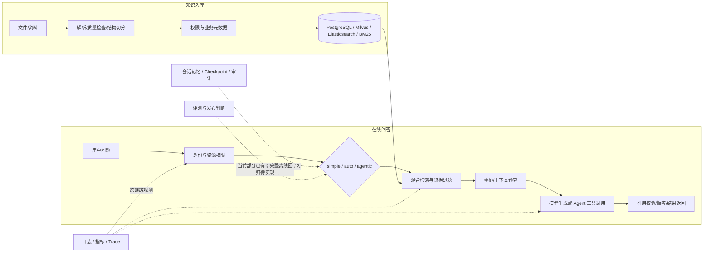

# 3 小时面试突击：AI 应用 / Agent 岗

> 更新时间：2026-10-25
> **用途**：面试前只有 3 小时时，优先准备项目讲述、核心架构追问、真实边界和 HR 高频题。
> **默认岗位假设**：高级 AI 应用 / Agent 工程岗位。若本次应聘前端负责人或前端架构岗位，把“前端如何承接 Agent 运行态、可观测和业务交付”作为个人优势展开。
> **资料来源**：项目现状以 [`ARCHITECTURE.md`](../architecture/ARCHITECTURE.md) 和 [`ROADMAP.md`](../../ROADMAP.md) 为准；《AI_Agent_42道面试共性题_逐题详解_含架构图》用于提炼通用题型。参考题库中的示例方案、数据模型和架构图不代表本项目已经实现。

## 0. 三小时的复习目标

3 小时后，不要求背完 42 题。要能做到：

- 不看稿讲清楚 **30 秒自我定位、2 分钟项目介绍、5 分钟架构主链路**。
- 对 Agent、RAG、上下文、任务恢复、权限、评测、可观测和 AI 编程这 8 类追问，先给结论，再讲项目做法和边界。
- 所有数字带上样本、环境和日期；没有证据就不报数字。
- 清楚区分 **已实现、设计中、待验证**，不把参考指南或通用题库中的方案说成项目现状。

推荐回答结构：**结论 → 项目做法 → 取舍 → 证据 → 边界**。先用 30～60 秒回答，面试官追问后再展开。

## 1. 180 分钟倒排计划

| 时间 | 分钟 | 复习任务 | 必须产出的口头答案 |
|---|---:|---|---|
| 00:00–00:15 | 15 | 写出岗位定位、项目职责、已实现/规划中边界 | 30 秒自我定位；一张事实卡 |
| 00:15–00:35 | 20 | 练项目介绍，不按目录读架构文档 | 2 分钟项目介绍，脱稿两遍 |
| 00:35–01:20 | 45 | 复习 RAG、三种路由、Agent 与工作流、上下文 | 5 个核心问题，每题 1 分钟以内 |
| 01:20–01:30 | 10 | 休息；不看资料复述问答主链路 | 画出入库和问答两个流程 |
| 01:30–02:05 | 35 | 复习权限、故障恢复、幂等、可观测、评测 | 讲清 3 个失败场景和 1 个评测边界 |
| 02:05–02:30 | 25 | 复习 AI 编程方法及个人岗位优势 | 讲一个真实交付例子，说明如何验收 |
| 02:30–02:45 | 15 | 准备离职、空窗、薪资、地点、求职动机 | HR 问题只填真实事实，不背虚构答案 |
| 02:45–03:00 | 15 | 随机模拟与查漏 | 10 个快问快答；补出最卡的 3 题 |

### 15 分钟事实卡

面试前把下列内容写在一页纸上，标注“已实现 / 规划中 / 待验证”：

1. 我在项目中的真实职责：`[填本人负责的模块和决策]`
2. 一个最能代表自己的技术决策：`[问题—方案—取舍—证据]`
3. 一个处理过的失败或缺陷：`[怎么定位、怎么修复、怎么防回归]`
4. 一个可引用的验证结果：`[时间、样本、环境、结果]`
5. 一个尚未完成的能力：`[当前边界、下一步验收方法]`

## 2. 项目现状与表述边界

下面是讲项目时的安全口径。具体细节和最新状态仍要以当前代码、`ARCHITECTURE.md`、`ROADMAP.md` 为准。

| 主题 | 可以讲的主线 | 需要主动说明的边界 |
|---|---|---|
| 项目定位 | 企业知识问答与 Agent 工作流平台，覆盖文档入库、检索问答、任务状态和运维治理 | 不要把“企业级”三个字当成已通过生产验收的证明 |
| 文档入库 | 认证与资源范围校验后，解析文档、保留结构和业务元数据，写入关系数据与检索索引；异步任务跟踪处理状态 | 讲清同步/异步分别做什么，以及失败、删除、重试的真实行为 |
| 用户问答 | `simple` 优先走直接回答与检索快路径；`auto` 根据证据和复杂度决定是否升级；`agentic` 执行多步检索与工具流程 | Agent 是按需使用的路径，不是每个问题都交给自主循环 |
| 检索 | 关键词、全文和向量检索互补，之后做结果融合、重排、上下文预算和引用校验 | 不要说“加了向量库准确率就提高”；要说用什么数据和指标证明 |
| 上下文 | 会话历史、短期窗口/摘要、长期记忆、运行 Checkpoint 和审计用途不同 | 记忆是模型可用的历史信息；Checkpoint 是任务恢复状态；审计是责任证据，不能混成一个概念 |
| GraphRAG | 作为可选能力，适合关系查询或多跳问题 | 不要把图谱当默认主路径，也不要把种子数据等同真实业务图谱收益 |
| 评测 | 项目文档记录了评测脚本、数据集检查和 Live 回放相关内容，结果要按最新 ROADMAP 核实 | **参考指南中的完整离线回归评测能力尚未实现。**它是规划设计，不要说成已经接入的发布门禁；Live 回放和离线评测是不同口径 |
| 发布 | 评测结果支持人工判断；文档指出自动灰度和回滚联动尚未闭环 | 不要宣称评测通过后自动发布或自动回滚 |
| 结果数字 | 可引用有日期、样本范围和验证方式的证据 | 架构文档中 2026-08-03 的成熟度和回放数字较旧，面试前先核对最新结果；模拟数据不能说成真实业务效果 |

**不会的内容这样答**：

> “这个能力目前没有完整实现。我能确认的现状是 `[已实现部分]`；参考设计建议补上 `[目标能力]`。如果继续做，我会先用 `[可复现的数据/故障场景]` 验证 `[指标或不变量]`，达标后再接入发布流程。”

## 3. 30 秒与 2 分钟项目介绍

### 30 秒版本

> “我主要做 `[真实职责，例如前端架构、全栈交付或 Agent/RAG 核心链路]`。这个项目面向企业知识问答和 Agent 工作流，重点不是简单接一个大模型，而是把文档入库、权限过滤、检索证据、Agent 路由、任务状态和问题追踪连成可维护的工程链路。我的重点贡献是 `[真实贡献]`，验证证据是 `[实际结果及口径]`；目前 `[真实限制]` 还没有完成生产级验证。”

把方括号换成自己的事实；没有证据时不要临场编数字。

### 2 分钟版本

> “项目要解决的是 `[具体业务场景]` 中资料分散、更新频繁、问题需要可追溯的需求。架构上把入库和在线问答分开：入库侧负责解析、结构化切分、业务元数据和索引更新；问答侧先校验身份与资料范围，再根据问题走 `simple`、`auto` 或 `agentic`。关键词/全文和向量召回互补，结果经过融合、重排和上下文预算后交给模型生成，关键回答要能回到检索证据。
>
> “我没有把所有工作都做成 Agent：稳定、可预测的业务步骤由后端和工作流控制；只有需要动态检索或工具选择的部分才进入 Agent。任务状态、对话记忆和审计记录分别处理，外部写操作需要考虑幂等和结果未知时的核验。我的实际负责范围是 `[填写]`，我做过的关键取舍是 `[填写一个]`，依据是 `[代码/评测/运行证据]`。完整离线回归评测目前属于规划项，不能当作已上线能力；生产业务效果也只按已验证数据说明。”

### 一张图记住主链路

讲图时只展开一条问答链路，再举一个失败恢复例子。不要逐个念技术栈。

## 4. 高频技术题：先背结论，再按需展开

### 1. 什么需求适合 Agent，什么应该写成普通代码？

> “输入输出和规则稳定时优先写普通代码或固定工作流；步骤需要根据上下文动态选择、并且工具结果会影响下一步时，才让 Agent 做有限决策。项目用固定服务边界承载确定性规则，把动态检索和工具选择放在 Agent 路径，并限制步骤、权限和预算。”

追问时补充：引入 Agent 会增加不确定性、延迟和评测成本；如果一个普通函数就能稳定完成，就不需要 Agent。

### 2. Agent 一次运行的流程是什么？

> “先从可信身份和任务输入构造状态，再由路由决定直接回答还是进入工作流；Agent 在约束内选择模型或工具，接收工具结果后继续或结束。每个步骤都需要预算、超时和停止条件；需要恢复的任务保存 Checkpoint，外部写操作另用幂等机制防重复。”

### 3. RAG 从文档到答案怎么走？

> “离线入库做解析、结构保留、元数据和权限标注、切块与索引；在线先按用户身份和资源范围过滤，再做关键词/向量召回、融合与重排，按 Token 预算组织证据，最后生成并校验引用。错误要定位到入库、过滤、召回、重排、上下文还是生成，不能一上来只换模型。”

### 4. 为什么不用纯向量检索？

> “向量检索擅长语义相似，精确编号、错误码、专有词往往需要关键词/全文补充。混合检索覆盖面更均衡，但会增加索引维护、延迟和调参成本。是否值得保留要用固定问题集比较 Recall@K、MRR、引用正确性、延迟和成本。”

### 5. `simple`、`auto`、`agentic` 如何区分？

> “`simple` 面向明确、低复杂度问题，优先走快速且可解释的检索回答；`auto` 先尝试快路径，再根据证据充分度和复杂度升级；`agentic` 用在需要多步检索、查询拆解或工具的任务。路由目标是在质量满足的前提下控制成本，而不是让最复杂的模式成为默认。”

### 6. RAG 没答对，怎么排查？

> “先确认正确文档是否入库、版本是否最新、权限是否误过滤；然后看 Chunk 是否保留了章节/表格语义、候选召回是否包含标准证据、重排和上下文有没有丢证据。若证据已进入上下文再检查生成和引用。保留 Query、候选 chunk、过滤条件、分数和最终上下文，才能复现问题。”

### 7. 怎么控制幻觉？

> “不能靠一句 Prompt 消除幻觉。知识问答要把结论绑定到证据，证据不足时拒答或澄清；结构化输出做 Schema 校验；确定性业务事实用数据库或工具核验；高风险写操作走审批。评测时分别看事实、引用支持、拒答和工具结果。”

### 8. 会话记忆、运行状态和审计有什么区别？

> “会话/长期记忆回答‘模型能参考什么历史信息’；Checkpoint 记录‘任务跑到哪里、如何恢复’；审计记录‘谁在什么权限下做了什么’。它们的数据结构、访问边界和保留周期不同，摘要也不能替代原始任务状态或审计证据。”

### 9. 长任务中断后如何恢复？

> “用稳定的 run/thread 标识保存任务状态和 Checkpoint，恢复时重新校验当前用户和资源权限。对有副作用的工具调用使用业务幂等键或查询外部结果；超时但结果未知时先核实状态，不盲目重放。通常能做到可恢复和有界重试，但不能随便承诺外部系统 exactly-once。”

### 10. MCP 和普通 API 的关系是什么？

> “API/RPC 解决服务间业务调用，MCP 提供面向模型的工具发现和调用约定，可以由 MCP Server 再调用已有业务 API。MCP 不自动提供业务授权；认证、资源 ACL、租户校验和高风险操作审批仍由服务端负责。”

### 11. 多租户权限如何回答？

> “权限必须来自可信登录身份，不能让模型在参数里自报 tenantId。请求上下文需要贯穿 API、异步任务、检索和结果返回，并在业务资源层执行授权；Prompt 不是安全边界。面试时我会按实际测试覆盖的资源和存储层说明，不把单测或一个过滤条件说成完整的生产隔离证明。”

### 12. 如何做全链路可观测？

> “用 traceId 贯穿请求，runId/threadId 关联 Agent 任务，记录节点耗时、模型调用、工具结果摘要、错误类型和资源成本；指标看成功率、P95、超时、降级和队列积压；日志用于定位，质量评测用于判断答案是否正确。敏感信息先脱敏，Trace 不应该无边界保存完整 Prompt 和私密资料。”

### 13. 离线评测和当前项目是什么关系？

> “离线固定集回归、开发集与留存集对比，是参考指南提出的目标设计；这条完整离线评测链路目前没有实现，所以我会把它列为规划项。当前文档提到的评测脚本或 Live 回放要按各自实际验证范围说明，不能混称为离线回归发布门禁。评测通过也不等于自动灰度或回滚已经接通。”

### 14. 你怎样用 AI 完成开发任务？

> “我先把需求拆成验收标准、权限边界、异常路径和改动范围，再让 AI 阅读相关代码并给方案；我确认方案后分小步实现，每一步通过构建、类型检查、测试和人工 Review 验证。架构取舍、权限、数据迁移和最终交付由我负责，不用生成了多少代码衡量效率。”

### 15. 作为前端负责人/架构师，你的优势怎么连接到 Agent 项目？

> “Agent 产品不能只看模型后端，还要把运行状态变成用户能理解、能控制的交互：当前步骤、引用证据、审批、失败原因、恢复入口和生成产物都要有清楚状态。我擅长把业务流程拆成前后端边界、API 契约和可验收的用户路径。具体哪些由我亲自实现，按简历和代码证据说明。”

## 5. 设计题与故障题的答题模板

遇到“如果让你重做 / 出现超时怎么办”，按这个顺序回答：

1. **先定目标和风险**：正确性、权限、恢复、延迟、成本分别哪个是硬约束？
2. **分阶段定位**：入口 → 状态/队列 → 检索或工具 → 模型 → 持久化 → 返回。
3. **区分错误类型**：参数/权限错误立即失败；429/部分 5xx/网络抖动限次退避；超时且有副作用时先查结果；结构错误才做有限修复。
4. **说恢复边界**：检查点能恢复计算进度，幂等键保护写操作；没有外部查询或幂等能力时转人工核对。
5. **给验收办法**：失败注入、重复提交、进程重启、权限矩阵和同一批回归问题；报告成功率、P95、成本和失败分类。

## 6. AI 编程与个人经历的 25 分钟准备

挑一个真实需求，准备下面 5 句，不讲泛泛的“我会用 AI”：

- 需求是什么，验收标准是什么？
- AI 读取了哪些上下文，如何限制改动范围？
- 你在哪个关键决策上纠正或拒绝了 AI 方案？
- 用哪些检查确认改动正确？
- 最终结果和仍未验证的边界是什么？

如果没有相应指标，讲验证过程和观察到的结果，不说“效率提升 N 倍”。如果面试偏前端，选择一个有业务状态、权限、错误和恢复的真实交付案例，解释交互如何对应后端状态机和 API 契约。

## 7. HR 七问：每题只填真实信息

| 问题 | 现场答题骨架 |
|---|---|
| 为什么离开上一家公司？ | “主要因为 `[真实原因]`。我在上一阶段负责 `[真实职责/结果]`，下一步希望在 `[岗位方向]` 持续承担 `[真实目标]`。” |
| 空窗期做了什么？ | “这段时间从 `[起止时间]` 做了 `[真实学习/项目/照顾家庭等]`，可以展示的证据是 `[仓库/材料/作品]`。目前求职方向是 `[岗位]`。” |
| 为什么考虑这个城市？ | “我考虑这里是因为 `[岗位/行业/个人实际原因]`；关于搬迁和到岗，我实际可以 `[真实安排]`。” |
| 下一份工作看重什么？ | “优先级是 `[岗位职责]`、`[业务目标/团队协作]`、`[薪酬或发展]`，其中最重要的是 `[第一项]`。” |
| 上份薪资结构？ | “固定税前月薪 `[X]` × `[Y]` 薪，浮动奖金 `[实际口径]`，其他津贴 `[实际情况]`。期望会结合职责和薪酬结构讨论。” |
| 还有哪些流程？ | “目前 `[无正式 offer / 有 X 家在第几轮]`，我会按岗位匹配度做决定；预计 `[真实时间]` 能反馈。” |
| 你想问什么？ | “这个岗位未来 3 个月最希望解决的两个问题是什么？目前项目处于 PoC、上线初期还是规模化阶段？团队如何衡量效果？” |

不要虚构离职原因、空窗安排、薪资、Offer 或到岗承诺。可以选择不提供不必要的隐私，但不能用编造内容填空。

## 8. 最后 15 分钟：随机模拟

请别人随机问，或遮住右侧答案，只说每题 30～60 秒：

1. 为什么用 Agent，不用普通代码？
2. 讲一次完整的文档问答链路。
3. 为什么混合检索？如何证明有效？
4. RAG 找不到答案，你先看哪里？
5. 长任务被中断，怎么恢复且避免重复副作用？
6. tenantId 从哪里来，如何防越权？
7. 会话记忆、Checkpoint、审计分别存什么？
8. 如何判断答案可信？
9. 离线评测现在实现了吗？
10. 项目最明显的不足是什么，下一步如何验收？
11. AI 写错代码时，你如何发现并纠正？
12. 你希望反问团队什么？

每题用 0～2 分自评：

- **0 分**：只报术语，无法解释项目做法。
- **1 分**：能讲做法，但讲不出取舍、证据或边界。
- **2 分**：结论清楚，有真实证据，能承认限制并给验证方案。

优先重练低于 2 分的题，不要继续扩充题目数量。

## 9. 考前速记卡

- 能用确定性代码解决的，不要硬塞 Agent。
- 固定流程用 Workflow，动态步骤在边界内交给 Agent。
- 入库、检索、重排、上下文、生成要分层排错。
- 关键词和向量互补；索引多了也会增加成本与延迟。
- 引用不是正确性的充分证明；缺证据要拒答或澄清。
- Memory 是历史信息；Checkpoint 是运行状态；Audit 是责任证据。
- Checkpoint 恢复不等于外部副作用 exactly-once。
- MCP 是工具接入协议，不是权限系统。
- 离线评测完整链路是规划项；不要说已经实现。
- 数字必须带样本、环境、时间和证据；模拟结果不等于生产结果。
- AI 是助手，需求边界、架构判断和最终验收由我负责。
- 不知道时说明当前事实，再讲下一步如何验证。
