# Agent 架构设计、方案对比与选型手册

更新时间：2026-08-03

## 一、结论先行

Agent 架构没有“越自治越高级、Agent 越多越好”。推荐顺序是：

```text
普通代码／固定 Workflow
  -> 单 Agent + Tools
  -> Workflow-first Agent
  -> Manager／Handoff 等多 Agent
  -> DAG／事件驱动的复杂协作平台
```

默认选择：

1. 路径固定、规则明确：普通 Workflow。
2. 路径动态、需要观察后决策：单 Agent。
3. 主流程稳定、局部需要语义判断：Workflow-first Agent，这是企业应用最推荐的主流方案。
4. 角色具有独立知识、上下文、权限或交付物：多 Agent。
5. 高风险写操作：任何方案都必须加入人工审批和确定性校验。

本项目推荐架构：

```text
Simple RAG Fast Path
  + Agentic RAG 状态机
  + 六岗位 Workflow-first Multi-Agent DAG
  + Tool Registry／MCP／Skill
  + Evidence Gate／Human Approval／Checkpoint／Evals
```

## 二、企业 Agent 平台总架构图

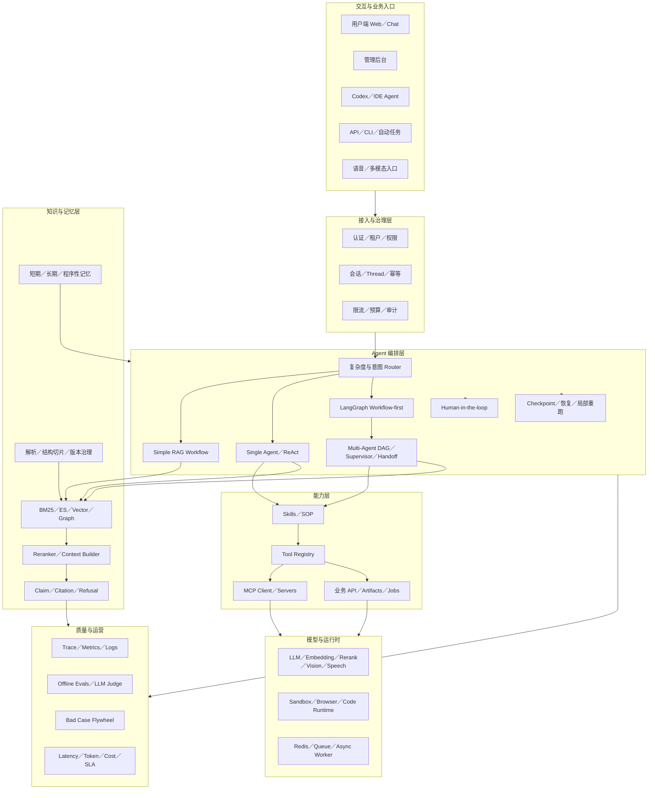

这张图面试时按四句话讲：

1. 入口统一经过身份、租户、预算和审计。
2. Router 根据复杂度选择 Simple、单 Agent、LangGraph 或多 Agent。
3. Agent 不直接碰业务系统，通过 Skill、Tool Registry 和 MCP 受控调用。
4. 知识证据、Checkpoint、人工审批和 Evals 是可靠性底座，不是后补功能。

## 三、核心选型决策树

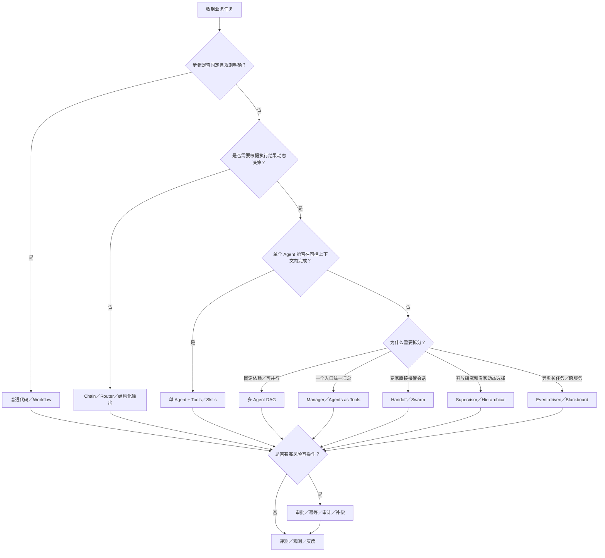

## 四、方案一：确定性 Workflow／Chain

### 架构图

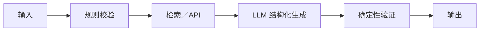

### 特点

流程由代码决定，LLM 只在某些节点完成分类、抽取或生成，不自主选择整个执行路径。

### 优点

- 可预测、易测试、延迟和成本稳定。
- 容易做权限、审计、回滚和 SLA。
- 错误定位清晰，适合高风险流程。

### 缺点

- 对开放任务和异常分支适应性弱。
- 流程变化时需要修改代码和图。
- 复杂分支过多会形成状态机维护成本。

### 适用场景

- 文档入库、审批、发布、支付、工单状态流转。
- Simple RAG、固定报表、结构化信息抽取。
- 测试门禁、数据校验、批处理任务。

### 伪代码

```ts
const input = InputSchema.parse(request);
const route = classifyByRules(input);
const evidence = await retriever.search(input.query, route.filters);
const output = await model
  .withStructuredOutput(ResultSchema)
  .invoke({ input, evidence });
assertBusinessRules(output);
return output;
```

### 面试结论

> 确定性问题不需要 Agent。能用规则和 Workflow 稳定解决时，让模型自由规划只会增加失败面。

## 五、方案二：Router／单次 Tool Calling Agent

### 架构图

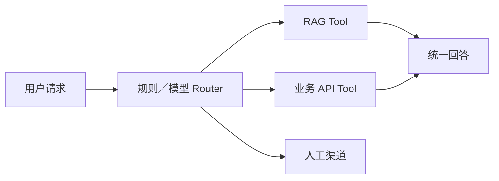

### 特点

模型或规则只负责从有限能力中选择一条路径，通常没有长循环。

### 优点

- 比完整 Agent 简单、快、便宜。
- Tool 选择和参数容易评测。
- 适合现有业务 API 的自然语言入口。

### 缺点

- 难以处理多步骤依赖和动态恢复。
- Router 分类错误会直接走错链路。
- 工具数量过多时 Schema 会占用大量上下文。

### 适用场景

- FAQ／知识库／订单／工单入口路由。
- 简单客服、办公助手、查询型 Copilot。
- Simple／Auto／Agentic 模式选择。

### 伪代码

```ts
const route = await router.invoke({ goal, routes: routeCards });
const handler = routeRegistry.get(route.name);
return handler.execute(route.arguments, context);
```

## 六、方案三：单 Agent ReAct

### 架构图

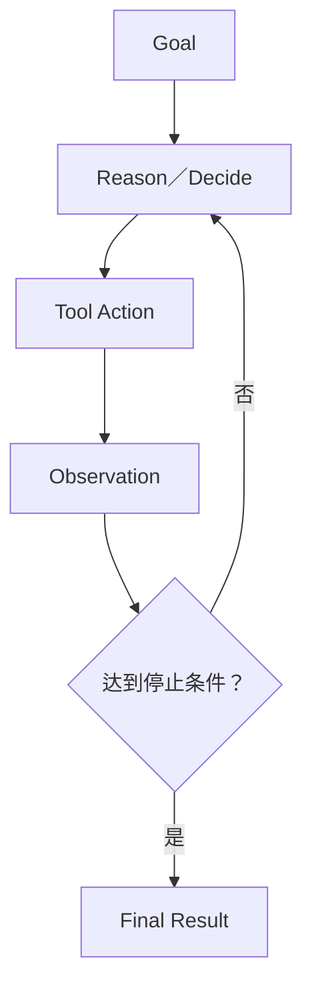

### 特点

Agent 根据每次 Tool Observation 动态决定下一步，适合路径未知的开放任务。

### 优点

- 灵活，能根据实时结果改变计划。
- 工具组合不需要预先枚举所有路径。
- 单 Agent 上下文和责任边界相对简单。

### 缺点

- 容易循环、重复调用和超预算。
- 轨迹、时延和结果稳定性低于 Workflow。
- 高风险写操作难以只靠 Prompt 控制。

### 适用场景

- 开放检索、故障诊断、轻量 Coding Agent。
- 需要边观察边探索，但单个上下文仍可承载的任务。
- 低风险、可回滚的工具操作。

### 伪代码

```ts
for (let step = 0; step < MAX_STEPS; step++) {
  const decision = await agent.decide(state);
  if (decision.type === "finish") return verify(decision.output);
  const result = await secureToolRuntime.execute(decision.tool, decision.args);
  state = reduce(state, decision, result);
  if (noProgress(state) || overBudget(state)) return handoffToHuman(state);
}
```

### 关键治理

- 最大步骤、时间、Token、费用和同 Tool 重复次数。
- 无新增证据／状态无变化时停止。
- Tool 白名单、参数 Schema、权限和幂等。
- Checkpoint、人工接管和真实业务结果断言。

## 七、方案四：Plan-and-Execute

### 架构图

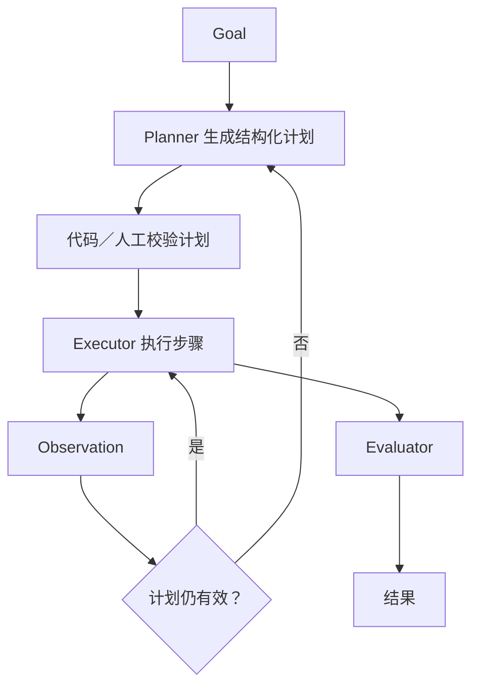

### 优点

- 长任务先显式规划，便于展示、审批和跟踪。
- Planner 与 Executor 可使用不同模型和权限。
- 可对计划做依赖、预算和危险动作检查。

### 缺点

- 初始计划可能因新信息快速过时。
- 规划本身增加一次模型调用和延迟。
- 重规划过多会退化成昂贵循环。

### 适用场景

- Deep Research、复杂数据分析、长 Coding 任务。
- 需要用户先确认计划的高价值任务。
- 任务可拆成结构化子任务但路径不是完全固定。

### 伪代码

```ts
let plan = await planner.createPlan(goal, constraints);
validatePlan(plan);

for (const step of topologicalOrder(plan)) {
  const result = await executor.run(step, state);
  state = update(state, result);
  if (materialAssumptionChanged(state)) {
    plan = await planner.replan(goal, state, remaining(plan));
  }
}

return evaluator.grade(state);
```

## 八、方案五：Workflow-first Agent／LangGraph

### 架构图

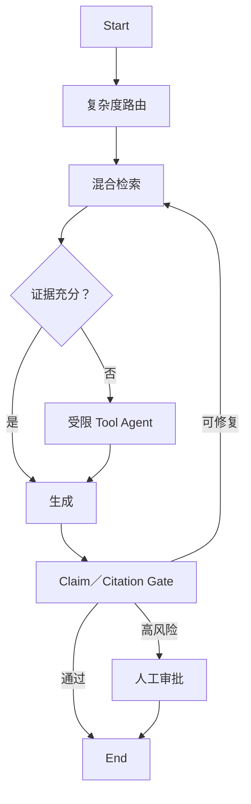

### 特点

控制流由显式图掌握，只在语义判断、工具选择等少量节点使用 Agent 能力。

### 优点

- 兼顾确定性和灵活性。
- State、条件边、Checkpoint、暂停恢复清晰。
- 适合审计、可观测、局部重跑和生产治理。

### 缺点

- 需要设计 State Schema 和图结构。
- 流程变化会增加图维护成本。
- 图设计过细会造成节点和状态膨胀。

### 适用场景

- 企业 RAG、业务 Copilot、产研协作、审批和发布。
- 多步骤但主流程相对稳定的生产应用。
- 对稳定性、证据、恢复和审计要求较高的场景。

### 推荐原因

这是当前企业 Agent 应用最常用、最务实的主流架构：代码负责可控性，LLM 负责不确定性。OpenAI 官方也区分 LLM 编排与代码编排，并指出代码编排在速度、成本和性能上更确定。

## 九、方案六：Manager／Agents as Tools

### 架构图

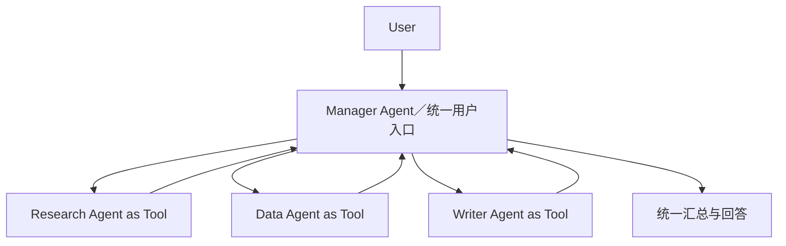

### 特点

Manager 保持对用户对话和最终答案的控制，专业 Agent 作为有边界的 Tool 完成子任务。

### 优点

- 用户只面对一个统一 Agent。
- Manager 可统一 Guardrail、风格、证据和汇总。
- 子 Agent 输入输出范围明确，易替换和评测。

### 缺点

- Manager 成为上下文、延迟和质量瓶颈。
- 所有结果回流 Manager，Token 成本可能较高。
- Manager 选错专家会影响全链路。

### 适用场景

- Deep Research、报告生成、企业统一助手。
- 一个入口需要调用多个专业分析能力。
- 专家只完成子任务，不应直接接管用户会话。

### 伪代码

```ts
const manager = createAgent({
  instructions: "统一理解目标、调用专家并汇总最终结果",
  tools: [
    researchAgent.asTool("research_expert"),
    dataAgent.asTool("data_expert"),
    writerAgent.asTool("writing_expert"),
  ],
});

return runner.run(manager, userGoal);
```

## 十、方案七：Handoff／Swarm

### 架构图

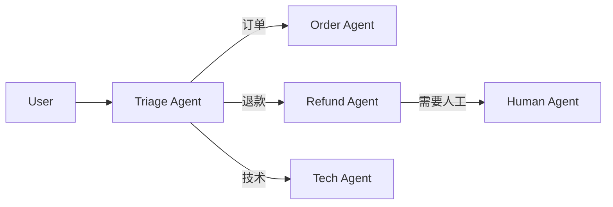

### 特点

当前 Agent 将控制权和必要上下文移交给另一个专家，专家直接成为用户当前对话方。

### 优点

- 专家 Prompt 和上下文聚焦。
- 专家可以直接与用户澄清，不需要 Manager 转述。
- 适合领域路由和长会话归属变化。

### 缺点

- 容易来回 Handoff 或失去统一口径。
- 上下文过滤不好会丢信息或泄露多余信息。
- 全局 Guardrail、状态和用户体验更难统一。

### 适用场景

- 客服分流、医疗／法律专业分诊、企业服务台。
- 不同阶段由不同专家真正接管的长会话。
- 专家需要直接向用户追问的场景。

### 伪代码

```ts
const next = await triage.selectSpecialist(userMessage, specialistCards);
const handoffPayload = HandoffSchema.parse({
  goal,
  userSummary: summarizeConversation(messages),
  verifiedFacts,
  unresolvedQuestions,
});

return specialistRegistry.get(next).resume(handoffPayload);
```

### 关键治理

- 最大 Handoff 次数和禁止原路往返。
- Handoff Payload 使用 Schema，不直接倾倒全部历史。
- 明确当前 Owner、退出条件和人工接管。
- 每个 Agent 继续执行统一权限和安全策略。

## 十一、方案八：多 Agent DAG／Pipeline

### 架构图

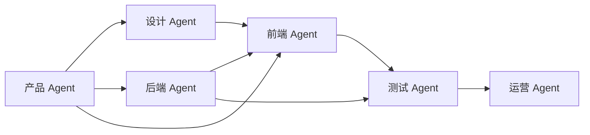

### 特点

角色和依赖由代码图明确表达；无依赖节点并行，有依赖节点等待；角色之间传版本化 Artifact。

### 优点

- 分工、依赖、并行和审批清晰。
- 适合 Checkpoint、失败恢复和局部重跑。
- 每个角色可独立配置 Tool、上下文和评测标准。

### 缺点

- 图和 Agent Contract 需要持续维护。
- 上游错误可能向下游传播。
- 角色过度拆分会产生协调成本和重复内容。

### 适用场景

- 产研协作、软件开发、内容生产审核、复杂报告流水线。
- 业务流程相对稳定，但各岗位需要专业模型能力。
- 有明确交付物、依赖和质量门禁的任务。

### 伪代码

```ts
for (const batch of topologicalBatches(agentDag)) {
  const ready = batch.filter((role) => dependenciesPassed(role, state));
  const results = await mapWithConcurrency(ready, MAX_PARALLEL, (role) =>
    runAgentWithContract(roleContracts[role], buildRoleInput(role, state)),
  );

  state = mergeVersionedArtifacts(state, results);
  state = await qualityGate.evaluate(state);
  await checkpointer.save(state);

  if (state.hasBlockingFailure) return handoffOrFail(state);
  if (state.requiresApproval) state = await waitForApproval(state);
}
```

## 十二、方案九：Supervisor／Hierarchical Multi-Agent

### 架构图

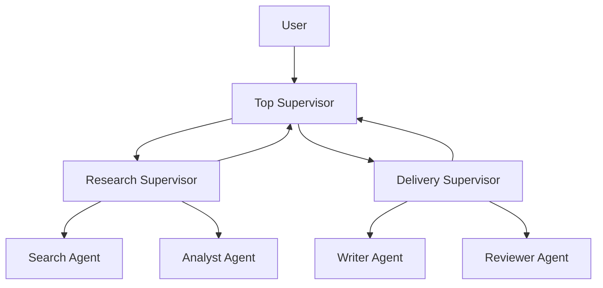

### 优点

- 能动态选择专家，适合开放且复杂的任务。
- 可按领域形成多层团队。
- 专家 Prompt、Tool 和上下文隔离。

### 缺点

- Supervisor 决策本身不稳定且增加调用。
- 层级越深，延迟、Token 和故障归因越难控制。
- 容易形成中心瓶颈或重复委派。

### 适用场景

- 大型 Deep Research、复杂咨询、跨领域分析。
- 专家集合较大，执行路径无法预先固定。
- 需要动态组队而不是固定岗位 DAG。

### 选择建议

固定流程不要用 Supervisor 替代代码路由。候选专家先按规则、权限和领域缩小，再让模型选择，减少错误和上下文成本。

## 十三、方案十：Group Chat／Debate／Critic

### 架构图

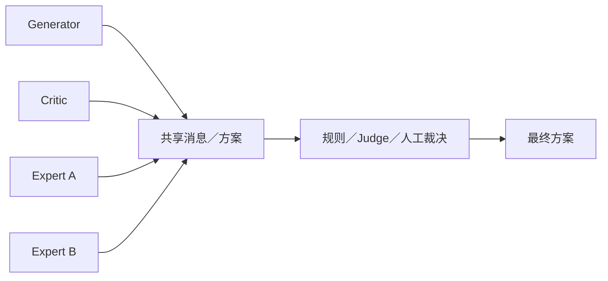

### 优点

- 可从不同专业角度发现遗漏和冲突。
- Generator＋Critic 对开放产物有一定质量收益。
- 适合需要方案比较和论证的高价值任务。

### 缺点

- 多个 Agent 可能共享同一模型偏差，只是重复表达。
- 全量群聊上下文膨胀快，成本和延迟高。
- 没有明确终止和裁决标准时容易空转。

### 适用场景

- 架构评审、风险评审、创意方案、复杂研究结论校验。
- 一次决策价值明显高于多次模型调用成本。

### 不适用

- 简单事实问答、固定审批、追求低延迟的在线请求。
- 没有可执行 Rubric，只让多个 Agent “互相讨论”。

## 十四、方案十一：Event-driven／Blackboard

### 架构图

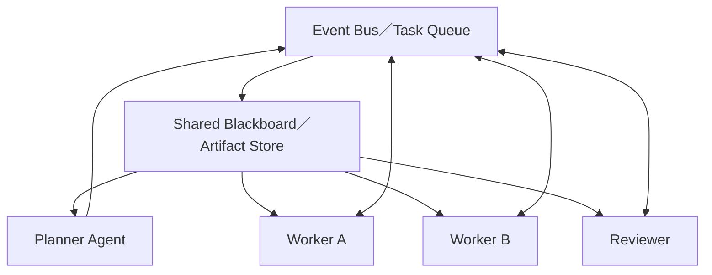

### 优点

- 支持异步长任务、弹性扩缩容和跨服务协作。
- Worker 可独立部署、失败重试和水平扩展。
- Artifact／Event 天然适合审计和恢复。

### 缺点

- 分布式一致性、重复消费和事件顺序复杂。
- 调试比单进程图困难。
- 最终一致性不适合强实时同步交互。

### 适用场景

- 大规模文档处理、批量评测、异步研究、跨系统任务。
- 一个任务可能持续数分钟到数小时。
- 不同 Agent／Worker 需要独立扩缩容。

### 关键治理

- At-least-once 消费下所有写操作必须幂等。
- Event 带 taskId、causationId、correlationId 和 schemaVersion。
- 使用 Outbox／Inbox、死信队列、补偿和超时扫描。
- Blackboard 只保存结构化事实和 Artifact，不保存无限聊天文本。

## 十五、主流业务场景推荐

| 业务场景         | 首选架构                              | 可选增强                     | 不推荐默认使用           |
| ---------------- | ------------------------------------- | ---------------------------- | ------------------------ |
| 企业知识库问答   | Simple RAG＋Workflow-first Agent      | GraphRAG、Web Search、HITL   | 自由多 Agent 群聊        |
| 客服助手         | Router＋单 Agent＋Handoff             | Manager、人工客服            | 所有专家共享全量上下文   |
| Coding Agent     | Plan-and-Execute＋Tools＋Sandbox      | Coder／Reviewer／Tester DAG  | 无沙箱的自由 Shell Agent |
| Deep Research    | Manager＋专家 Agents as Tools         | Supervisor、Critic、并行搜索 | 固定单次 Chain           |
| 数据分析 Agent   | Planner＋SQL／Metric Tools＋Evaluator | 多专家 DAG                   | 直接暴露任意 SQL         |
| 内容生产         | Research→Writer→Critic Pipeline       | 并行创意、人工终审           | 无限 Debate              |
| 产研协作平台     | Workflow-first 多 Agent DAG           | 风险审批、局部重跑           | Handoff 群聊替代项目流程 |
| 审批／发布／支付 | 确定性 Workflow＋HITL                 | LLM 做分类和摘要             | 自治 ReAct 写操作        |
| 运维故障处理     | Router＋Runbook Workflow＋受限 Agent  | 专家 Handoff、Blackboard     | 无预算自动修复生产       |
| 实时语音 Agent   | 单 Agent＋低延迟 Tools                | 专家 Handoff                 | 多层 Supervisor          |
| 批量文档／评测   | Event-driven Workers                  | Agent 做异常分类             | 同步长连接处理全部任务   |

### 15.1 先分清：主流的是架构思想，不是某一个框架

LangGraph、OpenAI Agents SDK、AutoGen、Semantic Kernel 等是实现载体，不是架构本身。面试时不要回答“我们的架构是 LangGraph”，这相当于别人问后端架构，你只回答“NestJS”。正确表达应该包含四层：

1. **控制权放在哪里**：由代码、单个 LLM、Manager，还是多个 Agent 决定下一步。
2. **能力如何提供**：Tool、MCP、Skill、RAG、Memory 如何进入执行上下文。
3. **状态如何流转**：State、Artifact、Checkpoint、Handoff Payload 如何保存和传递。
4. **可靠性如何闭环**：停止条件、预算、证据门禁、人工审批、评测和观测如何生效。

当前企业应用中最常见的不是某一种纯架构，而是以下组合：

```text
确定性代码骨架
  + 局部模型判断
  + 受控工具执行
  + 显式状态与恢复
  + 风险门禁与评测
```

### 15.2 主流方案 A：Workflow-first＋局部 Agent

**一句话定义**：代码掌握主流程和业务状态，LLM 只处理分类、检索规划、工具选择、生成和评审等不确定节点。

**核心执行流**：

```text
请求校验
  -> 规则／模型路由
  -> 检索或业务节点
  -> 证据充分性判断
  -> 必要时进入受限 Agent 循环
  -> 结构化生成
  -> 规则／模型双重校验
  -> 审批或输出
```

**核心组件**：

- Typed State：保存目标、证据、预算、当前节点、错误和产物版本。
- Deterministic Edges：固定依赖、权限判断、风险分支和最终状态由代码决定。
- Agentic Nodes：仅在路径无法完全预知的位置允许模型动态决策。
- Checkpoint：节点完成后持久化，失败从最近成功节点恢复。
- Gate：对引用、Schema、权限、风险和业务成功状态做硬校验。

**为什么主流**：企业任务通常不是完全确定，也不是完全开放。此方案把模型的语义能力留在真正需要它的位置，同时让速度、成本、权限、恢复和审计仍然可控。

**适用信号**：主流程稳定、分支有限；任务跨多个步骤；有外部副作用；需要暂停恢复、局部重跑或人工审批。

**不适用信号**：一次模型调用已经能稳定完成；步骤完全固定且不需要语义判断；或者任务开放到无法提前定义主要状态。

**生产必备**：State Schema 版本、节点幂等键、超时与重试策略、Checkpoint、补偿动作、风险分级、逐节点 Trace 和离线 Evals。

**面试表达**：

> 企业 Agent 的默认解不是完全自治，而是 Workflow-first。代码控制状态、依赖和风险，模型只控制局部不确定性。这样既保留 Agent 根据 Observation 调整动作的能力，又能对每个节点做恢复、评测和审计。

### 15.3 主流方案 B：单 Agent＋Tools／MCP／Skills

**一句话定义**：一个 Agent 保持任务所有权，根据目标和 Observation 在受控循环中选择能力；Tool 负责执行，MCP 负责标准化接入，Skill 负责按需加载方法和知识。

**核心执行流**：

```text
Goal + Context
  -> Agent 选择 Skill／Tool
  -> Function Call 生成结构化参数
  -> Tool Runtime 做权限与参数校验
  -> MCP／本地函数／业务 API 执行
  -> Observation 回写 State
  -> 完成、继续、降级或转人工
```

**核心组件**：

- Agent Loop：`decide -> act -> observe -> update -> stop`。
- Tool Registry：工具描述、Schema、权限、超时、幂等和风险级别统一注册。
- MCP Client：发现和调用外部 MCP Server 暴露的 tools、resources、prompts。
- Skill Loader：只把当前任务需要的 SOP、示例和工具说明加载进上下文。
- Stop Controller：限制步骤、时间、Token、费用、重复调用和无进展次数。

**为什么主流**：中等复杂度任务不需要多 Agent。一个 Owner 可以减少上下文转交、协调 Token 和故障面，又能组合企业内部工具完成动态任务。

**适用信号**：任务路径要根据执行结果变化；一个上下文可以容纳任务；工具和权限不需要按角色强隔离；最终答案应保持统一口径。

**不适用信号**：固定流程可以直接编码；工具过多导致选择准确率明显下降；上下文已经被多个专业领域挤满；存在可观的并行收益或独立交付物。

**生产必备**：工具动态检索而非全量注入、最小权限、参数 Schema、执行前确认、副作用幂等、循环检测、结果裁剪、Sandbox 和逐 Tool 评测。

**面试表达**：

> Function Calling 是模型表达调用意图，Tool 是可执行能力，MCP 是能力接入协议，Skill 是可按需加载的方法包。单 Agent 负责决策，但真正执行必须经过 Tool Runtime 的权限、Schema、预算和审计门禁。

### 15.4 主流方案 C：Manager／Subagents as Tools

**一句话定义**：Manager 始终拥有用户会话和最终答案，专业 Agent 以 Tool 形式接受边界明确的子任务，完成后把结构化结果交回 Manager。

**核心执行流**：

```text
用户目标
  -> Manager 拆解和选择专家
  -> Research／Data／Writer 等 Subagent
  -> Subagent 返回 Evidence + Result + Limitations
  -> Manager 去重、解决冲突并汇总
  -> 最终校验和回答
```

**核心组件**：Manager Policy、Subagent Card、结构化 Task Contract、独立上下文和 Tool 白名单、结果聚合器、冲突处理规则。

**为什么使用**：它用一次统一入口换取专业上下文隔离。专家不需要看到整段用户历史，Manager 可以统一风格、证据和 Guardrail。

**适用信号**：一个入口要调用多个专家；专家只完成子任务，不应直接与用户长期对话；需要并行研究后统一汇总。

**不适用信号**：专家需要持续追问用户；Manager 会成为明显的 Token、延迟或信息压缩瓶颈；专家之间依赖关系本来就是固定 DAG。

**生产必备**：Subagent 输入最小化、结构化返回、并发上限、结果去重、证据回传、冲突仲裁、Manager 失败降级和总预算分配。

**面试表达**：

> Manager 模式的关键不是“多个 Prompt”，而是控制权不转移。专家是有独立上下文和工具边界的能力单元，Manager 负责拆解、汇总和最终责任。

### 15.5 主流方案 D：Router＋Handoff

**一句话定义**：Router／Triage 判断领域后，把当前会话所有权和经过裁剪的上下文交给专家；专家直接继续与用户交互。

**核心执行流**：

```text
用户请求
  -> 规则优先、模型补充的 Triage
  -> 生成 Handoff Payload
  -> 专家接管会话
  -> 专家调用领域工具／继续追问
  -> 完成、转其他专家或人工
```

**核心组件**：路由标签、专家能力描述、Handoff Schema、上下文过滤器、当前 Owner、最大转交次数和人工兜底。

**为什么使用**：当专业 Agent 必须直接理解后续追问并持续服务用户时，Handoff 比 Manager 反复转述更自然，重复轮次的调用开销也更低。

**适用信号**：客服、工单、企业服务台等领域边界清楚；专家需要直接追问；会话会在同一领域持续多轮。

**不适用信号**：所有专家结果必须统一汇总；任务主要是后台并行计算；领域分类不稳定且错误转交代价很高。

**生产必备**：置信度阈值、低置信度澄清、禁止来回转交、Payload Schema、敏感上下文过滤、Owner 记录、全局策略在每个专家重复执行。

**面试表达**：

> Manager 是“专家帮我做，结果回到我”；Handoff 是“这件事归专家，控制权也交给他”。选择依据不是 Agent 数量，而是用户会话的 Owner 是否需要变化。

### 15.6 主流方案 E：多 Agent DAG／Pipeline

**一句话定义**：代码显式声明角色依赖和并行关系，每个 Agent 围绕独立交付物工作，通过版本化 Artifact 而不是无限聊天协作。

**核心执行流**：

```text
任务建模
  -> 拓扑排序
  -> 同批无依赖角色并行
  -> Artifact Schema 校验
  -> 下游消费指定版本
  -> 质量门禁／局部重跑
  -> 高风险节点审批
  -> 汇总交付
```

**核心组件**：DAG、Agent Contract、Artifact Store、Dependency Gate、并行调度、Checkpoint、局部重跑、版本和血缘。

**为什么使用**：已知流程中的角色分工、依赖和并行可以由代码精确表达，避免 Supervisor 每一步都花一次模型调用猜下一位执行者。

**适用信号**：专业角色有独立 Tool、上下文、交付物和验收标准；依赖关系大体稳定；失败需要只重跑局部；并行能明显降低总时延。

**不适用信号**：角色只是不同 Prompt，没有真正隔离；任务很短；依赖完全开放；协调成本高于专业化收益。

**生产必备**：Artifact 版本、Schema 和血缘，上游失败传播规则，fan-out／fan-in 并发控制，局部重跑影响分析，角色级成功率和协调开销评测。

**面试表达**：

> 多 Agent DAG 不是让六个 Agent 自由聊天，而是把组织协作建模成可恢复的执行图。角色通过结构化 Artifact 交接，代码控制依赖和并行，模型负责各节点的专业判断。

### 15.7 六个可组合的执行原语

主流系统通常把下面原语组合起来，而不是强行选择一种大而全框架：

| 执行原语             | 核心机制                                    | 适合场景                             | 主要代价                   |
| -------------------- | ------------------------------------------- | ------------------------------------ | -------------------------- |
| Prompt Chaining      | 前一步结构化输出作为后一步输入，中间加 Gate | 固定分解、逐步提高质量               | 串行延迟                   |
| Routing              | 规则或模型分类后进入专业链路                | 输入类别清楚、模型或工具需要分层     | 错路由会放大下游错误       |
| Parallelization      | 独立子任务并发或同题多次投票                | 降低总时延、获得多视角               | 聚合和冲突处理             |
| Orchestrator-Workers | 中央模型动态拆解未知子任务并汇总            | Coding、Deep Research 等开放复杂任务 | Manager 成本和拆解稳定性   |
| Evaluator-Optimizer  | 生成者和评审者按明确标准迭代                | 翻译、内容、代码、研究结论精修       | 可能循环，必须限制轮次     |
| Agent Loop           | 模型根据环境反馈动态选择下一步              | 无法预先编码路径的开放任务           | 成本、累积错误和不确定轨迹 |

组合示例：

- 企业 RAG：`Routing -> Parallel Hybrid Retrieval -> Rerank -> Evaluator Gate -> Answer`。
- Coding Agent：`Planner／Orchestrator -> Parallel Workers -> Tests as Ground Truth -> Evaluator`。
- 客服：`Router -> Handoff -> Domain Agent Loop -> Risk Approval`。
- 产研协作：`DAG -> Parallel Roles -> Artifact Gate -> QA Evaluator -> Human Approval`。

### 15.8 从单 Agent 升级到多 Agent 的硬门槛

至少满足以下一项，并用同一评测集证明收益，才值得升级：

1. **上下文隔离收益**：单 Agent 因工具或知识过多而明显选错，多 Agent 后准确率提升。
2. **专业化收益**：不同角色确实拥有独立 Prompt、数据、Tool、权限和验收标准。
3. **并行收益**：独立子任务并发后，P95 明显下降且聚合错误可控。
4. **组织边界收益**：不同团队需要独立开发、发布和评测能力单元。
5. **控制权收益**：业务确实需要 Manager 统一负责，或需要专家 Handoff 后直接接管。

不能证明以上收益时，优先保留单 Agent＋动态 Tools／Skills。多 Agent 不是能力倍增器，它首先会增加模型调用、上下文复制、协调成本和故障面。

## 十六、方案横向对比

评分：1 表示较弱／较低，5 表示较强／较高。成本和复杂度分数越高，代价越大。

| 方案                     | 灵活性 | 可预测性 | 低延迟 | 易评测 | 恢复能力 | 成本 | 工程复杂度 |
| ------------------------ | -----: | -------: | -----: | -----: | -------: | ---: | ---------: |
| Workflow／Chain          |      1 |        5 |      5 |      5 |        4 |    1 |          2 |
| Router／单次 Tool        |      2 |        4 |      4 |      4 |        3 |    2 |          2 |
| Single ReAct             |      4 |        2 |      3 |      2 |        2 |    3 |          3 |
| Plan-and-Execute         |      4 |        3 |      2 |      3 |        3 |    4 |          3 |
| Workflow-first Agent     |      4 |        5 |      3 |      5 |        5 |    3 |          4 |
| Manager／Agents as Tools |      4 |        3 |      2 |      3 |        3 |    4 |          4 |
| Handoff／Swarm           |      4 |        2 |      3 |      2 |        3 |    4 |          4 |
| Multi-Agent DAG          |      4 |        5 |      3 |      5 |        5 |    4 |          5 |
| Supervisor／Hierarchy    |      5 |        2 |      1 |      2 |        3 |    5 |          5 |
| Group Chat／Debate       |      5 |        1 |      1 |      2 |        2 |    5 |          4 |
| Event-driven／Blackboard |      4 |        4 |      1 |      4 |        5 |    4 |          5 |

## 十七、如何做正确选型

### 17.1 先问七个问题

1. 业务成功状态能否被代码验证？
2. 路径是否固定，还是必须根据 Observation 动态变化？
3. Tool 是否有副作用，错误能否回滚？
4. 单 Agent 的上下文、权限和能力是否已经足够？
5. 多角色是否有独立交付物和评测标准？
6. 时延、成本、稳定性和人工等待上限是多少？
7. 失败后要重试、降级、恢复、补偿还是转人工？

### 17.2 选型伪代码

```ts
function selectArchitecture(task: TaskProfile): Architecture {
  if (task.fixedSteps && task.rulesAreDeterministic) {
    return task.highRiskWrite ? "workflow-with-human-approval" : "workflow";
  }

  if (!task.needsIterativeObservation) {
    return "router-or-structured-chain";
  }

  if (task.fitsSingleContext && !task.requiresRoleIsolation) {
    return task.mainFlowStable
      ? "workflow-first-single-agent"
      : "single-react-agent";
  }

  if (task.dependenciesKnown) return "multi-agent-dag";
  if (task.singleUserFacingOwner) return "manager-agents-as-tools";
  if (task.specialistShouldTakeOver) return "handoff";
  if (task.openEndedExpertSelection) return "supervisor";
  if (task.longRunningAndDistributed) return "event-driven-blackboard";

  return "single-agent-baseline";
}
```

### 17.3 决策必须有数据

同一真实评测集比较：

- Task success、evidence coverage、citation accuracy。
- Tool／handoff／dependency accuracy。
- P50／P95、Token、cost per successful task。
- Loop、fallback、human handoff、rework rate。
- 多 Agent coordination overhead 和 parallel efficiency。

多 Agent 只有在成功率、质量、上下文隔离或并行收益明显超过单 Agent Baseline 时才保留。

## 十八、本项目为什么这样选

### 项目架构图

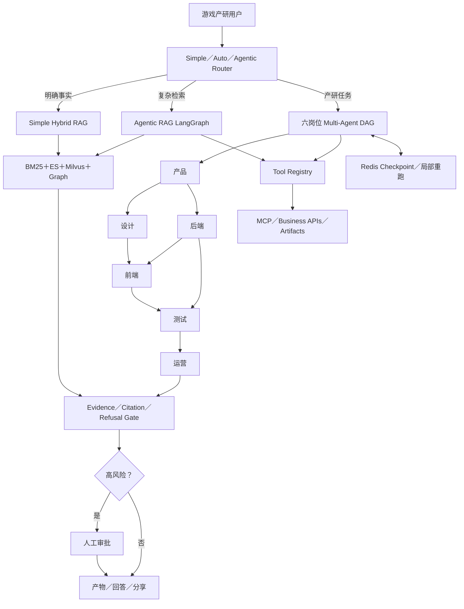

### 方案对比

| 候选方案                 | 为什么没有作为主方案                     |
| ------------------------ | ---------------------------------------- |
| 所有问题都走 ReAct       | 简单问题延迟、成本和失败概率没有必要增加 |
| 六岗位自由 Group Chat    | 依赖、责任、版本、终止和审批不可控       |
| 全部 Supervisor 动态路由 | 六岗位顺序本来就较稳定，模型路由收益不足 |
| 单 Agent 承担六岗位      | 上下文混杂、交付标准和 Tool 权限难隔离   |
| 纯固定 Workflow          | 对复杂检索、证据不足和工具异常适应性不够 |

### 最终选择

- 普通问答走 Simple Fast Path。
- 复杂问题进入 Agentic RAG 状态机。
- 六岗位使用显式 DAG，设计和后端并行。
- 每个角色有独立 Tool 白名单、结构化产物和证据门禁。
- 重要任务按风险审批，不强制逐步审批。
- Redis Checkpoint 支持跨进程恢复和局部重跑。
- Qwen 模型成功、工作流完成和降级分别统计。

### 效果怎么讲

> 这套选择的核心不是追求自治，而是把确定性和模型能力放在合适位置。六岗位完整真实回放修复超时后连续三次共 18／18 模型调用成功、0 降级；设计和后端保持并行。业务证据覆盖、审批就绪和真实用户价值仍作为独立指标，不用工作流成功冒充业务质量。

## 十九、常见架构错误

1. 没有 Baseline 就直接做多 Agent。
2. 把不同 System Prompt 当成真实角色边界。
3. 用群聊代替 Workflow、状态机和项目管理。
4. 把全量消息广播给所有 Agent，造成上下文污染。
5. 只看最终答案，不评 Tool、轨迹、依赖和业务状态。
6. 没有停止条件、预算、Checkpoint 和人工接管。
7. 高风险写操作只靠 Prompt 限制。
8. Supervisor 和 Worker 使用相同上下文、模型、Tool，却没有专业化收益。
9. MCP、Skill、Agent、Workflow 概念混在一起。
10. 用 HTTP 200 或“最终生成了文字”作为任务成功。

## 二十、面试回答模板

### 30 秒版本

> Agent 架构我不会直接上多 Agent，而是按任务确定性选型。固定流程用 Workflow，动态工具决策用单 Agent，主流程稳定但局部需要模型判断时用 Workflow-first；只有角色存在独立知识、上下文、权限、交付物或并行收益时才拆多 Agent。生产上无论哪种方案都要有显式 State、预算、停止条件、Checkpoint、权限、人工审批和 Evals。

### 两分钟版本

> 我先把业务拆成确定性和不确定性两部分。确定性的状态流转、审批和写操作交给代码；语义理解、复杂检索、规划和工具选择交给模型。单 Agent 已经能完成时不会拆团队，因为多 Agent 会增加协调 Token、延迟和故障面。
>
> 常见多 Agent 方案里，Manager 适合一个入口统一汇总多个专家；Handoff 适合客服分诊后专家直接接管；DAG 适合依赖已知的产研协作；Supervisor 适合开放任务动态选专家；事件驱动适合异步长任务。本项目六岗位依赖明确，所以选 LangGraph 风格的 Workflow-first DAG，而不是自由群聊。角色通过版本化 Artifact 和 Agent Contract 协作，关键失败阻塞下游，Checkpoint 支持恢复和局部重跑，高风险动作才审批。最后用真实任务成功、证据覆盖、P95、成本和协调开销与单 Agent Baseline 比较。

### 追问“哪个最主流”

> 企业落地最主流、最稳妥的是 Workflow-first＋局部 Agent；中等复杂度应用常用单 Agent＋Tools／MCP／Skills；Manager、Handoff 和多 Agent DAG 用在专业角色和协作收益明确的场景。不是所有业务都应该做成 Supervisor 或 Swarm。

## 二十一、本项目代码对应

| 架构能力                     | 项目入口                                                                                           |
| ---------------------------- | -------------------------------------------------------------------------------------------------- |
| Simple／Auto／Agentic Router | `backend/src/modules/chat/chat.service.ts`                                                         |
| Agentic RAG StateGraph       | `backend/src/rag/agentic/agentic-rag.service.ts`                                                   |
| Supervisor                   | `backend/src/modules/supervisor/supervisor.service.ts`                                             |
| 专家 Agent Pipeline          | `backend/src/rag/agents/agent-pipeline.service.ts`                                                 |
| Agent Contract               | `backend/src/rag/agents/agent.interface.ts`                                                        |
| 六岗位 DAG Plan              | `backend/src/modules/workflow/production-workflow.plan.ts`                                         |
| 六岗位 State                 | `backend/src/modules/workflow/production-workflow.state.ts`                                        |
| 六岗位执行与恢复             | `backend/src/modules/workflow/production-workflow.service.ts`                                      |
| 六岗位 Tool 白名单           | `backend/src/modules/workflow/production-workflow.tools.ts`                                        |
| Tool Registry                | `backend/src/tools/tool-registry.ts`                                                               |
| MCP Server                   | `tools/rag-mcp-server/src/server.ts`                                                               |
| Agent Evals                  | `backend/src/modules/agent-evals/agent-eval.service.ts`                                            |
| Metrics／Trace               | `backend/src/modules/metrics/metrics.service.ts`、`backend/src/modules/tracing/tracing.service.ts` |

## 二十二、主流框架共识与官方资料

### 22.1 不打开链接也必须掌握的核心结论

| 官方体系             | 核心内容                                                                                                             | 对选型的直接影响                                           |
| -------------------- | -------------------------------------------------------------------------------------------------------------------- | ---------------------------------------------------------- |
| OpenAI Agents SDK    | 编排分为 LLM 决策和代码编排，两者可以混用；常见多 Agent 模式是 Agents as Tools 与 Handoffs                           | 要先决定会话控制权是否转移，再选 Manager 或 Handoff        |
| Anthropic            | 区分固定代码路径的 Workflow 与模型动态控制过程的 Agent；先从简单可组合模式开始，只在有收益时加复杂度                 | 固定问题优先 Chain／Router，开放问题才使用 Agent Loop      |
| LangChain／LangGraph | 多 Agent 的主要价值是上下文管理、分布式开发和并行；核心模式包括 Subagents、Handoffs、Skills、Router、Custom Workflow | 多 Agent 的本质是 Context Engineering，不是多写几个 Prompt |
| Microsoft AutoGen    | Team 包含 RoundRobin、SelectorGroupChat、Swarm 等形态，同时明确简单任务应先优化单 Agent                              | Group Chat／Swarm 是特定协作模式，不应作为企业默认架构     |

### 22.2 四家资料共同收敛出的工程原则

1. **先简单后复杂**：Prompt＋RAG 或单 Agent 已经能解决时，不为了“高级”升级多 Agent。
2. **代码和模型混合编排**：确定性依赖、权限和风险交给代码；语义判断和开放规划交给模型。
3. **Manager 与 Handoff 不能混淆**：前者保留控制权并汇总，后者转移控制权让专家接管。
4. **多 Agent 首先解决上下文问题**：工具过多、专业知识过深、权限不同或需要并行时才拆分。
5. **环境反馈必须是真实信号**：Tool 结果、测试、检索证据和业务状态是 Agent 判断进度的 Ground Truth。
6. **循环必须可停止**：完成条件、最大轮次、超时、预算、无进展检测和人工接管至少具备一套。
7. **框架不能代替架构**：即使使用 SDK，也必须显式设计 State、Context、Tool Contract、Error Policy 和 Eval。
8. **复杂度必须由数据偿还**：用任务成功率、P95、成本、协调开销和失败恢复能力与简单 Baseline 比较。

### 22.3 面试时如何评价主流框架

> 我不会按框架品牌选架构，而是先确定控制权、上下文边界和任务拓扑。LangGraph 更适合显式 State、条件边、Checkpoint 和确定性／Agent 混合工作流；OpenAI Agents SDK 的 Manager 与 Handoff 原语适合快速实现统一入口或专家接管；AutoGen 的 Team／Group Chat 适合研究动态协作，但生产上必须额外约束共享上下文、终止和状态。框架只是实现工具，最终仍用同一评测集比较成功率、延迟、成本和可恢复性。

### 22.4 官方资料入口

- [OpenAI Agents SDK：Agent orchestration](https://openai.github.io/openai-agents-python/multi_agent/)
- [OpenAI Agents SDK：Agents](https://openai.github.io/openai-agents-python/agents/)
- [OpenAI Agents SDK：Handoffs](https://openai.github.io/openai-agents-python/handoffs/)
- [Anthropic：Building effective agents](https://www.anthropic.com/engineering/building-effective-agents)
- [LangChain：Multi-agent patterns](https://docs.langchain.com/oss/javascript/langchain/multi-agent)
- [LangGraph.js Multi-Agent Supervisor](https://langchain-ai.github.io/langgraphjs/reference/modules/langgraph-supervisor.html)
- [Microsoft AutoGen：Teams](https://microsoft.github.io/autogen/stable/user-guide/agentchat-user-guide/tutorial/teams.html)
- [Microsoft AutoGen：Selector Group Chat](https://microsoft.github.io/autogen/stable/user-guide/agentchat-user-guide/selector-group-chat.html)
