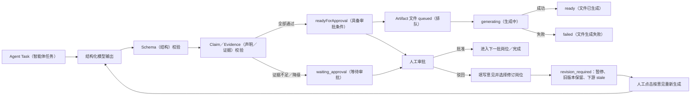

# Agent Task Artifact 结构、验收与驳回重跑

> 用途：说明 Artifact（结构化产物）长什么样、数据如何组织、系统怎样验收，以及 Agent Task（智能体任务）被驳回后在哪里填写修改意见并重新运行。
>
> 口径：本文按当前仓库真实实现整理。`readyForApproval`（具备审批条件）不等于“人工已经批准”，`ready`（文件已生成）也不等于“业务内容已验收”。

## 一、术语说明

| 英文术语 | 中文含义 |
|---|---|
| Artifact（结构化产物） | Agent 在某个阶段形成的可传递、可审计结果 |
| Agent Task（智能体任务） | 分配给某个 Agent／岗位执行的任务记录 |
| Chat Agentic（问答智能体模式） | 为复杂问答生成诊断产物的状态机 |
| Task Agentic（任务智能体模式） | 按岗位依赖生成业务交付物的状态机 |
| Schema（数据结构约束） | 字段、类型、长度和必填规则 |
| Deliverable（交付内容） | Artifact 中面向人阅读的 Markdown 内容 |
| Claim（事实声明） | 交付内容中的业务结论或事实判断 |
| Evidence（证据） | 支撑 Claim 的知识片段及来源信息 |
| Evidence Coverage（证据覆盖率） | 已有有效证据的 Claim 数量占全部 Claim 的比例 |
| readyForApproval（具备审批条件） | 已通过自动结构与证据门禁，可进入人工审批 |
| pending_confirmation（待人工确认） | 当前声明缺乏有效证据，不能按确定事实流转 |
| generated_artifacts（生成型产物表） | 保存文件产物元数据、状态和存储位置的 PostgreSQL 表 |
| Checkpoint（检查点） | Redis 中用于中断恢复的工作流状态快照 |

## 二、Artifact 到底是什么样子

当前项目有三层 Artifact，不应把它们混成一种文件。

### 2.1 Chat Agentic 诊断 Artifact

用于解释复杂问答为什么这样拆分、用了哪些证据、答案是否满足契约。基础结构为：

```json
{
  "id": "answer_contract:时间戳:随机串",
  "type": "answer_contract",
  "version": 1,
  "producer": "生成该产物的节点",
  "createdAt": "ISO 时间",
  "payload": {}
}
```

主要类型：

| type（类型） | 中文含义 | 主要内容 |
|---|---|---|
| `subquestion_plan`（子问题计划） | 问题拆解方案 | 子问题、前置依赖、检索次数、证据 ID、充分性 |
| `evidence_bundle`（证据包） | 本次问答证据集合 | Chunk、来源文档、相关性和覆盖关系 |
| `answer_contract`（答案契约） | 最终答案验收结果 | 答案、引用是否支撑、子问题覆盖率、是否有效、原因 |

它们随 LangGraph（状态图编排框架）状态进入 Redis Checkpoint（检查点），同时可持久化到 `agentic_structured_artifacts`（智能体结构化产物表），供运行详情和 Artifact 审计查看。

### 2.2 Task Agentic 岗位 Artifact

每个产品、设计、前端、后端、测试、运营岗位输出一个 `ProductionStageResult`（生产阶段结果），结构如下：

```json
{
  "role": "backend",
  "summary": "本岗位结论摘要",
  "deliverables": [
    {
      "type": "review",
      "title": "后端方案审查",
      "markdown": "# 完整 Markdown 交付内容"
    }
  ],
  "claims": [
    {
      "statement": "奖励领取接口必须支持幂等",
      "evidenceIds": ["chunk-id"],
      "status": "supported"
    },
    {
      "statement": "真实错误码尚未提供",
      "evidenceIds": [],
      "status": "pending_confirmation"
    }
  ],
  "evidence": [
    {
      "id": "chunk-id",
      "docId": "document-id",
      "chunkIndex": 3,
      "excerpt": "证据摘要",
      "totalScore": 0.83,
      "headingPath": ["接口规范", "奖励领取"],
      "docVersion": "v2"
    }
  ],
  "evidenceCoverage": 0.5,
  "issues": ["真实错误码待确认"],
  "downstreamRisks": ["前端不能按未确认错误码开发"],
  "riskLevel": "high",
  "toolExecutions": [
    {
      "tool": "rag.search",
      "status": "success",
      "durationMs": 320,
      "evidenceCount": 4
    }
  ],
  "generatedArtifact": {
    "id": "artifact-id",
    "title": "活动-backend-交付物",
    "kind": "markdown",
    "status": "queued"
  },
  "readyForApproval": false,
  "completedAt": "ISO 时间"
}
```

关键关系：

```text
Task（岗位任务）
  → ProductionStageResult（结构化阶段结果）
  → Deliverable（人可阅读的 Markdown）
  → Claim ↔ Evidence（事实与证据绑定）
  → Generated Artifact（可下载文件）
  → 人工审批后继续下游岗位
```

### 2.3 文件型 Artifact

岗位 Deliverable 会提交给 Artifact 服务，异步生成文件。PostgreSQL 的 `generated_artifacts` 保存：

| 字段 | 含义 |
|---|---|
| `id` | 文件产物 ID |
| `ownerUserId` | 所有者，用于权限隔离 |
| `threadId` | 所属工作流／会话 |
| `title` | 产物标题 |
| `kind` | `markdown`、`word`、`excel`、`architecture` 或 `image` |
| `status` | `queued`（排队中）→ `generating`（生成中）→ `ready`（已生成）／`failed`（失败） |
| `filename` | 下载文件名 |
| `sourceText` | 生成文件的原始内容 |
| `objectKey／storageUrl` | 对象存储定位信息 |
| `contentType／size` | 文件类型和大小 |
| `metadata` | 文件生成附加信息 |
| `errorMessage` | 生成失败原因 |

只有状态为 `ready`（已生成）的文件才能下载或创建分享链接。文件 `ready` 仅证明文件生成成功，不代表业务内容已通过审批。

## 三、系统内置的 Artifact 类型

除三类诊断产物外，Chat Agentic 还可以生成以下结构化交付初稿：

| 类型 | 中文说明 | 验收重点 |
|---|---|---|
| `requirement_brief`（需求简报） | 目标、用户、交付物、成功标准、开放问题 | 范围和待确认项是否完整 |
| `assumption_register`（假设登记表） | 活动、地区、接口等假设 | 假设是否显式标记待确认 |
| `claim_evidence_matrix`（声明证据矩阵） | Claim 与 Evidence 的映射 | 事实是否有合法证据 ID |
| `solution_brief`（方案简报） | 页面、流程、地区适配和方案摘要 | 是否覆盖问题且不编造事实 |
| `api_contract`（接口契约） | 接口职责、幂等和错误处理 | 真实路径、字段、鉴权是否确认 |
| `event_tracking_plan`（埋点计划） | 事件、字段、漏斗和校验 | 命名、触发时机和去重是否清楚 |
| `test_plan`（测试计划） | 功能、权限、地区、兼容、性能和异常用例 | 是否覆盖主路径与边界 |
| `acceptance_checklist`（验收清单） | 页面、接口、埋点、地区和版本检查项 | 每项是否可执行、可判定 |
| `risk_register`（风险登记表） | 风险、级别和缓解方案 | 高风险是否有负责人和措施 |
| `rollout_plan`（发布计划） | 测试、灰度、全量和回滚 | 门禁、监控和回滚路径是否完整 |
| `code_context_pack`（编码上下文包） | 给 Codex 等工具的受控编码上下文 | 证据、约束和验证命令是否齐全 |

## 四、Artifact 验收标准

### 4.1 结构验收

Task Agentic 的岗位结果先通过 Zod（TypeScript 数据校验库）Schema：

| 字段 | 当前约束 |
|---|---|
| `summary` | 必填，1～4,000 字符 |
| `deliverables` | 1～4 个；每个包含 type、title 和 20～30,000 字符的 Markdown |
| `claims` | 最多 20 条 |
| `evidenceIds` | 每条 Claim 最多 8 个 |
| `issues` | 最多 12 条 |
| `downstreamRisks` | 最多 12 条 |
| `riskLevel` | 只能是 low（低）、medium（中）、high（高） |
| `readyForApproval` | 必须为布尔值 |

结构不合法时模型最多尝试两次；仍失败则生成降级交付物，状态进入 `waiting_approval`（等待审批），不能静默当成正常结果。

### 4.2 证据验收

1. `supported`（已有证据支撑）的 Claim 必须引用本轮实际召回的 Evidence ID。
2. 引用了不存在或越界的 Evidence ID，系统会移除该 ID，并把声明改为 `pending_confirmation`（待人工确认）。
3. 没有证据的业务规则、概率、预算、活动时间、接口字段和错误码不能写成确定事实。
4. `evidenceCoverage` 按“有证据支撑的 Claim 数量 ÷ Claim 总数”计算。
5. 有待确认 Claim 时，前端显示“事实声明缺少有效证据”的警告。

### 4.3 自动通过条件

岗位结果只有同时满足以下条件，`readyForApproval` 才会保持为 true（具备审批条件）：

- 模型输出本身声明可审批；
- 至少生成一个 Deliverable；
- 所有 Claim 都是 `supported`，没有 `pending_confirmation`。

即使自动门禁通过，以下策略仍可强制人工审批：

- 工作流选择 `required`（每批必审）；
- 当前岗位被加入 `approvalRoles`（指定审批岗位）；
- `risk_based`（按风险审批）模式下，风险达到配置阈值。

### 4.4 岗位内容验收

| 岗位 | 必查内容 |
|---|---|
| 产品 | 目标、范围、规则、边界、地区版本、验收口径 |
| 设计 | 页面状态、交互闭环、尺寸、多语言、设计交付物 |
| 前端 | 组件、接口依赖、状态、埋点、性能、异常降级 |
| 后端 | 领域模型、接口、幂等、并发、资格、奖励、可观测 |
| 测试 | 测试范围、前置条件、输入输出、边界、兼容、回归门禁 |
| 运营 | 发布、配置、灰度、监控、应急、客服口径、复盘指标 |

### 4.5 文件和代码验收

- 普通文件必须完成生成并进入 `ready`，否则不能下载或分享。
- 生成 React 项目时必须包含 `package.json`、`index.html`、`src/main.tsx／jsx`。
- `package.json` 必须是合法 JSON，并含 `dev` 和 `build` 脚本。
- React 入口必须挂载页面，文件路径必须是安全相对路径，禁止 `..` 和绝对路径。
- 服务端只做结构、路径、入口和脚本静态验收，不执行模型生成代码；下载后仍须在隔离目录安装依赖、构建和测试。

## 五、Artifact 状态如何流转



## 六、Agent Task 驳回后在哪里修改并重新运行

### 6.1 正确操作入口

```text
Agent 运营
  → 产研运工作流
  → 打开对应工作流详情
  → 查看当前批次各岗位 Artifact、证据覆盖率、问题、风险和工具结果
  → 在“驳回时填写修改意见”中写明修改要求
  → 在“需要修订的岗位”中选择岗位
  → 点击“驳回并要求修订”
  → 工作流暂停，核对驳回范围和受影响下游
  → 点击“按意见重新生成”
```

例如设计和后端属于当前并行批次，仅后端缺少补偿机制时：

```text
修改意见：后端交付物缺少奖励发放失败后的重试、幂等和人工补偿流程，请补充状态流转与验收条件。
修订岗位：后端
操作：先“驳回并要求修订”，确认后再“按意见重新生成”
```

服务端先把修改意见写入 `feedback`（驳回反馈），把所选岗位写入 `rerunRoles`（待修订岗位），将状态改为 `revision_required`（待修订），并记录 `approval.rejected` 与 `revision.required` 事件。被驳回 Artifact 的 PostgreSQL metadata（产物元数据）写入 `rejected`（已驳回）、修订号与意见；依赖它的下游 Artifact 写入 `stale`（上游变化、结果已过期）。文件仍保留为可审计历史，此时不会执行模型。

管理员点击「按意见重新生成」后，系统才创建下一修订号，只重新执行所选岗位，并把驳回意见放进下一次模型 Prompt（提示词）。旧结果进入 `revisionHistory`（版本历史），不会被覆盖删除。如果未选择岗位，则默认修订当前待审批岗位。

修订结束后，新结果重新进入当前批次审批；点击“批准并继续”后，工作流才进入下一批岗位。

### 6.2 当前不能直接做什么

- 工作流详情目前不能直接手工编辑 Artifact 正文，只能通过“修改意见＋重跑岗位”让 Agent 重新生成。
- 驳回选择范围只包含当前批次；已经通过的前序批次不能在此处直接选中重跑。
- 当前入口不能修改最初的项目 Brief（需求背景）。如果需求本身已变化，应新建工作流，避免新旧目标混在同一条审计链。
- 历史 Artifact 不会被原地覆盖删除；新一轮结果和事件继续按 Thread／Run 留痕，便于审计。

### 6.3 “单任务重跑”按钮的真实边界

另一个入口是：

```text
Agent 运营
  → 协作编排
  → Task 看板
  → 单任务重跑
```

当前后端 `AgentTasksService.retry` 只执行三件事：

1. 把 Task 状态改为 `pending`（待处理）；
2. `retryCount`（重试次数）加一；
3. 清空 `errorMessage` 并记录 `task.retry` 事件。

它目前没有携带修改意见，也没有调用产研运工作流调度器重新执行岗位。因此这个按钮更准确地说是“任务重新排队标记”，不能替代工作流详情里的“驳回并重新处理”。需要真正修改并重新生成 Artifact 时，必须走 6.1 的工作流详情入口。

## 七、建议的人工验收清单

审批人至少逐项确认：

- Artifact 类型和岗位是否正确；
- 交付内容是否完整、可执行，而不是只有标题；
- 每条确定事实是否绑定有效 Evidence；
- 待确认项是否被明确标记，没有混进确定结论；
- Evidence Coverage 是否符合本次任务风险；
- 问题、下游风险和工具降级是否已处理；
- 高风险接口、奖励、预算、地区合规是否经过责任人确认；
- 验收项是否有明确输入、动作、预期结果和通过条件；
- 文件是否 `ready`，下载内容是否与页面展示一致；
- 驳回时是否写清“问题、期望修改、验收标准、重跑岗位”。

推荐驳回意见模板：

```text
问题：当前后端 Artifact 只写了失败重试，没有说明幂等键和最终失败状态。
修改要求：补充请求幂等、处理中／成功／失败状态、自动重试上限和人工补偿入口。
验收标准：每个状态有进入条件、退出条件、错误码和可观测事件；所有事实引用现有接口规范，缺失字段标记待确认。
重跑岗位：后端。
```

## 八、代码与页面证据

| 内容 | 证据位置 |
|---|---|
| Chat Artifact 基础结构和类型 | `backend/src/rag/agentic/agentic-rag.state.ts` |
| 结构化交付 Artifact | `backend/src/rag/agentic/structured-delivery-artifacts.ts` |
| Task 岗位结果结构 | `backend/src/modules/workflow/production-workflow.state.ts` |
| Schema、证据校验、审批与驳回重跑 | `backend/src/modules/workflow/production-workflow.service.ts` |
| 驳回请求字段 | `backend/src/modules/workflow/production-workflow.dto.ts` |
| Task 状态和单任务重试 | `backend/src/modules/agent-tasks/agent-tasks.service.ts` |
| 文件 Artifact 状态和对象存储 | `backend/src/modules/artifacts/artifacts.service.ts` |
| Artifact 数据表 | `backend/src/providers/db/entities/generated-artifact.entity.ts`、`backend/src/providers/db/entities/agentic-structured-artifact.entity.ts` |
| 后台工作流审批入口 | `admin/src/pages/agent-ops/index.tsx` |
