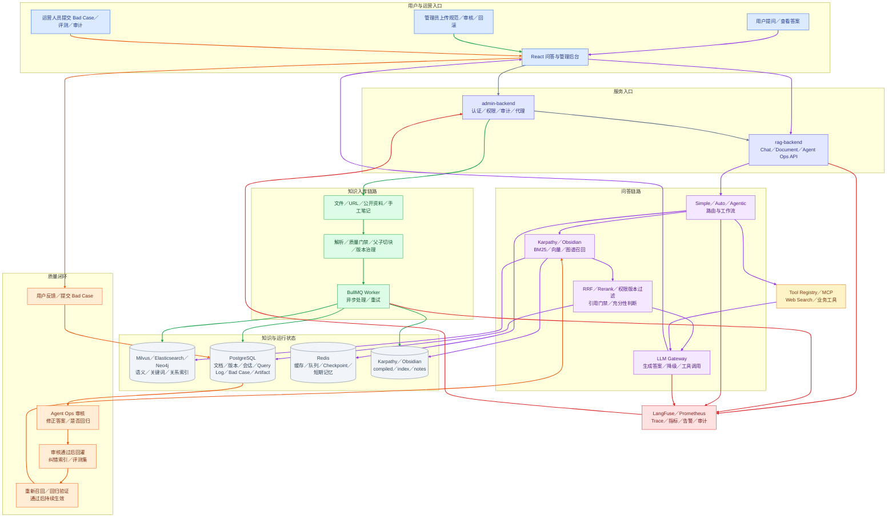

# 面试文档导航

更新时间：2026-08-12

## 一、先看结论

`docs/interview/` 里的材料不用全部从头读。默认从本文件进入，按目标选择路线：

```text
面试前 10 小时冲刺（高级 AI 应用/Agent 岗）
  -> deepseek-AI应用Agent岗-10小时冲刺指南.md
  -> deepseek-AI应用Agent岗-模拟问答题库.md

查自己问过什么
  -> USER_ARCHITECTURE_INTERVIEW_QUESTION_INVENTORY.md

理解核心知识
  -> ../../AI_AGENT_CORE_KNOWLEDGE.md
  -> AI_TOOLING_INTERVIEW_GUIDE.md
  -> AGENT_ARCHITECTURE_SELECTION_GUIDE.md

按项目模块和真实链路理解
  -> 功能步骤流程.md
  -> 开源项目参考能力归档.md
  -> ../../ARCHITECTURE.md

练习面试表达
  -> SEVEN_DIFFICULTIES_CHEATSHEET.md
  -> SEVEN_DIFFICULTIES_INTERVIEW_GUIDE.md
  -> 功能步骤流程.md
  -> ../../INTERVIEW_PLAYBOOK.md

准备投递和项目证据
  -> resume/
  -> jd/
  -> SENIOR_AGENT_INTERVIEW_READINESS.md
```

文档职责只有四类：

| 类型       | 解决的问题                        | 判断标准                       |
| ---------- | --------------------------------- | ------------------------------ |
| 核心知识   | 原理是什么、方案怎么选            | 能解释背景、对比、选择和边界   |
| 面试表达   | 现场怎样在 30 秒或 2 分钟内说清楚 | 能脱离文档复述                 |
| 项目证据   | 项目真的实现了什么                | 有代码、接口、评测或运行证据   |
| 岗位与简历 | 怎么投、怎么写、哪些不能夸大      | 与 JD 对齐且不超过项目真实边界 |

## 一、项目架构简图

面试时先讲这张简图，具体模块职责和数据流再展开看[功能步骤流程](./功能步骤流程.md)。



图例：

```text
绿色：知识入库完整链路    紫色：用户问答完整链路（含 Agentic 工具调用）
橙色：Bad Case 质量闭环    红色：观测、告警和审计链路
灰色：公共入口、服务分发和共享存储连接
```

### 这张图怎么讲

```text
知识从文件、URL、公开资料进入解析和质量门禁
  → 父子切块后写入 PostgreSQL、Milvus、Elasticsearch、Neo4j、Karpathy 和 Obsidian
  → 用户问题经过 Simple／Auto／Agentic 路由
  → 关键词、向量、图谱和纠错证据统一召回、融合、重排和版本权限过滤
  → LLM Gateway 基于证据生成答案，Agentic 必要时调用 Tool／MCP
  → 用户反馈进入 Bad Case 审核、回灌和回归验证
  → Redis 保存运行状态和 Checkpoint，LangFuse／Prometheus 记录全链路
```

### 箭头线颜色对应的流程

架构图中的箭头不是装饰，颜色表示一条完整的业务流。阅读时可以先选择一种颜色，再沿着同色箭头看完这条链路。

| 箭头颜色 | 代表流程 | 起点 | 经过的主要模块 | 终点／结果 |
| --- | --- | --- | --- | --- |
| 灰色 | 公共入口与服务分发 | React 页面和管理操作 | admin-backend、rag-backend | 完成认证、权限、审计和 API 分发；不属于某一条业务闭环 |
| 绿色 | 知识入库流 | 文件、URL、公开资料、手工笔记 | 解析、质量门禁、父子切块、BullMQ Worker | 写入 PostgreSQL、Milvus、Elasticsearch、Neo4j、Karpathy、Obsidian |
| 紫色 | 用户问答流 | 用户问题 | Simple／Auto／Agentic、混合检索、RRF、Rerank、引用门禁、Tool／MCP、LLM Gateway | 返回带引用的答案；必要时降级或拒答 |
| 橙色 | Bad Case 质量回流 | 用户反馈和 Bad Case | Agent Ops 审核、纠正答案、纠错索引、回归评测 | 重新召回验证，合格证据进入后续问答 |
| 红色 | 观测与告警流 | 问答、队列、Agent、模型调用 | LangFuse、Prometheus、告警适配层 | Trace、指标、告警、审计和运营处理 |

补充说明：灰色节点和灰色箭头表示公共连接，不代表独立业务流程；同一个存储节点可能被多种颜色的流程读写。例如 PostgreSQL 同时保存文档版本、Query Log、Bad Case 和 Artifact，Redis 同时保存队列、缓存和 Checkpoint。

### 这张图怎么看

#### 先看图的方向

这张图不是单纯的模块堆砌，箭头表示“谁调用谁、数据往哪里流转”。建议从上往下看：

1. **入口区**：用户、管理员和运营人员都从 React 页面进入；普通用户提问，管理员管理规范和版本，运营人员处理 Bad Case、评测和审计。
2. **服务入口区**：React 请求先进入 `admin-backend` 或 `rag-backend`。`admin-backend` 主要负责管理端认证、权限、审计和代理；真正的问答、入库和 Agent 执行由 `rag-backend` 完成。
3. **知识入库区**：文件、URL、公开资料和手工笔记经过解析、质量门禁、父子切块和版本治理，再由 BullMQ Worker 异步写入索引。
4. **问答区**：问题进入 Simple／Auto／Agentic 路由，随后检索证据、执行质量门禁，再交给 LLM Gateway 生成答案。
5. **数据区**：PostgreSQL 保存业务状态和审计；Milvus、Elasticsearch、Neo4j 负责不同类型的检索；Redis 保存运行时状态；Karpathy／Obsidian 保存编译知识和快速检索内容。
6. **质量闭环区**：错误答案不是直接覆盖，而是经过 Bad Case 审核、回灌、重新召回和回归验证后才再次参与回答。

#### 再看四条主要链路

**第一条：知识入库链路，左侧进入中间。**

```text
文件／URL／公开资料
  → 解析和编码修复
  → 质量门禁
  → 父子切块和版本治理
  → BullMQ Worker 异步处理
  → PostgreSQL 保存元数据
  → Milvus／Elasticsearch／Neo4j 建立索引
  → Karpathy／Obsidian 双写知识层
```

这条链路解决“知识怎么进入系统，以及最新规范如何替换旧规范”。新版本索引成功后，旧版本变成 `deprecated`（注：已废弃），默认检索不再使用旧版本。

**第二条：用户问答链路，中间向下。**

```text
用户问题
  → Chat API
  → Simple／Auto／Agentic 路由
  → Karpathy／Obsidian、关键词、向量、图谱召回
  → RRF 融合和 Rerank 重排
  → 权限／版本过滤和引用门禁
  → LLM Gateway
  → AG-UI／SSE 返回答案和引用
```

- `Simple`（注：简单链路）优先低延迟回答。
- `Auto`（注：自动链路）先走 Simple，证据不足才升级。
- `Agentic`（注：代理链路）可以拆分子问题、循环检索、调用工具和协调多 Agent。

**第三条：Agent 工具链路，从 Router 横向到右侧。**

Agentic 不是直接让模型随便执行动作，而是先通过 `Tool Registry`（注：工具注册表）检查工具权限、风险、超时和版本，再通过 MCP 或 Function Calling 调用 Web Search、图谱、RAG 或业务工具。工具结果回到 Agent Workflow，经过证据和状态检查后才进入最终生成。

**第四条：Bad Case 质量飞轮，从右下方回到检索。**

```text
用户反馈
  → Bad Case 提交
  → Agent Ops 人工审核
  → 修正答案和是否进入回归集
  → 审核通过后回灌纠错索引
  → 重新召回和回归验证
  → 下一次问答优先使用有效纠错证据
```

这里的关键是：Bad Case 不能未经审核直接覆盖知识库；历史纠错证据也不能覆盖当前生效规范，必须经过版本和引用门禁。

#### 面试时可以这样复述

> 这个项目分成入口、服务、知识入库、问答编排、检索存储和质量运营几部分。知识从文件、URL 或公开资料进入后，经过解析、质量门禁、父子切块和版本治理，分别写入 PostgreSQL、Milvus、Elasticsearch、Neo4j 以及 Karpathy 和 Obsidian。用户提问后，由 Simple、Auto、Agentic 三档链路路由，经过关键词、向量、图谱和纠错证据的混合检索、融合重排、权限版本过滤和引用门禁，最后通过 LLM Gateway 生成答案。Agentic 复杂任务可以调用受控工具并产出结构化 Artifact；错误答案通过 Bad Case 审核、回灌和回归验证形成质量飞轮，LangFuse 和 Prometheus 负责单次调用与整体运行监控。

## 二、最短阅读路线

### 2.1 面试前 30 分钟

按顺序看：

1. [七个难点速查卡](./SEVEN_DIFFICULTIES_CHEATSHEET.md)：先记回答结构和七条主线。
2. [面试回答手册](../../INTERVIEW_PLAYBOOK.md)：复习高频问题的短回答。
3. [问题总清单](./USER_ARCHITECTURE_INTERVIEW_QUESTION_INVENTORY.md)：检查是否还有没准备的问题。
4. [项目真实进度](../../ROADMAP.md)：确认数字、完成度和不能夸大的边界。

目标不是背全文，而是能顺畅回答：

```text
项目解决什么业务问题？
RAG 怎么查得准、答得稳、引用撑得住？
Agent 为什么这样编排，怎么防循环和恢复？
Tool、MCP、Skill 分别是什么？
为什么使用单 Agent 或多 Agent？
方案对比后为什么这样选？
最后用什么指标证明有效？
```

### 2.2 半天系统复习

| 顺序 | 文档                                                              | 复习目标                                |
| ---: | ----------------------------------------------------------------- | --------------------------------------- |
|    1 | [核心知识手册](../../AI_AGENT_CORE_KNOWLEDGE.md)                  | 建立 RAG／Agent 全局知识骨架            |
|    2 | [工具体系手册](./AI_TOOLING_INTERVIEW_GUIDE.md)                   | 讲清 Agent、Tool、MCP、Skill 和多 Agent |
|    3 | [架构选型手册](./AGENT_ARCHITECTURE_SELECTION_GUIDE.md)           | 讲清主流架构、优缺点、场景和项目选择    |
|    4 | [七个难点讲解稿](./SEVEN_DIFFICULTIES_INTERVIEW_GUIDE.md)         | 用背景、对比、选择、落地、效果讲项目    |
|    5 | [AgentGuide 项目对照](./agentguide-rag-interview-mapping.md)      | 对照外部知识体系，确认覆盖和边界        |
|    6 | [高级岗位就绪度](./SENIOR_AGENT_INTERVIEW_READINESS.md)           | 区分高级、资深、Staff 所需证据          |
|    7 | [问题总清单](./USER_ARCHITECTURE_INTERVIEW_QUESTION_INVENTORY.md) | 最后查漏补缺                            |

### 2.4 按实际操作理解项目

| 文档 | 适用场景 |
| --- | --- |
| [功能步骤流程](./功能步骤流程.md) | 按「用户操作→状态／数据流转」理解模块职责、模块交互、Simple、Auto、Agentic、RAG、版本治理、Bad Case、Artifact、观测和运营闭环 |
| [开源项目参考能力归档](./开源项目参考能力归档.md) | 了解 Dify、RAGFlow、AutoGPT、MetaGPT、CrewAI、AutoGen 的参考点，以及哪些能力已结合当前项目落地 |

### 2.3 一周准备路线

| 天数    | 任务                               | 使用文档                                                                                                           |
| ------- | ---------------------------------- | ------------------------------------------------------------------------------------------------------------------ |
| 第 1 天 | RAG 主链路、切片、检索、重排       | [核心知识手册](../../AI_AGENT_CORE_KNOWLEDGE.md)                                                                   |
| 第 2 天 | Agent、状态机、记忆、防循环        | [核心知识手册](../../AI_AGENT_CORE_KNOWLEDGE.md)、[七个难点讲解稿](./SEVEN_DIFFICULTIES_INTERVIEW_GUIDE.md)        |
| 第 3 天 | Function Calling、Tool、MCP、Skill | [工具体系手册](./AI_TOOLING_INTERVIEW_GUIDE.md)                                                                    |
| 第 4 天 | 单／多 Agent 架构和选型            | [架构选型手册](./AGENT_ARCHITECTURE_SELECTION_GUIDE.md)                                                            |
| 第 5 天 | 项目难点、效果、失败案例           | [七个难点讲解稿](./SEVEN_DIFFICULTIES_INTERVIEW_GUIDE.md)、[高级岗位就绪度](./SENIOR_AGENT_INTERVIEW_READINESS.md) |
| 第 6 天 | JD 对照、简历和岗位定制            | [JD 对照](./jd/jd-requirements-project-mapping.md)、[简历目录](./resume/)                                          |
| 第 7 天 | 模拟问答和查漏                     | [面试回答手册](../../INTERVIEW_PLAYBOOK.md)、[问题总清单](./USER_ARCHITECTURE_INTERVIEW_QUESTION_INVENTORY.md)     |

## 三、按主题找文档

| 面试主题                                  | 第一阅读入口                                                      | 深挖／证据入口                                                  |
| ----------------------------------------- | ----------------------------------------------------------------- | --------------------------------------------------------------- |
| RAG、Chunk、Embedding、Hybrid、Rerank     | [核心知识手册](../../AI_AGENT_CORE_KNOWLEDGE.md)                  | [七个难点讲解稿](./SEVEN_DIFFICULTIES_INTERVIEW_GUIDE.md)       |
| Agent 定义、状态机、防死循环、Memory      | [核心知识手册](../../AI_AGENT_CORE_KNOWLEDGE.md)                  | [工具体系手册](./AI_TOOLING_INTERVIEW_GUIDE.md)                 |
| Function Calling、Tool、MCP、Skill        | [工具体系手册](./AI_TOOLING_INTERVIEW_GUIDE.md)                   | [AgentGuide 对照](./agentguide-rag-interview-mapping.md)        |
| 单 Agent、多 Agent、Manager、Handoff、DAG | [架构选型手册](./AGENT_ARCHITECTURE_SELECTION_GUIDE.md)           | [七个难点讲解稿](./SEVEN_DIFFICULTIES_INTERVIEW_GUIDE.md)       |
| 项目七个核心技术难点                      | [七个难点速查卡](./SEVEN_DIFFICULTIES_CHEATSHEET.md)              | [七个难点讲解稿](./SEVEN_DIFFICULTIES_INTERVIEW_GUIDE.md)       |
| 评测、稳定性、成本、真实业务结果          | [高级岗位就绪度](./SENIOR_AGENT_INTERVIEW_READINESS.md)           | [项目真实进度](../../ROADMAP.md)                                |
| 项目还有什么没实现                        | [JD 缺口状态](./jd/jd-gap-implementation-status.md)               | [项目真实进度](../../ROADMAP.md)                                |
| 一线大厂岗位要求                          | [JD 要求与项目对照](./jd/jd-requirements-project-mapping.md)      | [高级岗位就绪度](./SENIOR_AGENT_INTERVIEW_READINESS.md)         |
| 游戏官网／活动业务背景                    | [游戏营销简历版](./resume/resume-rag-project-game-marketing.md)   | [游戏营销证据](./resume/game-marketing-rag-evidence.md)         |
| 公开资料入库与 Simple Karpathy 验收        | [公开资料与 Karpathy 方案](../plans/游戏运营营销公开资料与Karpathy方案.md) | [功能步骤流程](./功能步骤流程.md) |
| 简历怎么写                                | [通用 RAG 简历版](./resume/resume-rag-project.md)                 | [游戏营销简历版](./resume/resume-rag-project-game-marketing.md) |
| 历次真实面试题和主人问过的问题            | [问题总清单](./USER_ARCHITECTURE_INTERVIEW_QUESTION_INVENTORY.md) | 表中标注的具体答案入口                                          |
| AI 应用完整知识地图                       | [ProcessOn 知识图谱](./processon-ai-application-mindmap.md)       | [AgentGuide 对照](./agentguide-rag-interview-mapping.md)        |
| 项目模块如何协作                          | [功能步骤流程](./功能步骤流程.md)                                | [项目架构](../../ARCHITECTURE.md)                               |
| 文档规范增量、发布、废弃和回滚            | [功能步骤流程](./功能步骤流程.md)                                | [项目真实进度](../../ROADMAP.md)                                |
| Dify 到 AutoGen 的能力借鉴                | [开源项目参考能力归档](./开源项目参考能力归档.md)                 | [功能步骤流程](./功能步骤流程.md)                               |

## 四、目录内全部文件

### 4.1 核心知识与架构

| 文件                                                                             | 内容                                                                                                  | 优先级 |
| -------------------------------------------------------------------------------- | ----------------------------------------------------------------------------------------------------- | ------ |
| [AI_TOOLING_INTERVIEW_GUIDE.md](./AI_TOOLING_INTERVIEW_GUIDE.md)                 | Agent、多 Agent、Function Calling、Tool、MCP Server、Skill 的定义、关系、伪代码、业务场景、设计和评测 | 必读   |
| [AGENT_ARCHITECTURE_SELECTION_GUIDE.md](./AGENT_ARCHITECTURE_SELECTION_GUIDE.md) | 11 类架构、5 套主流方案、6 个执行原语、决策树、优缺点和项目选择                                       | 必读   |
| [agentguide-rag-interview-mapping.md](./agentguide-rag-interview-mapping.md)     | AgentGuide 高频知识和项目能力、代码证据、不能夸大的边界                                               | 深挖   |
| [processon-ai-application-mindmap.md](./processon-ai-application-mindmap.md)     | AI 应用全景知识图谱逐节点整理                                                                         | 查漏   |

### 4.2 项目讲解与速查

| 文件                                                                                                     | 内容                                                 | 优先级     |
| -------------------------------------------------------------------------------------------------------- | ---------------------------------------------------- | ---------- |
| [deepseek-AI应用Agent岗-10小时冲刺指南.md](./deepseek-AI应用Agent岗-10小时冲刺指南.md)                     | 高级 AI 应用/Agent 岗 10 小时倒排冲刺、数字表、红线、模拟问答和面试复盘 | 面试前必读 |
| [deepseek-AI应用Agent岗-模拟问答题库.md](./deepseek-AI应用Agent岗-模拟问答题库.md)                         | 33 道高频模拟题逐题可背答案、追问应对和边界红线（覆盖检索/Agentic/Prompt/安全/多租户/可观测等全知识面） | 面试前必读 |
| [SEVEN_DIFFICULTIES_CHEATSHEET.md](./SEVEN_DIFFICULTIES_CHEATSHEET.md)                                   | 七个难点的一页式速查和回答框架                       | 面试前必读 |
| [SEVEN_DIFFICULTIES_INTERVIEW_GUIDE.md](./SEVEN_DIFFICULTIES_INTERVIEW_GUIDE.md)                         | 七个难点的背景、方案比较、项目选择、代码、效果和追问 | 必读       |
| [USER_ARCHITECTURE_INTERVIEW_QUESTION_INVENTORY.md](./USER_ARCHITECTURE_INTERVIEW_QUESTION_INVENTORY.md) | 历次提问、真实面试题、覆盖状态和建议补齐项           | 查漏必读   |
| [SENIOR_AGENT_INTERVIEW_READINESS.md](./SENIOR_AGENT_INTERVIEW_READINESS.md)                             | 高级／资深／Staff 岗位差距、真实数据采集和证据验收   | 投递前必读 |
| [interview-docs-usage.md](./interview-docs-usage.md)                                                     | 更详细的文档使用场景、问题定位和复习说明             | 需要时查   |
| [功能步骤流程.md](./功能步骤流程.md)                                                                       | 项目模块清单、模块交互、用户操作和服务端状态／数据流 | 项目深挖   |
| [开源项目参考能力归档.md](./开源项目参考能力归档.md)                                                       | Dify、RAGFlow、AutoGPT、MetaGPT、CrewAI、AutoGen 的参考能力与当前项目融合边界 | 项目深挖 |

### 4.5 参考项目与项目融合

| 文件 | 内容 | 优先级 |
| --- | --- | --- |
| [开源项目参考能力归档.md](./开源项目参考能力归档.md) | 记录各开源项目参考了什么、当前项目实际实现了什么、没有照搬什么，以及生产环境仍需补齐的部分 | 面试追问必读 |
| [功能步骤流程.md](./功能步骤流程.md) | 把参考能力落到当前项目的真实用户操作、模块交互、状态变化和验证路径 | 面试演示必读 |

### 4.3 JD 对照

| 文件                                                                             | 内容                                                    | 优先级     |
| -------------------------------------------------------------------------------- | ------------------------------------------------------- | ---------- |
| [jd/jd-requirements-project-mapping.md](./jd/jd-requirements-project-mapping.md) | 一线大厂 AI 应用／Agent JD 要求与项目实现、代码入口对照 | 投递前必读 |
| [jd/jd-gap-implementation-status.md](./jd/jd-gap-implementation-status.md)       | 已补齐、部分实现、仍需真实环境的能力边界                | 面试前核对 |

### 4.4 简历与业务证据

| 文件                                                                                         | 内容                                                 | 优先级   |
| -------------------------------------------------------------------------------------------- | ---------------------------------------------------- | -------- |
| [resume/resume-rag-project.md](./resume/resume-rag-project.md)                               | 通用企业级 Agentic RAG 项目简历写法                  | 通用投递 |
| [resume/resume-rag-project-game-marketing.md](./resume/resume-rag-project-game-marketing.md) | 游戏官网、活动和营销业务版本                         | 优先使用 |
| [resume/游戏营销RAG项目完整描述.md](./resume/游戏营销RAG项目完整描述.md) | 游戏营销 RAG 项目完整描述与七项技术难点展开版 | 面试深挖 |
| [resume/game-marketing-rag-evidence.md](./resume/game-marketing-rag-evidence.md)             | 游戏活动专项数据、评测、MCP、多 Agent 和业务边界证据 | 深挖     |
| [resume/deepseek-高级资深Agent全栈简历定位与面试口径.md](./resume/deepseek-高级资深Agent全栈简历定位与面试口径.md) | 高级／资深 Agent 全栈岗位的简历定位、项目口径和追问边界 | 定制投递 |

## 五、四类岗位分别怎么看

### 高级 Agent 开发工程师

```text
核心知识 -> 工具体系 -> 架构选型 -> 七个难点 -> 问题总清单
```

重点讲 Agent Loop、状态、Tool Runtime、MCP、Skill、多 Agent 边界、Checkpoint 和 Evals。

### 高级 AI 应用开发工程师

```text
核心知识 -> 七个难点 -> AgentGuide 对照 -> JD 对照 -> 高级岗位就绪度
```

重点讲 RAG 质量、Agentic Workflow、引用与拒答、评测、稳定性、成本和业务结果。

### 高级前端开发工程师

```text
游戏营销简历版 -> 七个难点 -> 面试回答手册 -> 项目真实进度
```

重点讲 AG-UI／SSE、流式状态、任务恢复、复杂交互、产物展示、管理后台和前后端协议。

### 前端负责人

```text
游戏营销业务证据 -> 架构选型 -> 高级岗位就绪度 -> JD 对照
```

重点讲业务背景、跨岗位协作、方案取舍、技术边界、交付效率、质量指标和团队推动。

## 六、信息冲突时以谁为准

| 信息类型               | 唯一优先来源                                                                                        |
| ---------------------- | --------------------------------------------------------------------------------------------------- |
| 当前完成度、验证和阻塞 | [ROADMAP.md](../../ROADMAP.md)                                                                      |
| 运行架构和模块边界     | [ARCHITECTURE.md](../../ARCHITECTURE.md)                                                            |
| 面试时怎么说           | [INTERVIEW_PLAYBOOK.md](../../INTERVIEW_PLAYBOOK.md)                                                |
| Agent／RAG 原理        | [AI_AGENT_CORE_KNOWLEDGE.md](../../AI_AGENT_CORE_KNOWLEDGE.md)                                      |
| 架构方案与选型         | [AGENT_ARCHITECTURE_SELECTION_GUIDE.md](./AGENT_ARCHITECTURE_SELECTION_GUIDE.md)                    |
| 项目模块与实际交互流程 | [功能步骤流程.md](./功能步骤流程.md)                                                            |
| 开源项目参考与融合边界 | [开源项目参考能力归档.md](./开源项目参考能力归档.md)                                              |
| Tool／MCP／Skill       | [AI_TOOLING_INTERVIEW_GUIDE.md](./AI_TOOLING_INTERVIEW_GUIDE.md)                                    |
| 项目七个难点           | [SEVEN_DIFFICULTIES_INTERVIEW_GUIDE.md](./SEVEN_DIFFICULTIES_INTERVIEW_GUIDE.md)                    |
| 真实生产数据           | [SENIOR_AGENT_INTERVIEW_READINESS.md](./SENIOR_AGENT_INTERVIEW_READINESS.md) 中实际采集并验收的数据 |

方案文档中的目标能力不等于已经实现；面试回答里的表达不等于生产数据；本地模拟评测不能说成线上真实业务结果。任何数字最终以 `ROADMAP.md` 和实际评测输出为准。

## 七、维护规则

1. 新增面试文档后，必须在本文件“目录内全部文件”登记。
2. 同一知识点优先补充既有主文档，不继续创建近义重复文件。
3. 速查卡只保留结论和表达，原理与证据放在主文档。
4. 项目完成度只更新 `ROADMAP.md`，其他文档引用它，不各自维护一套进度。
5. 面试结束后先把新题加入问题总清单，再决定补充哪份答案文档。
