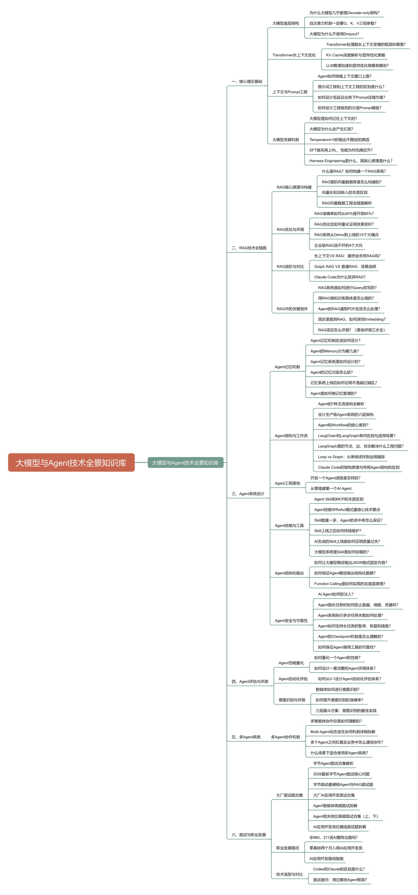

# ProcessOn「AI 应用」思维导图整理

来源链接：

```text
https://www.processon.com/view/link/6a66ce9ad35afd24c9ee7c62
```

原图标题：

```text
大模型与 Agent 技术全景知识库
```

整理时间：2026-07-27

原图文件：

```text
docs/assets/processon-ai-application-mindmap.png
```



说明：本文根据 ProcessOn 原图图片内容整理，方便面试前直接查阅。它更适合作为 AI 应用 / Agent / RAG 的知识检查清单，不适合逐条背诵到简历里。面试回答仍然要围绕当前 RAG 项目的真实链路：知识入库、分层检索、Hybrid Search、GraphRAG、Agentic Workflow、可信输出、MCP 和 AI Coding。

## 一、核心理论基础

### 1. 大模型底层架构

- 为什么大模型几乎都是 Decoder-only 架构？
- 自注意力机制一定要 Q、K、V 三组参数？
- 大模型为什么不使用 Dropout？

### 2. Transformer 长上下文优化

- Transformer 处理超长上下文变慢的瓶颈在哪里？
- KV Cache 深度解析与显存优化策略
- LLM 推理加速和显存优化策略有哪些？

### 3. 上下文与 Prompt 工程

- Agent 如何突破上下文窗口上限？
- 提示词工程和上下文工程的区别是什么？
- 如何设计低延迟业务下 Prompt 压缩方案？
- 如何设计工程级别的分层 Prompt 模板？

### 4. 大模型关键机制

- 大模型是如何记住上下文的？
- 大模型为什么会产生幻觉？
- Temperature = 0 时输出不确定的原因
- SFT 做完再上 RL，性能为何先降后升？
- Harness Engineering 是什么，其核心原理是什么？

## 二、RAG 技术全链路

### 1. RAG 核心原理与构建

- 什么是 RAG？如何构建一个 RAG 系统？
- RAG 里面向量数据库是怎么构建的？
- 向量化和词嵌入的本质区别
- RAG 向量数据库工程全链路解析

### 2. RAG 优化与评测

- RAG 准确率如何从 60% 提升到 85%？
- RAG 优化后如何量化证明效果变好？
- RAG 系统从 Demo 到上线的 12 个大痛点
- 企业级 RAG 逃不开的 4 个大坑

### 3. RAG 进阶与对比

- 长上下文 VS RAG：最终会杀死 RAG 吗？
- Graph RAG VS 普通 RAG：场景选择
- Claude Code 为什么放弃 RAG？

### 4. RAG 中的关键组件

- RAG 系统是如何进行 Query 改写的？
- 用 RAG 做知识库具体是怎么做的？
- Agent 的 RAG 遇到 PDF 应该怎么处理？
- 简历里提到 RAG，如何深挖 Embedding？
- RAG 项目怎么评测？（落地评测三步走）

## 三、Agent 系统设计

### 1. Agent 记忆机制

- Agent 记忆机制应该如何设计？
- Agent 的 Memory 分为哪几类？
- Agent 记忆系统是如何设计的？
- Agent 的记忆污染怎么办？
- 记忆系统上线后如何证明不是越记越乱？
- Agent 是如何做记忆管理的？

### 2. Agent 架构与工作流

- Agent 的 7 种主流架构全解析
- 设计生产级 Agent 系统的六层架构
- Agent 和 Workflow 的核心差异？
- LangChain 和 LangGraph 有何区别与适用场景？
- LangGraph 里的节点、边、状态解决什么工程问题？
- Loop vs Graph：从单线闭环到全局编排
- Claude Code 的架构原理与传统 Agent 架构的区别

### 3. Agent 工程落地

- 开发一个 Agent 流程是怎样的？
- 从零搭建第一个 AI Agent

### 4. Agent 技能与工具

- Agent Skill 和 MCP 的本质区别
- Agent 技能中 ReAct 模式最核心技术要点
- Skill 数量一多，Agent 的命中率怎么保证？
- Skill 上线之后如何持续维护？
- AI 生成的 Skill 上线前如何证明质量过关？
- 大模型系统里 Skill 是如何加载的？

### 5. Agent 结构化输出

- 如何让大模型稳定输出 JSON 格式固定内容？
- 如何保证 Agent 稳定输出结构化数据？
- Function Calling 是如何实现以及底层原理？

### 6. Agent 安全与可靠性

- AI Agent 如何防注入？
- Agent 超长任务时如何防止跑偏、绕路、死循环？
- Agent 系统执行多少任务失败如何处理？
- Agent 如何支持长任务的暂停、恢复和续跑？
- Agent 的 Checkpoint 机制是怎么理解的？
- 如何保证 Agent 调用工具的可靠性？

## 四、Agent 评估与评测

### 1. Agent 性能量化

- 如何量化一个 Agent 的性能？
- 如何设计一套完整的 Agent 评测体系？

### 2. Agent 自动化评估

- 如何从 0-1 设计 Agent 自动化评估体系？

### 3. 意图识别与评测

- 智能体如何进行意图识别？
- 如何提升意图识别的准确率？
- 三层漏斗方案：意图识别的最佳实践

## 五、多 Agent 系统

### 1. 多 Agent 协作机制

- 多智能体协作你是如何理解的？
- Multi-Agent 动态派生协同机制详细拆解
- 多个 Agent 之间在真实业务中怎么通信协作？
- 什么场景下适合使用多 Agent 系统？

## 六、面试与职业发展

### 1. 大厂面试题合集

- 字节 Agent 面试合集解析
- 2026 最新字节 Agent 面试核心问题
- 字节跳动最硬核 Agent 与 RAG 面试题
- 大厂 AI 应用开发面试合集
- Agent 智能体高频面试拆解
- Agent 相关岗位高频面试合集（上、下）
- AI 应用开发岗位精选面试题拆解

### 2. 职业发展路径

- 非 985、211 进入腾讯 AI 指南？
- 零基础两个月入局 AI 应用开发岗
- AI 应用开发路线指南

### 3. 技术选型与对比

- Codex 和 Claude 的区别是什么？
- 面试被问：用过哪些 Agent 框架？

## 和当前 RAG 项目的对应关系

| 导图方向 | 当前项目能对应的内容 | 面试说法 |
|---|---|---|
| Decoder-only / KV Cache / 长上下文 | 项目不主讲模型底层训练，更多是应用层调用与上下文治理 | 可以回答基本原理，但不要说项目自己训练或改造模型底层 |
| Prompt 工程 / 上下文工程 | Prompt Registry、分层 Prompt、上下文裁剪、引用片段控制 | 重点讲低延迟、低 token、输出稳定和安全边界 |
| RAG 核心构建 | 文档解析、Chunk、Embedding、Milvus、BM25/ES、Rerank、生成、引用校验 | 这是项目主线，必须能完整讲清楚 |
| RAG 优化与评测 | Hybrid Search、RRF、Rerank、低相关拒答、评测集回归 | 重点讲如何从“能回答”变成“可评测、可迭代” |
| GraphRAG | 活动类型、玩法、页面、接口、埋点、地区版本、风险项关系补全 | 讲它不是替代向量，而是补关系和方案遗漏 |
| Query 改写 | Agentic RAG 里的 query augment / routing | 讲什么时候改写、什么时候不改写，避免过度改写 |
| PDF 处理 | 文档解析、结构化切片、引用来源保留 | 可讲 PDF 难点：页眉页脚、表格、跨页、图片 OCR、引用定位 |
| Memory | Redis 短期记忆、摘要压缩、Mem0 长期记忆、Admin 记忆管理 | 重点讲记忆污染、用户隔离和长期事实写入边界 |
| LangGraph / Workflow | simple / auto / agentic 分层路由，复杂需求走 LangGraph | 讲简单问题不用 Agent，复杂问题才编排 |
| 多 Agent | researcher / analyst / writer / critic / editor + Supervisor | 讲各 Agent 职责，以及不是所有任务都全量调用 |
| Skill / MCP / Tool Calling | RAG MCP Server、rag_search、rag_context、rag_game_plan、rag_agent_pipeline | 讲 CLI 给脚本，MCP 给 Agent，工具要有 Registry 和评测 |
| 结构化输出 | 方案模板、JSON / checklist 输出、citation gate | 讲结构化输出靠模板、约束、校验和失败兜底 |
| Agent 安全可靠性 | Prompt Injection 检测、低相关拒答、Checkpoint 思路、评测回归 | 当前是基础版，生产级仍需真实权限、审计、灰度和 SLA |
| Agent 评测 | 通用 RAG 指标 + 游戏活动专项评测 + Agent 任务评测脚手架 | 面试要讲指标和失败样本回流，不要只说主观体验 |
| 面试职业发展 | RAG 项目简历、JD 对照、缺口文档、面试回答稿 | 用它查缺补漏，不要把所有概念塞进简历 |

## 面试优先级

### P0：必须讲熟

- RAG 怎么从 0 到 1 构建
- 文档如何入库、切片、Embedding、索引
- Milvus 向量召回、BM25/ES 精确召回、RRF 融合、Rerank
- simple / auto / agentic 分层路由
- GraphRAG 为什么能补关系
- Agentic Workflow 怎么拆复杂需求
- MCP 怎么给 Codex / Claude Code / Trae 提供上下文
- 引用校验、低相关拒答、Prompt Injection、评测集回归

### P1：大概率会追问

- Memory 怎么做，记忆污染怎么处理
- Token 怎么节省
- 缓存怎么设计
- Query 改写怎么做
- PDF / 多格式文档怎么处理
- 结构化输出怎么保证
- 工具调用失败怎么兜底
- Agent 跑偏、死循环、长任务怎么处理

### P2：加分但不要强行主讲

- Decoder-only、KV Cache、长上下文原理
- SFT / RLHF / Temperature 底层机制
- 生产级 Agent 六层架构
- Multi-Agent 动态派生
- Claude Code 架构原理
- Codex 和 Claude 的差异

## 面试回答收敛口径

不要这样说：

```text
我做了一个覆盖大模型、RAG、Agent、Multi-Agent、MCP、评测、安全、生产化的全栈 AI 平台。
```

这样会显得太虚。

建议这样说：

```text
我这个项目主线是企业级统一 Hybrid RAG 和 Agentic Workflow（智能体工作流）。资料入库后进入 Hybrid Search（混合检索）和 GraphRAG；Simple 与 Auto 先精确直答，未命中后执行统一混合检索，复杂活动需求再由 LangGraph 拆成方案、接口、埋点、风险和验收 checklist（检查清单）。为了让结果可信，我做了 Rerank（重排）、引用校验、低相关拒答、Prompt Injection（提示注入）检测和评测集回归；为了配合 AI Coding（人工智能辅助编码），又通过 MCP（模型上下文协议）把检索和方案能力暴露给 Codex／Claude Code／Trae。
```

一句话记忆：

```text
这张图是 AI 应用面试知识地图，你的项目回答主线是：RAG 主链路 + Hybrid Search + GraphRAG + Agentic Workflow + Memory/Eval/Safety + MCP 赋能 AI Coding。
```
