# 企业级 RAG 智能体功能链路与设计方案

> 更新：2026-10-25。本篇按“资料准备 → 本轮上下文 → 问答或任务执行 → 校验 → 反馈与运营”讲项目。只把仓库可定位的能力写作当前实现；参考方案、模拟数据和待验收能力单独标明。

**读法**：先看每章“解决的问题”和主图，再按“设计取舍 → 代码入口 → 边界”复述。图中普通节点代表当前链路；红色节点及正文的 🔴 【待补充】 代表尚未实现或尚未完成生产验收的事项。红色事项是优化方向，不应在面试中说成已完成。

| 阅读顺序 | 这一段回答什么 |
| --- | --- |
| [一、系统地图](#system) | 产品有哪些链路？共享什么数据和规则？ |
| [二、知识准备](#knowledge) | 文件如何上传、索引、生效并成为证据？ |
| [三、问答与上下文](#question-context) | 问题如何路由，模型本轮到底看到什么？ |
| [四、Task Agentic](#task) | 多岗位如何取证、交付、审批与恢复？ |
| [五、质量反馈与评测](#quality) | 错误如何纠正，改动如何验证？ |
| [六、运行与观测](#operations) | 如何查运行过程、定时任务和事件投递？ |
| [七、安全与治理](#safety) | 不可信内容、工具、MCP 和配置如何受控？ |
| [八、面试速查](#interview) | 如何讲取舍、代码证据与生产边界？ |

**概念边界**：RAG 提供当前问题相关的资料证据；Session 保留同一会话的消息与摘要；Memory 保存跨会话的用户线索；Checkpoint 保存可恢复的执行位置；Artifact 是可审计的过程或交付产物；Trace/Metrics 用于观察过程与趋势。它们可以共同参与一次任务，但信任级别和生命周期不同。

## 一、系统地图：从用户输入到可信结果

**解决的问题**：把资料入库、可信问答、多岗位交付、错误纠正和运营排障连成闭环。用户得到的答案或 Artifact 必须能追到来源、版本、权限与运行过程。

**执行主线**：身份与作用域先确定；文档经治理后成为可检索资料；用户问题由 `ChatService` 统一接收，QueryPlan 在内部选择快速或深度路径；长任务进入 Task Agentic。结果经引用、Schema 或审批门禁后保存，Bad Case 与评测再推动下一轮改进。

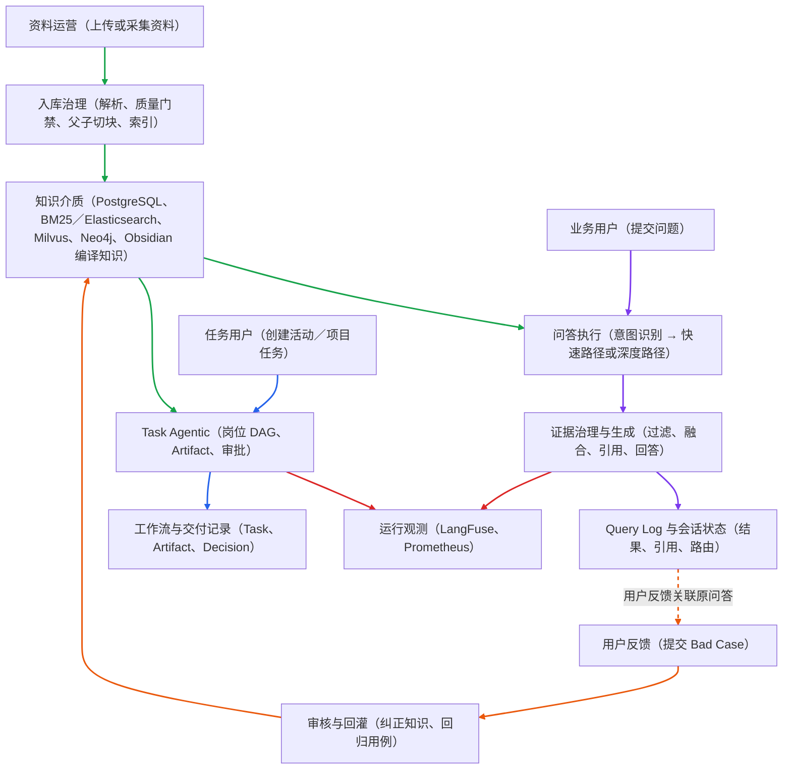

**四种状态各归其位**：PostgreSQL 保存文档、消息、Run、Task、Artifact 元数据和审计事实；Redis 保存缓存、短期窗口与 LangGraph Checkpoint；Milvus/Elasticsearch/编译知识/可选 Neo4j 提供索引；LangFuse 看单次 Trace，Prometheus 看长期指标。Redis 快照、Trace 和业务事务不能互相替代。

**贯穿标识**：`docId` 定位资料及版本，`conversationId/threadId` 定位会话与状态图，`runId` 定位一次执行，`queryLogId` 定位一次问答。每章只解释本链路独有的状态。

**代码入口**：`DocumentService`、`ChatService`、`RagService`、`AgenticRagService`、`ProductionWorkflowService`、`RagFeedbackService`。

## 二、知识准备：上传、索引与生效

**解决的问题**：文件上传成功并不表示知识可用。系统要先确认文件可解析、内容可信、权限与版本明确，必要索引写入成功后才允许进入有效检索。本章只讲资料准备；回答问题时如何取证见第三章。

### 2.1 上传与处理任务

1. 管理员在「文档管理」批量上传，浏览器逐个发送 `multipart/form-data`；Admin Backend 校验登录态和 `admin:documents:write`，带当前用户 `ownerUserId` 和内部服务令牌转发给 RAG Backend。
2. Redis 队列可用时，`DocumentQueueService` 创建 `taskId` 并由 BullMQ Worker 处理；未启用队列时同步解析和建索引。前端轮询 `queued → processing → completed／failed`，以任务状态和文档记录确认完成，而不以 HTTP 请求成功作为入库成功。
3. 解析器处理 Markdown、Office、PDF、表格、图片和音视频等支持的格式。扫描件质量取决于 OCR 配置；不支持的扩展名明确报错。列表按 `createdAt` 倒序展示。

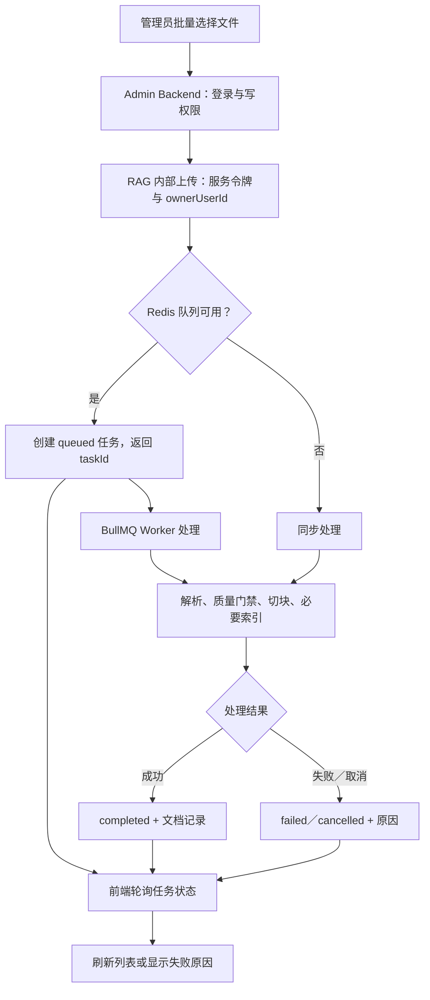

**设计取舍**：队列隔开上传响应与耗时的解析／Embedding；同步模式仅是兼容路径。失败任务可保留原因和任务 ID，不能假装索引成功。代码入口：`admin-documents.controller.ts`、`RagAdminService.uploadDocumentAsync`、`DocumentQueueService`、`DocumentService`。

### 2.2 解析、索引与版本生效

原文先保存来源、Hash 和版本元数据，再做空内容、提示注入和质量检查；高风险内容保留原件并进入 `failed／security_review`，不切块。父块保留章节语境，子块用于召回。必要分支是 PostgreSQL 文档／Chunk／权限、Milvus 向量索引、编译知识／BM25 与 Elasticsearch 关键词索引；Obsidian 是尽力而为的编译资产，Neo4j 是可选的异步图谱分支。必要分支失败时保留业务事实并清理已成功的外部索引。

普通上传按部署配置成为 `draft` 或 `effective`；版本治理创建的新版本固定为 `draft`。管理员核对 Chunk 数与索引状态，提交审核并获批后才设为 `effective`；同版本链旧版本转 `deprecated`。草稿可废弃，旧版本可按相同切换规则回滚；失败任务可凭原 `taskId` 重放，过期或不存在的任务必须返回失败原因。

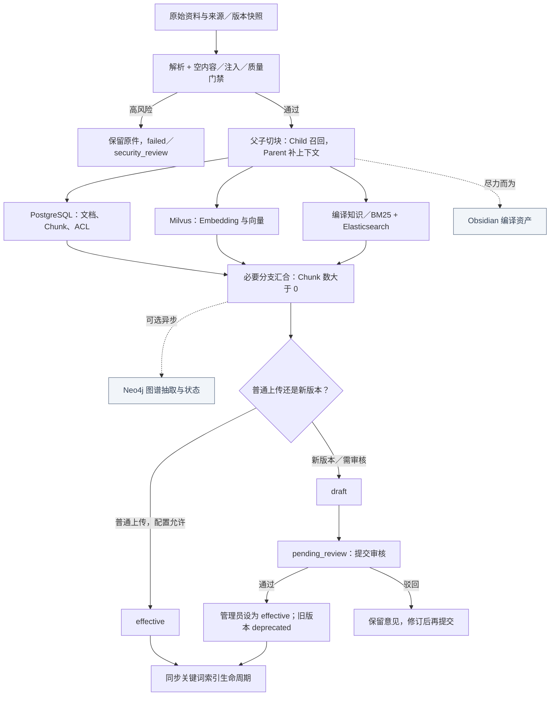

**为什么这样设计**：PostgreSQL 保存唯一的版本事实，ES/编译知识 同步生命周期，Milvus 的候选在汇合后按允许文档 ID 再过滤。删除时同步清理向量、全文、图片、图谱来源、Chunk 与权限记录。Obsidian 笔记有 `allowed_users／allowed_roles` 过滤，但与主文档生命周期不保证原子一致；人工笔记和编译摘要不能冒充正式原文。

**代码入口**：`DocumentService.upload()`、`updateLifecycle()`、`activateVersion()`、`delete()`；`ObsidianIngestService`、`GraphService`。

### 2.3 多模态资料与独立搜索

图片会形成预览、OCR 文本、描述和标签；PDF/PPTX 内嵌图片按页绑定，视频关键帧带时间点，最终进入 Markdown Chunk 和受控图片代理。只有顶层上传的图片文件写入 `rag_images`，用于文搜图／以图搜图；内嵌图片与视频帧目前只绑定文本证据，未逐张写入图片向量库。图片代理先做用户与文档权限校验。

管理后台「智能搜索」是浏览链路：完整文档正文进入 Elasticsearch `kh_document`，支持全文高亮、文件类型／时间／分类／权限筛选；热门词从 Query Log 聚合。问答检索则使用分块索引 `rag_chunks`、Milvus 等证据源。Neo4j 图谱搜索返回实体和关系，图谱不可用不影响文档全文搜索；图谱结果仍要回到可引用原文。编译知识/Obsidian 服务知识编译、辅助召回与降级，不是第四种用户问答模式。Obsidian 来源笔记只定位关联资料，校验权限与生命周期后再取原文 Chunk；笔记摘要本身不作为回答证据。其刷新在进程内用单飞锁合并，独立编译产物可并发，关联笔记回写须等待索引产物完成。

🔴 【待补充】内嵌图片与视频帧的独立视觉索引、跨模态效果和真实业务数据验收；大规模图谱实体消歧与持续来源治理。

## 三、问答与上下文：模型本轮看到什么

**解决的问题**：用户问题、可信策略、当前证据、会话线索和工具结果来自不同地方。模型只应看到与本轮目标相关且在预算内的信息；历史或网页即使被检索到，也不能获得系统指令或客观事实的权威。这里把路由、上下文组织和回答收口放在一条链路中解释。

### 3.1 单一链路与内部意图路由

普通 HTTP、SSE、AG-UI 和后台代理最终都进入同一条 `ChatService` 问答链路。每轮只构造一次 QueryPlan，由后端 Policy 决定来源、权限、档位和预算；多义问题可提前澄清。旧客户端如果仍传 `simple/auto/agentic`，服务端只做兼容归一化，不再提供三套用户可选执行模式。

| 内部路径 | 本轮怎么走 | 为什么这样选 |
| --- | --- | --- |
| 快速路径 | 已审核精确纠正／受治理结构化事实可直答；其余做一次 Hybrid RAG、生成和引用校验 | 单意图问题低成本、低延迟 |
| 深度路径 | 按子问题并行取证，必要时调用受控工具／网页，反思、审批和有限重试 | 处理多跳、实时或证据不足的问题 |

**路由依据**：QueryPlan 的问题类型、子问题数量、上下文模式、实时／执行意图，以及首轮 Hybrid Fast Path 的证据充分性。用户不再手选模式；内部路径只作为同一条链路的执行策略。

**共同门禁**：内部公司、项目、业务、研发流程和上传资料固定 `local_only`；模型不能自行扩大权限或改选公网。升级到深度路径时携带同一证据快照、来源策略与剩余预算。

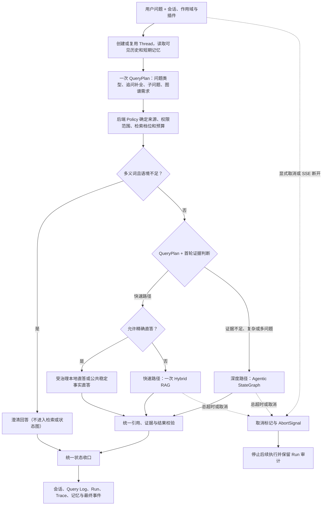

**结果收口**：快速路径不进入反思循环；深度路径有步骤、工具、时间和预算上限。模型草稿 token 先缓冲，只有最终正文通过引用／安全门禁后才发布；会话、Query Log、Run、Trace 和助手消息元数据统一落库，再发 `final` 事件。

**取消与超时**：请求开始时设总 deadline，并把取消信号传给 Query Planner、快速路径和深度路径的模型调用。用户可按会话显式取消；SSE／AG-UI 断开会触发 AbortSignal，并按用户与租户归属标记活动 Run。`RUN_INTERRUPTED` 表示等待审批，不等同于用户取消；超时或取消也不应被讲成成功完成的答案。

### 3.2 在线取证与 Evidence Bundle

`QueryPlannerService` 表达问题类型、追问补全、子问题和图谱需求；`RetrievalPolicyService` 再结合登录身份与请求 Scope 决定能查什么。内部资料固定 `local_only`，未命中须说明资料不足；只有符合策略的非内部问题才可受控联网。

多条计划查询可以并行；每条查询内部先关键词、再向量、再做 RRF 与权限／版本／有效期过滤。跨查询候选合并去重后，按原问题可选 Rerank、补邻块或同章节片段，并受 Token/字符预算约束。图谱、图片、已审核纠正层和会话附件按计划或权限加入证据快照。`Evidence Bundle` 保存本次请求唯一的证据与充分性结果，快速路径升级到深度路径时可复用；答案另过 Citation Gate。

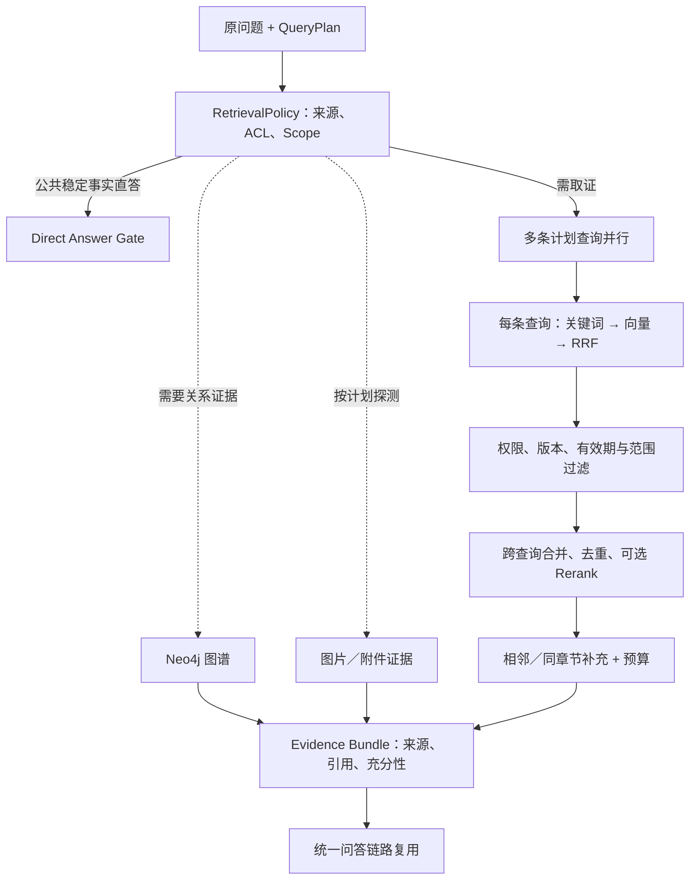

**设计取舍**：BM25 擅长编号、字段、精确词，向量覆盖相近表达；小块帮助命中，父块补上下文。候选相关不等于答案可信，版本、权限、充分性和引用都要再次校验。代码入口：`RagService.retrieveByPlan()`、`ContextBuilder`、`ImageIndexService`、`ElasticsearchProvider`、`RagAdminController`。

### 3.3 本轮上下文怎么组装

按[上下文工程实践指南](https://wakeup-jin.github.io/Practical-Guide-to-Context-Engineering/%E6%A6%82%E8%BF%B0/%E4%B8%8A%E4%B8%8B%E6%96%87%E5%B7%A5%E7%A8%8B.html)的视角，可以把输入看作当前问题、系统规则、相关资料、会话历史、用户记忆、工具定义与结果、输出约束的组合；实际只选本轮需要的部分。项目中这些输入分散在 `ChatService`、`RetrievalPolicyService`、短期记忆服务、RAG `ContextBuilder` 和 Agent 状态图中，不能把 RAG 的 `ContextBuilder` 误说成已经统一管理了所有来源。

| 上下文来源 | 项目里的作用 | 使用边界 |
| --- | --- | --- |
| 当前问题与系统规则 | 确定本轮目标、身份、来源策略 | 当前问题保留原文；权限由后端决定 |
| RAG／附件证据 | 支撑业务事实与引用 | 先过滤 ACL、版本和有效期，再按预算选片段 |
| 会话历史与摘要 | 补追问指代、会话设定 | 标为不可信，不覆盖当前证据 |
| Mem0／历史问答 | 按需补用户线索 | 客观事实核验可跳过；不能充当事实来源 |
| 工具定义与结果 | 支持 Agent 下一步行动 | 只开放当前策略允许的工具，结果仍需校验 |
| 输出契约 | 限制引用、Schema 和交付格式 | 格式通过不代表内容正确，还要过证据／审批门禁 |

1. **当前输入与权限**：先生成独立 `RequestContext`，保留原问题；QueryPlan 只描述问题，后端 Policy 决定来源与 Scope。可信系统规则优先于检索文本。
2. **证据与历史**：Evidence Bundle 经 ACL、版本、有效期、业务范围、去重和预算进入生成；`selectHistoryForQuery` 只留下指代和必要轮次，并标成不可信上下文。会话设定留在当前 thread；客观事实核验可跳过 Mem0 与历史问答向量。
3. **压缩与恢复**：Redis 读最近消息和摘要，缺失时回退 PostgreSQL；一轮问答写回后，超本轮历史预算或 40 条消息才加锁压缩早期历史。先持久化 PostgreSQL 摘要，再镜像 Redis 并裁剪被覆盖消息；失败保留原消息。摘要不能替代原文证据或 Checkpoint。
4. **输出**：RAG `ContextBuilder` 对候选 Chunk 去重、限制单文档占比、排序并控制字符预算；Agent 的工具白名单、岗位 Schema 和输出约束由各执行链提供。关键结论仍需 Citation Gate 或 Artifact Schema／审批校验。

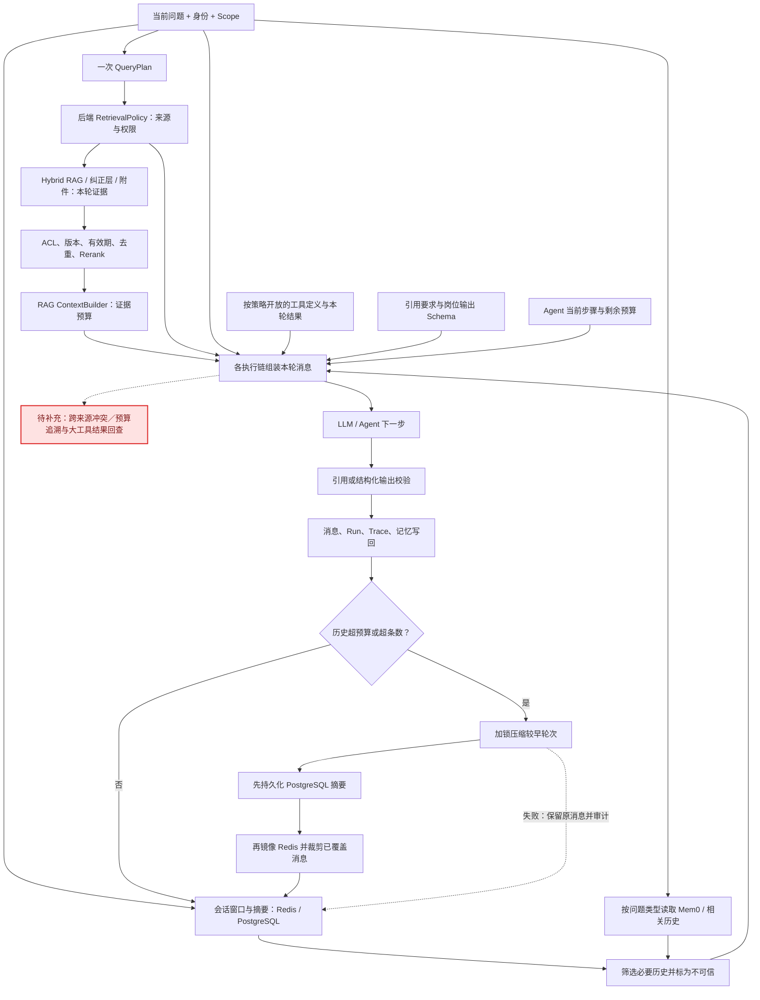

**串一个例子**（只演示流程，不预设业务答案）：用户追问“这个活动现在走哪版审批流程？”系统先从当前句和必要历史补出活动指代；后端把来源限定为有权限的内部资料，检索当前生效版本并组装带引用的 Evidence Bundle。旧会话里即使出现另一版流程，也只作为追问线索；若现行资料不足，就回答“待确认”，不会引用旧消息或公网结果补成确定结论。

**为什么这样设计**：上下文窗口大也不能全量投喂。会话里可能有过期设定，Memory 可能误提取偏好，工具结果或网页可能携带提示注入；本轮事实应由授权资料或确定性业务查询支撑。🔴 【待补充】跨来源统一的来源／信任／预算记录、冲突检测，以及跨工具大结果裁剪和原文回查策略；当前只能确认各链路分别实施了过滤、预算或输出预览。

### 3.4 深度路径的受控循环

复杂问答先拆子问题，再并行取证并汇入 `EvidenceBundle`；每个新子问题可追加检索，已取得的快照不重复查。受控工具按 Tool Registry、来源策略和预算调用；必要时做反思或等待审批。生成答案后检查关键 Claim 是否有当前证据支持，失败时抽取式回退、补证或安全降级，而不是展示检索残片。启用审批时，`approvalPending` 节点先把暂停态写入 Checkpoint，AG-UI 发 `RUN_INTERRUPTED`，不把草稿当完成答案；批准后才用 `Command.resume` 继续。不能泛称“任意节点都能断点续跑”。

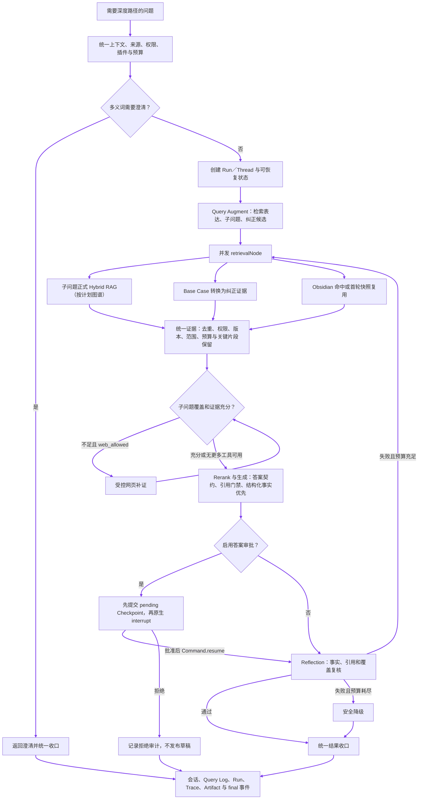

**代码入口**：`ChatService`、`QueryPlannerService`、`RetrievalPolicyService`、`RagService`、`AgenticRagService`、`short-term-memory.service.ts`、`context-policy.ts`。**边界**：短期摘要仍可能带有错误线索，需坚持“不可信历史不能覆盖当前证据”的门禁；SSE 断线续传和跨实例事件恢复仍待生产验证。

## 四、Task Agentic：多岗位如何交付与恢复

**解决的问题**：产品、设计、后端、前端、测试和运营之间有依赖。不能让多个 Agent 自由聊天后把任意文本当交付物，也不能在上游修订后继续复用过期下游产物。

### 4.1 岗位 DAG、证据与 Artifact

管理员创建活动／项目任务，给出目标、选中岗位和审批策略。工作流按依赖批次推进：产品先确认需求；设计与后端可并行；前端依赖两者；随后测试、运营。岗位内部只调用职责匹配的只读知识检索工具，当前默认最多一次，生成 Markdown Artifact、证据和机器可读的 `lowCodeSchemas`，由 Zod/Schema 校验。Schema 承载页面、API、埋点、校验和验收项；缺字段时后端提供岗位兜底 Schema，不代表业务事实已经验证。

审批通过才解锁下游。驳回先保存意见，把旧 Artifact 标 `rejected`、受影响下游标 `stale`，工作流进入 `revision_required`；管理员点击重新生成后才从指定岗位局部重跑。所有选中岗位都为当前 `approved` 且通过交付门禁，才可导出 Markdown／ZIP／MCP 交接包。`Handoff Manifest` 关联岗位版本、状态、内容 Hash、Schema 与 RAG 引用。

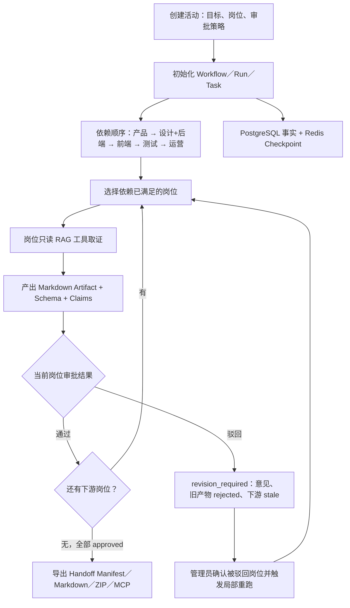

**串一个例子**：管理员驳回后端接口交付时，系统先记录意见并将旧后端产物标记为 `rejected`、受影响的前端等下游标记为 `stale`，此时不调用模型。管理员点击按意见重生成后，Worker 才从指定岗位执行；新产物重新获批，依赖它的岗位才可继续使用当前版本。

**设计取舍**：DAG 用代码确定岗位依赖，模型只在岗位内生成和判断；这样能局部修订，且审批点清楚。`sequential` 按依赖批次执行，`hierarchical` 由负责人受控委派，`conditional` 根据证据或审批状态补证与人工确认，均不允许无限自主委派。`ProductionWorkflowService.runRole()` 准备岗位 RAG 证据并生成 Schema，`publishRoleArtifact()` 写入产物，`codingContext()` 与 `generateProjectZip()` 复用同一交接内容。

### 4.2 队列、Checkpoint 与幂等

PostgreSQL 保存 Run、Task、Artifact、Decision 等长期事实；BullMQ 管理启动、恢复和修订 Job，Worker 接管与重试；Redis LangGraph Checkpoint 保存状态机位置。`pending_approval` 走 `resume`，`revision_required` 走 `revise`；页面刷新可重新查看事实和快照。工具的真实副作用另由幂等记录保护：`completed` 复用结果，`running／unknown` 阻断盲目重放。Checkpoint 不等于会话记忆，也不能单独保证外部动作 exactly-once。

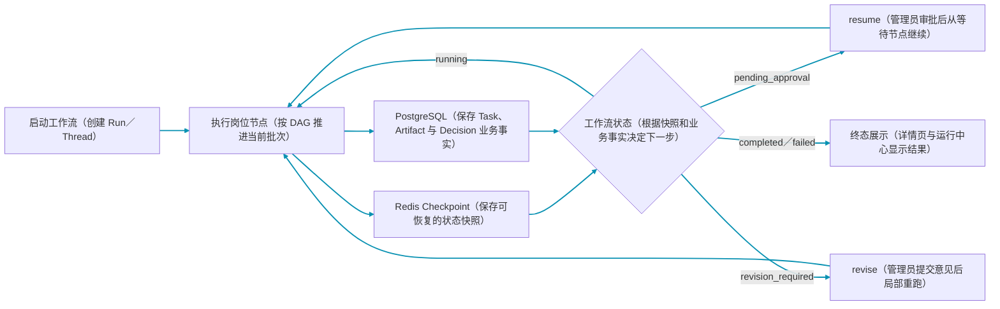

🔴 【待补充】跨实例崩溃后的未知工具结果扫描、自动接管和多副本故障演练；当前不提供从任意节点继续的 UI，也没有通用 `paused／interrupted` 状态。

**代码入口**：`ProductionWorkflowService`、`AgentTasksService`、`ArtifactsService`、`AgentRuntimeEventsService`、Redis Checkpointer。

## 五、质量反馈与评测：错误如何变成改进证据

**解决的问题**：一次回答附带引用不等于长期可靠。错误反馈先核实，再进入纠正知识或回归用例；模型、检索或 Prompt 改动需要用可复核样本证明没有退化。

### 5.1 Bad Case 审核回灌

用户提交错误答案后生成 `rag_feedback=pending`，关联原问题、答案、引用和检索快照。运营人员核对来源，选择忽略、记录、审核通过；满足条件时进入纠正层或晋升正式知识，并按需加入回归用例。已审核的精确纠正可参与快速路径直答；语义纠正只作为 Base Case 候选，还要按权限、版本和引用门禁处理。未经审核的用户反馈不能立即改变线上答案。

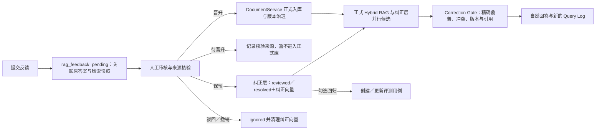

**代码入口**：`RagFeedbackService`、`BadCaseFlywheelService`；评测用例由管理后台维护。

### 5.2 评测从样本到发布判断

仓库已有数据集结构校验、质量／性能／成本脚本、三模式 Live 回放、项目级 A/B 对照和后台报告读取。离线结构检查只能说明样本字段与脚本可运行；Live 回放才请求真实服务并检查目标答案、引用、拒答、路由、检索指标、延迟与估算成本。发布门禁脚本要求已审核的真实业务样本和明确阈值；合成数据不能冒充业务效果。评测结果能供人工判断，但目前不自动发布配置、灰度或回滚。

**诊断顺序**：先看目标文档是否已入库且生效 → 解析／Chunk 是否完整 → ACL 是否误过滤 → QueryPlan 和 BM25／向量是否召回 → Rerank／上下文预算是否丢证据 → 生成是否遵守 Citation Gate。这样可把检索错误与生成错误分开，不必直接归因于模型。

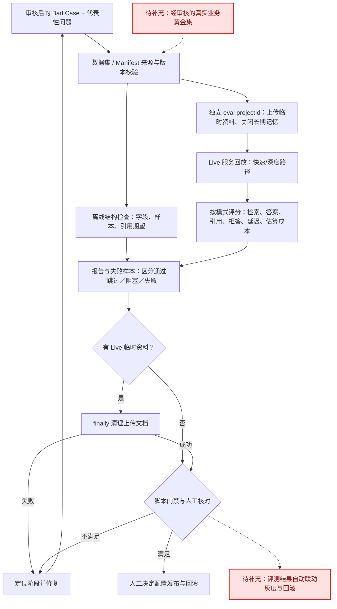

🔴 【待补充】足量且经领域专家审核的真实业务黄金集；当前仓库合成样本与模拟 Adoption 指标不能证明线上质量。配置发布的自动门禁、灰度流量和回滚联动也尚未闭环。 评测方法参考[上下文工程实践指南的 Agent 评估章节](https://wakeup-jin.github.io/Practical-Guide-to-Context-Engineering/Agent%E8%AF%84%E4%BC%B0/Agent%E7%9A%84%E8%AF%84%E4%BC%B0.html)，但该站点的建议不等于本项目已实现。

**评测隔离边界**：项目级 Live 脚本给每轮评测生成独立 `projectId`，上传该轮资料，回放时限定该 Scope 并关闭长期记忆；`finally` 清理临时文档，清理失败也会使脚本失败。服务不可用等情况下的 `skipped` 只代表本轮没有完成质量测量，不能算通过。`blocked／failed` 同样要留在报告里，不可混成零分或成功。

## 六、运行与观测：如何看见过程和故障

**解决的问题**：只看最终答案，无法判断问题出在路由、检索、模型、工具、审批还是队列。运行中心看业务 Run，LangFuse 看单次调用，Prometheus/Grafana 看长期指标；三者各回答不同问题。

### 6.1 Run、事件、工具和 Artifact

问答或工作流创建 `runId/threadId`，节点、检索、预算、审批、重试写入 `agent_runtime_events`，工具动作写入 `agent_actions`；Chat 的诊断 Artifact 与 Task 的交付 Artifact 分别保存。运行中心按 Run 聚合终态、事件时间线、成本、工具与 Failure Onset，Artifact 审计从 Redis 快照和 PostgreSQL 持久副本读取。重跑仍必须过原有权限、预算和审批门禁。

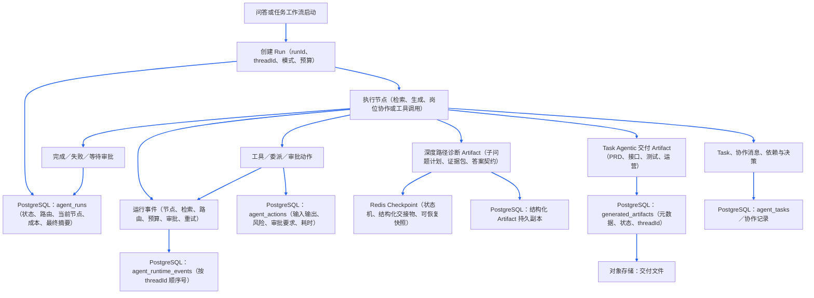

**代码入口**：`AgentRunsService`、`AgentRuntimeEventsService`、`ArtifactsService`、`AgenticRagService.getRunSnapshot()`。

### 6.2 定时分析与领域事件

管理员用自然语言或 Markdown 准备定时任务，解析器只提取名称、Cron、统计窗口和范围；人工确认后才保存并启用。复制新版本默认停用，当前版本和执行历史保留。到点后采集本项目规则、Query Log、负反馈代理指标与工作流数据，生成统计快照和 Markdown 建议，记录每次 `running／completed／failed`。这里的“投诉”只是 `rag_feedback` 代理指标，不是企业客服工单总量。

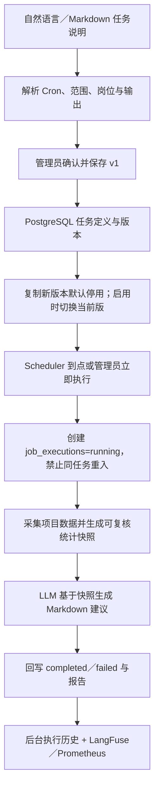

文档生效、工作流待审批／修订／完成和定时任务结果会产生领域事件：先写 PostgreSQL Outbox，再由 Worker 依据订阅规则投递；失败退避重试，耗尽后留审计并支持人工重试。订阅表存 `endpointKey`，真实 Webhook URL 来自服务端配置，不在页面保存。外部接收方仍需按 delivery ID 幂等；远端已处理而本地超时时可能重复投递。

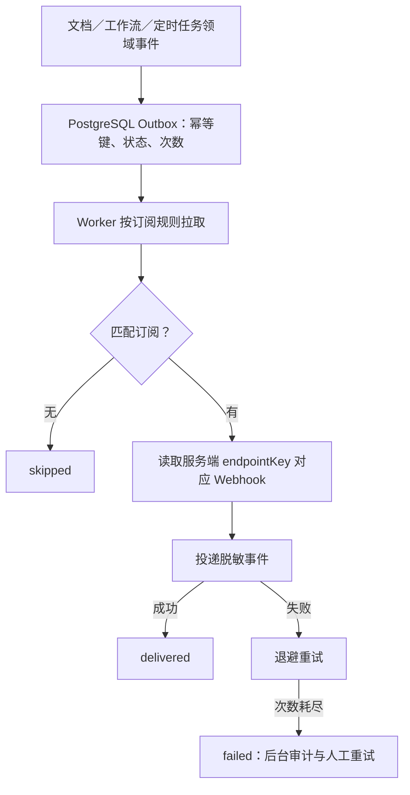

**代码入口**：`JobsService`、`ScheduledAnalysisService`、Outbox Worker。🔴 【待补充】企业客服／工单真实数据接入，以及企业通知凭证与跨服务事件一致性的生产验收。

### 6.3 观测、后台与生产边界

LangFuse 记录 Trace／Generation／Span 及估算成本，Prometheus 暴露 QPS、错误率、P95、空召回、工具成功率等指标；仓库提供 Grafana 看板、Recording Rules 和 Alertmanager 模板。管理后台首页按权限读取访问趋势、文档、用户、热门内容和公告，属于汇总展示，不代替运行中心明细或自动告警。

🔴 【待补充】真实通知凭证、采样与脱敏策略、值班和事故复盘流程；`Last-Event-ID` 断线续传、跨实例事件恢复与真实多副本 SLA 验收。

## 七、安全与治理：内容、动作和配置各有边界

**解决的问题**：上传文件和网页可能携带提示注入，模型也可能请求有副作用的工具。内容进入模型和动作真正执行是两道独立门禁，不能靠一段系统 Prompt 同时解决。

### 7.1 内容安全与工具执行

入库时高风险文本隔离，中风险留告警；检索或 Bocha 网页补证返回的文本在生成前再次清洗，只作为不可信证据。模型提出工具调用后，Tool Registry 校验 Schema、模式、角色和风险，Tool Execution Policy 再校验权限、审批、预算和超时；拒绝要写审计事件。插件是已注册工具的声明式组合，不允许上传任意脚本或绕过角色权限。

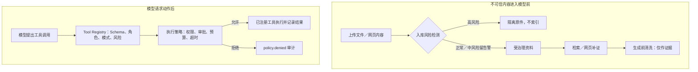

**代码入口**：文档注入检测、`Tool Registry`、`Tool Execution Policy`、`plugin-runtime/`、`agent-loop/`。

### 7.2 MCP、CLI 与配置治理

MCP 是外部客户端的受控入口，不继承浏览器登录态；按 Token、API Key 或账号身份访问后端。它有只读工具，也有触发问答／Agent 生成的计算工具，但不开放审批、删除、文档发布或定时任务启停。CLI 的管理员写操作由后端角色校验；MCP/CLI 都不直连数据库或向量库。

平台治理能登记模型、启停插件、发布工作流模板版本并维护评测用例；文档发布则使用第二章的草稿／审核／生效／回滚生命周期。两套治理不能混说。🔴 【待补充】独立 Prompt Registry、模型／插件／模板的统一评测审批门禁、配置灰度与回滚平台；企业 IAM、DLP 和隔离沙箱。

## 八、面试速查：按“问题、取舍、证据、边界”讲

### 一分钟项目介绍

> 我做的是一个企业级 Agentic RAG 知识协同平台。资料先经解析、质量检查、切块、必要索引和版本审核；用户问题由 QueryPlanner 理解，再由后端权限策略决定可查范围。ChatService 统一接收问题，先用 QueryPlan 识别意图和复杂度；简单问题走一次受治理快速路径，复杂或证据不足时自动进入深度状态图。系统把历史、用户记忆和本轮证据分开组织，用 Evidence Bundle 与 Citation Gate 控制回答；Task Agentic 按岗位依赖生成可审批、可修订的 Artifact。Bad Case 经审核进入纠正与回归，运行中心、LangFuse 和 Prometheus 帮助定位质量、成本与故障。当前仍需真实业务评测数据和生产环境验收。

### 高频取舍

| 追问 | 回答重点 |
| --- | --- |
| 为什么不全走深度 Agentic？ | 简单问题走快速路径，减少延迟、成本和失败节点；复杂或多子问题由 QueryPlan 和证据充分性自动升级深度路径。 |
| 为什么 BM25 + 向量？ | 编号／字段与语义表达互补；RRF 融合、Rerank 和权限／版本过滤决定最终证据。 |
| 为什么命中后还可能拒答？ | 命中只是候选；还要核对权限、生效版本、证据充分性和关键 Claim 引用。 |
| Memory、Session、Checkpoint 差别？ | 用户线索、会话连续性、执行恢复分别管理；都不代替本轮事实证据。 |
| 多 Agent 是自由讨论吗？ | 当前是受控岗位 DAG，岗位内工具白名单、Schema、Artifact 和人工审批。 |
| 如何定位 Bad Case？ | 先查索引与 ACL，再查召回、重排、预算和生成／引用，最后才考虑换模型。 |
| 如何发布新文档？ | 新版本先草稿并完成索引，审核通过后切换 effective；旧版本 deprecated，可回滚。 |

### 当前实现与生产边界

| 能力 | 可展示的当前能力 | 不应说成已完成的部分 |
| --- | --- | --- |
| 异步执行 | BullMQ 文档／Task 工作流／Artifact Job，Redis Checkpoint | 🔴 独立 Worker 集群、多副本故障与未知副作用自动接管验收 |
| 多模态与图谱 | OCR/ASR/Vision、顶层图片索引、Neo4j 查询 | 🔴 内嵌图片与视频帧视觉索引、跨模态效果、大规模实体消歧 |
| 评测 | 数据集校验、Live 回放脚本、报告与门禁证据 | 🔴 经审核的真实业务黄金集、线上随机 A/B、配置自动灰度与回滚 |
| 可观测与安全 | 运行中心、Trace、Metrics、ACL、注入防护、工具策略 | 🔴 企业 IAM/DLP、通知凭证、长期 SLA 与值班体系 |

### 代码核对入口

| 链路 | 主要位置 |
| --- | --- |
| 上传与版本 | `apps/rag-api/src/modules/document/`、`apps/rag-api/src/modules/rag-admin/` |
| 问答与证据 | `apps/rag-api/src/modules/chat/chat.service.ts`、`apps/rag-api/src/rag/rag.service.ts`、`apps/rag-api/src/rag/retrieval/context-builder.ts` |
| 深度路径 | `apps/rag-api/src/rag/agentic/agentic-rag.service.ts`、`apps/rag-api/src/modules/agent-loop/` |
| Task Agentic | `apps/rag-api/src/modules/workflow/production-workflow.service.ts`、`apps/rag-api/src/modules/agent-runs/` |
| 历史与恢复 | `apps/rag-api/src/modules/memory/short-term-memory.service.ts`、`apps/rag-api/src/providers/langgraph-checkpointer/redis-checkpointer.ts` |
| 纠错与评测 | `apps/rag-api/src/modules/chat/rag-feedback.service.ts`、`apps/rag-api/src/rag/prompts/bad-case-flywheel.service.ts`、`apps/rag-api/scripts/` |
| 工具与运营 | `apps/rag-api/src/tools/`、`apps/rag-api/src/modules/plugin-runtime/`、`apps/rag-api/src/modules/agent-runtime-events/` |

**参考边界**：[上下文工程实践指南](https://github.com/WakeUp-Jin/Practical-Guide-to-Context-Engineering)用于组织分层思路；技术细节以本仓库代码、`docs/architecture/ARCHITECTURE.md` 和 `ROADMAP.md` 为准。
