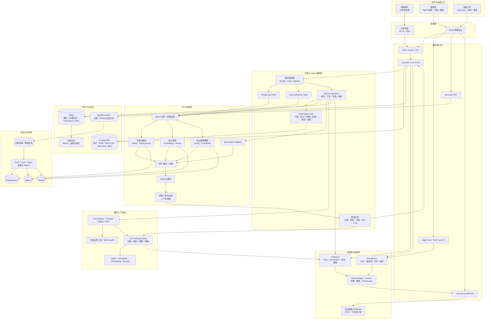
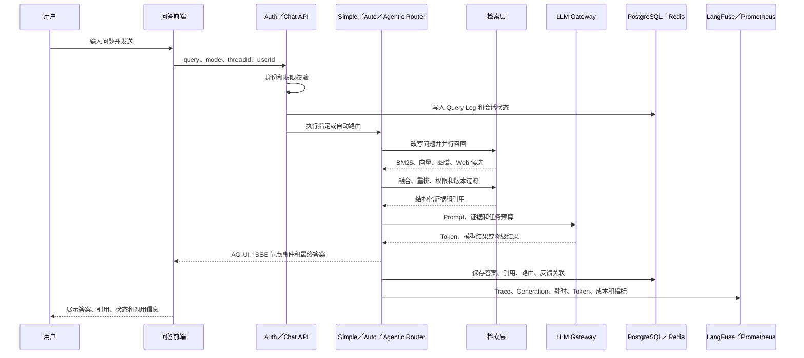

# 功能步骤流程

更新时间：2026-08-11

## 文档目的

本文用「用户操作流程→状态／数据流转流程」说明项目核心功能的实际运行方式，重点回答两个问题：

1. 用户在页面上做了什么；
2. 请求进入服务端后，经过哪些模块、产生了哪些状态变化，最后数据保存在哪里。

其中本文将 Bad Case 也称为主人前面说的「base case」。实际代码和后台名称统一使用 `Bad Case`。

## 术语注释

第一次看到英文词时，可以先看这里。后文保留英文原词，是为了和代码、日志、面试资料保持一致。

| 术语 | 中文解释 | 在本项目中的作用 |
| --- | --- | --- |
| Agent | 智能代理 | 能根据目标读取状态、选择工具、执行步骤并决定何时结束的模型应用 |
| Simple | 简单链路 | 以快速检索和轻量生成优先的低成本问答路径 |
| Auto | 自动链路 | 先尝试 Simple，再根据证据是否足够自动升级到 Agentic |
| Agentic | 代理链路 | 能规划、调用工具、反思、重试和审批的复杂问答路径 |
| Multi-Agent | 多 Agent | 多个职责不同的 Agent 通过结构化交付物协作完成任务 |
| RAG | Retrieval-Augmented Generation，检索增强生成 | 先找知识，再让模型基于知识回答 |
| Query | 查询 | 用户输入的问题 |
| Query Log | 查询日志 | 保存问题、答案、路由、耗时、引用和状态，供反馈与评测关联 |
| Chunk | 文本块 | 文档切片后用于检索和引用的最小知识单元 |
| Parent Chunk／Child Chunk | 父块／子块 | 子块用于精确召回，父块保留完整章节语义；命中子块后按需补回父块或同章节上下文 |
| Embedding | 向量化 | 把文字转换成数字向量，便于按语义相似度搜索 |
| BM25 | 关键词相关性算法 | Elasticsearch 的关键词搜索方式，擅长命中专有名词、数字和版本号 |
| Semantic Search | 语义搜索 | 不要求关键词完全相同，而是按含义相近查找内容 |
| Milvus | 向量数据库 | 保存 Embedding，执行向量相似度检索 |
| Elasticsearch | 搜索引擎 | 执行 BM25 关键词、字段和过滤条件搜索 |
| Neo4j | 图数据库 | 保存实体和关系，支持知识图谱查询 |
| GraphRAG | 图谱增强检索生成 | 先查实体关系和多跳路径，再结合文本证据回答 |
| Graph Search | 图谱搜索 | 从实体出发查找邻居、关系、路径和关联文档 |
| RRF | Reciprocal Rank Fusion，倒数排名融合 | 把关键词、向量和图谱多个检索结果合并排序 |
| Rerank | 重排 | 对初步召回的候选重新打分，把最能回答问题的证据排前面 |
| Sufficiency Gate | 证据充分性门禁 | 判断当前检索结果够不够回答问题，决定直接回答、升级或拒答 |
| Citation | 引用 | 答案中指向原始文档、版本和文本块的来源信息 |
| Claim | 事实声明 | 答案里可以被单独核验的一条事实 |
| Faithfulness | 忠实度 | 答案是否忠实于检索到的证据，有没有编造 |
| Bad Case | 坏例／错误案例 | 用户认为答案错误、遗漏或不完整而提交的反馈样本 |
| Few-Shot | 少样本示例 | 把少量已审核案例作为提示参考，帮助模型处理相似问题 |
| Checkpoint | 检查点 | 保存 Agent 当前执行位置和状态，失败后可以继续执行 |
| Redis | 内存数据库 | 保存缓存、会话状态和 Checkpoint，也支持队列协调 |
| AG-UI | Agent 用户界面事件协议 | 把 Agent 的节点、Token、工具和最终状态以统一事件发给前端 |
| SSE | Server-Sent Events，服务端推送事件 | 服务端持续向浏览器推送流式答案和执行状态 |
| Abort | 中止 | 用户点击停止或连接断开后，取消上游模型和 Agent 执行 |
| Trace | 一次完整请求的追踪记录 | 查看一次问答从入口到模型、工具和最终答案的完整链路 |
| Generation | 一次模型生成记录 | LangFuse 中的一次模型调用，包含模型、输入、输出、Token、耗时和成本 |
| Span | Trace 中的一段操作 | 表示一个 Agent 节点、工具调用或服务处理阶段 |
| LangFuse | LLM 可观测平台 | 查看模型调用、Token、成本、Prompt、耗时和质量关联 |
| Prometheus | 指标监控系统 | 统计 QPS、成功率、错误率、P95、并发和服务资源状态 |
| Token | 模型计费和上下文单位 | 影响上下文长度、模型成本和输出上限 |
| P50／P95／P99 | 延迟分位数 | P95 表示 95％ 请求的耗时低于该值，比平均耗时更能反映长尾 |
| BullMQ | 基于 Redis 的任务队列 | 异步执行文档解析、索引和 Artifact 生成任务 |
| Worker | 后台任务执行器 | 从队列取任务并执行，不阻塞用户请求 |
| Retry | 重试 | 临时失败后再次执行任务或模型调用 |
| Backoff | 退避 | 重试前逐步增加等待时间，避免持续冲击故障服务 |
| Fallback | 降级／备用路径 | 主模型、搜索或工具失败时切换备用能力或返回受控结果 |
| Tool | 工具 | Agent 可以调用的原子能力，例如检索、重排、图谱和外部搜索 |
| Function Calling | 函数调用 | 模型以结构化参数提出工具调用请求 |
| MCP | Model Context Protocol | Host 与外部 Tool、Resource、Prompt Server 之间的标准协议 |
| Tool Registry | 工具注册表 | 记录工具权限、风险、超时、重试、审计和降级策略 |
| Prompt | 提示词 | 发送给模型的系统规则、任务说明和上下文模板 |
| Prompt Registry | 提示词注册表 | 记录 Prompt 版本、负责人、用途、评测集和回滚信息 |
| Prompt Injection | 提示词注入 | 不可信文档或用户内容试图改变系统规则或诱导工具调用的攻击 |
| Artifact | 结构化交付物 | 多 Agent 之间传递的需求、设计、代码、测试或运营结果 |
| Schema | 结构约束 | 规定对象必须有哪些字段、字段类型和格式 |
| ACL | Access Control List，访问控制列表 | 规定某个用户、角色或部门能否访问文档和资源 |
| userId 隔离 | 用户身份隔离 | 查询、反馈和 Bad Case 只能访问当前用户范围内的数据 |
| TTL | Time To Live，过期时间 | 缓存或临时状态的自动失效时间 |
| Idempotency | 幂等 | 同一个任务重复执行不会重复产生错误副作用 |
| Sidecar | 旁车数据 | 从图片、音频或视频提取出的 OCR、ASR 或媒体说明文本 |
| DLP | Data Loss Prevention，数据防泄漏 | 识别、脱敏和阻止敏感数据被不当读取或输出 |
| IAM | Identity and Access Management，身份权限管理 | 企业统一管理用户、组织、角色和权限的系统 |
| Adoption | 用户采纳率 | 用户是否真正接受答案，不能只看调用次数，还要看反馈、返工和人工接管 |
| Baseline | 基线版本 | 用来和新版本比较质量、延迟、成本和成功率的旧版本 |
| Smoke Test | 冒烟测试 | 用最小测试验证服务或依赖是否能正常工作 |
| SLA | Service Level Agreement，服务等级目标 | 对成功率、延迟、可用性和恢复时间的约定 |
| 企业微信机器人 Webhook | 企业微信提供的机器人回调地址 | `NotifyService.sendEnterpriseWechatMarkdown()` 通过它发送 Markdown 告警；未配置时走本地模拟通知 |

简单记忆：RAG 负责「找证据」，Agent 负责「决定下一步」，Tool 负责「执行动作」，Checkpoint 负责「记住执行到哪」，LangFuse 负责「看单次链路」，Prometheus 负责「看整体服务」。

## 实现状态总览

本地能通过代码、测试或 smoke 验证的能力不再重复实现；下面区分「已实现」「部分实现」和「必须依赖真实生产环境」。

| 能力 | 当前状态 | 已有实现／证据 | 仍缺内容 |
| --- | --- | --- | --- |
| AG-UI／SSE 流式链路 | 基础已实现 | AG-UI 生命周期事件、节点事件、Token 流、断开 Abort、前端中止请求 | Last-Event-ID 断线续传和跨实例事件恢复 |
| 异步任务与队列 | 本地已实现 | 文档处理和 Artifact 使用 BullMQ，支持进度状态、重试、指数退避、并发和 Redis 不可用时降级 | 生产死信队列、跨服务补偿和独立 Worker 集群 |
| 多模态 RAG | 基础已实现 | OCR、Vision Provider、ASR／TTS、图片／音视频 sidecar 和模拟评测集 | 真实视觉向量、视频抽帧检索、以图搜图和真实模型效果 |
| GraphRAG | 基础已实现 | Neo4j 实体／关系查询、Graph Search、Obsidian graph seed、图谱运营接口 | 企业级实体对齐、别名合并、增量冲突治理和大规模回滚 |
| Web Search fallback | 本地已实现 | Bocha Tool、Agentic 外部搜索节点、超时和失败降级、外部工具 smoke | 真实来源长期治理、网页快照留存和生产引用审计 |
| 缓存、限流和并发 | 本地已实现 | Redis 缓存、Embedding／权限／会话缓存、Nest Throttler、队列并发、超时和重试 | 租户级配额、分布式限流看板和生产熔断平台 |
| DLP／数据合规 | 部分实现 | ACL、userId 隔离、Prompt Injection 防护、敏感内容边界和审计基础 | 企业 DLP、数据分级、保留周期、删除请求和完整脱敏策略 |
| 成本核算 | 本地已实现基础能力 | Token、成本字段、模型预算、LLM Gateway 路由和成本摘要 API | 真实租户账单、配额、月度结算和成本告警 |
| 线上事故处理 | 本地证据已具备 | Trace、Prometheus 指标、健康检查、降级、回滚流程和事故模板 | 生产告警编排、值班系统、真实事故和 Postmortem |

因此，当前不是“全部没有实现”，而是“本地核心能力已实现，生产级扩展项仍有边界”。

## 一、整体系统链路

### 1.1 项目总体架构图



### 1.2 架构图怎么讲

面试时可以按六层说明：

1. **入口层**：普通用户从 AI 问答进入，管理员从 Agent 运营、文档管理和知识图谱进入。
2. **接口层**：Auth／ACL 先校验身份和权限，再进入 Chat、Document、Agent Ops 或 RAG Ops API。
3. **编排层**：Simple 负责低延迟快路径，Auto 通过 Sufficiency Gate 自动升级，Agentic 负责规划、工具、反思、审批和多 Agent DAG。
4. **检索层**：关键词、向量、知识图谱和 Web Search 并行召回，经过 RRF、去重、权限／版本过滤、Rerank 和上下文预算后交给模型。
5. **状态与数据层**：PostgreSQL 保存业务事实和审计，Redis 保存缓存、短期状态、Checkpoint 和队列，Milvus／Elasticsearch／Neo4j 保存不同类型的知识索引。
6. **治理与观测层**：LLM Gateway 控制模型主备、超时和成本，LangFuse 看单次调用，Prometheus 看整体服务，告警再进入企业微信和值班流程。

### 1.3 一次问答的主链路图



```text
用户操作
  → 前端页面／会话
  → API Controller
  → 业务 Service
  → RAG／Agent 编排
  → PostgreSQL／Redis／Milvus／Elasticsearch／Neo4j
  → LangFuse／Prometheus
  → 页面返回答案、状态和调用轨迹
```

统一原则：

- PostgreSQL 保存业务事实、会话关联、Query Log、反馈、Bad Case、审核和审计记录；
- Redis 保存短期状态、缓存和 Checkpoint，支持跨进程恢复；
- Milvus 保存向量和 Bad Case 动态 Few-Shot 索引；
- Elasticsearch 负责关键词和结构化检索；
- Neo4j 保存实体关系和 GraphRAG 数据；
- LangFuse 记录单次请求和模型调用级 Trace；
- Prometheus 记录服务整体性能和基础设施指标。

### 1.4 简历核心职责流程速览

这一节将简历中的三条「负责内容」直接对应到用户可见操作和后端数据流；后续章节再展开每一步的实现细节。

#### 1.4.1 活动营销知识库与管理后台

**用户操作流程：**

1. 管理员在「文档管理」上传活动模板、官网规范、前端经验、Obsidian 笔记或 URL 文档。
2. 管理员填写项目、活动、地区、角色权限、版本、生效时间和来源权威等信息。
3. 管理员查看解析和索引进度；更新资料后发布新版本，旧版本自动失效或标记为被替代。
4. 普通用户问答时，只能看到自己权限范围内、当前有效版本的内容，并可打开引用查看来源。

**数据／状态流程：**

```text
上传／同步资料
  → Document Service（注：文档业务服务）校验文件、来源、ACL（注：访问控制列表）、版本和元数据（注：描述文档的项目、地区、角色等附加信息）
  → Parser（注：文档解析器）提取标题、表格、代码、正文和多模态 sidecar（注：图片、音视频附带的 OCR／转写说明）
  → Chunker（注：文档切块器）按文档结构切出 Child Chunk（注：子文本块，用于精确检索）
  → 记录 Parent Chunk（注：父文本块，保留完整章节）、headingPath（注：标题层级路径）、source span（注：原文起止位置）和相邻块关系
  → PostgreSQL（注：关系型数据库）保存 document（注：文档）、version（注：版本）、chunk（注：文本块）、ACL 和索引状态
  → Milvus（注：向量数据库）写入 Child Chunk Embedding（注：子块的语义向量）
  → Elasticsearch 写入正文、字段和关键词索引
  → Neo4j 写入活动、玩法、页面、接口、埋点和地区实体关系
  → 新版本生效：旧版本标记 superseded（注：已被新版本替代）／expired（注：已过期）；索引失败：保留旧可用索引并支持回滚
```

#### 1.4.2 智能问答、方案生成与 MCP 上下文服务

**用户操作流程：**

1. 业务用户在「AI 智能问答」选择 Simple、Auto 或 Agentic，输入活动问题。
2. 简单问题直接返回带引用的答案；复杂需求自动或手动进入活动方案工作流，页面展示页面结构、接口、埋点、风险和验收 Checklist。
3. 开发人员在 Codex、Claude Code 或 Trae 中调用 MCP 工具，检索组件规范、活动模板、埋点规则和地区适配知识，再继续编码。

**数据／状态流程：**

```text
用户问题／MCP tool request（注：MCP 工具调用请求）
  → Auth（注：身份认证）、userId（注：用户唯一标识）、ACL、角色和 scope（注：本次查询允许访问的项目、地区、文档范围）校验
  → Router（注：链路选择器）选择 Simple／Auto／Agentic
  → Query（注：用户问题）改写、意图识别和权限／版本条件注入
  → BM25＋向量＋GraphRAG 并行召回
  → RRF（注：多路结果按排名融合）、去重、Parent／Neighbor Expansion（注：补父块、同章节和相邻上下文）、Rerank（注：对候选再次精排）
  → 引用／充分性／冲突门禁
  → Simple 生成答案，或 Agentic 输出结构化方案 Artifact（注：可被下游继续使用的标准交付物）
  → AG-UI（注：Agent 前端事件协议）／SSE（注：服务端持续推送事件）或 MCP tool result（注：MCP 工具结果）返回前端／编码工具
  → PostgreSQL 保存 Query Log（注：查询日志）、答案、引用、路由和 Artifact；Redis（注：缓存与状态数据库）保存会话与 Checkpoint（注：执行检查点）
```

#### 1.4.3 质量运营、Bad Case 与运行观测

**用户操作流程：**

1. 用户在答案下提交 Bad Case，填写错误类型、补充说明、修正答案和是否加入回归。
2. 运营人员在「Agent 运营→Bad Case 审核」查看原问题、原答案、引用和检索快照，选择审核通过、驳回或撤销。
3. 审核通过后，用户再次询问相似问题；系统基于纠正证据重新组织答案。
4. 开发／运营人员在调用轨迹、LangFuse 和 Prometheus 查看慢请求、空召回、模型失败、工具失败、成本及回归结果。

**数据／状态流程：**

```text
提交反馈
  → PostgreSQL 保存 RagFeedback（注：用户反馈记录）、Bad Case、Query Log 关联、检索快照和审核状态=pending（注：待审核）
  → 审核通过：写入 corrected_answer（注：修正答案）、reviewed_by（注：审核人）、reviewed_at（注：审核时间）和回归开关
  → 生成 Bad Case Embedding（注：错误案例的语义向量），写入独立 Milvus correction collection（注：纠正知识专用集合）
  → Simple／Auto／Agentic 均先执行 Bad Case Preflight（注：生成前的纠正知识预检查）
  → Correction Gate（注：纠正答案采用门禁）按相似度、当前正式证据和版本判断是否采用纠正知识
  → 生成自然回答并保存新的 Query Log；回归脚本记录用例结果
  → 撤销：删除／失效对应纠正向量，恢复仅使用正式知识
  → LangFuse 记录 Trace（注：一次完整请求）、Generation（注：一次模型生成）／Span（注：一次节点或工具操作）；Prometheus（注：服务指标系统）聚合延迟、空召回、重试、工具成功率和循环限制指标
```

### 1.5 简历五项技术难点流程

本节与简历中的五项技术难点一一对应。前面的「职责流程」说明系统交付了什么；本节说明这些能力在实际使用中如何运行、各模块如何变更状态。

#### 1.5.1 多 Agent 协作可控性

**用户操作流程：**

1. 管理员进入「Agent 工作台」，填写活动／项目需求，选择参与岗位、最大步骤和审批策略。
2. 普通任务点击启动后自动流转；高风险任务在关键节点暂停，等待管理员批准或驳回。
3. 管理员查看产品、设计、后端、前端、测试、运营各岗位的状态和结构化交付物。
4. 单一岗位失败时，管理员只重跑该岗位及其依赖下游，不重跑已完成节点。

**数据／状态流程：**

```text
创建 workflow（注：多 Agent 工作流）
  → Manager（注：流程总协调器）初始化 threadId（注：会话线程标识）、runId（注：本次运行标识）、状态图、参与角色、预算和审批策略
  → Product Agent（注：产品代理）读取需求与证据，输出 Product Artifact（注：产品结构化交付物）
  → Design Agent（注：设计代理）＋Backend Agent（注：后端代理）并行，分别输出 Design／Backend Artifact（注：设计／后端交付物）
  → Schema（注：字段格式约束）／依赖／证据门禁校验通过后，Frontend Agent（注：前端代理）消费必要 Artifact
  → QA Agent（注：测试代理）生成测试、风险和验收 Artifact
  → Operations Agent（注：运营代理）汇总上线、埋点和复盘 Artifact
  → 每个节点写入 status（注：节点状态）、输入版本、输出 Artifact、owner（注：该节点责任角色）、耗时、Trace 和重试次数
  → 风险节点变为 approval_required（注：等待人工审批）；批准后继续，驳回后按 rerunRoles（注：允许局部重跑的岗位列表）局部重跑
  → 达到最大步骤、工具次数、Token 或超时预算时安全停止并降级
```

#### 1.5.2 复杂度路由与成本控制

**用户操作流程：**

1. 用户在问答页选择 `simple`、`auto` 或 `agentic`，也可以默认使用 `auto`。
2. 选择 `auto` 时，用户只提交一次问题；若快路径证据充足直接出答案，若不足系统自动升级，不要求用户重复输入。
3. 页面显示最终路由、检索充分性、重试次数和耗时，帮助用户理解为什么进入复杂链路。

**数据／状态流程：**

```text
请求进入 Router（注：链路选择器）
  → simple（注：简单快速链路）：固定 Hybrid RAG（注：混合检索增强生成）＋轻量生成，写入 route=simple（注：本次实际使用简单链路）
  → auto（注：自动选择链路）：先执行 Fast Path（注：低延迟、低成本的快速检索路径），计算 retrievalHit（注：检索是否命中有效证据）、citationCoverage（注：关键结论被引用覆盖的程度）、confidence（注：当前答案置信度）、taskComplexity（注：问题是否需要多步骤或工具协作）
      → Sufficiency Gate（注：证据充分性门禁）通过：route=auto_simple（注：Auto 最终走简单链路），直接生成
      → Sufficiency Gate 不通过：route=auto_agentic（注：Auto 最终升级复杂链路），复用 Fast Path 已召回的原问题证据，创建 Agentic State（注：复杂 Agent 的运行状态）并升级
          → Auto 最多规划 2 个子问题；补充子问题并行执行检索，避免串行等待和原问题重复召回
  → agentic（注：可规划的复杂链路）：直接创建 Agentic State，进入规划、工具、反思和审批节点
  → 三条路径统一记录 query（注：问题）／chunk（注：命中文本块）／tool（注：调用工具）／retry（注：重试）／step（注：执行步骤）／Token（注：模型上下文与计费单位）预算
  → 预算耗尽、模型或工具失败：LLM Gateway（注：模型路由和降级服务）选择备用模型、降级答案或受控拒答
  → PostgreSQL 保存 route（注：最终路由）、升级原因、预算消耗、耗时和最终状态；LangFuse 记录模型成本
```

#### 1.5.3 混合检索与关联补全

**用户操作流程：**

1. 用户提出包含活动名称、地区、接口字段、埋点事件或跨文档关系的问题。
2. 用户只看到最终答案和引用，不需要分别操作关键词、向量或图谱搜索。
3. 用户点击引用时可以查看命中的文档版本、章节和原始片段；无足够证据时系统提示澄清或拒答。

**数据／状态流程：**

```text
文档入库
  → Parser（注：文档解析器）保留标题、表格、代码围栏、source span（注：原文起止位置）和元数据
  → Chunker（注：切块器）划分 Parent Chunk（注：父块）／Child Chunk（注：子块）：Child 用于精确命中，Parent 保存完整章节语义
  → Child Embedding（注：子块语义向量）写入 Milvus；关键词／字段写入 Elasticsearch；实体关系写入 Neo4j

用户查询
  → Query Normalize（注：清理和标准化问题）／Rewrite（注：补全别名和隐含条件）／Intent（注：识别问题类型）／Scope Builder（注：生成可访问知识范围）
  → 并行召回：BM25（注：关键词精确检索）＋Milvus 语义（注：按含义相近检索）＋Neo4j 实体关系／多跳扩展
  → ACL、userId（注：用户标识）、项目、地区、角色、版本和生效时间过滤
  → RRF（注：多路排名融合）、去重、单文档限额
  → 命中 Child（注：子块）后 Parent／Neighbor Expansion（注：补父块、同章节和相邻必要上下文）
  → Rerank（注：二次精排）按问题、内容、来源、时间和意图排序
  → Context Budget（注：上下文 Token 预算）、引用校验和证据充分性门禁
  → 将结构化证据、引用和答案返回，并保存检索快照
```

#### 1.5.4 回答可信与持续纠错

**用户操作流程：**

1. 用户查看回答及其引用；证据不足时系统明确拒答或提示待确认，不把猜测写成事实。
2. 用户发现错误后点击「提交 Bad Case」，填写错误类型、说明、修正答案和回归开关。
3. 运营人员审核原答案、引用、检索快照和修正内容，选择通过、驳回或撤销。
4. 审核通过后，用户重新提问相似问题；三个路由都会优先检查已审核纠正知识，并自然化输出修正后的回答。

**数据／状态流程：**

```text
生成前
  → Evidence Sufficiency（注：证据充分性检查）：证据不足则澄清／拒答
  → Prompt Builder（注：组装模型指令和上下文的模块）分离系统规则、用户输入与不可信检索内容
  → Citation／Claim Gate（注：引用与事实声明门禁）校验关键事实能否回指当前版本的正式证据

Bad Case 提交与回灌
  → PostgreSQL 写入 feedback（注：反馈）、bad_case（注：错误案例）、queryLogId（注：关联查询日志编号）、retrievalSnapshot（注：当时的检索结果快照）、status=pending（注：待审核）
  → 审核通过：status=reviewed（注：已审核），保存 correctedAnswer（注：修正答案）、reviewer（注：审核人）、回归开关
  → 生成向量，写入独立 correction collection（注：纠正知识专用向量集合）
  → 下次查询：Bad Case Preflight（注：纠正知识预检查）相似检索＋短实体兜底
  → Correction Gate（注：纠正知识采用门禁）按相似度、审核状态、当前正式知识和版本决定 hint（注：仅提示）／correction（注：作为纠正证据）／exact（注：高置信精确修正）级别
  → 生成器基于纠正证据重述答案，不原样复制人工文本
  → 撤销／驳回：状态失效并删除或跳过对应纠正索引
  → 回归任务记录 Simple／Auto／Agentic 的通过结果，失败样例回到 Bad Case 或评测集
```

#### 1.5.5 长流程恢复与可观测性

**用户操作流程：**

1. 用户发起多步骤 Agentic 或多 Agent 任务，前端持续显示节点、工具调用和生成状态。
2. 用户刷新页面、SSE 短暂断开或原处理进程退出后，使用相同会话继续查看并恢复任务。
3. 开发／运营人员通过「调用轨迹」、LangFuse 和 Prometheus 查看某次任务的节点耗时、空召回、工具失败、重试、Token 和成本。
4. 指标超过阈值后，告警服务生成事件并预留企业微信机器人通知入口。

**数据／状态流程：**

```text
执行与恢复
  → 每个 Agent 节点结束后，Redis Checkpointer（注：Redis 检查点存储）写入 threadId（注：会话线程标识）、runId（注：本次运行标识）、节点、消息、Artifact、工具结果和状态版本
  → Redis 设置 TTL（注：自动过期时间）并按 userId／threadId 隔离
  → 新进程／恢复请求读取最近 checkpoint（注：检查点），校验 Schema（注：状态字段格式）和版本
  → 幂等检查后从未完成节点继续；已完成节点不重复产生副作用
  → 完成后写入 final state（注：最终运行状态），按生命周期清理临时 checkpoint

观测与告警
  → 请求创建 LangFuse Trace（注：完整请求链路）；模型调用写 Generation（注：单次模型生成）；岗位节点／工具写 Span（注：局部操作记录）和事件
  → Prometheus 记录 HTTP（注：接口请求）、节点耗时、TTFT（注：首个 Token 返回耗时）、空召回、工具成功率、重试、循环／预算命中和错误率
  → Alert Rule（注：告警阈值规则）按阈值生成 alert event（注：告警事件）
  → NotifyService.sendEnterpriseWechatMarkdown()（注：发送企业微信 Markdown 消息的函数）作为企业微信 Webhook（注：机器人回调地址）接入点；未配置时记录本地模拟通知
  → 运营人员用 Trace ID（注：请求追踪编号）关联 Query Log、Bad Case、审计记录和指标，定位后修复并执行回归
```

六岗位生产工作流使用独立的 `agent.production.workflow` Trace（注：一次完整产研协作追踪），并为每个岗位写入 `agent.production.stage.*` Span（注：岗位阶段记录）和 `agent.production.generation.*` Generation（注：岗位模型生成记录）；普通 Simple／Auto／Agentic 问答继续使用 `rag.answer` Trace。工作流和问答完成后都会执行 flush（注：把本地观测队列立即发送到 LangFuse），因此不需要等服务关闭才能在 LangFuse 后台看到数据。

---

## 二、多 Agent（注：多个智能代理分工协作）：Simple（注：简单快速链路）、Auto（注：自动选择链路）、Agentic（注：可规划和调用工具的复杂链路）

### 2.1 Simple（注：优先检索和轻量生成）链路

#### 用户操作流程

1. 用户进入「AI 智能问答」页面。
2. 选择 `simple` 链路和模型，输入问题并发送。
3. 系统先返回检索和生成过程中的流式状态，最后显示答案、引用、路由、检索评估和耗时信息。
4. 用户可以继续追问，也可以点击「提交 Bad Case」反馈当前答案。

#### 状态／数据流转流程

```text
请求进入 Chat／AG-UI 接口
  → 校验用户身份、threadId、模式和输入
  → Query Log（注：保存问题、答案、路由和耗时的查询日志）记录问题和请求上下文
  → 检查当前知识是否足够
  → 查询已审核 Bad Case 纠正证据
  → 权限过滤
  → Karpathy／Obsidian Fast Path 或 Hybrid RAG
  → BM25（注：关键词相关性搜索）／向量（注：按语义相似度搜索）／图谱召回
  → RRF（注：把多路搜索结果合并排名）合并与 Rerank（注：对候选结果再次精确排序）
  → 引用和证据校验
  → 生成自然语言答案
  → 保存回答、引用、路由、耗时和 trace
  → LangFuse 上报 Trace（注：一次请求的完整追踪），Prometheus（注：服务指标监控系统）记录指标
```

Simple 的核心特点是快路径：固定问题优先用检索和轻量生成完成，不启动完整 Agent 规划，降低延迟、Token 和成本。若命中高置信度 Bad Case，先把审核后的纠正事实作为受控证据交给生成器加工，避免原样透传人工答案。

### 2.2 Auto（注：先走简单链路，证据不足时自动升级）链路

#### 用户操作流程

1. 用户选择 `auto` 链路，输入问题。
2. 系统先自动尝试简单检索，不要求用户手动选择是否升级。
3. 如果证据充分，直接返回自然化答案。
4. 如果证据不足、问题复杂或需要多步处理，系统自动升级到 Agentic 流程。
5. 页面展示最终使用的路由，例如 `simple` 或 `agentic`，用户无需改变输入。

#### 状态／数据流转流程

```text
请求进入 Auto Router
  → 先执行 Simple／Fast Path
  → 记录候选证据、相关性和 sufficiency 评估
  → 通过 Sufficiency Gate（注：证据充分性门禁）？
      ├─ 是：生成答案 → 引用校验 → 返回
      └─ 否：升级 Agentic Workflow
                    → 复用 Fast Path 原问题召回结果
                    → 最多规划 2 个子问题并行检索
                    → 工具调用、反思和生成
  → Bad Case Correction Gate 在快路径和升级路径都生效
  → 保存最终路由、升级原因、节点轨迹、答案和指标
```

Auto 的关键不是简单随机选链路，而是先用便宜路径判断问题是否能被当前证据回答，再根据充分性门禁决定是否支付 Agentic 的额外成本。

### 2.3 Agentic（注：由状态图控制规划、工具、反思和审批）链路

#### 用户操作流程

1. 用户选择 `agentic` 链路，输入复杂问题或需要多步推理的问题。
2. 系统展示节点执行状态，例如检索、重排、工具调用、生成和反思。
3. 如果触发高风险动作或证据不足，系统进入人工审批或返回澄清／拒答。
4. 完成后返回加工后的答案、引用、工具结果、路由和调用轨迹。
5. 用户可以继续追问、提交 Bad Case 或查看当前回答的执行信息。

#### 状态／数据流转流程

```text
请求进入 Agentic RAG Service
  → 创建 thread／run 状态
  → Query Augment（注：查询扩展／子问题规划）：把原问题拆成最多 3 个可独立检索的 SubQuestion（注：子问题），保留 dependsOn（注：前置依赖）和独立状态
  → 写入 SubQuestion Plan Artifact（注：子问题计划交接物）：保存问题、子问题、依赖和版本，供后续节点和 Checkpoint（注：执行检查点）恢复使用
  → Bad Case Preflight：先检查已审核纠正案例
  → Retrieval（注：逐子问题检索）：每个 SubQuestion 分别执行 Milvus 向量语义检索＋BM25／Elasticsearch 关键词检索；空结果再走 BM25 降级；关系、多跳问题按需调用 Neo4j GraphRAG（注：知识图谱增强检索）
  → Permission Filter：按 userId／ACL／作用域过滤
  → SubQuestion Sufficiency（注：逐子问题证据充分性判断）：按每个子问题绑定的 evidenceIds（注：证据编号）判断是否已经有直接证据
      → 全部充分：进入合并和重排
      → 部分不足：只对不足子问题调用 Bocha Web Search（注：联网搜索兜底）
  → Merge／Deduplicate（注：合并去重）：合并各子问题候选，并优先保留每个子问题至少一条证据
  → 写入 Evidence Bundle Artifact（注：证据包交接物）：保存 chunk id（注：证据片段编号）、子问题证据绑定和联网补检索数量
  → Rerank（注：重排候选证据）：按整体问题对融合证据重新排序
  → Generate：根据证据生成答案
  → 写入 Answer Contract Artifact（注：答案契约交接物）：记录答案、引用是否支持、子问题覆盖率和校验原因
  → Critic Gate（注：确定性质量门禁）：答案契约不通过时进入受限重试，不直接把不完整答案标记为成功
  → Reflection：检查事实、引用和任务完成度
  → 不通过则受限重试、重新召回或降级
  → 高风险动作进入 Human Approval
  → 写入 Checkpoint（注：可恢复的执行检查点）、Query Log、答案和 Trace
  → Agent 运营后台自动列出最近 Agentic／Auto 会话，运营人员选择问题即可查询 Artifact；Thread ID 仅作为高级排障入口；若运行失败，具备权限的运营人员可触发同一 Thread 的 Agentic 重新执行并对比新旧产物
  → 返回流式事件和最终结果
```

Agentic 使用显式状态图和停止条件控制循环，限制最大步数、总耗时、工具次数、Token 和重复调用；不是让模型无限自由调用工具。

#### 2.3.1 Agentic 子问题检索的实际例子

**用户操作流程：**

1. 用户输入「活动落地页需要哪些页面模块、接口和埋点，海外地区有什么差异？」并选择 Agentic，点击发送。
2. 页面先显示「问题规划」，再显示三个子问题的检索状态；用户能看到哪个子问题已找到证据、哪个子问题触发了联网搜索。
3. 所有子问题完成后，页面展示统一答案、引用和检索／重排状态；用户不需要手动分别提问。

**状态／数据流转流程：**

```text
原问题
  → SubQuestion 1：页面需要哪些模块
  → SubQuestion 2：模块对应哪些接口和埋点（依赖 SubQuestion 1）
  → SubQuestion 3：海外地区有哪些适配差异（依赖原问题）
  → 每个子问题分别执行：Milvus 语义召回＋BM25／Elasticsearch 关键词召回
  → RRF（注：多路排名融合）＋父子块／相邻章节补全
  → 子问题 Sufficiency Gate（注：证据充分性门禁）
  → 不足时调用 GraphRAG 或 Web Search
  → 汇总 evidence（注：证据）并按 chunk id 去重
  → 产出 SubQuestion Plan／Evidence Bundle／Answer Contract 三类 Artifact（注：结构化节点交接物），并通过 AG-UI Custom Event（注：自定义流式事件）推送阶段状态
  → 保证每个子问题至少保留一条候选，再按整体问题 Rerank
  → 引用校验、Prompt Injection（注：提示词注入）过滤、权限／版本过滤
  → 模型生成自然答案，先做引用支持和子问题覆盖率校验；保存子问题状态、证据编号、Artifact、工具调用和最终 Query Log
```

这里的“拆分”不是把多个关键词拼在一起，而是把每个子问题作为独立检索单元；每个单元都有自己的召回结果、充分性、重试次数和联网兜底状态，最终才合并为一个答案。

### 2.4 三条链路的区别

| 链路 | 用户感知 | 服务端主要策略 | 适用问题 |
| --- | --- | --- | --- |
| Simple | 快速得到答案 | Fast Path、检索、重排、轻量生成 | 单知识点、明确事实查询 |
| Auto | 系统自动决定快慢 | Simple 先行，Sufficiency Gate 决定是否升级 | 不确定复杂度的普通问答 |
| Agentic | 能看到多步执行过程 | 状态图、工具、反思、审批、Checkpoint | 多跳、复杂分析、需要工具的问题 |

### 2.5 多 Agent 协作流程

#### 用户操作流程

1. 管理员进入「Agent 工作台」，填写项目／活动 ID、需求背景、参与岗位和最大步骤。
2. 选择普通任务自动流转，或者重要任务按风险进入人工审批。
3. 点击「启动工作流」，系统创建一个统一的项目任务。
4. 产品 Agent 先整理需求和验收目标。
5. 设计 Agent 与后端 Agent 在产品交付物完成后并行工作，分别产出设计方案和技术方案。
6. 前端 Agent 消费设计与技术 Artifact，生成页面和交互实现方案。
7. 测试 Agent 消费需求、设计和技术 Artifact，生成测试用例和风险清单。
8. 运营 Agent 汇总上线、埋点、活动配置和复盘要求。
9. 管理员可以查看每个岗位状态，批准、驳回、指定岗位重跑或等待任务自动结束。

#### 状态／数据流转流程

```text
创建 project workflow
  → Manager 初始化统一 State、threadId、runId 和预算
  → Product Agent
      → 读取需求背景和知识证据
      → 产出 Product Artifact
  → fan-out：Design Agent ＋ Backend Agent 并行
      → 各自读取最小必要上下文
      → 产出 Design Artifact、Backend Artifact
  → fan-in：依赖检查和 Artifact Schema 校验
  → Frontend Agent 消费上游 Artifact
      → 产出 Frontend Artifact
  → QA Agent 消费需求、设计、前后端 Artifact
      → 产出测试用例、风险和验收结果
  → Operations Agent 消费全链路 Artifact
      → 产出上线、埋点、运营和复盘清单
  → 汇总 Manager 检查完整性、证据覆盖、风险和任务成功
  → 普通任务自动完成；高风险任务进入 Human Approval
  → 每个节点写入状态、输入版本、输出 Artifact、耗时和 Trace
```

多 Agent 不是把同一段上下文复制给六个模型，而是通过版本化 Artifact 和 Agent Contract 协作：上游输出结构化交付物，下游只读取自己需要的字段；明确依赖的节点才阻塞，设计和后端可以并行；某个岗位失败时支持该岗位局部重跑，不必重做整条链路。

### 2.6 多 Agent 的失败、审批和恢复

```text
节点开始
  → 权限／输入 Schema／预算检查
  → 模型调用和工具调用
  → 成功：保存 Artifact，推进下游
  → 可重试错误：退避后重试，记录 retry
  → 不可恢复错误：标记节点 failed，阻塞依赖节点
  → 风险动作：暂停为 approval_required
  → 人工批准：继续下游
  → 人工驳回：按 rerunRoles 指定岗位局部重跑
  → 进程中断：从 Redis Checkpoint 恢复
  → 超过步数／时间／Token／重复调用预算：安全停止并降级
```

---

---

## 三、RAG（注：先检索知识，再让模型基于知识回答）：召回、重排、权限过滤、知识版本治理

### 用户操作流程

1. 管理员进入「文档管理」，上传文件、输入网页或同步资料。
2. 填写项目、部门、角色、来源权威、生效时间、失效时间和版本信息。
3. 系统完成解析、切片、Embedding 和索引。
4. 用户在问答页面提问，系统只返回当前用户有权限看到的知识。
5. 用户可以点击引用查看来源文档和版本。
6. 管理员更新文档后重新发布，旧版本自动进入失效或替代状态。

### 状态／数据流转流程

```text
上传／同步文档
  → Document Service 校验元数据和权限
  → Parser 解析正文、表格、标题和结构
  → Chunker 结构保护切片并生成父子块：父块保留完整章节，子块保留标题路径、表格头、代码围栏和来源位置
  → Embedding 写入 Milvus
  → 关键词和字段写入 Elasticsearch
  → 实体关系写入 Neo4j
  → 保存 document／version／chunk 状态到 PostgreSQL

用户查询
  → Query Augment 和意图识别
  → 注入 userId、部门、角色、scope 等权限条件
  → Elasticsearch 关键词召回
  → Milvus 向量召回
  → Neo4j 图谱扩展
  → RRF 合并候选
  → Reranker 精排
  → 再次执行权限和版本过滤
  → 引用校验、上下文组装、生成答案
```

知识版本治理会比较 `content_hash`、文档版本、生效时间和来源权威；替代文档发布后，旧版本不再作为当前知识优先证据，索引失败时保留可回滚状态。

### 3.1 检索详细步骤

#### 用户操作流程

1. 用户输入问题，例如「周年庆活动的充值返利规则是什么」。
2. 系统识别问题中的实体、时间、活动、地区、角色和问题意图。
3. 用户看不到底层多个搜索引擎，只看到最终答案和引用来源。
4. 如果问题需要多跳关系，Agent 会继续沿着实体关系检索，而不是只依赖一段相似文本。
5. 如果所有召回证据都不足，系统返回澄清或拒答，不编造答案。

#### 状态／数据流转流程

```text
原始 query
  → Query Normalize：清理表达、识别语言和时间
  → Query Rewrite：补全别名、实体和隐含条件
  → Intent Classifier：判断事实、规则、对比、多跳或无答案问题
  → Scope Builder：生成 project、activity、region、locale、roleScope、documentType 等过滤条件
  → 并行召回：
      ├─ 关键词搜索：Elasticsearch BM25、字段权重、短语和过滤条件
      ├─ 语义搜索：Query Embedding → Milvus 向量相似度召回
      ├─ 知识图谱搜索：实体识别 → Neo4j 节点、关系和属性查询
      └─ 图谱扩展搜索：沿别名、上下位、关联活动和跨文档关系扩展候选
  → 结果标准化：统一 docId、chunkId、score、source、version、metadata
  → 权限过滤：删除 userId、部门、角色和租户无权访问的结果
  → 版本过滤：保留当前生效、来源权威和适用范围正确的知识
  → RRF／加权融合：合并关键词、向量和图谱候选，去重同一文档和相邻块
  → Parent／Neighbor Expansion：命中子块后，按 Token 预算补充父块、同 Section 和相邻必要上下文；父块只补语义完整性，不重复挤占候选名额
  → Reranker：综合 query、候选内容、时间、来源和意图重新排序
  → Diversity／Document Limit：限制单文档占比，避免一个文档霸榜
  → Context Budget：按 Token 预算截断并用 Lost-in-the-Middle 排布
  → Evidence Sufficiency：判断是否有足够证据支撑答案
  → 引用校验：每个关键 Claim 必须能回指 source、docVersion 和 chunk
  → 交给 Simple 生成或 Agentic 后续节点
```

### 3.2 四类检索的职责

| 检索方式 | 解决的问题 | 典型命中内容 | 主要局限 |
| --- | --- | --- | --- |
| 关键词／BM25 | 精确词、数字、活动名、版本号、兑换码 | 「周年庆」「685 分」「v2.1」 | 同义表达和改写不稳定 |
| 语义／向量 | 同义表达、自然语言描述和语义相近问题 | 「充值返利」与「消费回馈规则」 | 可能把相似但不适用的内容排前 |
| 知识图谱 | 实体、属性、关系和多跳约束 | 人物→学校→工作单位、活动→地区→时间 | 图谱缺失时无法覆盖 |
| 图谱扩展／Graph Search | 从实体出发扩展关联文档和邻居关系 | 同一活动的规则、组件、埋点和复盘 | 扩展过宽会增加噪声和延迟 |

实际链路不是四选一，而是按问题意图并行召回，再统一做权限、版本、融合、重排和证据门禁。Reranker 只能改善已经召回的候选，不能补回第一阶段完全没有找出的证据。

### 3.3 文档入库和索引更新流程

```text
管理员上传／网页同步／Obsidian 编译
  → Document API 创建 source document
  → 文件类型、大小、来源、权限和版本校验
  → Parser 提取正文、标题、表格、代码和多模态 sidecar
  → Quality Gate 检查空文档、重复内容、敏感信息和结构完整性
  → Chunker 进行结构保护切片
  → 生成 content_hash、docVersion、sourceAuthority、effectiveAt、expiredAt
  → Embedding 写入 Milvus
  → BM25 字段写入 Elasticsearch
  → 实体和关系写入 Neo4j
  → PostgreSQL 更新入库状态和索引状态
  → 新版本生效后废弃旧版本，失败时保留旧索引并支持回滚
```

---

## 四、Bad Case（注：用户提交的错误答案案例）：提交、审核、回灌、重新召回、回归验证

### 用户操作流程

1. 用户完成一次问答后，在答案下点击「提交 Bad Case」。
2. 选择错误类型，填写问题描述和纠正答案，并选择是否加入回归集。
3. 提交后，前端把 `threadId`、当前问题、AI 原回答、错误类型、评论和纠正答案发送到服务端。
4. Bad Case 进入「Agent 运营→Bad Case 审核」列表，初始状态是待审核。
5. 运营人员打开记录，确认问题、旧答案、纠正答案和来源，点击审核通过。
6. 审核通过后回灌到 Bad Case 向量索引；刷新系统，再次输入之前的问题。
7. Simple、Auto、Agentic 都会先检查已审核纠正证据，最终回答会基于纠正事实重新组织，不是原样复制纠正答案。
8. 回归脚本继续执行三条链路，确认旧错误不再出现、纠正事实被覆盖、路由符合预期。

### 状态／数据流转流程

```text
提交 Bad Case
  → Chat Feedback API
  → 根据 threadId 找 Query Log／召回快照
  → 保存 RagFeedback 和 Bad Case 记录
  → status=pending_review
  → Agent Ops 后台查询待审核记录

审核通过
  → 更新 status=reviewed、reviewer、reviewedAt
  → 判断 includeInRegression
  → 生成 Bad Case Embedding（注：把案例转换成可搜索的数字向量）
  → 写入 Milvus（注：向量数据库）agent_bad_case_examples
  → 返回 indexing 状态

重新问同一问题
  → Simple／Auto／Agentic 的 Bad Case Preflight
  → Milvus 相似检索＋短实体包含兜底
  → 判断 hint／correction／exact 命中级别
  → 当前正式知识优先，Bad Case 作为纠正证据
  → Correction Gate 约束生成
  → 自然化回答
  → 保存新的 Query Log、引用、路由和 Trace

撤销或取消回归
  → 更新 PostgreSQL 状态
  → 删除对应 Milvus Bad Case 向量
  → 后续查询不再使用该案例
```

Bad Case 不是直接覆盖正式知识，而是进入独立的动态纠错索引。正式知识证据充分时，Bad Case 只作为提示；正式知识不足时，已审核的高相似 Bad Case 才可以作为强纠正证据。

---

## 五、Redis（注：保存缓存和运行状态的内存数据库） Checkpointer（注：保存 Agent 执行位置的检查点）：跨进程恢复

### 用户操作流程

1. 用户启动一个需要多步执行的 Agent 任务。
2. 系统执行到中途时，把当前状态保存到 Redis Checkpoint。
3. 原进程停止、请求超时或实例发生切换。
4. 新进程收到同一个 `threadId`／`runId` 后，从 Redis 读取最近 Checkpoint。
5. 系统从可恢复节点继续执行，不重新从第一步开始。
6. 任务完成后保留结果，并按生命周期策略清理临时状态。

### 状态／数据流转流程

```text
Agent State
  → Checkpointer 序列化 threadId、runId、节点、消息、工具结果和版本
  → Redis 写入 checkpoint key
  → 新进程按 threadId／runId 读取
  → 校验 state schema 和版本
  → 恢复 LangGraph 执行位置
  → 节点幂等检查，避免重复副作用
  → 继续执行或进入人工审批
  → 完成后更新 final state 并清理临时 checkpoint
```

当前本地已验证两个独立进程共享 Redis 的 writer→reader 恢复；真正线上还需要在多副本编排、实例崩溃和长时间暂停场景复验。

---

## 六、LangFuse（注：记录模型调用和 Agent 轨迹的可观测平台）：Trace（注：一次请求的追踪记录）、Generation（注：一次模型生成记录）、Flush（注：发送观测数据）、健康检查

### 用户操作流程

1. 用户发起一次问答或 Agent 任务。
2. 页面正常看到答案，用户不需要额外操作。
3. 开发或运营人员进入 LangFuse，按 Trace 查看这次请求。
4. 展开 Generation，查看模型、Prompt、输出、Token、成本和耗时。
5. 如果答案异常，沿着节点和工具调用定位问题。
6. 运营人员结合 Bad Case、评测结果和 Trace 做回归分析。

### 状态／数据流转流程

```text
请求开始
  → LangfuseProvider 创建 Trace
  → 每次模型调用创建 Generation（注：记录模型输入、输出、Token、耗时和成本）
  → 每个 Agent 节点／工具调用写入 Span 或事件
  → 记录 route、model、latency、token、cost、status 和错误
  → 请求完成后 flush 到 LangFuse Cloud
  → 本地 provider 更新 lastFlushAt、tracesSent、lastError
  → /observability/langfuse/health 返回健康状态
```

LangFuse 负责单次问答和 Agent 轨迹定位；Prometheus 负责服务整体运行指标。当前已验证真实 `trace／generation／flush／health`，生产仍需配置看板、告警、采样脱敏和长期留存。

---

## 七、Agent 运营后台、审计、调用链路

### 用户操作流程

1. 管理员进入「Agent 运营」。
2. 在「Agent 工作台」启动产研运工作流，设置项目、岗位、最大步骤和审批策略。
3. 在「Agent Evals」输入评测问题、上下文、必备事实和评分条件，执行单案例评测。
4. 在「Bad Case 审核」审核用户提交的错误案例并决定是否回灌。
5. 在「调用轨迹」查看请求 Trace、路由、接口状态、耗时和开始时间。
6. 对高风险或需要人工判断的任务执行批准、驳回或局部重跑。

### 状态／数据流转流程

```text
管理员操作
  → admin 前端路由和 Agent Ops API
  → admin-backend 权限校验和审计拦截器
  → backend Agent Ops／Eval／Bad Case 服务
  → PostgreSQL 保存任务、审核、评测和审计记录
  → Redis 保存运行中工作流和 Checkpoint
  → Trace Service 聚合 thread／run／node／tool
  → LangFuse 保存模型级观测
  → 前端轮询或刷新展示最新状态
```

审计记录包含操作者、动作、目标资源、结果、时间和 Trace ID；调用链路把一次请求拆成 HTTP、Agent Node、Tool、Model Generation 多层，便于定位「哪个节点慢」和「谁做了什么操作」。

---

## 八、Prompt Injection（注：不可信内容试图改变系统规则的攻击）防护、Tool Registry（注：工具权限和执行策略登记表）

### 用户操作流程

1. 用户正常提问，或者问题引用了外部网页、上传文档和检索内容。
2. 系统照常检索，但不会把检索内容当成系统指令。
3. 如果用户要求调用工具，Agent 根据工具白名单、权限和风险等级决定是否允许。
4. 高风险工具要求审批或拒绝执行，并把原因展示到轨迹中。
5. 运营人员可以查看工具调用、参数校验、超时、降级和审计记录。

### 状态／数据流转流程

```text
检索片段／工具输出
  → Prompt Injection Guard 检测高风险指令
  → 对危险行脱敏，并标注为不可信证据
  → Prompt 明确禁止证据覆盖系统规则
  → Tool Registry 根据 tool、risk、permission、timeout、audit、fallback 做准入
  → 参数 Schema 校验和用户／租户权限校验
  → 必要时进入人工审批
  → Tool Executor 执行、超时、重试或降级
  → 结果脱敏、结构校验、写入审计和 Trace
```

Prompt Injection 防护解决「内容不能改变规则」；Tool Registry 解决「工具能不能调用、谁能调用、调用失败怎么办」。两者不是只靠 System Prompt，而是由代码和策略层共同约束。

---

## 九、稳定性、性能、成本评估脚本

### 用户操作流程

1. 开发或测试人员在 `backend` 目录执行稳定性、性能或成本脚本。
2. 选择 `local` 或 `strict` Profile，并设置样本数、并发数和目标链路。
3. 脚本自动发起重复问答、Agent DAG 或 Redis／Milvus／LangFuse smoke。
4. 执行完成后查看终端摘要和 `.tmp/evidence` 报告。
5. 在发布前比较成功率、P95、降级率、Token、成本和错误趋势。

### 状态／数据流转流程

```text
脚本读取环境和测试 Profile
  → 准备固定数据集和请求参数
  → 按并发／重试／429 退避策略执行
  → 采集成功、失败、超时、降级和恢复状态
  → 记录 p50／p95、吞吐、错误率、Token 和成本
  → 写入 JSON／Markdown evidence 报告
  → local 门禁给出本地工程结论
  → strict 门禁要求真实数据、真实单价、真实 SLA 和目标机器证据
```

常用脚本：

```bash
cd backend
npm run evidence:stability
PERF_RAG_PROFILE=local PERF_RAG_SAMPLES=30 npm run perf:rag
npm run eval:bad-case:long-term
npm run evidence:operations -- redis,milvus-bad-case,langfuse
npm run smoke:adoption
```

---

## 十、Adoption（注：用户是否真正采纳答案）指标统计

### 用户操作流程

1. 用户正常使用 AI 问答并提交正面或负面反馈。
2. 系统自动记录查询、回答、用户、时间、路由和反馈关联。
3. 运营人员进入 RAG Ops 或调用接口选择统计窗口，例如最近 30 天。
4. 查看活跃用户、复访用户、总问题数、回答率、反馈覆盖率和正向反馈率。
5. 结合 Bad Case、返工和人工接管判断用户是否真正采纳答案，而不是只看调用次数。

### 状态／数据流转流程

```text
用户提问
  → Query Log 保存 userId、query、answer、mode、route、status、latency
  → 用户反馈写入 RagFeedback，并关联 queryLogId
  → QueryLogService 按时间窗口聚合
  → 计算 activeUsers、repeatUsers、totalQueries、answeredQueries
  → 计算 answerRate、feedbackCoverage、positiveFeedbackRate
  → RAG Ops API 返回 adoption summary
  → 运营后台或报表展示趋势
```

当前接口能统计指标，但本地少量数据只能证明采集链路可用；真实采纳率需要持续线上流量、反馈、返工和人工接管数据。

### 十、二 用户效果模拟验证

#### 用户操作流程

1. 测试人员执行 `npm run simulate:user-outcomes`，生成一批模拟用户、问题和回答结果。
2. 模拟用户按不同场景产生复访、采纳、返工和人工接管行为。
3. 脚本模拟不同请求耗时，并用 SLA 目标判断 P95 是否通过。
4. 测试人员查看报告中的采纳率、返工率、人工接管率、节省工时和 SLA。
5. 修改参数后重新运行，比较不同策略对用户效果的影响。

#### 状态／数据流转流程

```text
模拟用户／问题生成
  → 生成用户活跃、复访和提问事件
  → 生成回答成功、采纳、返工、人工接管事件
  → 生成每次请求 latency
  → 聚合 activeUsers、repeatUsers、adoptionRate、reworkRate
  → 聚合 humanTakeoverRate、savedHours 和 P50／P95／P99
  → 按目标 SLA 计算 p95Pass 和 withinTargetRate
  → 写入 .tmp/evidence/user-outcomes-simulation.json
```

该脚本只生成 `simulated_operational_evidence`，不会写入真实 Query Log，也不能证明真实用户效果；真实结论仍来自 `smoke:adoption` 和线上长期流量。

---

## 十一、LLM Gateway（注：统一管理模型选择、超时、预算和备用模型）路由和降级策略

### 用户操作流程

1. 用户只选择问答链路和模型偏好，不直接管理供应商 SDK 细节。
2. 系统根据任务类型自动选择 fast、reasoning、structured 或 embedding 路由。
3. 主模型超时、限流、错误或超过预算时，系统按策略切换备用模型或返回受控降级。
4. 用户最终拿到答案、澄清、拒答或降级结果；后台能看到实际模型、路由和原因。

### 状态／数据流转流程

```text
业务请求
  → LlmProvider 识别任务类型
  → LlmGatewayPolicy 读取 primary、fallback、timeout、maxTokens、maxCostUsd
  → 调用主模型
  → 成功：返回结果并记录模型／Token／成本
  → 失败：判断是否可重试、是否超过预算、是否允许 fallback
  → 调用备用模型或进入受控降级
  → 记录 route、retry、fallback、error 和最终状态
  → LangFuse 记录 Generation，Prometheus 记录错误率和延迟
```

网关策略层把业务和厂商 SDK 解耦，当前已具备主备、超时、输出上限和成本预算策略；真实生产还需要接入统一网关、租户配额、账单和告警。

---

## 十二、登录、身份、权限与租户隔离

### 用户操作流程

1. 用户登录系统后进入问答、文档或运营页面。
2. 用户只能看到自己有权限访问的文档、会话和功能菜单。
3. 管理员可以审核 Bad Case、查看运营数据和执行高风险操作；普通用户不能进入管理接口。
4. 用户切换部门、角色或租户后，后续查询自动使用新的权限范围。

### 状态／数据流转流程

```text
登录请求
  → Auth Controller 校验凭证
  → 创建登录会话／返回身份上下文
  → 请求携带 userId、role、department、tenant／scope
  → API Guard 和权限策略校验功能权限
  → Document Permission Service 生成 ACL 过滤条件
  → RAG 召回阶段做物理权限过滤
  → Query Log、Feedback、Bad Case 按 userId 关联
  → 审计拦截器记录操作者、资源、动作、结果和 Trace ID
```

权限不是只在前端隐藏按钮，而是在接口、业务 Service 和检索条件三层执行。当前已有 userId／ACL／审计基础，企业生产还需要接入真实 IAM、组织同步和租户账单。

---

## 十三、会话、短期记忆、长期记忆与上下文控制

### 用户操作流程

1. 用户创建问答会话，系统生成 `threadId`。
2. 用户连续追问，系统自动读取当前会话窗口。
3. 长对话超过上下文预算时，系统压缩历史并保留关键事实、实体和未解决问题。
4. 需要跨会话使用的稳定事实，经过结构化后进入长期记忆；临时问题不直接永久保存。
5. 新问题根据当前消息、摘要、记忆和检索证据重新生成答案。

### 状态／数据流转流程

```text
创建 thread
  → Conversation Service 保存 userId、mode、model 和消息
  → Redis 保存短期窗口和运行状态
  → Memory Extractor 提取实体、偏好、事实和待办
  → Summary Service 生成结构化摘要
  → Mem0／长期记忆保存带来源、作用域和时间的稳定事实
  → 新问题合并当前消息＋短期窗口＋摘要＋相关长期记忆
  → Token Budget 控制上下文大小
  → RAG／Agent 继续检索和生成
  → 新回答和新的有效记忆回写
```

记忆不等于把所有历史聊天塞回 Prompt：短期记忆解决当前会话连贯性，摘要解决长对话压缩，长期记忆保存可复用事实，Redis Checkpoint 解决执行状态恢复。

---

## 十四、答案生成、引用、拒答与质量门禁

### 用户操作流程

1. 用户提出问题，系统先检索证据。
2. 有足够证据时，页面返回加工后的自然语言答案和引用来源。
3. 用户点击引用查看原文、文档版本和相关片段。
4. 证据不足、来源冲突或用户无权限时，系统返回澄清、有限回答或拒答。
5. 用户发现答案错误时，可以提交 Bad Case，进入后续质量飞轮。

### 状态／数据流转流程

```text
候选证据
  → Evidence Sufficiency 判断覆盖度和置信度
  → Conflict Resolver 检查不同版本、来源和字段冲突
  → Prompt Builder 区分系统规则、用户问题和不可信检索证据
  → LLM 根据允许的证据生成
  → Claim／Citation Validator 检查关键事实是否有来源支撑
  → Faithfulness／Refusal Gate
      ├─ 通过：返回答案和 citations
      ├─ 证据不足：返回澄清或拒答
      └─ 冲突或高风险：提示边界并进入人工处理
  → Query Log 保存答案、证据、引用、门禁结果和路由
```

答案不是模型生成完就直接返回，而是经过证据充分性、引用、冲突和拒答门禁；Bad Case 纠正事实也必须经过同一生成和校验过程，不能原样透传。

---

## 十五、Tool（注：Agent 可以调用的原子能力）、Function Calling（注：模型按结构化参数请求调用工具）与 MCP（注：连接模型应用和外部工具的标准协议）

### 用户操作流程

1. 用户提出需要搜索、重排、图谱查询或外部业务操作的问题。
2. Agent 判断是否真的需要工具，而不是所有问题都调用工具。
3. 页面显示工具调用状态，完成后继续生成答案。
4. 只读工具可以自动执行；写操作、外部发布或高风险动作需要审批。
5. 工具失败时，系统重试、切换备用能力或给出受控降级。

### 状态／数据流转流程

```text
Agent 决策
  → Tool Registry 查找工具描述和版本
  → 检查用户／角色／租户权限和风险级别
  → Function Calling 生成结构化 tool name＋arguments
  → JSON Schema 校验参数
  → MCP Client 连接对应 MCP Server
  → Server 透传身份和最小权限调用业务能力
  → 执行超时、重试、幂等和结果裁剪
  → 返回结构化 Observation
  → Agent 消费 Observation，继续、反思或停止
  → 写入 Tool Trace、审计和成本指标
```

Function Calling 是模型提出结构化调用，MCP 是 Host 与外部 Tool／Resource／Prompt 的协议，Tool Registry 是项目内部治理清单，三者不是同一个概念。

---

## 十六、Prompt Registry（注：管理提示词版本、评测和回滚）与版本发布

### 用户操作流程

1. 开发人员修改 RAG、Agent 或工具 Prompt。
2. 为 Prompt 填写名称、版本、负责人、用途、适用链路和绑定评测集。
3. 提交前执行 registry 校验和固定回归。
4. 测试通过后选择默认版本或灰度版本。
5. 线上发现质量下降时，根据 Trace 和评测报告回滚到上一版本。

### 状态／数据流转流程

```text
Prompt 修改
  → Prompt Registry 记录 name、version、owner、purpose、file、evals、rollback
  → 静态校验变量、引用关系和版本
  → Prompt Injection、Bad Case、任务评测和固定数据集回归
  → 生成 Prompt 版本绑定 model／route／mode
  → LangFuse Trace 记录实际 Prompt 版本
  → 观察质量、延迟、成本和错误
  → 通过则升为默认；失败则回滚并保留审计记录
```

当前已具备代码级 Prompt Registry 和校验脚本；后台版本管理、灰度、回放和企业审批属于生产增强项。

---

## 十七、评测集、回归门禁与上线流程

### 用户操作流程

1. 测试人员准备问题、标准答案、期望引用、拒答条件、工具期望和评分规则。
2. 执行检索评测、Agent 任务评测、Bad Case 回归和稳定性回放。
3. 查看质量、工具、轨迹、延迟、成本和降级报告。
4. 如果门禁失败，定位 Trace，修改切片、检索、Prompt、模型或路由策略。
5. 修复后用同一数据集重新运行，确认旧问题没有回归。
6. 通过后进入候选发布；生产环境还要加真实数据和灰度门禁。

### 状态／数据流转流程

```text
评测数据集
  → Dataset Loader
  → Retrieval Grader：Recall@K、MRR、nDCG、来源和权限
  → Generation Grader：事实、引用、拒答、冲突和自然化
  → Agent Grader：任务成功、步骤、工具、证据和停止条件
  → Stability／Performance Runner：成功率、P95、降级、吞吐和成本
  → LangFuse／JSON／Markdown 保存证据
  → Gate 汇总通过或失败原因
  → 失败样例进入 Bad Case 或回归集
  → 新版本与 Baseline 使用同一数据集比较
```

评测把「模型调用成功」和「业务任务成功」分开统计；模拟数据只能证明工程路径，不能替代真实业务质量结论。

---

## 十八、部署、故障恢复、灰度与回滚

### 用户操作流程

1. 运维人员部署前检查 PostgreSQL、Redis、Milvus、Elasticsearch、Neo4j、模型和 LangFuse 配置。
2. 启动候选版本，执行健康检查和 smoke。
3. 小比例流量进入新版本，观察错误率、P95、成本、Bad Case 和用户反馈。
4. 指标正常则逐步扩大流量；指标异常则停止放量。
5. 出现严重问题时回滚应用版本、Prompt／模型路由和索引版本。
6. 服务或实例故障恢复后，用户可以继续原会话或从 Checkpoint 恢复任务。

### 状态／数据流转流程

```text
构建产物
  → 配置检查和依赖健康检查
  → 数据库／索引版本检查
  → 发布候选实例
  → readiness／liveness／metrics 检查
  → 灰度流量和 LangFuse／Prometheus 观测
  → 达到 SLA：扩大流量
  → 未达到 SLA：熔断、降级或回滚
  → PostgreSQL 保留业务事实，Redis 恢复运行状态
  → Checkpoint 恢复 Agent，索引按版本切换或回滚
  → 审计记录发布、批准、回滚和事故处理
```

当前本地具备健康检查、共享 Redis 恢复、索引生命周期和评测脚手架；真实多副本部署、灰度平台、备份恢复和生产告警需要目标环境配置。

---

## 补充专项功能流程

下面不是功能清单，而是前面缺失的专项链路。每一项都按「用户操作流程→状态／数据流转流程」描述；流程中明确标注本地已经走通的步骤和依赖真实环境的终点。

### A. AG-UI（注：Agent 与前端之间的统一事件格式）／SSE（注：服务端持续向浏览器推送事件）流式输出、取消和恢复

#### 用户操作流程

1. 用户在 AI 问答输入问题并点击发送。
2. 页面立即创建一条 `streaming` 消息，显示路由、检索、生成等过程事件。
3. 模型生成期间，Token 持续追加到当前答案，节点状态同步更新。
4. 用户点击停止，前端取消当前请求，后端终止上游读取和 Agent 执行。
5. 正常完成时，页面把最后的引用、指标和答案状态改为 `done`；异常时显示 `error` 和可重试入口。

#### 状态／数据流转流程

```text
发送 query
  → 前端创建 AbortController 和 streaming message
  → Chat／AG-UI Controller 建立 text/event-stream
  → AguiService 把 RAG SseEvent 映射为 AG-UI lifecycle event
  → routing／retrieval／token／citation／node_timing 事件逐条写回
  → 前端按 threadId 合并事件和 Token
  → 客户端 close
      ├─ 正常结束：发送 final／done → 保存 Query Log → response end
      └─ 用户停止：AbortController.abort → 后端 AbortSignal → 上游和 Agent 停止
```

当前已实现流式事件、节点状态、Token、取消和最终状态；跨实例断线后依据 `Last-Event-ID` 继续补发历史事件尚未实现，需要共享事件日志或专门的 Stream Broker。

### B. 文档异步队列、进度、重试和失败任务

#### 用户操作流程

1. 用户在文档管理上传文件或提交网页地址。
2. 页面立即拿到 `taskId`，显示「排队中」。
3. 系统后台依次执行解析、切片、Embedding、Milvus／ES／Neo4j 入库。
4. 用户刷新页面或轮询任务详情，看到排队、处理中、完成或失败状态。
5. 临时网络错误由 Worker 自动重试；超过次数后用户看到失败原因，可以重新提交。

#### 状态／数据流转流程

```text
上传文件
  → Document Service 创建 DocumentTask(status=queued, stage=queued)
  → Redis 可用：BullMQ add(jobId=taskId)
  → Worker 取任务：status=processing，stage=parse／chunk／index
  → 每个阶段更新进度、错误和产物统计
  → 成功：status=completed，保存 chunkCount 和索引状态
  → 可重试异常：指数退避，attempts + 1，重新进入队列
  → 超过 attempts：status=failed，保留 failedReason
  → Redis 不可用：降级同步处理，并明确记录降级状态
```

当前本地已有 BullMQ、并发、指数退避、任务状态和同步降级。生产死信队列、独立 Worker 集群和跨服务补偿需要部署环境，不能仅靠本地进程模拟完成。

### C. 多模态入库与检索

#### 用户操作流程

1. 用户上传 PDF、图片、音频或视频，或在文档中引用多媒体附件。
2. 系统显示文件解析和 sidecar 处理进度。
3. 用户在问答中用文字询问图片或视频里的内容，也可以根据音频转写文本检索。
4. 答案返回文字引用，并标识来源文件、页码、时间片段或媒体附件。

#### 状态／数据流转流程

```text
上传媒体
  → Document Resource 保存原文件和 content hash
  → Parser 判断 pdf／image／audio／video
  → image：Vision Provider OCR／图片理解
  → audio：Speech Provider ASR 转写
  → video：抽取 transcript／sidecar（已配置 Provider 时执行）
  → 生成带 source、page、timestamp 的 sidecar 文本
  → 进入普通 Chunker、Embedding、Milvus／ES 索引
  → 查询时召回 sidecar chunk
  → Citation Validator 回填页码／时间片段／资源 ID
  → 答案返回多媒体来源
```

当前已实现 OCR、ASR、Vision Provider 和 sidecar 基础链路；真实视觉向量、视频抽帧理解、以图搜图和跨模态 Rerank 没有真实模型与数据时停止在 sidecar 文本阶段。

### D. GraphRAG 实体、关系和增量治理

#### 用户操作流程

1. 管理员导入业务文档或 Obsidian 知识。
2. 系统抽取人物、活动、版本、地区、组件等实体和关系。
3. 管理员在「知识图谱」查看节点、关系、统计和异常。
4. 用户提出多跳问题，例如「某活动在哪些地区上线，分别使用了什么组件」。
5. 系统先定位实体，再扩展关系和来源文档，最后返回带引用的答案。

#### 状态／数据流转流程

```text
文档／Obsidian source
  → Entity Extractor 生成 canonical entity、alias、type
  → Relation Extractor 生成 source、predicate、target、evidence
  → Graph Importer 写入 Neo4j，并记录 sourceId／version
  → 同名或别名实体进入候选合并和冲突检查
  → 用户 query 做实体识别
  → Neo4j 查实体、关系、邻居和路径
  → Graph Search 扩展关联文档 chunk
  → 与 BM25／向量结果 RRF 融合
  → 权限／版本／来源过滤
  → Rerank 和引用校验
  → 生成多跳答案
```

当前已实现 GraphRAG 查询、业务种子、Obsidian seed、节点关系和图谱运营接口；企业级实体对齐、别名自动合并、增量冲突仲裁、大规模图谱回滚仍需真实数据和治理规则。

### E. Web Search fallback（注：本地知识不足时使用外部搜索作为备用路径）外部搜索降级

#### 用户操作流程

1. 用户提出当前知识库没有覆盖或需要最新资料的问题。
2. Simple 先尝试本地知识；Auto 根据 Sufficiency Gate 判断是否升级；Agentic 进入 Web Search fallback。
3. 页面显示联网搜索状态和外部来源。
4. 搜索结果经过清洗、重排和引用校验后参与答案生成。
5. 搜索服务超时或不可用时，系统返回知识库答案、澄清或拒答，不伪造联网结果。

#### 状态／数据流转流程

```text
本地召回不足／问题要求最新资料
  → Sufficiency Gate 或 Agentic Policy 允许 web_search
  → Tool Registry 校验 Bocha 工具权限和预算
  → BochaSearchService 发起外部搜索，设置 timeout
  → 标准化 title、url、snippet、publishedAt、source
  → 清洗网页内容并过滤高风险提示注入
  → 外部结果与本地候选合并、Rerank
  → Citation Validator 校验 URL 和证据片段
  → 生成答案并标明外部来源
  → timeout／503／空结果：记录失败 → fallback／澄清／拒答
```

当前已有 Bocha 工具、Agentic 触发、超时和失败降级；没有真实 Web Key 时不会把本地模拟结果冒充联网效果，生产还需来源快照、可信度和长期引用审计。

### F. 缓存、限流、超时和并发控制

#### 用户操作流程

1. 用户提交问题或批量任务。
2. 正常请求直接进入问答；重复 Embedding、会话和权限数据优先命中缓存。
3. 请求过快或超过接口配额时，页面收到限流提示，稍后重试。
4. 外部模型、向量库或工具超时后，系统自动重试或降级，不让页面无限等待。
5. 批量文档和 Artifact 任务由队列控制并发，不阻塞普通问答。

#### 状态／数据流转流程

```text
请求进入
  → ThrottlerGuard 按窗口检查请求次数
  → 生成 query／embedding／permission／conversation cache key
  → Redis 命中：直接返回缓存或复用状态
  → 未命中：进入 Service，并设置 timeout／retry／budget
  → 外部依赖失败：指数退避、fallback 或 circuit-like stop
  → 写入成功结果和 TTL
  → 文档／Artifact 任务进入 BullMQ，按 worker concurrency 执行
  → 返回 X-RateLimit 状态、降级原因和 Trace
```

当前已有 Redis 缓存、Nest Throttler、队列并发、超时、重试和模型降级；租户级配额、分布式限流看板和独立熔断平台属于生产增强项。

### G. DLP（注：数据防泄漏）、日志脱敏和数据生命周期

#### 用户操作流程

1. 用户上传文档、提交问题或调用工具。
2. 系统按权限和安全规则处理数据，敏感内容不会直接展示给无权用户。
3. 管理员查看审计记录时，只看到允许展示的字段。
4. 需要删除或过期的数据，按保留周期进入归档、删除或索引撤销。

#### 状态／数据流转流程

```text
输入／文档／工具参数
  → 分类：公开、内部、敏感或受限
  → Permission Filter 判断 userId／role／tenant scope
  → Prompt Injection Guard 和敏感行检测
  → 日志、Trace、Prompt、Feedback 按字段脱敏
  → PostgreSQL 保存业务审计和保留期限
  → Milvus／ES／Neo4j 同步删除或废弃索引
  → 到期任务清理正文、缓存、Trace 和临时文件
```

当前已有 ACL、userId 隔离、Prompt Injection 基础检测和审计字段；企业 DLP 规则、数据分级平台、删除请求编排和完整脱敏策略无法用本地模拟替代，保留为生产事项。

### H. 成本统计、租户预算和超预算处理

#### 用户操作流程

1. 用户发起问答、Agent 任务或批量评测。
2. 系统根据任务类型选择模型，并在页面或运营后台显示路由和耗时。
3. 如果单次调用接近预算，系统限制输出、切换低成本模型或提前停止。
4. 运营人员查看时间窗口内的 Token、成本、成功率和单位成功成本。

#### 状态／数据流转流程

```text
请求进入 LlmGatewayPolicy
  → 读取 task、primary、fallback、timeout、maxTokens、maxCostUsd
  → Generation 记录 input／output token 和 model
  → LangFuseProvider 估算 costUsdEstimated
  → Query Log／RAG Ops 聚合成本、调用量和成功率
  → 未超预算：正常返回
  → 超预算：限制输出、fallback、降级或拒答
  → 记录 route、budget decision、fallback 和最终成本
```

当前已实现任务级路由、输出上限、成本预算字段和成本摘要；真实租户账单、配额、月度结算和成本告警需要计费系统接入。

### I. 线上告警、事故和复盘

#### 用户操作流程

1. 用户遇到超时、错误、错误回答或服务不可用。
2. 页面显示错误、降级或重试提示，并保留 thread／run／trace 关联。
3. 运营人员查看 LangFuse Trace、Prometheus 指标、Bad Case 和 Query Log。
4. 管理员采取限流、降级、切换模型、回滚 Prompt 或回滚索引等动作。
5. 事故结束后记录根因、影响范围、修复动作和新增回归案例。

#### 状态／数据流转流程

```text
指标异常／错误率升高／用户反馈
  → Prometheus 发现 QPS、P95、错误率或资源异常
  → LangFuse 定位具体 Trace、Generation、节点和工具
  → 事故记录关联时间窗口、版本、模型和影响范围
  → NotifyService.sendOperationsAlert 组装级别、摘要、Trace ID 和 Incident ID
  → sendEnterpriseWechatMarkdown 调用企业微信机器人 Webhook
      ├─ 已配置 Webhook：发送 Markdown 告警给值班群
      └─ 未配置 Webhook：记录 simulated 通知，不阻塞事故流程
  → 执行限流、熔断、模型 fallback、Prompt／索引回滚
  → 服务恢复后重新跑 smoke 和固定评测
  → 负面样例进入 Bad Case／回归集
  → 保存 root cause、corrective actions 和 postmortem
```

当前已有 Trace、Prometheus 指标、健康检查、降级、回滚流程和事故证据模板；真实生产告警编排、值班系统和线上事故数据仍需实际环境。

### I.2 生产运营模拟验证

#### 用户操作流程

1. 测试人员在 `admin-backend` 执行 `npm run simulate:operations`。
2. 脚本模拟 Prometheus 发现 P95 超标并触发告警。
3. 系统模拟发送企业微信通知；未配置 Webhook 时记录模拟通知。
4. 模拟值班人员确认事故、执行模型降级和并发收敛。
5. 模拟指标恢复，关闭 Incident，并生成 Postmortem 和回归动作。
6. 如果配置 `WECHAT_WORK_WEBHOOK_URL`，脚本会把模拟告警发送到企业微信群。

#### 状态／数据流转流程

```text
P95／错误率异常
  → alert_triggered
  → sendOperationsAlert
  → wechat_notified 或 notification_simulated
  → acknowledged
  → mitigated：fallback／限流／并发收敛
  → resolved：指标恢复
  → postmortem_completed：记录根因、修复动作和回归案例
  → 写入 .tmp/evidence/operations-lifecycle-simulation.json
```

可执行命令：

```bash
cd backend
npm run simulate:user-outcomes

cd ../admin-backend
npm run simulate:operations
```

该模拟验证告警、通知、值班确认、缓解、恢复和复盘状态机，不代表真实值班人员、线上事故或生产 SLA。

### I.1 企业微信通知接入入口

#### 用户操作流程

1. 运维人员在部署环境注入 `WECHAT_WORK_WEBHOOK_URL`，不把 Webhook 地址写进代码。
2. 告警、事故创建、恢复或成本超预算事件调用统一的 `sendOperationsAlert()`。
3. 值班群收到 Markdown 消息，消息中包含级别、摘要、Trace ID 和 Incident ID。
4. 本地未配置 Webhook 时，系统记录模拟通知结果，运营人员仍可继续测试后续 Incident 流程。

#### 状态／数据流转流程

```text
告警事件
  → NotifyService.sendOperationsAlert()
  → 组装 Markdown 内容
  → sendEnterpriseWechatMarkdown()
  → 读取 WECHAT_WORK_WEBHOOK_URL
  → POST 企业微信机器人 markdown API
  → 检查 HTTP 状态和 errcode
  → 返回 sent=true 或记录 simulated=true／失败原因
```

外部告警系统也可以调用 `POST /api/notify/operations-alert`，由后台统一做登录校验、消息格式化和通知渠道选择；业务代码不直接拼接企业微信请求。

当前已经留好企业微信通知函数入口和本地模拟分支；LangFuse 基础接入已经完成并验证真实云端上报，仍需部署生产 Dashboard、告警规则、采样脱敏和长期留存；真实值班群和 Webhook 地址需要部署时配置。

---

## 总体验收模拟流程

### 用户操作流程

1. 测试人员在 `backend` 目录执行 `npm run simulate:production-closure`。
2. 系统一次模拟真实业务数据验收、生产高可用、多模态、安全合规、成本治理、生产运营和用户效果。
3. 测试人员查看每个模块的通过状态、模拟指标和具体外部接入注释。
4. 如果配置 `WECHAT_WORK_WEBHOOK_URL`，运营告警模拟会额外发送到企业微信群；未配置时保留模拟通知。
5. 测试人员把报告作为本地面试证据，真实环境接入后再替换对应 section 的 `simulated` 数据。

### 状态／数据流转流程

```text
simulate:production-closure
  → businessData：模拟真实文档、问题、标准答案、引用和长期 Bad Case
  → highAvailability：模拟多实例、SSE 断线重连、Checkpoint、Worker 和死信重放
  → multimodal：模拟 OCR、视觉向量、视频抽帧、以图搜图和跨模态 Rerank
  → compliance：模拟 IAM、DLP、分级、脱敏、删除和保留周期
  → costGovernance：模拟租户配额、模型价格、月度结算和超预算告警
  → operations：模拟 Prometheus 告警、通知、值班、缓解、恢复和 Postmortem
  → userEffects：模拟采纳率、返工率、人工接管率、节省工时和真实 SLA 的计算方式
  → 每个 section 写入 passed、simulated 和 integrationNotes
  → 生成 .tmp/evidence/production-closure-simulation.json
```

### 无法本地真实完成的接入注释

| 能力 | 本地模拟结果 | 真实接入入口 |
| --- | --- | --- |
| 企业微信 | `NotifyService.sendEnterpriseWechatMarkdown()` | 配置 `WECHAT_WORK_WEBHOOK_URL` |
| 钉钉 | 暂无真实发送 | 新增 DingTalk Webhook Provider，接入钉钉机器人 API |
| 飞书／PagerDuty | 暂无真实发送和值班升级 | 新增通知 Provider，接入对应 Webhook／事件 API |
| 真实 IAM | 模拟用户、角色和跨租户拒绝 | 接入企业 SSO、组织和租户目录 |
| 真实 DLP | 模拟分级和脱敏 | 接入企业 DLP 和合规审计平台 |
| 真实模型价格 | 使用模拟单价 | 接入供应商价格表和账单校验 |
| 真实多模态 | 模拟向量和跨模态排序 | 接入视觉 Embedding、视频模型和跨模态 Reranker |
| 真实高可用 | 模拟实例切换和事件重放 | 接入 Kubernetes、共享事件日志、独立 Worker 和死信队列 |

可执行命令：

```bash
cd backend
npm run simulate:production-closure
```

该报告只能证明七类生产闭环的状态模型、指标计算和接入边界已经准备好，不能把模拟结果当成真实业务或生产证据。

---

## 二十、面试文档和 ROADMAP 同步流程

### 用户操作流程

1. 新功能实现并完成测试后，开发人员更新对应面试文档。
2. 在文档中同时写清「已实现能力」「验证证据」和「生产边界」。
3. 将已完成项、待真实数据项和阻塞项同步到 `ROADMAP.md`。
4. 面试时按代码、脚本、报告和文档四类证据说明，不把模拟数据说成真实生产结果。

### 状态／数据流转流程

```text
代码／配置变更
  → 单测、构建、smoke 或评测脚本
  → 生成 evidence 报告
  → 更新面试速查卡、讲解稿或 JD 差距文档
  → 更新 ROADMAP 的完成项、待办项和最近验证
  → 通过 git diff --check 检查文档格式
```

当前文档同步的核心口径是：本地核心工程闭环已经具备；真实业务数据、生产 SLA、部署高可用、企业 IAM／DLP、长期采纳率等需要真实环境继续验收。

## 一句话总述

用户从页面发起问题或运营操作，前端进入对应 API，服务端经过权限、RAG／Agent 编排、状态恢复、质量门禁和观测模块，业务结果保存到 PostgreSQL／Redis／向量与检索系统，LangFuse 记录单次链路，Prometheus 记录整体性能，Bad Case 和反馈再反向进入评测与检索优化，形成可追踪、可恢复、可回归的闭环。
