# 功能步骤流程

更新时间：2026-08-12

## 文档目的

本文用「用户操作流程→状态／数据流转流程」说明项目核心功能的实际运行方式，重点回答两个问题：

1. 用户在页面上做了什么；
2. 请求进入服务端后，经过哪些模块、产生了哪些状态变化，最后数据保存在哪里。

其中本文将 Bad Case 也称为主人前面说的「base case」。实际代码和后台名称统一使用 `Bad Case`。

## 阅读导航与章节约定

本文按“先看整体，再看主链路，最后看专项和参考项目”的顺序组织，不建议从中间章节开始连续通读。

| 阅读目标 | 建议章节 | 重点内容 |
| --- | --- | --- |
| 先理解系统怎么组成 | 第一章 | 总体架构、模块边界、一次问答和三类职责 |
| 先理解问答怎么跑 | 第二章、第三章 | Simple／Auto／Agentic、多 Agent、召回、重排和版本权限过滤 |
| 先理解质量怎么闭环 | 第四章～第七章 | Bad Case、Checkpoint、LangFuse、Agent Ops 和审计 |
| 先理解工程治理 | 第八章～第十八章 | 安全、稳定性、成本、身份、记忆、工具、评测、发布和恢复 |
| 查看补充实现 | 补充专项功能流程 | AG-UI、异步队列、多模态、GraphRAG、Web Search、DLP、告警等 |
| 准备面试或核对参考项目 | 第十九章～第二十八章 | 总体验收、文档同步和 Dify～DeepSeek Harness 的实际融合 |

从第四章开始，核心功能统一使用以下模板：

1. **本功能完整链路图**：只表达这一项功能的闭环，箭头统一使用一种颜色。
2. **用户操作流程**：说明用户或运营人员在页面上做什么。
3. **数据／状态流程**：说明请求经过哪些服务、状态如何变化、最终写入哪里。
4. **实现边界**：说明当前本地已实现的部分，以及必须接入真实生产系统的部分。

第一章的图是全局架构图，不代表单个功能的执行顺序；第二章和第三章的图是问答与检索主链路；补充专项图是主链路的横切能力。

### 主目录

- [一、整体系统链路](#一整体系统链路)
- [二、多 Agent 与三类问答链路](#二多-agent注多个智能代理分工协作simple注简单快速链路auto注自动选择链路agentic注可规划和调用工具的复杂链路)
- [三、RAG 检索、重排、权限和版本治理](#三rag注先检索知识再让模型基于知识回答召回重排权限过滤知识版本治理)
- [四、Bad Case 质量闭环](#四bad-case注用户提交的错误答案案例提交审核回灌重新召回回归验证)
- [五、Redis Checkpointer 跨进程恢复](#五redis注保存缓存和运行状态的内存数据库-checkpointer注保存-agent-执行位置的检查点跨进程恢复)
- [六、LangFuse 与 Prometheus 可观测](#六langfuse注记录模型调用和-agent-轨迹的可观测平台trace注一次请求的追踪记录generation注一次模型生成记录flush注发送观测数据健康检查)
- [七、Agent 运营、审计和调用链路](#七agent-运营后台审计调用链路)
- [八～十八、工程治理能力](#八prompt-injection注不可信内容试图改变系统规则的攻击防护tool-registry注工具权限和执行策略登记表)
- [补充专项功能流程](#补充专项功能流程)
- [十九、总体验收模拟流程](#十九总体验收模拟流程)
- [二十、面试文档和 ROADMAP 同步流程](#二十面试文档和-roadmap-同步流程)
- [二十一～二十八、参考项目融合记录](#二十一dify-参考能力在本项目中的落地)

阅读单个功能时，只需要按该功能的三段结构阅读：**完整链路图 → 用户操作流程 → 数据／状态流程**。当前实现状态和生产边界优先看每节末尾的说明，不要把模拟验证结果理解为真实生产数据。

## 相关参考项目归档

本文已经把六个参考项目的能力按当前项目实际链路拆开记录：

| 参考项目 | 本文对应章节 | 重点看什么 |
| --- | --- | --- |
| Dify | 二十一 | 平台治理、模型／工具、工作流版本、评测集和运营入口 |
| RAGFlow | 二十二 | 文档解析、父子切块、关键词／语义／图谱检索、融合、重排和引用 |
| AutoGPT | 二十三 | Run、Action、成本、审批、重试、模板复用和运行中心 |
| MetaGPT | 二十四 | 角色 SOP、结构化交接、Artifact 依赖、冲突决策和项目回放 |
| CrewAI | 二十五 | Task、Sequential、Hierarchical、Conditional 和单任务重跑 |
| AutoGen | 二十六 | 运行事件、消息传递、Agent as Tool、工具预算和多 Agent 指标 |

完整的开源项目对照、未照搬内容和生产边界见：[开源项目参考能力归档](./开源项目参考能力归档.md)。本文重点讲用户怎么操作、服务端怎么流转；归档文档重点讲为什么参考以及最终融合了什么。

## 术语注释

第一次看到英文词时，可以先看这里。后文保留英文原词，是为了和代码、日志、面试资料保持一致。

| 术语 | 中文解释 | 在本项目中的作用 |
| --- | --- | --- |
| Agent | 智能代理 | 能根据目标读取状态、选择工具、执行步骤并决定何时结束的模型应用 |
| Simple | 简单链路 | 以快速检索和轻量生成优先的低成本问答路径 |
| Auto | 自动链路 | 先尝试 Simple，再根据证据是否足够自动升级到 Agentic |
| Agentic | 代理链路 | 能规划、调用工具、反思、重试和审批的复杂问答路径 |
| Multi-Agent | 多 Agent | 多个职责不同的 Agent 通过结构化交付物协作完成任务 |
| RAG | Retrieval-Augmented Generation，检索增强生成 | 先找知识，再让模型基于知识回答 |
| Query | 查询 | 用户输入的问题 |
| Query Log | 查询日志 | 保存问题、答案、路由、耗时、引用和状态，供反馈与评测关联 |
| Chunk | 文本块 | 文档切片后用于检索和引用的最小知识单元 |
| Parent Chunk／Child Chunk | 父块／子块 | 子块用于精确召回，父块保留完整章节语义；命中子块后按需补回父块或同章节上下文 |
| Embedding | 向量化 | 把文字转换成数字向量，便于按语义相似度搜索 |
| BM25 | 关键词相关性算法 | Elasticsearch 的关键词搜索方式，擅长命中专有名词、数字和版本号 |
| Semantic Search | 语义搜索 | 不要求关键词完全相同，而是按含义相近查找内容 |
| Milvus | 向量数据库 | 保存 Embedding，执行向量相似度检索 |
| Elasticsearch | 搜索引擎 | 执行 BM25 关键词、字段和过滤条件搜索 |
| Neo4j | 图数据库 | 保存实体和关系，支持知识图谱查询 |
| GraphRAG | 图谱增强检索生成 | 先查实体关系和多跳路径，再结合文本证据回答 |
| Graph Search | 图谱搜索 | 从实体出发查找邻居、关系、路径和关联文档 |
| RRF | Reciprocal Rank Fusion，倒数排名融合 | 把关键词、向量和图谱多个检索结果合并排序 |
| Rerank | 重排 | 对初步召回的候选重新打分，把最能回答问题的证据排前面 |
| Sufficiency Gate | 证据充分性门禁 | 判断当前检索结果够不够回答问题，决定直接回答、升级或拒答 |
| Citation | 引用 | 答案中指向原始文档、版本和文本块的来源信息 |
| Claim | 事实声明 | 答案里可以被单独核验的一条事实 |
| Faithfulness | 忠实度 | 答案是否忠实于检索到的证据，有没有编造 |
| Bad Case | 坏例／错误案例 | 用户认为答案错误、遗漏或不完整而提交的反馈样本 |
| Few-Shot | 少样本示例 | 把少量已审核案例作为提示参考，帮助模型处理相似问题 |
| Checkpoint | 检查点 | 保存 Agent 当前执行位置和状态，失败后可以继续执行 |
| Redis | 内存数据库 | 保存缓存、会话状态和 Checkpoint，也支持队列协调 |
| AG-UI | Agent 用户界面事件协议 | 把 Agent 的节点、Token、工具和最终状态以统一事件发给前端 |
| SSE | Server-Sent Events，服务端推送事件 | 服务端持续向浏览器推送流式答案和执行状态 |
| Abort | 中止 | 用户点击停止或连接断开后，取消上游模型和 Agent 执行 |
| Trace | 一次完整请求的追踪记录 | 查看一次问答从入口到模型、工具和最终答案的完整链路 |
| Generation | 一次模型生成记录 | LangFuse 中的一次模型调用，包含模型、输入、输出、Token、耗时和成本 |
| Span | Trace 中的一段操作 | 表示一个 Agent 节点、工具调用或服务处理阶段 |
| LangFuse | LLM 可观测平台 | 查看模型调用、Token、成本、Prompt、耗时和质量关联 |
| Prometheus | 指标监控系统 | 统计 QPS、成功率、错误率、P95、并发和服务资源状态 |
| Token | 模型计费和上下文单位 | 影响上下文长度、模型成本和输出上限 |
| P50／P95／P99 | 延迟分位数 | P95 表示 95％ 请求的耗时低于该值，比平均耗时更能反映长尾 |
| BullMQ | 基于 Redis 的任务队列 | 异步执行文档解析、索引和 Artifact 生成任务 |
| Worker | 后台任务执行器 | 从队列取任务并执行，不阻塞用户请求 |
| Retry | 重试 | 临时失败后再次执行任务或模型调用 |
| Backoff | 退避 | 重试前逐步增加等待时间，避免持续冲击故障服务 |
| Fallback | 降级／备用路径 | 主模型、搜索或工具失败时切换备用能力或返回受控结果 |
| Tool | 工具 | Agent 可以调用的原子能力，例如检索、重排、图谱和外部搜索 |
| Function Calling | 函数调用 | 模型以结构化参数提出工具调用请求 |
| MCP | Model Context Protocol | Host 与外部 Tool、Resource、Prompt Server 之间的标准协议 |
| Tool Registry | 工具注册表 | 记录工具权限、风险、超时、重试、审计和降级策略 |
| Prompt | 提示词 | 发送给模型的系统规则、任务说明和上下文模板 |
| Prompt Registry | 提示词注册表 | 记录 Prompt 版本、负责人、用途、评测集和回滚信息 |
| Prompt Injection | 提示词注入 | 不可信文档或用户内容试图改变系统规则或诱导工具调用的攻击 |
| Artifact | 结构化交付物 | 多 Agent 之间传递的需求、设计、代码、测试或运营结果 |
| Schema | 结构约束 | 规定对象必须有哪些字段、字段类型和格式 |
| ACL | Access Control List，访问控制列表 | 规定某个用户、角色或部门能否访问文档和资源 |
| userId 隔离 | 用户身份隔离 | 查询、反馈和 Bad Case 只能访问当前用户范围内的数据 |
| TTL | Time To Live，过期时间 | 缓存或临时状态的自动失效时间 |
| Idempotency | 幂等 | 同一个任务重复执行不会重复产生错误副作用 |
| Sidecar | 旁车数据 | 从图片、音频或视频提取出的 OCR、ASR 或媒体说明文本 |
| DLP | Data Loss Prevention，数据防泄漏 | 识别、脱敏和阻止敏感数据被不当读取或输出 |
| IAM | Identity and Access Management，身份权限管理 | 企业统一管理用户、组织、角色和权限的系统 |
| Adoption | 用户采纳率 | 用户是否真正接受答案，不能只看调用次数，还要看反馈、返工和人工接管 |
| Baseline | 基线版本 | 用来和新版本比较质量、延迟、成本和成功率的旧版本 |
| Smoke Test | 冒烟测试 | 用最小测试验证服务或依赖是否能正常工作 |
| SLA | Service Level Agreement，服务等级目标 | 对成功率、延迟、可用性和恢复时间的约定 |
| 企业微信机器人 Webhook | 企业微信提供的机器人回调地址 | `NotifyService.sendEnterpriseWechatMarkdown()` 通过它发送 Markdown 告警；未配置时走本地模拟通知 |

简单记忆：RAG 负责「找证据」，Agent 负责「决定下一步」，Tool 负责「执行动作」，Checkpoint 负责「记住执行到哪」，LangFuse 负责「看单次链路」，Prometheus 负责「看整体服务」。

## 实现状态总览

本地能通过代码、测试或 smoke 验证的能力不再重复实现；下面区分「已实现」「部分实现」和「必须依赖真实生产环境」。

### 状态字段统一口径

| 业务对象 | 状态或字段 | 含义 |
| --- | --- | --- |
| `rag_feedback` | `pending` | 用户刚提交，等待 Agent Ops 审核 |
| `rag_feedback` | `reviewed` | 审核通过，已确认纠正内容 |
| `rag_feedback` | `resolved` | 已处理完成，可继续作为纠正知识使用 |
| `rag_feedback` | `ignored` | 驳回、忽略或撤销，不参与纠正召回 |
| `rag_feedback` | `correctedAnswer` | 审核人员确认的修正答案；不是用户提交后立即生效的正式知识 |
| `rag_feedback` | `includeInRegression` | 是否同步创建／更新 `evaluation_cases` 回归用例 |
| Bad Case 向量 | `agent_bad_case_examples` | 审核通过后写入的独立纠正向量集合 |
| 文档版本 | `effective` | 当前生效版本 |
| 文档版本 | `deprecated` | 被新版本替代，默认检索过滤；是否过期由 `expiredAt` 时间字段判断，不是额外状态 |
| Agent 节点 | `pending_approval` | 等待人工审批，不等同于 Bad Case 的 `pending` |

后文出现的状态流程必须使用以上口径；`pending_review`、`reviewer` 和 `correction collection` 仅作为旧写法，不代表当前代码字段。

### 功能流程与代码入口对照

下面这张表是本次全量核对的结论。阅读后文流程时，以“代码入口”和“实际存储”两列为准；“生产边界”是需要真实部署、真实数据或第三方平台才能验收的部分。

| 功能 | 代码入口 | 实际状态／存储 | 生产边界 |
| --- | --- | --- | --- |
| Simple／Auto／Agentic | `ChatController`、`RagGatewayService`、`AgenticRagService` | 统一写 Query Log；Agentic 额外写 Redis Checkpoint、Artifact 和节点事件 | 多副本事件续传、真实 SLA |
| RAG 入库与检索 | `DocumentService`、`KarpathyRagService`、`RagAdminService` | PostgreSQL 保存文档／版本／切块状态；Milvus、Elasticsearch／BM25、Neo4j 分别承担语义、关键词和关系检索 | 真实业务数据质量与长期索引运维 |
| Bad Case | `ChatController`、`RagFeedbackService`、`BadCaseFlywheelService` | `rag_feedback.status=pending→reviewed／resolved／ignored`；审核通过且满足条件后写 `evaluation_cases` 和 Milvus `agent_bad_case_examples` | 长期回归集质量与人工采纳 |
| Checkpoint | `RedisCheckpointer`、`ProductionWorkflowService` | Redis 保存 thread、run、节点状态、消息、工具结果和版本 | 真实多副本、崩溃恢复和事件日志 |
| LangFuse／Prometheus | `LangfuseProvider`、`MetricsInterceptor`、`ObservabilityController` | LangFuse 记录 Trace／Generation／Span；Prometheus 暴露服务指标；支持 Flush 和健康检查 | Dashboard、采样脱敏、告警和值班系统 |
| Agent 运营与 Artifact | `admin-backend AgentOpsController`、`AgentOpsService` | PostgreSQL 保存运行、任务、审计和交接物；Redis 保存运行中状态；后台支持运行中心、Artifact 审计和局部重跑 | 生产权限体系和事故流程 |
| Prompt／Tool／MCP | `prompt-injection.guard`、`prompt-registry`、`ToolRegistry`、`McpProvider` | 代码级提示词注册、注入检测、工具准入、参数校验、MCP 调用和审计 | 企业凭证中心、完整工具市场和审批编排 |
| 文档异步任务 | `DocumentService`、BullMQ Worker | `document_tasks.status=queued／processing／completed／failed`，阶段为 `queued／parsing／embedding／vector_index／metadata／completed／failed` | 独立 Worker 集群、死信队列和跨服务补偿 |
| Adoption／效果评估 | `QueryLogService`、`RagOpsApiController`、模拟脚本 | 线上接口聚合问答量、活跃用户、反馈覆盖和正向反馈；模拟脚本补充采纳、返工、人工接管、节省工时和 SLA | 真实用户长期行为和真实 SLA |

| 能力 | 当前状态 | 已有实现／证据 | 仍缺内容 |
| --- | --- | --- | --- |
| AG-UI／SSE 流式链路 | 基础已实现 | AG-UI 生命周期事件、节点事件、Token 流、断开 Abort、前端中止请求 | Last-Event-ID 断线续传和跨实例事件恢复 |
| 异步任务与队列 | 本地已实现 | 文档处理和 Artifact 使用 BullMQ，支持进度状态、重试、指数退避、并发和 Redis 不可用时降级 | 生产死信队列、跨服务补偿和独立 Worker 集群 |
| 多模态 RAG | 基础已实现 | OCR、Vision Provider、ASR／TTS、图片／音视频 sidecar 和模拟评测集 | 真实视觉向量、视频抽帧检索、以图搜图和真实模型效果 |
| GraphRAG | 基础已实现 | Neo4j 实体／关系查询、Graph Search、Obsidian graph seed、图谱运营接口 | 企业级实体对齐、别名合并、增量冲突治理和大规模回滚 |
| Web Search fallback | 本地已实现 | Bocha Tool、Agentic 外部搜索节点、超时和失败降级、外部工具 smoke | 真实来源长期治理、网页快照留存和生产引用审计 |
| 缓存、限流和并发 | 本地已实现 | Redis 缓存、Embedding／权限／会话缓存、Nest Throttler、队列并发、超时和重试 | 租户级配额、分布式限流看板和生产熔断平台 |
| DLP／数据合规 | 部分实现 | ACL、userId 隔离、Prompt Injection 防护、敏感内容边界和审计基础 | 企业 DLP、数据分级、保留周期、删除请求和完整脱敏策略 |
| 成本核算 | 本地已实现基础能力 | Token、成本字段、模型预算、LLM Gateway 路由和成本摘要 API | 真实租户账单、配额、月度结算和成本告警 |
| 线上事故处理 | 本地证据已具备 | Trace、Prometheus 指标、健康检查、降级、回滚流程和事故模板 | 生产告警编排、值班系统、真实事故和 Postmortem |

因此，当前不是“全部没有实现”，而是“本地核心能力已实现，生产级扩展项仍有边界”。

### 公共收口规则（各功能默认继承）

为避免每个章节重复描述同一套基础设施，除非某节专门讲该能力，后文均默认遵循以下规则：

```text
请求进入 API
  → JWT／userId／租户与权限校验
  → 业务链路执行
  → PostgreSQL 保存业务事实、Query Log、审核和审计状态
  → Redis 保存缓存、短期记忆、队列协调和 Agent Checkpoint
  → LangFuse 记录单次 Trace／Generation／Span
  → Prometheus 记录服务延迟、错误率、重试、资源和预算指标
```

- 每个功能章节只展开自己的专有状态和分支；公共收口不再逐节重复。
- `Query Log`（注：查询日志）是问答、反馈、Bad Case、评测和调用链路的关联键。
- 失败统一遵循“可重试则有限重试、可降级则降级、不可恢复则落失败状态”；具体次数以代码配置为准：Agentic／模型最多 2 次，文档任务 3 次，Artifact 任务 2 次，Milvus 删除 5 次。
- “本地已实现”表示已有代码、测试或 smoke 证据；真实 Dashboard、值班、IAM、SLA 和长期数据仍按各节边界说明。

## 一、整体系统链路

说明：本章前面的架构图和模块交互图用于回答“系统由哪些模块组成、模块如何协作”；从第二章开始，每个功能问题都紧跟一张“本功能完整链路图”，图文按章节对应。每张功能图只使用一种箭头颜色，表示该功能从用户操作到服务端状态落库的完整闭环；颜色含义以图下方的说明和本文术语为准。

### 1.1 项目总体架构图

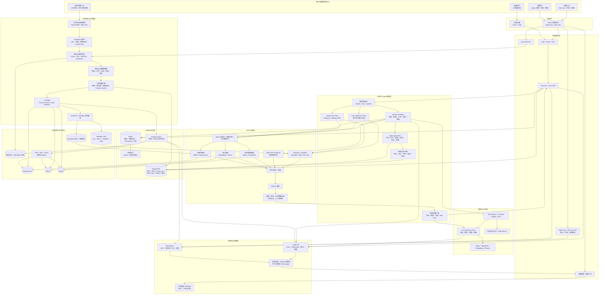

### 1.2 架构图怎么讲

面试时可以按八个区域说明：

1. **入口层**：普通用户从 AI 问答进入；管理员和运营人员从 Agent Ops、文档、图谱、评测、Bad Case 和 Artifact 审计进入；资料运营人员可以运行公开资料采集。
2. **前端与接口层**：React 页面通过 Auth／ACL 访问 Chat、Document、Agent Ops、RAG Ops 和通知接口；问答使用 AG-UI／SSE，管理操作保留审计。
3. **知识接入层**：公开 URL、官方文档和用户上传文件先生成 Markdown 快照，再做解析、编码修复、事实／元数据抽取、质量门禁和父子切块；网页没有写出的奖励、预算、概率和内部策略不会被补成事实。
4. **编排层**：Simple 走 Karpathy／Obsidian Fast Path；Auto 先执行快路径并由 Sufficiency Gate 判断是否升级；Agentic 负责子问题拆分、循环检索、工具调用、反思、审批、多 Agent 协作和结构化交付物。
5. **检索层**：关键词、向量、图谱和必要的 Web Search 并行召回；Karpathy／Obsidian 负责高优先级编译索引，所有候选经过 RRF、去重、父块补全、权限／版本过滤、Rerank 和上下文预算。
6. **状态层**：PostgreSQL 保存用户、会话、Query Log、Bad Case、Artifact 和审计；Redis 保存缓存、短期记忆、LangGraph Checkpoint 和 BullMQ 队列；Mem0 保存结构化长期记忆。
7. **知识与工具层**：原始文件和快照保留证据，Obsidian 管理 raw／notes／compiled／index，Karpathy 管理 BM25／编译索引，Elasticsearch、Milvus、Neo4j 分别承担关键词、语义和关系检索；LLM Gateway 统一模型路由、预算、超时、重试和降级，Tool Registry／MCP 暴露可控工具。
8. **治理与观测层**：LangFuse 记录单次 Trace／Generation，Prometheus 记录整体 QPS、错误率、延迟和队列指标；本地告警适配层可接企业微信，生产环境再替换为 Alertmanager、值班和 Postmortem 系统。

这张图与当前实现的边界是对应的：公开资料采集器是离线／批处理入口，不是用户问答时直接爬网页；Karpathy 与 Obsidian 是同一份知识的双写与取用层；原始快照、内容指纹、来源和版本用于证据追溯；质量门禁拒绝的内容可以保留原始记录，但不能进入可回答索引。

### 1.2.1 项目模块清单与交互关系

#### 模块分组

| 模块 | 主要职责 | 依赖和输出 |
| --- | --- | --- |
| React 问答与管理后台 | 提供 AI 问答、文档管理、Agent Ops、Bad Case、评测、图谱、Artifact 和调用轨迹页面 | 通过 HTTP、AG-UI／SSE 调用 admin-backend 和 rag-backend |
| admin-backend | 管理员登录、权限校验、菜单、操作审计，并代理文档、RAG 和 Agent Ops 请求 | 校验管理员权限后调用 rag-backend，不直接读 Milvus 或 PostgreSQL |
| rag-backend API 层 | 提供 Chat、Document、RAG Admin、Agent Ops、Artifact、Graph、Observability 等接口 | 进入对应业务 Service，统一返回状态和错误 |
| Chat／RAG Gateway | 接收问题、识别模式和检索范围，统一连接 Simple、Auto、Agentic | 把用户问题路由到编排层，并保存 Query Log |
| Document Ingest | 处理文件、URL、手工笔记和公开资料，完成解析、质量门禁、父子切块和版本治理 | 写入原始快照、PostgreSQL、队列和各知识索引 |
| Simple／Auto／Agentic Workflow | Simple 低延迟回答；Auto 判断是否升级；Agentic 规划、循环检索、调用工具、反思和审批 | 消费检索证据、Checkpoint 和工具结果，输出答案或结构化 Artifact |
| Multi-Agent 协作 | 产品、设计、前端、后端、测试、运营 Agent 按 DAG（注：有向依赖图）执行 | 通过结构化 Artifact 和交接消息传递，不复制整段聊天上下文 |
| Hybrid Retrieval | BM25／Elasticsearch、Milvus、Neo4j、Karpathy／Obsidian 并行或按策略召回 | RRF 融合、去重、父块补全、权限／版本过滤、Rerank 后输出证据包 |
| PostgreSQL | 保存用户、文档元数据、版本、会话、Query Log、Bad Case、Artifact、任务和审计 | 业务事实和状态的主存储，不承担向量相似度搜索 |
| Redis／BullMQ／Checkpointer | 缓存、短期记忆、队列、Agent 工作流 Checkpoint 和跨请求恢复 | 支撑异步任务、断点恢复、重试和并发控制 |
| Milvus／Elasticsearch／Neo4j | 分别承担语义、关键词和实体关系检索 | 由文档入库和图谱抽取模块写入，由 RAG 检索模块读取 |
| Karpathy／Obsidian | Karpathy 保存 BM25／编译索引；Obsidian 保存 raw、notes、compiled、index 知识层 | 作为 Simple Fast Path，也为 Auto／Agentic 提供高优先级上下文 |
| Tool Registry／MCP／LLM Gateway | 管理工具权限、风险、超时和版本；统一模型路由、预算、重试和降级 | Agent 通过受控工具调用外部搜索、RAG、图谱和业务能力 |
| LangFuse／Prometheus／通知 | LangFuse 记录单次 Trace／Generation；Prometheus 记录整体指标；通知适配层推送企业微信 | 连接 Agent Ops、告警、值班和事故复盘 |

#### 模块协作总图

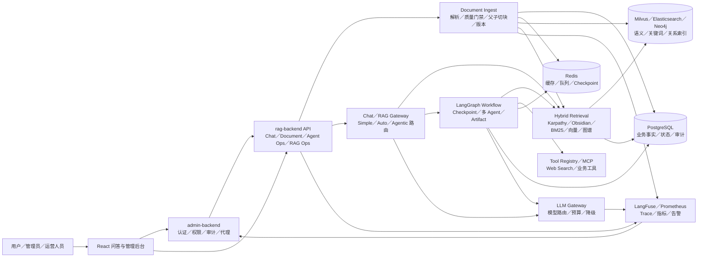

#### 四条典型模块交互链路

**1. 用户问答链路**

```text
React 问答页
  → rag-backend Chat API
  → Auth／ACL 校验用户和检索范围
  → Chat／RAG Gateway 识别 Simple、Auto 或 Agentic
  → Karpathy／Obsidian Fast Path + BM25／Milvus／Neo4j 检索
  → RRF、Rerank、权限／版本过滤和引用门禁
  → LLM Gateway 选择模型并生成加工后的答案
  → AG-UI／SSE 返回 Token、节点状态、引用和最终答案
  → PostgreSQL 保存 Query Log，LangFuse 保存 Trace，Prometheus 记录指标
```

**2. 文档和最新规范入库链路**

```text
文档管理页／公开资料采集器
  → admin-backend 权限和审计
  → Document API
  → Parser 解析正文和媒体
  → Metadata／Version Governance 写入版本、权限、生效期和替代关系
  → Quality Gate 判断是否允许入库
  → BullMQ Worker 异步执行父子切块和 Embedding
  → PostgreSQL 保存元数据和状态
  → Milvus／Elasticsearch／Neo4j 写入检索索引
  → Karpathy／Obsidian 双写编译知识
  → 新版本完成索引后旧版本变为 deprecated
```

**3. Bad Case 闭环链路**

```text
用户点击提交 Bad Case
  → Chat API 保存原问题、原答案、路由、引用和检索快照
  → Agent Ops 展示待审核记录
  → 管理员填写错误类型、评论、修正答案和是否进入回归集
  → 审核通过后写入 Bad Case／评测数据
  → 回灌服务写入受控纠错索引
  → Simple／Auto／Agentic 查询时先做精确纠错匹配，再结合当前生效知识
  → 重新召回、重排和生成自然答案
  → 回归脚本验证不复发，LangFuse／Query Log 关联前后版本
```

**4. Agentic 与多 Agent 交接链路**

```text
Agentic Workflow 创建 threadId
  → Redis Checkpointer 保存目标、节点、预算和当前状态
  → Research／Planner Agent 拆分子问题并检索证据
  → Product／Design／Frontend／Backend／Test／Ops Agent 按 DAG 分批执行
  → 每个 Agent 输出带 schema、版本、证据和依赖的 Artifact
  → Dependency Gate 检查上游产物是否齐全
  → Critic／Reviewer Agent 检查引用、冲突、风险和验收项
  → 高风险动作进入人工审批，失败节点支持重试或局部重跑
  → Artifact 写入 PostgreSQL，运行轨迹写入 Agent Ops、LangFuse 和 Prometheus
  → 前端展示结构化交付物、交接关系和最终状态
```

### 1.3 一次问答的主链路图

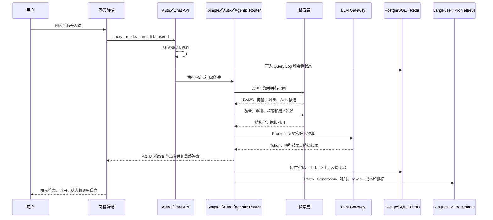

```text
用户操作
  → 前端页面／会话
  → API Controller
  → 业务 Service
  → RAG／Agent 编排
  → PostgreSQL／Redis／Milvus／Elasticsearch／Neo4j
  → LangFuse／Prometheus
  → 页面返回答案、状态和调用轨迹
```

统一原则：

- PostgreSQL 保存业务事实、会话关联、Query Log、反馈、Bad Case、审核和审计记录；
- Redis 保存短期状态、缓存和 Checkpoint，支持跨进程恢复；
- Milvus 保存向量和 Bad Case 动态 Few-Shot 索引；
- Elasticsearch 负责关键词和结构化检索；
- Neo4j 保存实体关系和 GraphRAG 数据；
- LangFuse 记录单次请求和模型调用级 Trace；
- Prometheus 记录服务整体性能和基础设施指标。

### 1.4 简历核心职责流程速览

这一节将简历中的三条「负责内容」直接对应到用户可见操作和后端数据流；后续章节再展开每一步的实现细节。

#### 1.4.0 三条核心职责总体架构流程图

这张图先看三条职责链，再结合下面 1.4.1～1.4.3 的用户操作和数据流：绿色是知识入库与版本治理，紫色是智能问答、方案生成与 MCP 上下文服务，橙色是 Bad Case、评测与运行观测；灰色表示三条链路共用的业务存储和观测出口。

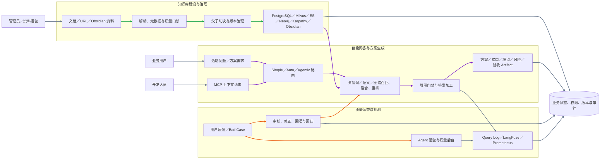

图中三条链路的对应关系：

- **绿色知识链路**：管理员／资料运营 → 解析与治理 → 多路索引，支撑后续所有检索。
- **紫色问答链路**：业务用户／开发人员 → 路由与检索 → 答案或结构化 Artifact。
- **橙色质量链路**：用户反馈／运营审核 → Bad Case 回灌与回归 → 重新参与检索和生成。
- **灰色公共链路**：各模块把业务状态、权限、版本、审计和运行指标统一落到共享存储与观测体系。

#### 1.4.1 活动营销知识库与管理后台

**用户操作流程：**（公共身份、会话和观测步骤按“公共收口规则”执行。）

1. 管理员在「文档管理」上传活动模板、官网规范、前端经验、Obsidian 笔记或 URL 文档。
2. 管理员填写项目、活动、地区、角色权限、版本、生效时间和来源权威等信息。
3. 管理员查看解析和索引进度；更新资料后发布新版本，旧版本自动失效或标记为被替代。
4. 普通用户问答时，只能看到自己权限范围内、当前有效版本的内容，并可打开引用查看来源。

**数据／状态流程：**（公共落库、指标和 Trace 步骤按“公共收口规则”执行。）

```text
上传／同步资料
  → Document Service（注：文档业务服务）校验文件、来源、ACL（注：访问控制列表）、版本和元数据（注：描述文档的项目、地区、角色等附加信息）
  → Parser（注：文档解析器）提取标题、表格、代码、正文和多模态 sidecar（注：图片、音视频附带的 OCR／转写说明）
  → Chunker（注：文档切块器）按文档结构切出 Child Chunk（注：子文本块，用于精确检索）
  → 记录 Parent Chunk（注：父文本块，保留完整章节）、headingPath（注：标题层级路径）、source span（注：原文起止位置）和相邻块关系
  → PostgreSQL（注：关系型数据库）保存 document（注：文档）、version（注：版本）、chunk（注：文本块）、ACL 和索引状态
  → Milvus（注：向量数据库）写入 Child Chunk Embedding（注：子块的语义向量）
  → Elasticsearch 写入正文、字段和关键词索引
  → Neo4j 写入活动、玩法、页面、接口、埋点和地区实体关系
  → 新版本生效：旧版本标记 superseded（注：已被新版本替代）／expired（注：已过期）；索引失败：保留旧可用索引并支持回滚
```

#### 1.4.2 智能问答、方案生成与 MCP 上下文服务

**用户操作流程：**

1. 业务用户在「AI 智能问答」选择 Simple、Auto 或 Agentic，输入活动问题。
2. 简单问题直接返回带引用的答案；复杂需求自动或手动进入活动方案工作流，页面展示页面结构、接口、埋点、风险和验收 Checklist。
3. 开发人员在 Codex、Claude Code 或 Trae 中调用 MCP 工具，检索组件规范、活动模板、埋点规则和地区适配知识，再继续编码。

**数据／状态流程：**

```text
用户问题／MCP tool request（注：MCP 工具调用请求）
  → Auth（注：身份认证）、userId（注：用户唯一标识）、ACL、角色和 scope（注：本次查询允许访问的项目、地区、文档范围）校验
  → Router（注：链路选择器）选择 Simple／Auto／Agentic
  → Query（注：用户问题）改写、意图识别和权限／版本条件注入
  → BM25＋向量＋GraphRAG 并行召回
  → RRF（注：多路结果按排名融合）、去重、Parent／Neighbor Expansion（注：补父块、同章节和相邻上下文）、Rerank（注：对候选再次精排）
  → 引用／充分性／冲突门禁
  → Simple 生成答案，或 Agentic 输出结构化方案 Artifact（注：可被下游继续使用的标准交付物）
  → AG-UI（注：Agent 前端事件协议）／SSE（注：服务端持续推送事件）或 MCP tool result（注：MCP 工具结果）返回前端／编码工具
  → PostgreSQL 保存 Query Log（注：查询日志）、答案、引用、路由和 Artifact；Redis（注：缓存与状态数据库）保存会话与 Checkpoint（注：执行检查点）
```

#### 1.4.3 质量运营、Bad Case 与运行观测

**用户操作流程：**

1. 用户在答案下提交 Bad Case，填写错误类型、补充说明、修正答案和是否加入回归。
2. 运营人员在「Agent 运营→Bad Case 审核」查看原问题、原答案、引用和检索快照，选择审核通过、驳回或撤销。
3. 审核通过后，用户再次询问相似问题；系统基于纠正证据重新组织答案。
4. 开发／运营人员在调用轨迹、LangFuse 和 Prometheus 查看慢请求、空召回、模型失败、工具失败、成本及回归结果。

**数据／状态流程：**

```text
提交 Bad Case
  → Chat Feedback API（注：接收反馈的接口）根据 threadId／queryLogId 找到原问题、原答案和检索快照
  → PostgreSQL 保存 RagFeedback（注：用户反馈记录）、Bad Case、Query Log 关联、retrievalSnapshot（注：原始检索快照）和 status=pending（注：待审核）
  → Agent Ops 后台读取 pending 记录，运营人员查看原问题、原答案、引用、检索快照和修正答案
  → 审核分支
      ├─ 驳回／忽略／撤销
      │    → PostgreSQL 更新 status（注：审核状态）
      │    → 不生成纠正向量，不进入后续 Bad Case 召回
      │
      └─ 审核通过
           → PostgreSQL 写入 correctedAnswer（注：修正答案）、reviewedBy（注：审核人）、reviewedAt（注：审核时间）和 status=reviewed／resolved
           → includeInRegression=true（注：加入回归集）时创建或更新 evaluation_cases（注：评测用例）；为 false 时只作为纠正知识，不进入回归集
           → 生成 Bad Case Embedding（注：错误案例的语义向量）
           → 写入 Milvus 的 agent_bad_case_examples（注：Bad Case 专用向量集合）

重新查询原问题或相似问题
  → Simple／Auto／Agentic 生成前都执行 Bad Case Preflight（注：纠正知识预检查）
  → 查询已审核的 PostgreSQL 记录，并检索 agent_bad_case_examples 相似向量
  → Correction Gate（注：纠正答案采用门禁）综合相似度、审核状态、当前正式证据和知识版本
      ├─ 不匹配：只使用正式知识检索
      └─ 匹配：把纠正内容作为受控证据，继续正式知识召回、融合、重排和引用校验
  → 生成加工后的自然语言答案，不直接原样复制 correctedAnswer（注：修正答案）
  → PostgreSQL 保存新的 Query Log、答案、路由、引用、检索快照和状态
  → LangFuse 记录 Trace（注：完整请求）、Generation（注：模型生成）和 Span（注：节点／工具操作）
  → Prometheus（注：服务指标系统）记录延迟、空召回、错误率、重试、工具成功率和循环限制指标
```

#### 1.4.4 产研运工作流列表、阶段产物与审批

**用户操作流程：**

1. 管理员进入「Agent 运营→产研运工作流」，先看到新建表单和按最近更新时间排列的工作流列表，不需要手动输入 Thread ID。
2. 列表展示项目／活动、当前状态、完成岗位、当前批次和 Thread；点击某一行跳转到独立详情页。
3. 详情页单独展示产品、设计、前端、后端、测试、运营各阶段的执行状态、证据覆盖率、风险等级和完整 Markdown 产物，不与新建表单混排。
4. 当状态为「待审批」时，管理员在详情底部填写意见，选择批准继续或驳回并选择需要重跑的岗位；已完成岗位不重复执行。
5. 工作流运行中页面自动刷新状态；切换到其他菜单后再次进入，仍自动恢复最近查看的工作流。
6. 工作流完成或失败后，当前处理区自动收起；历史记录仍保留在列表中，点击列表行即可重新查看详情和阶段产物。
7. 工作流完成后，管理员可以在独立详情页点击「导出到代码目录」选择本地项目目录，或复制 Thread ID 交给 MCP／Codex 获取已审批的代码交接上下文。
8. 详情页区分两个出口：「导出 Markdown 交接物」只保存原始岗位文档；「生成可运行项目代码」把已审批 Markdown 交给模型生成结构化项目文件，再生成 `package.json`、入口、页面、样式、工作流 JSON 和交接物，进入目录执行 `npm install && npm run dev` 即可运行。

**数据／状态流程：**

```text
启动产研运工作流
  → Redis Checkpoint（注：可恢复执行检查点）保存 Thread、项目、参与岗位、批次、当前状态和审批策略；PostgreSQL 保存任务、Artifact 和审计记录
  → Redis Sorted Set（注：按更新时间排序的轻量索引）保存当前用户的工作流 Thread 列表
  → 每次启动、状态轮询、阶段完成、审批或驳回都更新工作流列表摘要
  → 管理后台查询列表接口，只返回状态、批次和阶段摘要，不把完整 Markdown 塞进列表
  → 点击列表项
      → 按 Thread 查询完整状态
      → 读取各岗位结果、证据、风险、工具记录和 Artifact 交付物
      → 页面按岗位展开阶段产物
  → pending_approval（注：待审批）
      → 管理员批准：当前批次标记完成，进入下一个依赖批次
      → 管理员驳回：保存意见，只重跑选定岗位及其允许的下游节点
  → completed／failed（注：已完成／失败）写回最终状态、产物和审计记录
  → completed 工作流允许导出两类内容：Markdown 出口写入 JSON 上下文、README 和各岗位 Markdown；项目代码出口将岗位 Markdown 作为生成上下文，调用 LLM 生成结构化项目文件，再打包为 ZIP 下载（包含源码、README、工作流上下文 JSON 和各岗位交接物）
  → MCP 只读返回同一份已完成上下文，不直接写本机文件；Codex 负责在项目目录继续实现真实业务接口和测试
  → Redis 不可用时使用当前服务进程内存索引兜底；跨进程恢复仍以 Redis Checkpoint 为准
```

### 1.5 简历五项技术难点流程

本节是面试速览，只保留五个难点的关键差异；完整用户操作、状态字段、异常分支和生产边界分别以第二章至第十八章为准，避免与后文逐字重复。

本节与简历中的五项技术难点一一对应。前面的「职责流程」说明系统交付了什么；本节说明这些能力在实际使用中如何运行、各模块如何变更状态。

#### 1.5.1 多 Agent 协作可控性

**用户操作流程：**

1. 管理员进入「Agent 工作台」，填写活动／项目需求，选择参与岗位、最大步骤和审批策略。
2. 普通任务点击启动后自动流转；高风险任务在关键节点暂停，等待管理员批准或驳回。
3. 管理员查看产品、设计、后端、前端、测试、运营各岗位的状态和结构化交付物。
4. 单一岗位失败时，管理员只重跑该岗位及其依赖下游，不重跑已完成节点。

**数据／状态流程：**

```text
创建 workflow（注：多 Agent 工作流）
  → Manager（注：流程总协调器）初始化 threadId（注：会话线程标识）、runId（注：本次运行标识）、状态图、参与角色、预算和审批策略
  → Product Agent（注：产品代理）读取需求与证据，输出 Product Artifact（注：产品结构化交付物）
  → Design Agent（注：设计代理）＋Backend Agent（注：后端代理）并行，分别输出 Design／Backend Artifact（注：设计／后端交付物）
  → Schema（注：字段格式约束）／依赖／证据门禁校验通过后，Frontend Agent（注：前端代理）消费必要 Artifact
  → QA Agent（注：测试代理）生成测试、风险和验收 Artifact
  → Operations Agent（注：运营代理）汇总上线、埋点和复盘 Artifact
  → 每个节点写入 status（注：节点状态）、输入版本、输出 Artifact、owner（注：该节点责任角色）、耗时、Trace 和重试次数
  → 风险节点变为 approval_required（注：等待人工审批）；批准后继续，驳回后按 rerunRoles（注：允许局部重跑的岗位列表）局部重跑
  → 达到最大步骤、工具次数、Token 或超时预算时安全停止并降级
```

#### 1.5.2 复杂度路由与成本控制

**用户操作流程：**

1. 用户在问答页选择 `simple`、`auto` 或 `agentic`，也可以默认使用 `auto`。
2. 选择 `auto` 时，用户只提交一次问题；若快路径证据充足直接出答案，若不足系统自动升级，不要求用户重复输入。
3. 页面显示最终路由、检索充分性、重试次数和耗时，帮助用户理解为什么进入复杂链路。

**数据／状态流程：**

```text
请求进入 Router（注：链路选择器）
  → simple（注：简单快速链路）：固定 Hybrid RAG（注：混合检索增强生成）＋轻量生成，写入 route=simple（注：本次实际使用简单链路）
  → auto（注：自动选择链路）：先执行 Fast Path（注：低延迟、低成本的快速检索路径），计算 retrievalHit（注：检索是否命中有效证据）、citationCoverage（注：关键结论被引用覆盖的程度）、confidence（注：当前答案置信度）、taskComplexity（注：问题是否需要多步骤或工具协作）
      → Sufficiency Gate（注：证据充分性门禁）通过：route=auto_simple（注：Auto 最终走简单链路），直接生成
      → Sufficiency Gate 不通过：route=auto_agentic（注：Auto 最终升级复杂链路），复用 Fast Path 已召回的原问题证据，创建 Agentic State（注：复杂 Agent 的运行状态）并升级
          → Auto 最多规划 2 个子问题；补充子问题并行执行检索，避免串行等待和原问题重复召回
  → agentic（注：可规划的复杂链路）：直接创建 Agentic State，进入规划、工具、反思和审批节点
  → 三条路径统一记录 query（注：问题）／chunk（注：命中文本块）／tool（注：调用工具）／retry（注：重试）／step（注：执行步骤）／Token（注：模型上下文与计费单位）预算
  → 预算耗尽、模型或工具失败：LLM Gateway（注：模型路由和降级服务）选择备用模型、降级答案或受控拒答
  → PostgreSQL 保存 route（注：最终路由）、升级原因、预算消耗、耗时和最终状态；LangFuse 记录模型成本
```

#### 1.5.3 混合检索与关联补全

**用户操作流程：**

1. 用户提出包含活动名称、地区、接口字段、埋点事件或跨文档关系的问题。
2. 用户只看到最终答案和引用，不需要分别操作关键词、向量或图谱搜索。
3. 用户点击引用时可以查看命中的文档版本、章节和原始片段；无足够证据时系统提示澄清或拒答。

**数据／状态流程：**

```text
文档入库
  → Parser（注：文档解析器）保留标题、表格、代码围栏、source span（注：原文起止位置）和元数据
  → Chunker（注：切块器）划分 Parent Chunk（注：父块）／Child Chunk（注：子块）：Child 用于精确命中，Parent 保存完整章节语义
  → Child Embedding（注：子块语义向量）写入 Milvus；关键词／字段写入 Elasticsearch；实体关系写入 Neo4j

用户查询
  → Query Normalize（注：清理和标准化问题）／Rewrite（注：补全别名和隐含条件）／Intent（注：识别问题类型）／Scope Builder（注：生成可访问知识范围）
  → 并行召回：BM25（注：关键词精确检索）＋Milvus 语义（注：按含义相近检索）＋Neo4j 实体关系／多跳扩展
  → ACL、userId（注：用户标识）、项目、地区、角色、版本和生效时间过滤
  → RRF（注：多路排名融合）、去重、单文档限额
  → 命中 Child（注：子块）后 Parent／Neighbor Expansion（注：补父块、同章节和相邻必要上下文）
  → Rerank（注：二次精排）按问题、内容、来源、时间和意图排序
  → Context Budget（注：上下文 Token 预算）、引用校验和证据充分性门禁
  → 将结构化证据、引用和答案返回，并保存检索快照
```

#### 1.5.4 回答可信与持续纠错

本节只说明面试时要讲的控制点；Bad Case 的完整页面操作、状态变化和回归分支统一以第四章为准。

**用户操作流程：**

1. 用户查看回答及其引用；证据不足时系统明确拒答或提示待确认，不把猜测写成事实。
2. 用户发现错误后点击「提交 Bad Case」，填写错误类型、说明、修正答案和回归开关。
3. 运营人员审核原答案、引用、检索快照和修正内容，选择通过、驳回或撤销。
4. 审核通过后，用户重新提问相似问题；三个路由都会优先检查已审核纠正知识，并自然化输出修正后的回答。

**数据／状态流程：**

```text
生成前
  → Evidence Sufficiency（注：证据充分性检查）：证据不足则澄清／拒答
  → Prompt Builder（注：组装模型指令和上下文的模块）分离系统规则、用户输入与不可信检索内容
  → Citation／Claim Gate（注：引用与事实声明门禁）校验关键事实能否回指当前版本的正式证据
  → 通过后进入统一的 Bad Case 回灌、纠正门禁和回归闭环（详见第四章）
```

#### 1.5.5 长流程恢复与可观测性

本节只说明面试时要讲的恢复原则；Redis Checkpoint、LangFuse、Prometheus 和 Agent Ops 的详细操作分别以第五章至第七章为准。

**用户操作流程：**

1. 用户发起多步骤 Agentic 或多 Agent 任务，前端持续显示节点、工具调用和生成状态。
2. 用户刷新页面、SSE 短暂断开或原处理进程退出后，使用相同会话继续查看并恢复任务。
3. 开发／运营人员通过「调用轨迹」、LangFuse 和 Prometheus 查看某次任务的节点耗时、空召回、工具失败、重试、Token 和成本。
4. 指标超过阈值后，告警服务生成事件并预留企业微信机器人通知入口。

**数据／状态流程：**

```text
执行中断
  → Redis Checkpoint 保存当前节点和状态
  → 新进程按 threadId／runId 恢复
  → 幂等检查后继续未完成节点，已完成节点不重复执行
  → 结果进入 Agent Ops 审计；观测和告警按“公共收口规则”执行
```

六岗位生产工作流使用独立的 `agent.production.workflow` Trace（注：一次完整产研协作追踪）；普通 Simple／Auto／Agentic 问答使用 `rag.answer` Trace。具体字段和后台入口见第六章、第七章。

---

## 二、多 Agent（注：多个智能代理分工协作）：Simple（注：简单快速链路）、Auto（注：自动选择链路）、Agentic（注：可规划和调用工具的复杂链路）

### 2.1 Simple（注：优先检索和轻量生成）链路

### 本功能完整链路图

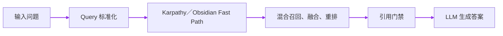

### 用户操作流程

1. 用户进入「AI 智能问答」页面。
2. 选择 `simple` 链路和模型，输入问题并发送。
3. 系统先返回检索和生成过程中的流式状态，最后显示答案、引用、路由、检索评估和耗时信息。
4. 用户可以继续追问，也可以点击「提交 Bad Case」反馈当前答案。

### 状态／数据流转流程

```text
请求进入 Chat／AG-UI 接口
  → 校验用户身份、threadId、模式和输入
  → Query Log（注：保存问题、答案、路由和耗时的查询日志）记录问题和请求上下文
  → 检查当前知识是否足够
  → 查询已审核 Bad Case 纠正证据
  → 权限过滤
  → Karpathy／Obsidian Fast Path 或 Hybrid RAG
  → BM25（注：关键词相关性搜索）／向量（注：按语义相似度搜索）／图谱召回
  → RRF（注：把多路搜索结果合并排名）合并与 Rerank（注：对候选结果再次精确排序）
  → 引用和证据校验
  → 生成自然语言答案
  → 保存回答、引用、路由、耗时和 trace；公共观测与落库按“公共收口规则”执行
```

Simple 的核心特点是快路径：固定问题优先用检索和轻量生成完成，不启动完整 Agent 规划，降低延迟、Token 和成本。若命中高置信度 Bad Case，先把审核后的纠正事实作为受控证据交给生成器加工，避免原样透传人工答案。

### 2.2 Auto（注：先走简单链路，证据不足时自动升级）链路

### 本功能完整链路图

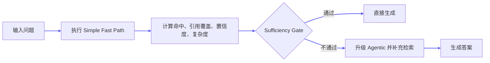

### 用户操作流程

1. 用户选择 `auto` 链路，输入问题。
2. 系统先自动尝试简单检索，不要求用户手动选择是否升级。
3. 如果证据充分，直接返回自然化答案。
4. 如果证据不足、问题复杂或需要多步处理，系统自动升级到 Agentic 流程。
5. 页面展示最终使用的路由，例如 `simple` 或 `agentic`，用户无需改变输入。

### 状态／数据流转流程

```text
请求进入 Auto Router
  → 先执行 Simple／Fast Path
  → 记录候选证据、相关性和 sufficiency 评估
  → 通过 Sufficiency Gate（注：证据充分性门禁）？
      ├─ 是：生成答案 → 引用校验 → 返回
      └─ 否：升级 Agentic Workflow
                    → 复用 Fast Path 原问题召回结果
                    → 最多规划 2 个子问题并行检索
                    → 工具调用、反思和生成
  → Bad Case Correction Gate 在快路径和升级路径都生效
  → 保存最终路由、升级原因、节点轨迹、答案和指标；公共观测与落库按“公共收口规则”执行
```

Auto 的关键不是简单随机选链路，而是先用便宜路径判断问题是否能被当前证据回答，再根据充分性门禁决定是否支付 Agentic 的额外成本。

### 2.3 Agentic（注：由状态图控制规划、工具、反思和审批）链路

### 本功能完整链路图


### 用户操作流程

1. 用户选择 `agentic` 链路，输入复杂问题或需要多步推理的问题。
2. 系统展示节点执行状态，例如检索、重排、工具调用、生成和反思。
3. 如果触发高风险动作或证据不足，系统进入人工审批或返回澄清／拒答。
4. 完成后返回加工后的答案、引用、工具结果、路由和调用轨迹。
5. 用户可以继续追问、提交 Bad Case 或查看当前回答的执行信息。

### 状态／数据流转流程

```text
请求进入 Agentic RAG Service
  → 创建 thread／run 状态
  → Query Augment（注：查询扩展／子问题规划）：把原问题拆成最多 3 个可独立检索的 SubQuestion（注：子问题），保留 dependsOn（注：前置依赖）和独立状态
  → 写入 SubQuestion Plan Artifact（注：子问题计划交接物）：保存问题、子问题、依赖和版本，供后续节点和 Checkpoint（注：执行检查点）恢复使用
  → Bad Case Preflight：先检查已审核纠正案例
  → Retrieval（注：逐子问题检索）：每个 SubQuestion 分别执行 Milvus 向量语义检索＋BM25／Elasticsearch 关键词检索；空结果再走 BM25 降级；关系、多跳问题按需调用 Neo4j GraphRAG（注：知识图谱增强检索）
  → Permission Filter：按 userId／ACL／作用域过滤
  → SubQuestion Sufficiency（注：逐子问题证据充分性判断）：按每个子问题绑定的 evidenceIds（注：证据编号）判断是否已经有直接证据
      → 全部充分：进入合并和重排
      → 部分不足：只对不足子问题调用 Bocha Web Search（注：联网搜索兜底）
  → Merge／Deduplicate（注：合并去重）：合并各子问题候选，并优先保留每个子问题至少一条证据
  → 写入 Evidence Bundle Artifact（注：证据包交接物）：保存 chunk id（注：证据片段编号）、子问题证据绑定和联网补检索数量
  → Rerank（注：重排候选证据）：按整体问题对融合证据重新排序
  → Generate：根据证据生成答案
  → 写入 Answer Contract Artifact（注：答案契约交接物）：记录答案、引用是否支持、子问题覆盖率和校验原因
  → Critic Gate（注：确定性质量门禁）：答案契约不通过时进入受限重试，不直接把不完整答案标记为成功
  → Reflection：检查事实、引用和任务完成度
  → 不通过则受限重试、重新召回或降级
  → 高风险动作进入 Human Approval
  → 写入 Checkpoint（注：可恢复的执行检查点）、Query Log、答案和 Trace
  → Agent 运营后台自动列出最近 Agentic／Auto 会话，运营人员选择问题即可查询 Artifact；Thread ID 仅作为高级排障入口；若运行失败，具备权限的运营人员可触发同一 Thread 的 Agentic 重新执行并对比新旧产物
  → 返回流式事件和最终结果
```

Agentic 使用显式状态图和停止条件控制循环，限制最大步数、总耗时、工具次数、Token 和重复调用；不是让模型无限自由调用工具。

### 2.3.1 Agentic 子问题检索的实际例子

**用户操作流程：**

1. 用户输入「活动落地页需要哪些页面模块、接口和埋点，海外地区有什么差异？」并选择 Agentic，点击发送。
2. 页面先显示「问题规划」，再显示三个子问题的检索状态；用户能看到哪个子问题已找到证据、哪个子问题触发了联网搜索。
3. 所有子问题完成后，页面展示统一答案、引用和检索／重排状态；用户不需要手动分别提问。

**状态／数据流转流程：**

```text
原问题
  → SubQuestion 1：页面需要哪些模块
  → SubQuestion 2：模块对应哪些接口和埋点（依赖 SubQuestion 1）
  → SubQuestion 3：海外地区有哪些适配差异（依赖原问题）
  → 每个子问题分别执行：Milvus 语义召回＋BM25／Elasticsearch 关键词召回
  → RRF（注：多路排名融合）＋父子块／相邻章节补全
  → 子问题 Sufficiency Gate（注：证据充分性门禁）
  → 不足时调用 GraphRAG 或 Web Search
  → 汇总 evidence（注：证据）并按 chunk id 去重
  → 产出 SubQuestion Plan／Evidence Bundle／Answer Contract 三类 Artifact（注：结构化节点交接物），并通过 AG-UI Custom Event（注：自定义流式事件）推送阶段状态
  → 保证每个子问题至少保留一条候选，再按整体问题 Rerank
  → 引用校验、Prompt Injection（注：提示词注入）过滤、权限／版本过滤
  → 模型生成自然答案，先做引用支持和子问题覆盖率校验；保存子问题状态、证据编号、Artifact、工具调用和最终 Query Log
```

这里的“拆分”不是把多个关键词拼在一起，而是把每个子问题作为独立检索单元；每个单元都有自己的召回结果、充分性、重试次数和联网兜底状态，最终才合并为一个答案。

### 2.4 三条链路的区别

| 链路 | 用户感知 | 服务端主要策略 | 适用问题 |
| --- | --- | --- | --- |
| Simple | 快速得到答案 | Fast Path、检索、重排、轻量生成 | 单知识点、明确事实查询 |
| Auto | 系统自动决定快慢 | Simple 先行，Sufficiency Gate 决定是否升级 | 不确定复杂度的普通问答 |
| Agentic | 能看到多步执行过程 | 状态图、工具、反思、审批、Checkpoint | 多跳、复杂分析、需要工具的问题 |

### 2.4.1 结构化交付物（Autix 交接模式）闭环

### 用户操作流程

1. 用户在 Agentic 链路输入复杂活动需求，例如「为海外新角色抽奖 H5 生成页面、接口、埋点、风险和验收方案」。
2. 系统完成检索、子问题拆分、证据绑定和回答后，在会话详情中展示可展开的 Artifact 交接物（注：带固定类型、版本和来源的结构化结果）。
3. 产品、设计、研发、测试或运营人员按需查看需求、方案、接口、埋点、测试和上线交付物；对标记「待确认」的业务事实补充人工输入。
4. 运营人员在 Agent 审计页选择对应会话，检查交付物状态、证据来源、生成节点和调用链；必要时重新执行同一 Thread（注：一次可恢复的工作流会话）。
5. 审核通过后，下游 Agent 或 MCP（注：给外部 AI 编程工具提供受控上下文的协议）只消费已通过版本；Bad Case 或人工修正会进入回归集，重新验证后再发布。

### 状态／数据流转流程

```text
用户问题
  → Agentic State（注：LangGraph 的共享工作流状态）创建 thread／run
  → 检索证据、子问题计划和答案契约
  → buildStructuredDeliveryArtifacts（注：按固定 Schema 生成交付物）
  → 产出 11 类交付物：需求简报、假设登记、结论—证据矩阵、方案简报、接口契约、埋点方案、测试计划、验收清单、风险登记、发布计划、编码上下文包
  → 每个 Artifact 写入 schemaVersion、status、producer、version、evidenceIds、sourceDocIds、confirmationRequired
  → Redis Checkpointer 保存运行中状态；PostgreSQL 表 agentic_structured_artifacts 持久化最终交付物
  → Agent Ops 按 Thread 查询，Redis 过期后从 PostgreSQL 恢复展示
  → 审核／人工确认／重新执行／回归验证
  → 通过版本供 MCP、代码 Agent、测试 Agent 和运营流程消费
```

当前实现把「模型生成文本」和「下游可消费交付物」分开：通用结构可以由模拟或公开资料生成；活动时间、预算、奖励、概率、真实接口、权限和地区法规等事实没有证据时统一标记「待确认」，不能把模拟资料当作真实业务结论。

#### 公开资料与模拟资料的入库流程

**用户操作流程：**

1. 在 `backend` 执行 `npm run game:public-sources`，采集公开官网／社区页面快照。
2. 执行 `npm run game:import-public-sources`，将公开快照和标记为 `simulated`（注：模拟数据）的公司通用模板提交到异步入库队列。
3. 在文档管理页查看解析、切块、Embedding（注：文本向量化）、Milvus（注：向量数据库）和 BM25（注：关键词检索算法）索引状态。
4. 在 Agentic 问答中使用这些资料验证结构化交付物，但在面试或生产验收中区分公开事实、模拟模板和真实业务原件。

**状态／数据流转流程：**

```text
公开 URL／模拟模板
  → 来源快照与 evidenceLevel（注：证据等级）登记
  → async upload → BullMQ（注：基于 Redis 的异步任务队列）
  → 编码识别、HTML 清洗、事实字段提取、文档类型归一化、质量门禁、父子切块
  → Embedding → Milvus；关键词倒排 → BM25／Elasticsearch
  → 权限、版本、来源和 simulated 标记写入元数据
  → Agentic 子问题检索 → RRF／Rerank → Artifact 交接物
```

本地数据包覆盖 32 家用户指定游戏公司的脱敏模拟模板；另有 Top100 公开资料目录，最新批次实际抓取 127 个公开页面，目录和 Simple Karpathy 方案均已入库，108 份唯一目标文档全部完成索引。其中 1 个页面以去重摘要卡入库，完整原始快照仍保留，不等同于这些公司的内部资料。

**公开资料不是原文搬运：**

系统不把网页正文直接复制到回答中，也不把页面里的宣传语自动改写成业务结论。每个页面先保留原始 Markdown 快照，再根据页面实际出现的内容生成可检索事实：

| 页面实际内容 | 系统记录的事实 | 当前项目的使用方式 |
| --- | --- | --- |
| 《梦幻西游》电脑版官网出现“最新游戏资讯、精彩图片推荐、玩家线下交流、咨询订阅、福利汇总、实用工具箱” | 官网信息架构、资讯入口、福利入口、工具入口、社区触点 | 回答游戏官网首页和内容运营模块怎么拆，不推断真实转化率 |
| 《魔兽世界》页面出现“21周年庆典、坐骑赠送、现金活动、版本更新、典藏年卡礼包” | 周年庆、版本更新、福利／礼包、活动时间等页面明确事实 | 作为周年庆会场和版本专题的公开案例，具体奖励只引用来源页面 |
| 《逆水寒》官网出现“新服开启、资料片、下载入口、新闻公告、明星鉴定官” | 新服宣发、资料片入口、内容公告、下载转化和代言人内容模块 | 生成官网活动页面的模块清单和验收项，不复制页面文案 |
| 《穿越火线》官网出现“嘉年华季、下载游戏、进入官网、登录、绑定大区”等入口 | 官网首屏、活动入口、下载、账号／大区绑定等交互触点 | 补充活动页接口和登录态待确认项，不能凭页面推断接口字段 |
| 腾讯游戏公开案例出现“万人同屏、直播互动、抽奖、弹幕、实时数据推送” | 高并发互动活动、抽奖、弹幕、实时状态同步等公开玩法线索 | 用于生成活动技术拆解和风险清单，标记为公开案例而非当前项目真实方案 |

加工规则是“页面明确写了什么，就保存什么；页面没有写什么，就标记待确认”：

1. 标题、导航、公告、活动时间、公开奖励、下载／预约／客服入口可以作为页面事实。
2. 页面事实会按游戏、平台、来源 URL、页面类型、抓取时间和内容指纹写入 metadata。
3. 运营玩法、页面模块、接口类别、埋点和风险是基于多页面事实整理出的“可复用分析”，必须与原始来源分开标注，不能伪装成官网原文。
4. 预算、概率、库存、用户资格、真实接口、内部转化率、组织权限和法务口径没有公开依据时，一律输出“待确认”。
5. 登录框、浏览器兼容提示、重复导航和模板噪声先做编码修复与去重；去重后仍不满足质量门禁的页面只能保留快照，或生成明确标注来源的摘要卡。

#### 中国 PC 端与页游 Top100 公开资料入库

**用户操作流程：**

1. 运营或研发执行 `backend npm run game:top100`，系统按照保存的公开榜单来源建立 PC 端候选 Top50 和页游候选 Top50 目录。
2. 系统访问候选游戏公开官网及常见公开入口，抓取官网、活动、运营、营销和社区页面；访问失败的页面在目录中显示失败原因，不生成模拟事实。
3. 在 `backend/eval/game-marketing-top100-markdown/` 查看公开页面 Markdown 快照和 `Simple-Karpathy-Fast-Path-游戏运营营销资料方案.md`。
4. 执行 `GAME_MARKETING_PUBLIC_DATASET=eval/game-marketing-top100.dataset.json npm run game:import-public-sources -- --only-public`，将目录、Karpathy 方案和真实抓到的公开页面提交入库。
5. 在文档管理页查看文档、来源 URL、抓取时间、证据级别、父子切块及索引状态；在 Simple 中提问官网模块、活动玩法、营销入口或验收清单。

**数据／状态流程：**

```text
公开榜单来源
  → PC 50 + 页游 50 候选目录
  → 官方 URL 抓取与失败记录
  → HTML 清洗 → Markdown 快照
  → sourceUrl／publicRank／rankType／company／fetchedAt／contentHash
  → 异步文档任务 → PostgreSQL
  → 父子切块 → Milvus 语义索引 + BM25／Elasticsearch 关键词索引
  → Karpathy compiled/index + Obsidian raw／notes／compiled／index
  → Simple 优先读取 Karpathy Fast Path；Auto／Agentic 复用同一版本与证据
  → 引用校验、低相关拒答、LangFuse Trace／Generation、Prometheus 延迟与失败指标
```

**Simple Karpathy 方案：** Simple 先识别游戏、平台、活动类型和官网／运营／营销／社区意图，再优先读取 Karpathy 编译知识卡，补充 Milvus、BM25／Elasticsearch 和父子块结果，使用 RRF（注：多路排名融合）与轻量重排后生成“公开事实、可复用拆解、待确认项、来源”。它不会原样复制网页，也不会将没有页面证据的奖励、预算、概率、真实接口或内部策略写成结论。Auto 在充分性门禁不通过时才升级 Agentic，Agentic 负责复杂多跳检索和必要的网络搜索。详细方案见 `docs/plans/游戏运营营销公开资料与Karpathy方案.md`。

**入库状态机与异常处理：**

```text
discovered（注：已发现候选游戏）
  → fetched（注：网页抓取成功）／fetch_failed（注：HTTP、超时或空页面）
  → normalized（注：编码识别、HTML 清洗、Markdown 化）
  → queued（注：进入 Redis／BullMQ 文档队列）
  → processing（注：解析、父子切块、Embedding、关键词索引）
  → indexed（注：PostgreSQL、Milvus、BM25／ES、Karpathy、Obsidian 均完成）
  → rejected（注：质量门禁拒绝，保留原始 Markdown 和原因）
```

本批次实际验证了 GBK／GB18030 编码页面处理、同页重复行去重、异步队列、429 重试、文档质量门禁和摘要卡降级。`DOCUMENT_QUEUE_CONCURRENCY` 只作为本地批量验收时的运行参数，默认并发仍为 2；质量门禁不会因为批量导入而关闭。被拒绝的页面不能直接进入回答上下文，必须先清洗、人工确认或生成有来源的摘要卡后再入库。

**三条问答链路如何取用这批资料：**

```text
Simple
  → 识别游戏／平台／意图
  → Karpathy compiled/index 优先命中
  → Milvus + BM25／ES 补召回
  → RRF + 轻量 Rerank
  → 引用门禁 → 加工回答／待确认项

Auto
  → 先执行 Simple Fast Path
  → 计算 retrievalHit、citationCoverage、confidence、taskComplexity
  → Sufficiency Gate（注：检索充分性门禁）通过：route=auto_simple
  → 门禁不通过：route=auto_agentic，创建 Agentic 任务

Agentic
  → 拆分子问题
  → 分别执行关键词、语义、图谱和必要的网络搜索
  → 合并证据、RRF、Rerank、引用校验
  → 生成页面／接口／埋点／风险／验收等结构化 Artifact
```

因此，公开资料不是只服务 Simple：三条链路共用同一份版本化资料和权限过滤；Simple 负责低延迟取用，Auto 负责复杂度判断，Agentic 负责多跳研究和方案协作。

### 2.5 多 Agent 协作流程

### 用户操作流程

1. 管理员进入「Agent 工作台」，填写项目／活动 ID、需求背景、参与岗位和最大步骤。
2. 选择普通任务自动流转，或者重要任务按风险进入人工审批。
3. 点击「启动工作流」，系统创建一个统一的项目任务。
4. 产品 Agent 先整理需求和验收目标。
5. 设计 Agent 与后端 Agent 在产品交付物完成后并行工作，分别产出设计方案和技术方案。
6. 前端 Agent 消费设计与技术 Artifact，生成页面和交互实现方案。
7. 测试 Agent 消费需求、设计和技术 Artifact，生成测试用例和风险清单。
8. 运营 Agent 汇总上线、埋点、活动配置和复盘要求。
9. 管理员可以查看每个岗位状态，批准、驳回、指定岗位重跑或等待任务自动结束。

### 状态／数据流转流程

```text
创建 project workflow
  → Manager 初始化统一 State、threadId、runId 和预算
  → Product Agent
      → 读取需求背景和知识证据
      → 产出 Product Artifact
  → fan-out：Design Agent ＋ Backend Agent 并行
      → 各自读取最小必要上下文
      → 产出 Design Artifact、Backend Artifact
  → fan-in：依赖检查和 Artifact Schema 校验
  → Frontend Agent 消费上游 Artifact
      → 产出 Frontend Artifact
  → QA Agent 消费需求、设计、前后端 Artifact
      → 产出测试用例、风险和验收结果
  → Operations Agent 消费全链路 Artifact
      → 产出上线、埋点、运营和复盘清单
  → 汇总 Manager 检查完整性、证据覆盖、风险和任务成功
  → 普通任务自动完成；高风险任务进入 Human Approval
  → 每个节点写入状态、输入版本、输出 Artifact、耗时和 Trace
```

多 Agent 不是把同一段上下文复制给六个模型，而是通过版本化 Artifact 和 Agent Contract 协作：上游输出结构化交付物，下游只读取自己需要的字段；明确依赖的节点才阻塞，设计和后端可以并行；某个岗位失败时支持该岗位局部重跑，不必重做整条链路。

### 2.6 多 Agent 的失败、审批和恢复

```text
节点开始
  → 权限／输入 Schema／预算检查
  → 模型调用和工具调用
  → 成功：保存 Artifact，推进下游
  → 可重试错误：退避后重试，记录 retry
  → 不可恢复错误：标记节点 failed，阻塞依赖节点
  → 风险动作：暂停为 approval_required
  → 人工批准：继续下游
  → 人工驳回：按 rerunRoles 指定岗位局部重跑
  → 进程中断：从 Redis Checkpoint 恢复
  → 超过步数／时间／Token／重复调用预算：安全停止并降级
```

---

## 三、RAG（注：先检索知识，再让模型基于知识回答）：Karpathy 知识编译、召回、重排、权限过滤、知识版本治理

### 3.0 RAG 总体流程图

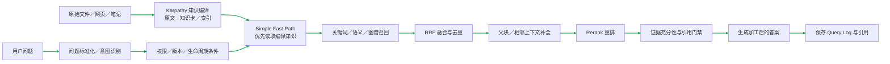

### 用户操作流程

1. 管理员进入「文档管理」，上传文件、输入网页或同步资料。
2. 填写项目、部门、角色、来源权威、生效时间、失效时间和版本信息。
3. 系统完成解析、切片、Embedding 和索引。
4. 用户在问答页面提问，系统只返回当前用户有权限看到的知识。
5. 用户可以点击引用查看来源文档和版本。
6. 管理员更新文档后重新发布，旧版本自动进入失效或替代状态。

说明：身份校验、Query Log、权限、版本过滤、LangFuse、Prometheus 和失败重试遵循“公共收口规则”，本节只展开 RAG 特有的入库、召回和版本治理。

### 状态／数据流转流程

```text
上传／同步文档
  → Document Service 校验元数据和权限
 → Parser 解析正文、表格、标题和结构
  → Chunker 结构保护切片并生成父子块：父块保留完整章节，子块保留标题路径、表格头、代码围栏和来源位置
  → Karpathy 编译层将原文与切块整理为 source note（注：带来源的知识笔记）、compiled 知识卡（注：按实体／主题归纳的可复用结论）和 index 索引（注：主题、实体、来源导航）；保留原文回链，不把模型摘要当成唯一事实来源
  → Embedding 写入 Milvus
  → 关键词和字段写入 Elasticsearch
  → 实体关系写入 Neo4j
  → 保存 document／version／chunk 状态到 PostgreSQL

用户查询
  → Query Augment 和意图识别
  → 所有链路先执行 Bad Case Preflight（注：已审核纠正案例预检查），再继续正式知识检索
  → 注入 userId、部门、角色、scope 等权限条件
  → Simple 优先命中 Karpathy compiled／index Fast Path（注：先用已编译的稳定知识快速定位），Auto／Agentic 将其作为高优先级候选证据，仍回链原文与正式索引校验
  → Elasticsearch 关键词召回
  → Milvus 向量召回
  → Neo4j 图谱扩展
  → RRF 合并候选
  → Reranker 精排
  → 再次执行权限和版本过滤
  → 引用校验、上下文组装、生成答案
```

知识版本治理会比较 `content_hash`、文档版本、生效时间和来源权威；替代文档发布后，旧版本不再作为当前知识优先证据，索引失败时保留可回滚状态。

### 3.1 检索详细步骤

### 本功能完整链路图

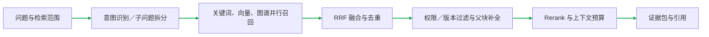

### 用户操作流程

1. 用户输入问题，例如「周年庆活动的充值返利规则是什么」。
2. 系统识别问题中的实体、时间、活动、地区、角色和问题意图。
3. 用户看不到底层多个搜索引擎，只看到最终答案和引用来源。
4. 如果问题需要多跳关系，Agent 会继续沿着实体关系检索，而不是只依赖一段相似文本。
5. 如果所有召回证据都不足，系统返回澄清或拒答，不编造答案。

### 状态／数据流转流程

```text
原始 query
  → Query Normalize：清理表达、识别语言和时间
  → Query Rewrite：补全别名、实体和隐含条件
  → Intent Classifier：判断事实、规则、对比、多跳或无答案问题
  → Scope Builder：生成 project、activity、region、locale、roleScope、documentType 等过滤条件
  → 并行召回：
      ├─ 关键词搜索：Elasticsearch BM25、字段权重、短语和过滤条件
      ├─ 语义搜索：Query Embedding → Milvus 向量相似度召回
      ├─ 知识图谱搜索：实体识别 → Neo4j 节点、关系和属性查询
      └─ 图谱扩展搜索：沿别名、上下位、关联活动和跨文档关系扩展候选
  → 结果标准化：统一 docId、chunkId、score、source、version、metadata
  → 权限过滤：删除 userId、部门、角色和租户无权访问的结果
  → 版本过滤：保留当前生效、来源权威和适用范围正确的知识
  → RRF／加权融合：合并关键词、向量和图谱候选，去重同一文档和相邻块
  → Parent／Neighbor Expansion：命中子块后，按 Token 预算补充父块、同 Section 和相邻必要上下文；父块只补语义完整性，不重复挤占候选名额
  → Reranker：综合 query、候选内容、时间、来源和意图重新排序
  → Diversity／Document Limit：限制单文档占比，避免一个文档霸榜
  → Context Budget：按 Token 预算截断并用 Lost-in-the-Middle 排布
  → Evidence Sufficiency：判断是否有足够证据支撑答案
  → 引用校验：每个关键 Claim 必须能回指 source、docVersion 和 chunk
  → 交给 Simple 生成或 Agentic 后续节点
```

### 3.2 四类检索的职责

| 检索方式 | 解决的问题 | 典型命中内容 | 主要局限 |
| --- | --- | --- | --- |
| 关键词／BM25 | 精确词、数字、活动名、版本号、兑换码 | 「周年庆」「685 分」「v2.1」 | 同义表达和改写不稳定 |
| 语义／向量 | 同义表达、自然语言描述和语义相近问题 | 「充值返利」与「消费回馈规则」 | 可能把相似但不适用的内容排前 |
| 知识图谱 | 实体、属性、关系和多跳约束 | 人物→学校→工作单位、活动→地区→时间 | 图谱缺失时无法覆盖 |
| 图谱扩展／Graph Search | 从实体出发扩展关联文档和邻居关系 | 同一活动的规则、组件、埋点和复盘 | 扩展过宽会增加噪声和延迟 |

实际链路不是四选一，而是按问题意图并行召回，再统一做权限、版本、融合、重排和证据门禁。Reranker 只能改善已经召回的候选，不能补回第一阶段完全没有找出的证据。

### 3.3 文档入库和索引更新流程

### 本功能完整链路图

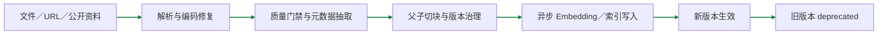

### 用户操作流程

1. 管理员在文档管理页上传文件、输入 URL 或同步 Obsidian 笔记。
2. 管理员填写项目、地区、角色、来源、版本和生效时间。
3. 页面展示解析、切块、向量化和多路索引进度。
4. 新版本索引成功后发布为当前版本；旧版本保留在版本链中并默认不再参与检索。

### 数据／状态流转流程

```text
管理员上传／网页同步／Obsidian 编译
  → Document API 创建 source document
  → 文件类型、大小、来源、权限和版本校验
  → Parser 提取正文、标题、表格、代码和多模态 sidecar
  → Quality Gate 检查空文档、重复内容、敏感信息和结构完整性
  → Chunker 进行结构保护切片
  → 生成 content_hash、docVersion、sourceAuthority、effectiveAt、expiredAt
  → Embedding 写入 Milvus
  → BM25 字段写入 Elasticsearch
  → 实体和关系写入 Neo4j
  → PostgreSQL 更新入库状态和索引状态
  → 新版本生效后废弃旧版本，失败时保留旧索引并支持回滚
```

3.3 只描述“资料如何进入索引”，不描述用户查询时的召回顺序；查询顺序统一以 3.0 和 3.1 为准。

---

## 四、Bad Case（注：用户提交的错误答案案例）：提交、审核、回灌、重新召回、回归验证

### 本功能完整链路图

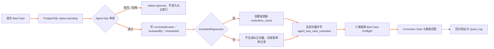

### 用户操作流程

1. 用户完成一次问答后，在答案下点击「提交 Bad Case」。
2. 选择错误类型，填写问题描述和纠正答案，并选择是否加入回归集。
3. 提交后，前端把 `threadId`、当前问题、AI 原回答、错误类型、评论和纠正答案发送到服务端。
4. Bad Case 进入「Agent 运营→Bad Case 审核」列表，初始状态是待审核。
5. 运营人员打开记录，确认问题、旧答案、纠正答案和来源，点击审核通过。
6. 审核通过且勾选「加入回归集」后，系统才会创建评测用例并回灌 Bad Case 向量；索引成功后无需重启服务，再次输入之前的问题即可验证。
7. Simple、Auto、Agentic 都会先检查已审核纠正证据，最终回答会基于纠正事实重新组织，不是原样复制纠正答案。
8. 回归脚本继续执行三条链路，确认旧错误不再出现、纠正事实被覆盖、路由符合预期。

### 状态／数据流转流程

```text
提交 Bad Case
  → Chat Feedback API
  → 根据 threadId 找 Query Log／召回快照
  → 保存 RagFeedback 和 Bad Case 记录
  → status=pending（注：待审核）
  → Agent Ops 后台查询待审核记录

审核通过
  → 更新 status=reviewed、reviewedBy、reviewedAt
  → 判断 includeInRegression
      ├─ false：不创建 evaluation_cases（注：评测用例），不生成纠正向量，保留审核记录
      └─ true：创建或更新 evaluation_cases，生成 Bad Case Embedding（注：把案例转换成可搜索的数字向量）
              → 写入 Milvus（注：向量数据库）agent_bad_case_examples（注：Bad Case 专用向量集合）
              → 返回 indexing 状态

重新问同一问题
  → Simple／Auto／Agentic 的 Bad Case Preflight
  → Milvus 相似检索＋短实体包含兜底
  → 判断 hint／correction／exact 命中级别
  → 当前正式知识优先，Bad Case 作为纠正证据
  → Correction Gate 约束生成
  → 自然化回答
  → 保存新的 Query Log、引用、路由和 Trace

撤销或取消回归
  → 更新 PostgreSQL 状态
  → 删除对应 Milvus Bad Case 向量
  → 后续查询不再使用该案例
```

Bad Case 不是直接覆盖正式知识，而是进入独立的动态纠错索引。正式知识证据充分时，Bad Case 只作为提示；正式知识不足时，已审核的高相似 Bad Case 才可以作为强纠正证据。

---

## 五、Redis（注：保存缓存和运行状态的内存数据库） Checkpointer（注：保存 Agent 执行位置的检查点）：跨进程恢复

### 本功能完整链路图

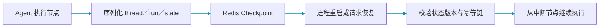

### 用户操作流程

1. 用户启动一个需要多步执行的 Agent 任务。
2. 系统执行到中途时，把当前状态保存到 Redis Checkpoint。
3. 原进程停止、请求超时或实例发生切换。
4. 新进程收到同一个 `threadId`／`runId` 后，从 Redis 读取最近 Checkpoint。
5. 系统从可恢复节点继续执行，不重新从第一步开始。
6. 任务完成后保留结果，并按生命周期策略清理临时状态。

### 状态／数据流转流程

```text
Agent State
  → Checkpointer 序列化 threadId、runId、节点、消息、工具结果和版本
  → Redis 写入 checkpoint key
  → 新进程按 threadId／runId 读取
  → 校验 state schema 和版本
  → 恢复 LangGraph 执行位置
  → 节点幂等检查，避免重复副作用
  → 继续执行或进入人工审批
  → 完成后更新 final state 并清理临时 checkpoint
```

当前本地已验证两个独立进程共享 Redis 的 writer→reader 恢复；真正线上还需要在多副本编排、实例崩溃和长时间暂停场景复验。

---

## 六、LangFuse（注：记录模型调用和 Agent 轨迹的可观测平台）：Trace（注：一次请求的追踪记录）、Generation（注：一次模型生成记录）、Flush（注：发送观测数据）、健康检查

### 本功能完整链路图

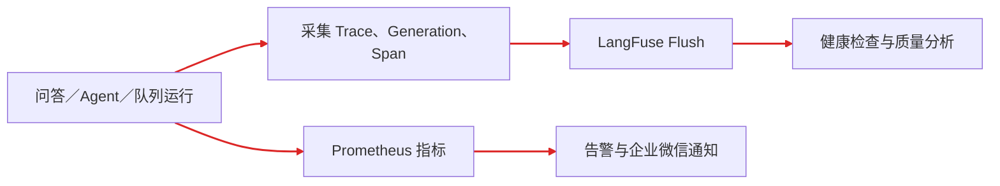

### 用户操作流程

1. 用户发起一次问答或 Agent 任务。
2. 页面正常看到答案，用户不需要额外操作。
3. 开发或运营人员进入 LangFuse，按 Trace 查看这次请求。
4. 展开 Generation，查看模型、Prompt、输出、Token、成本和耗时。
5. 如果答案异常，沿着节点和工具调用定位问题。
6. 运营人员结合 Bad Case、评测结果和 Trace 做回归分析。

### 状态／数据流转流程

```text
请求开始
  → LangfuseProvider 创建 Trace
  → 每次模型调用创建 Generation（注：记录模型输入、输出、Token、耗时和成本）
  → 每个 Agent 节点／工具调用写入 Span 或事件
  → 记录 route、model、latency、token、cost、status 和错误
  → 请求完成后 flush 到 LangFuse Cloud
  → 本地 provider 更新 lastFlushAt、tracesSent、lastError
  → /observability/langfuse/health 返回健康状态
```

LangFuse 负责单次问答和 Agent 轨迹定位；Prometheus 负责服务整体运行指标。当前已验证真实 `trace／generation／flush／health`，生产仍需配置看板、告警、采样脱敏和长期留存。

---

## 七、Agent 运营后台、审计、调用链路

### 本功能完整链路图

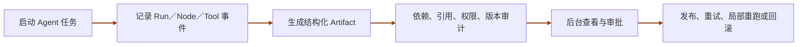

### 用户操作流程

1. 管理员进入「Agent 运营」。
2. 在「Agent 工作台」启动产研运工作流，设置项目、岗位、最大步骤和审批策略。
3. 在「Agent Evals」输入评测问题、上下文、必备事实和评分条件，执行单案例评测。
4. 在「Bad Case 审核」审核用户提交的错误案例并决定是否回灌。
5. 在「调用轨迹」查看请求 Trace、路由、接口状态、耗时和开始时间。
6. 对高风险或需要人工判断的任务执行批准、驳回或局部重跑。

### 状态／数据流转流程

```text
管理员操作
  → admin 前端路由和 Agent Ops API
  → admin-backend 权限校验和审计拦截器
  → backend Agent Ops／Eval／Bad Case 服务
  → PostgreSQL 保存任务、审核、评测和审计记录
  → Redis 保存运行中工作流和 Checkpoint
  → Trace Service 聚合 thread／run／node／tool
  → LangFuse 保存模型级观测
  → 前端轮询或刷新展示最新状态
```

审计记录包含操作者、动作、目标资源、结果、时间和 Trace ID；调用链路把一次请求拆成 HTTP、Agent Node、Tool、Model Generation 多层，便于定位「哪个节点慢」和「谁做了什么操作」。

### 7.1 产研运工作流与运行中心的关联

#### 用户操作流程

1. 管理员在「产研运工作流」创建活动并启动执行；列表展示项目、岗位进度、审批状态和 Thread。
2. 管理员进入「运行中心」，可看到同一活动对应的一条「产研运工作流」运行记录，而不是另一份独立数据。
3. 点击「运行详情」可查看各岗位检索、工具调用、交付物、审批和最终状态；点击工作流列表行则查看阶段产物与审批操作。

#### 数据／状态流转流程

```text
启动产研运工作流
  → 生成 workflow threadId
  → 同一 threadId 创建 agent_runs（route=production_workflow）
  → 产品／设计／前端／后端／测试／运营岗位执行
    → 检索、工具、Artifact、审批事件均写入该 runId
  → 工作流状态=待审批／完成／失败
    → 同步 agent_runs.status=waiting_approval／completed／failed
  → 工作流列表读取工作流索引；运行中心读取 agent_runs
  → 历史工作流缺少 Run：读取列表时补建一条关联运行记录
```

两张列表承担不同视图：工作流列表用于阶段交付和审批，运行中心用于事件、工具、成本和诊断；它们通过同一个 `threadId`／`runId` 关联，不复制业务数据。

### 7.2 Artifact 审计页面的实际使用流程

### 用户操作流程

1. 管理员进入「Agent 运营」→「Artifact 审计」。
2. 页面自动加载最近的 Agentic／Auto 会话，并在下拉框展示问题、链路模式、更新时间和是否已保存 Checkpoint。
3. 管理员选择一个会话，页面自动查询该 Thread 的最新结构化交接物，无需手动复制 Thread ID。
4. 页面展示 SubQuestion Plan、Evidence Bundle、Answer Contract、检索充分性、重试次数和当前 Checkpoint。
5. 如果列表为空，先在「AI 智能问答」选择 Agentic 完成一次提问，再点击「刷新会话列表」；页面会明确提示当前没有可审计会话。
6. 如果会话没有 Checkpoint，页面提示该会话可能已过 Redis TTL，或没有真正进入 Agentic LangGraph 流程；只有高级排障时才手动输入 Thread ID。
7. 如果交接物或回答状态异常，具备权限的管理员点击「重新执行 Agentic 链路」，完成后重新查询并对比新旧结果。

### 状态／数据流转流程

```text
AI 问答选择 Agentic 并完成一次请求
  → ConversationService 保存会话摘要、mode、threadId、updatedAt
  → Agentic LangGraph 在每个关键节点写入 Redis Checkpointer
  → Checkpoint 保存子问题计划、证据包、答案契约、节点状态、工具结果和版本
  → 管理员打开 Artifact 审计页面
  → admin 前端调用 /api/admin/agent-ops/runs
  → admin-backend 校验管理员权限并代理到 rag-backend
  → rag-backend 查询最近非 Simple 会话，并逐条读取最新 Checkpoint 可用性
  → 前端将会话显示为「问题 · 模式 · 时间 · 已保存／无 Checkpoint」
  → 管理员选择会话
  → 前端调用 /api/admin/agent-ops/runs/:threadId/artifacts
  → backend 从 Redis 读取最新快照，解析 Artifact、检索结论、路由和重试次数
  → 前端展示交接物与运行状态
  → 点击重新执行
  → backend 校验 Thread 和权限，恢复或重新运行 Agentic 链路
  → 新结果写入新的 Checkpoint，并保留原 Query Log／Trace 关联
```

该页面的下拉列表是“最近可审计运行”的入口，不是独立的会话数据库；会话事实来自 PostgreSQL／会话服务，执行状态和交接物来自 Redis Checkpointer。Redis 状态过期后，列表仍可能显示该会话，但会标记为「无 Checkpoint」，便于区分“没有会话”和“会话存在但运行状态已过期”。

---

## 八、Prompt Injection（注：不可信内容试图改变系统规则的攻击）防护、Tool Registry（注：工具权限和执行策略登记表）

### 本功能完整链路图

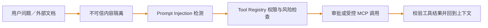

### 用户操作流程

1. 用户正常提问，或者问题引用了外部网页、上传文档和检索内容。
2. 系统照常检索，但不会把检索内容当成系统指令。
3. 如果用户要求调用工具，Agent 根据工具白名单、权限和风险等级决定是否允许。
4. 高风险工具要求审批或拒绝执行，并把原因展示到轨迹中。
5. 运营人员可以查看工具调用、参数校验、超时、降级和审计记录。

### 状态／数据流转流程

```text
检索片段／工具输出
  → Prompt Injection Guard 检测高风险指令
  → 对危险行脱敏，并标注为不可信证据
  → Prompt 明确禁止证据覆盖系统规则
  → Tool Registry 根据 tool、risk、permission、timeout、audit、fallback 做准入
  → 参数 Schema 校验和用户／租户权限校验
  → 必要时进入人工审批
  → Tool Executor 执行、超时、重试或降级
  → 结果脱敏、结构校验、写入审计和 Trace
```

Prompt Injection 防护解决「内容不能改变规则」；Tool Registry 解决「工具能不能调用、谁能调用、调用失败怎么办」。两者不是只靠 System Prompt，而是由代码和策略层共同约束。

---

## 九、稳定性、性能、成本评估脚本

### 本功能完整链路图

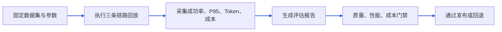

### 用户操作流程

1. 开发或测试人员在 `backend` 目录执行稳定性、性能或成本脚本。
2. 选择 `local` 或 `strict` Profile，并设置样本数、并发数和目标链路。
3. 脚本自动发起重复问答、Agent DAG 或 Redis／Milvus／LangFuse smoke。
4. 执行完成后查看终端摘要和 `.tmp/evidence` 报告。
5. 在发布前比较成功率、P95、降级率、Token、成本和错误趋势。

### 状态／数据流转流程

```text
脚本读取环境和测试 Profile
  → 准备固定数据集和请求参数
  → 按并发／重试／429 退避策略执行
  → 采集成功、失败、超时、降级和恢复状态
  → 记录 p50／p95、吞吐、错误率、Token 和成本
  → 写入 JSON／Markdown evidence 报告
  → local 门禁给出本地工程结论
  → strict 门禁要求真实数据、真实单价、真实 SLA 和目标机器证据
```

常用脚本：

```bash
cd backend
npm run evidence:stability
PERF_RAG_PROFILE=local PERF_RAG_SAMPLES=30 npm run perf:rag
npm run eval:bad-case:long-term
npm run evidence:operations -- redis,milvus-bad-case,langfuse
npm run smoke:adoption
```

---

## 十、Adoption（注：用户是否真正采纳答案）指标统计

### 本功能完整链路图

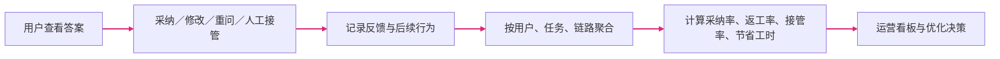

### 用户操作流程

1. 用户正常使用 AI 问答并提交正面或负面反馈。
2. 系统自动记录查询、回答、用户、时间、路由和反馈关联。
3. 运营人员进入 RAG Ops 或调用接口选择统计窗口，例如最近 30 天。
4. 查看活跃用户、复访用户、总问题数、回答率、反馈覆盖率和正向反馈率。
5. 结合 Bad Case、返工和人工接管判断用户是否真正采纳答案，而不是只看调用次数。

### 状态／数据流转流程

```text
用户提问
  → Query Log 保存 userId、query、answer、mode、route、status、latency
  → 用户反馈写入 RagFeedback，并关联 queryLogId
  → QueryLogService 按时间窗口聚合
  → 计算 activeUsers、repeatUsers、totalQueries、answeredQueries
  → 计算 answerRate、feedbackCoverage、positiveFeedbackRate
  → RAG Ops API 返回 adoption summary
  → 运营后台或报表展示趋势
```

当前接口能统计指标，但本地少量数据只能证明采集链路可用；真实采纳率需要持续线上流量、反馈、返工和人工接管数据。

### 10.1 用户效果模拟验证

### 用户操作流程

1. 测试人员执行 `npm run simulate:user-outcomes`，生成一批模拟用户、问题和回答结果。
2. 模拟用户按不同场景产生复访、采纳、返工和人工接管行为。
3. 脚本模拟不同请求耗时，并用 SLA 目标判断 P95 是否通过。
4. 测试人员查看报告中的采纳率、返工率、人工接管率、节省工时和 SLA。
5. 修改参数后重新运行，比较不同策略对用户效果的影响。

### 状态／数据流转流程

```text
模拟用户／问题生成
  → 生成用户活跃、复访和提问事件
  → 生成回答成功、采纳、返工、人工接管事件
  → 生成每次请求 latency
  → 聚合 activeUsers、repeatUsers、adoptionRate、reworkRate
  → 聚合 humanTakeoverRate、savedHours 和 P50／P95／P99
  → 按目标 SLA 计算 p95Pass 和 withinTargetRate
  → 写入 .tmp/evidence/user-outcomes-simulation.json
```

该脚本只生成 `simulated_operational_evidence`，不会写入真实 Query Log，也不能证明真实用户效果；真实结论仍来自 `smoke:adoption` 和线上长期流量。

---

## 十一、LLM Gateway（注：统一管理模型选择、超时、预算和备用模型）路由和降级策略

### 本功能完整链路图

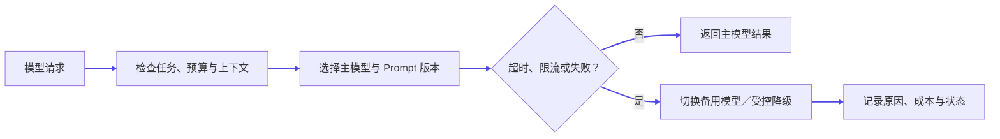

### 用户操作流程

1. 用户只选择问答链路和模型偏好，不直接管理供应商 SDK 细节。
2. 系统根据任务类型自动选择 fast、reasoning、structured 或 embedding 路由。
3. 主模型超时、限流、错误或超过预算时，系统按策略切换备用模型或返回受控降级。
4. 用户最终拿到答案、澄清、拒答或降级结果；后台能看到实际模型、路由和原因。

### 状态／数据流转流程

```text
业务请求
  → LlmProvider 识别任务类型
  → LlmGatewayPolicy 读取 primary、fallback、timeout、maxTokens、maxCostUsd
  → 调用主模型
  → 成功：返回结果并记录模型／Token／成本
  → 失败：判断是否可重试、是否超过预算、是否允许 fallback
  → 调用备用模型或进入受控降级
  → 记录 route、retry、fallback、error 和最终状态
  → 公共观测与落库按“公共收口规则”执行
```

网关策略层把业务和厂商 SDK 解耦，当前已具备主备、超时、输出上限和成本预算策略；真实生产还需要接入统一网关、租户配额、账单和告警。

---

## 十二、登录、身份、权限与租户隔离

### 本功能完整链路图

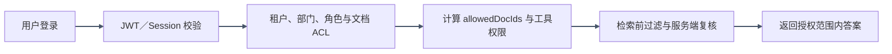

### 用户操作流程

1. 用户登录系统后进入问答、文档或运营页面。
2. 用户只能看到自己有权限访问的文档、会话和功能菜单。
3. 管理员可以审核 Bad Case、查看运营数据和执行高风险操作；普通用户不能进入管理接口。
4. 用户切换部门、角色或租户后，后续查询自动使用新的权限范围。

### 状态／数据流转流程

```text
登录请求
  → Auth Controller 校验凭证
  → 创建登录会话／返回身份上下文
  → 请求携带 userId、role、department、tenant／scope
  → API Guard 和权限策略校验功能权限
  → Document Permission Service 生成 ACL 过滤条件
  → RAG 召回阶段做物理权限过滤
  → Query Log、Feedback、Bad Case 按 userId 关联
  → 审计拦截器记录操作者、资源、动作、结果和 Trace ID
```

权限不是只在前端隐藏按钮，而是在接口、业务 Service 和检索条件三层执行。当前已有 userId／ACL／审计基础，企业生产还需要接入真实 IAM、组织同步和租户账单。

---

## 十三、会话、短期记忆、长期记忆与上下文控制

### 本功能完整链路图

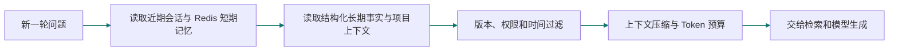

### 用户操作流程

1. 用户创建问答会话，系统生成 `threadId`。
2. 用户连续追问，系统自动读取当前会话窗口。
3. 长对话超过上下文预算时，系统压缩历史并保留关键事实、实体和未解决问题。
4. 需要跨会话使用的稳定事实，经过结构化后进入长期记忆；临时问题不直接永久保存。
5. 新问题根据当前消息、摘要、记忆和检索证据重新生成答案。

### 状态／数据流转流程

```text
创建 thread
  → Conversation Service 保存 userId、mode、model 和消息
  → Redis 保存短期窗口和运行状态
  → Memory Extractor 提取实体、偏好、事实和待办
  → Summary Service 生成结构化摘要
  → Mem0／长期记忆保存带来源、作用域和时间的稳定事实
  → 新问题合并当前消息＋短期窗口＋摘要＋相关长期记忆
  → Token Budget 控制上下文大小
  → RAG／Agent 继续检索和生成
  → 新回答和新的有效记忆回写
```

记忆不等于把所有历史聊天塞回 Prompt：短期记忆解决当前会话连贯性，摘要解决长对话压缩，长期记忆保存可复用事实，Redis Checkpoint 解决执行状态恢复。

---

## 十四、答案生成、引用、拒答与质量门禁

### 本功能完整链路图

```mermaid
flowchart LR
A[召回证据] --> B[Claim 事实声明抽取]
  B --> C[逐条引用支撑校验]
  C --> D[冲突、低相关、敏感内容检查]
  D --> E{证据足够？}
  E -->|是| F[生成带引用答案]
  E -->|否| G[拒答、补充检索或澄清]
  linkStyle 0,1,2,3,4,5 stroke:#b91c1c,stroke-width:2px
```

### 用户操作流程

1. 用户提出问题，系统先检索证据。
2. 有足够证据时，页面返回加工后的自然语言答案和引用来源。
3. 用户点击引用查看原文、文档版本和相关片段。
4. 证据不足、来源冲突或用户无权限时，系统返回澄清、有限回答或拒答。
5. 用户发现答案错误时，可以提交 Bad Case，进入后续质量飞轮。

### 状态／数据流转流程

```text
候选证据
  → Evidence Sufficiency 判断覆盖度和置信度
  → Conflict Resolver 检查不同版本、来源和字段冲突
  → Prompt Builder 区分系统规则、用户问题和不可信检索证据
  → LLM 根据允许的证据生成
  → Claim／Citation Validator 检查关键事实是否有来源支撑
  → Faithfulness／Refusal Gate
      ├─ 通过：返回答案和 citations
      ├─ 证据不足：返回澄清或拒答
      └─ 冲突或高风险：提示边界并进入人工处理
  → Query Log 保存答案、证据、引用、门禁结果和路由；公共观测与落库按“公共收口规则”执行
```

答案不是模型生成完就直接返回，而是经过证据充分性、引用、冲突和拒答门禁；Bad Case 纠正事实也必须经过同一生成和校验过程，不能原样透传。

---

## 十五、Tool（注：Agent 可以调用的原子能力）、Function Calling（注：模型按结构化参数请求调用工具）与 MCP（注：连接模型应用和外部工具的标准协议）

### 本功能完整链路图

```mermaid
flowchart LR
A[Agent 判断需要工具] --> B[读取 Tool Registry]
  B --> C[生成结构化参数]
  C --> D[权限、风险、超时检查]
  D --> E[Function Calling／MCP 执行]
  E --> F[结果校验并回到 Agent]
  linkStyle 0,1,2,3,4 stroke:#d97706,stroke-width:2px
```

### 用户操作流程

1. 用户提出需要搜索、重排、图谱查询或外部业务操作的问题。
2. Agent 判断是否真的需要工具，而不是所有问题都调用工具。
3. 页面显示工具调用状态，完成后继续生成答案。
4. 只读工具可以自动执行；写操作、外部发布或高风险动作需要审批。
5. 工具失败时，系统重试、切换备用能力或给出受控降级。

### 状态／数据流转流程

```text
Agent 决策
  → Tool Registry 查找工具描述和版本
  → 检查用户／角色／租户权限和风险级别
  → Function Calling 生成结构化 tool name＋arguments
  → JSON Schema 校验参数
  → MCP Client 连接对应 MCP Server
  → Server 透传身份和最小权限调用业务能力
  → 执行超时、重试、幂等和结果裁剪
  → 返回结构化 Observation
  → Agent 消费 Observation，继续、反思或停止
  → 写入 Tool Trace、审计和成本指标
```

Function Calling 是模型提出结构化调用，MCP 是 Host 与外部 Tool／Resource／Prompt 的协议，Tool Registry 是项目内部治理清单，三者不是同一个概念。

---

## 十六、Prompt Registry（注：管理提示词版本、评测和回滚）与版本发布

### 本功能完整链路图

```mermaid
flowchart LR
A[创建 Prompt 草稿] --> B[变量、引用与安全校验]
  B --> C[绑定模型、路由和评测集]
  C --> D[离线回归与人工复核]
  D --> E[发布默认／灰度版本]
  E --> F[Trace 观察后保留或回滚]
  linkStyle 0,1,2,3,4 stroke:#8b5cf6,stroke-width:2px
```

### 用户操作流程

1. 开发人员修改 RAG、Agent 或工具 Prompt。
2. 为 Prompt 填写名称、版本、负责人、用途、适用链路和绑定评测集。
3. 提交前执行 registry 校验和固定回归。
4. 测试通过后选择默认版本或灰度版本。
5. 线上发现质量下降时，根据 Trace 和评测报告回滚到上一版本。

### 状态／数据流转流程

```text
Prompt 修改
  → Prompt Registry 记录 name、version、owner、purpose、file、evals、rollback
  → 静态校验变量、引用关系和版本
  → Prompt Injection、Bad Case、任务评测和固定数据集回归
  → 生成 Prompt 版本绑定 model／route／mode
  → LangFuse Trace 记录实际 Prompt 版本
  → 观察质量、延迟、成本和错误
  → 通过则升为默认；失败则回滚并保留审计记录
```

当前已具备代码级 Prompt Registry 和校验脚本；后台版本管理、灰度、回放和企业审批属于生产增强项。

---

## 十七、评测集、回归门禁与上线流程

### 本功能完整链路图

```mermaid
flowchart LR
A[固定评测集／Bad Case 集] --> B[离线与在线回放]
  B --> C[比较质量、延迟、成本和错误趋势]
  C --> D[评测门禁与人工复核]
  D --> E[候选版本灰度]
  E --> F[观察指标后发布或回滚]
  linkStyle 0,1,2,3,4 stroke:#c2410c,stroke-width:2px
```

### 用户操作流程

1. 测试人员准备问题、标准答案、期望引用、拒答条件、工具期望和评分规则。
2. 执行检索评测、Agent 任务评测、Bad Case 回归和稳定性回放。
3. 查看质量、工具、轨迹、延迟、成本和降级报告。
4. 如果门禁失败，定位 Trace，修改切片、检索、Prompt、模型或路由策略。
5. 修复后用同一数据集重新运行，确认旧问题没有回归。
6. 通过后进入候选发布；生产环境还要加真实数据和灰度门禁。

### 状态／数据流转流程

```text
评测数据集
  → Dataset Loader
  → Retrieval Grader：Recall@K、MRR、nDCG、来源和权限
  → Generation Grader：事实、引用、拒答、冲突和自然化
  → Agent Grader：任务成功、步骤、工具、证据和停止条件
  → Stability／Performance Runner：成功率、P95、降级、吞吐和成本
  → LangFuse／JSON／Markdown 保存证据
  → Gate 汇总通过或失败原因
  → 失败样例进入 Bad Case 或回归集
  → 新版本与 Baseline 使用同一数据集比较
```

评测把「模型调用成功」和「业务任务成功」分开统计；模拟数据只能证明工程路径，不能替代真实业务质量结论。

---

## 十八、部署、故障恢复、灰度与回滚

### 本功能完整链路图

```mermaid
flowchart LR
A[发布候选版本] --> B[健康检查与 smoke]
  B --> C[监控错误率、P95、成本和队列]
  C --> D{异常或 SLA 超限？}
  D -->|否| E[继续运行并留存指标]
  D -->|是| F[限流、降级、恢复 Checkpoint 或回滚]
  F --> G[事故记录与复盘]
  linkStyle 0,1,2,3,4,5 stroke:#7f1d1d,stroke-width:2px
```

### 用户操作流程

1. 运维人员部署前检查 PostgreSQL、Redis、Milvus、Elasticsearch、Neo4j、模型和 LangFuse 配置。
2. 启动候选版本，执行健康检查和 smoke。
3. 小比例流量进入新版本，观察错误率、P95、成本、Bad Case 和用户反馈。
4. 指标正常则逐步扩大流量；指标异常则停止放量。
5. 出现严重问题时回滚应用版本、Prompt／模型路由和索引版本。
6. 服务或实例故障恢复后，用户可以继续原会话或从 Checkpoint 恢复任务。

### 状态／数据流转流程

```text
构建产物
  → 配置检查和依赖健康检查
  → 数据库／索引版本检查
  → 发布候选实例
  → readiness／liveness／metrics 检查
  → 灰度流量和 LangFuse／Prometheus 观测
  → 达到 SLA：扩大流量
  → 未达到 SLA：熔断、降级或回滚
  → PostgreSQL 保留业务事实，Redis 恢复运行状态
  → Checkpoint 恢复 Agent，索引按版本切换或回滚
  → 审计记录发布、批准、回滚和事故处理
```

当前本地具备健康检查、共享 Redis 恢复、索引生命周期和评测脚手架；真实多副本部署、灰度平台、备份恢复和生产告警需要目标环境配置。

---

## 补充专项功能流程

下面不是功能清单，而是前面缺失的专项链路。每一项都按「用户操作流程→状态／数据流转流程」描述；流程中明确标注本地已经走通的步骤和依赖真实环境的终点。

### A. AG-UI（注：Agent 与前端之间的统一事件格式）／SSE（注：服务端持续向浏览器推送事件）流式输出、取消和恢复

### 本功能完整链路图

```mermaid
flowchart LR
A[创建流式请求] --> B[发送 RUN／NODE／TOKEN 事件]
  B --> C[前端增量渲染]
  C --> D[用户停止或连接断开]
  D --> E[Abort 上游请求并保存状态]
  E --> F[按 thread／Checkpoint 恢复]
  linkStyle 0,1,2,3,4 stroke:#0284c7,stroke-width:2px
```

### 用户操作流程

1. 用户在 AI 问答输入问题并点击发送。
2. 页面立即创建一条 `streaming` 消息，显示路由、检索、生成等过程事件。
3. 模型生成期间，Token 持续追加到当前答案，节点状态同步更新。
4. 用户点击停止，前端取消当前请求，后端终止上游读取和 Agent 执行。
5. 正常完成时，页面把最后的引用、指标和答案状态改为 `done`；异常时显示 `error` 和可重试入口。

### 状态／数据流转流程

```text
发送 query
  → 前端创建 AbortController 和 streaming message
  → Chat／AG-UI Controller 建立 text/event-stream
  → AguiService 把 RAG SseEvent 映射为 AG-UI lifecycle event
  → routing／retrieval／token／citation／node_timing 事件逐条写回
  → 前端按 threadId 合并事件和 Token
  → 客户端 close
      ├─ 正常结束：发送 final／done → 保存 Query Log → response end
      └─ 用户停止：AbortController.abort → 后端 AbortSignal → 上游和 Agent 停止
```

当前已实现流式事件、节点状态、Token、取消和最终状态；跨实例断线后依据 `Last-Event-ID` 继续补发历史事件尚未实现，需要共享事件日志或专门的 Stream Broker。

### B. 文档异步队列、进度、重试和失败任务

### 本功能完整链路图

```mermaid
flowchart LR
A[上传文档] --> B[创建 taskId]
  B --> C[BullMQ 入队]
  C --> D[Worker 解析、切块、索引]
  D --> E[进度与结果回写]
  E --> F[失败重试或人工处理]
  linkStyle 0,1,2,3,4 stroke:#16a34a,stroke-width:2px
```

### 用户操作流程

1. 用户在文档管理上传文件或提交网页地址。
2. 页面立即拿到 `taskId`，显示「排队中」。
3. 系统后台依次执行解析、切片、Embedding、Milvus／ES／Neo4j 入库。
4. 用户刷新页面或轮询任务详情，看到排队、处理中、完成或失败状态。
5. 临时网络错误由 Worker 自动重试；超过次数后用户看到失败原因，可以重新提交。

### 状态／数据流转流程

```text
上传文件
  → Document Service 创建 DocumentTask(status=queued, stage=queued)
  → Redis 可用：BullMQ add(jobId=taskId)
  → Worker 取任务：status=processing，stage=parsing
  → 解析完成后依次更新 stage=embedding／vector_index／metadata
  → 每个阶段更新进度、错误和产物统计
  → 成功：status=completed，保存 chunkCount 和索引状态
  → 可重试异常：指数退避，attempts + 1，重新进入队列
  → 超过 attempts：status=failed，保留 failedReason
  → Redis 不可用：降级同步处理，并明确记录降级状态
```

当前本地已有 BullMQ、并发、指数退避、任务状态和同步降级。生产死信队列、独立 Worker 集群和跨服务补偿需要部署环境，不能仅靠本地进程模拟完成。

### C. 多模态入库与检索

### 本功能完整链路图

```mermaid
flowchart LR
A[图片／音频／视频] --> B[OCR／ASR／Vision Sidecar]
  B --> C[生成文本、标签或摘要]
  C --> D[统一父子切块和元数据]
  D --> E[写入语义、关键词和图谱索引]
  E --> F[问答召回并引用原始媒体]
  linkStyle 0,1,2,3,4 stroke:#0d9488,stroke-width:2px
```

### 用户操作流程

1. 用户上传 PDF、图片、音频或视频，或在文档中引用多媒体附件。
2. 系统显示文件解析和 sidecar 处理进度。
3. 用户在问答中用文字询问图片或视频里的内容，也可以根据音频转写文本检索。
4. 答案返回文字引用，并标识来源文件、页码、时间片段或媒体附件。

### 状态／数据流转流程

```text
上传媒体
  → Document Resource 保存原文件和 content hash
  → Parser 判断 pdf／image／audio／video
  → image：Vision Provider OCR／图片理解
  → audio：Speech Provider ASR 转写
  → video：抽取 transcript／sidecar（已配置 Provider 时执行）
  → 生成带 source、page、timestamp 的 sidecar 文本
  → 进入普通 Chunker、Embedding、Milvus／ES 索引
  → 查询时召回 sidecar chunk
  → Citation Validator 回填页码／时间片段／资源 ID
  → 答案返回多媒体来源
```

当前已实现 OCR、ASR、Vision Provider 和 sidecar 基础链路；真实视觉向量、视频抽帧理解、以图搜图和跨模态 Rerank 没有真实模型与数据时停止在 sidecar 文本阶段。

### D. GraphRAG 实体、关系和增量治理

### 本功能完整链路图

```mermaid
flowchart LR
A[文档与结构化事实] --> B[实体、别名、关系抽取]
  B --> C[Neo4j 写入图谱]
  C --> D[查询实体邻居与多跳关系]
  D --> E[与文本召回结果融合]
  E --> F[冲突检查与增量更新]
  linkStyle 0,1,2,3,4 stroke:#2563eb,stroke-width:2px
```

### 用户操作流程

1. 管理员导入业务文档或 Obsidian 知识。
2. 系统抽取人物、活动、版本、地区、组件等实体和关系。
3. 管理员在「知识图谱」查看节点、关系、统计和异常。
4. 用户提出多跳问题，例如「某活动在哪些地区上线，分别使用了什么组件」。
5. 系统先定位实体，再扩展关系和来源文档，最后返回带引用的答案。

### 状态／数据流转流程

```text
文档／Obsidian source
  → Entity Extractor 生成 canonical entity、alias、type
  → Relation Extractor 生成 source、predicate、target、evidence
  → Graph Importer 写入 Neo4j，并记录 sourceId／version
  → 同名或别名实体进入候选合并和冲突检查
  → 用户 query 做实体识别
  → Neo4j 查实体、关系、邻居和路径
  → Graph Search 扩展关联文档 chunk
  → 与 BM25／向量结果 RRF 融合
  → 权限／版本／来源过滤
  → Rerank 和引用校验
  → 生成多跳答案
```

当前已实现 GraphRAG 查询、业务种子、Obsidian seed、节点关系和图谱运营接口；企业级实体对齐、别名自动合并、增量冲突仲裁、大规模图谱回滚仍需真实数据和治理规则。

### E. Web Search fallback（注：本地知识不足时使用外部搜索作为备用路径）外部搜索降级

### 本功能完整链路图

```mermaid
flowchart LR
A[检索充分性不足] --> B[Agent 判断允许外部搜索]
  B --> C[Tool Registry 校验 Web Search]
  C --> D[调用外部搜索并保存来源]
  D --> E[来源可信度与 Prompt Injection 检查]
  E --> F[与内部证据融合后生成]
  linkStyle 0,1,2,3,4 stroke:#f59e0b,stroke-width:2px
```

### 用户操作流程

1. 用户提出当前知识库没有覆盖或需要最新资料的问题。
2. Simple 先尝试本地知识；Auto 根据 Sufficiency Gate 判断是否升级；Agentic 进入 Web Search fallback。
3. 页面显示联网搜索状态和外部来源。
4. 搜索结果经过清洗、重排和引用校验后参与答案生成。
5. 搜索服务超时或不可用时，系统返回知识库答案、澄清或拒答，不伪造联网结果。

### 状态／数据流转流程

```text
本地召回不足／问题要求最新资料
  → Sufficiency Gate 或 Agentic Policy 允许 web_search
  → Tool Registry 校验 Bocha 工具权限和预算
  → BochaSearchService 发起外部搜索，设置 timeout
  → 标准化 title、url、snippet、publishedAt、source
  → 清洗网页内容并过滤高风险提示注入
  → 外部结果与本地候选合并、Rerank
  → Citation Validator 校验 URL 和证据片段
  → 生成答案并标明外部来源
  → timeout／503／空结果：记录失败 → fallback／澄清／拒答
```

当前已有 Bocha 工具、Agentic 触发、超时和失败降级；没有真实 Web Key 时不会把本地模拟结果冒充联网效果，生产还需来源快照、可信度和长期引用审计。

### F. 缓存、限流、超时和并发控制

### 本功能完整链路图

```mermaid
flowchart LR
A[收到请求] --> B[检查用户／租户限流]
  B --> C[读取缓存或进入队列]
  C --> D[执行超时与并发控制]
  D --> E[成功返回或重试／降级]
  E --> F[记录指标和成本]
  linkStyle 0,1,2,3,4 stroke:#64748b,stroke-width:2px
```

### 用户操作流程

1. 用户提交问题或批量任务。
2. 正常请求直接进入问答；重复 Embedding、会话和权限数据优先命中缓存。
3. 请求过快或超过接口配额时，页面收到限流提示，稍后重试。
4. 外部模型、向量库或工具超时后，系统自动重试或降级，不让页面无限等待。
5. 批量文档和 Artifact 任务由队列控制并发，不阻塞普通问答。

### 状态／数据流转流程

```text
请求进入
  → ThrottlerGuard 按窗口检查请求次数
  → 生成 query／embedding／permission／conversation cache key
  → Redis 命中：直接返回缓存或复用状态
  → 未命中：进入 Service，并设置 timeout／retry／budget
  → 外部依赖失败：指数退避、fallback 或 circuit-like stop
  → 写入成功结果和 TTL
  → 文档／Artifact 任务进入 BullMQ，按 worker concurrency 执行
  → 返回 X-RateLimit 状态、降级原因和 Trace
```

当前已有 Redis 缓存、Nest Throttler、队列并发、超时、重试和模型降级；租户级配额、分布式限流看板和独立熔断平台属于生产增强项。

### G. DLP（注：数据防泄漏）、日志脱敏和数据生命周期

### 本功能完整链路图

```mermaid
flowchart LR
A[接收用户与文档内容] --> B[敏感信息识别]
  B --> C[日志、Prompt、Trace 脱敏]
  C --> D[按权限和保留周期存储]
  D --> E[删除请求或到期清理]
  E --> F[审计删除结果]
  linkStyle 0,1,2,3,4 stroke:#be123c,stroke-width:2px
```

### 用户操作流程

1. 用户上传文档、提交问题或调用工具。
2. 系统按权限和安全规则处理数据，敏感内容不会直接展示给无权用户。
3. 管理员查看审计记录时，只看到允许展示的字段。
4. 需要删除或过期的数据，按保留周期进入归档、删除或索引撤销。

### 状态／数据流转流程

```text
输入／文档／工具参数
  → 分类：公开、内部、敏感或受限
  → Permission Filter 判断 userId／role／tenant scope
  → Prompt Injection Guard 和敏感行检测
  → 日志、Trace、Prompt、Feedback 按字段脱敏
  → PostgreSQL 保存业务审计和保留期限
  → Milvus／ES／Neo4j 同步删除或废弃索引
  → 到期任务清理正文、缓存、Trace 和临时文件
```

当前已有 ACL、userId 隔离、Prompt Injection 基础检测和审计字段；企业 DLP 规则、数据分级平台、删除请求编排和完整脱敏策略无法用本地模拟替代，保留为生产事项。

### H. 成本统计、租户预算和超预算处理

### 本功能完整链路图

```mermaid
flowchart LR
A[模型／工具调用] --> B[记录 Token、耗时、模型和路由]
  B --> C[按租户、任务、用户聚合成本]
  C --> D[检查预算与配额]
  D --> E[正常继续或切换低成本降级]
  E --> F[告警并更新运营指标]
  linkStyle 0,1,2,3,4 stroke:#ca8a04,stroke-width:2px
```

### 用户操作流程

1. 用户发起问答、Agent 任务或批量评测。
2. 系统根据任务类型选择模型，并在页面或运营后台显示路由和耗时。
3. 如果单次调用接近预算，系统限制输出、切换低成本模型或提前停止。
4. 运营人员查看时间窗口内的 Token、成本、成功率和单位成功成本。

### 状态／数据流转流程

```text
请求进入 LlmGatewayPolicy
  → 读取 task、primary、fallback、timeout、maxTokens、maxCostUsd
  → Generation 记录 input／output token 和 model
  → LangFuseProvider 估算 costUsdEstimated
  → Query Log／RAG Ops 聚合成本、调用量和成功率
  → 未超预算：正常返回
  → 超预算：限制输出、fallback、降级或拒答
  → 记录 route、budget decision、fallback 和最终成本
```

当前已实现任务级路由、输出上限、成本预算字段和成本摘要；真实租户账单、配额、月度结算和成本告警需要计费系统接入。

### I. 线上告警、事故和复盘

### 本功能完整链路图

```mermaid
flowchart LR
A[Prometheus／LangFuse 指标异常] --> B[告警规则匹配]
  B --> C[企业微信通知与值班处理]
  C --> D[限流、降级、回滚或人工接管]
  D --> E[恢复服务并验证指标]
  E --> F[记录 Postmortem 与改进项]
  linkStyle 0,1,2,3,4 stroke:#dc2626,stroke-width:2px
```

### 用户操作流程

1. 用户遇到超时、错误、错误回答或服务不可用。
2. 页面显示错误、降级或重试提示，并保留 thread／run／trace 关联。
3. 运营人员查看 LangFuse Trace、Prometheus 指标、Bad Case 和 Query Log。
4. 管理员采取限流、降级、切换模型、回滚 Prompt 或回滚索引等动作。
5. 事故结束后记录根因、影响范围、修复动作和新增回归案例。

### 状态／数据流转流程

```text
指标异常／错误率升高／用户反馈
  → Prometheus 发现 QPS、P95、错误率或资源异常
  → LangFuse 定位具体 Trace、Generation、节点和工具
  → 事故记录关联时间窗口、版本、模型和影响范围
  → NotifyService.sendOperationsAlert 组装级别、摘要、Trace ID 和 Incident ID
  → sendEnterpriseWechatMarkdown 调用企业微信机器人 Webhook
      ├─ 已配置 Webhook：发送 Markdown 告警给值班群
      └─ 未配置 Webhook：记录 simulated 通知，不阻塞事故流程
  → 执行限流、熔断、模型 fallback、Prompt／索引回滚
  → 服务恢复后重新跑 smoke 和固定评测
  → 负面样例进入 Bad Case／回归集
  → 保存 root cause、corrective actions 和 postmortem
```

当前已有 Trace、Prometheus 指标、健康检查、降级、回滚流程和事故证据模板；真实生产告警编排、值班系统和线上事故数据仍需实际环境。

### I.1 生产运营模拟验证

### 用户操作流程

1. 测试人员在 `admin-backend` 执行 `npm run simulate:operations`。
2. 脚本模拟 Prometheus 发现 P95 超标并触发告警。
3. 系统模拟发送企业微信通知；未配置 Webhook 时记录模拟通知。
4. 模拟值班人员确认事故、执行模型降级和并发收敛。
5. 模拟指标恢复，关闭 Incident，并生成 Postmortem 和回归动作。
6. 如果配置 `WECHAT_WORK_WEBHOOK_URL`，脚本会把模拟告警发送到企业微信群。

### 状态／数据流转流程

```text
P95／错误率异常
  → alert_triggered
  → sendOperationsAlert
  → wechat_notified 或 notification_simulated
  → acknowledged
  → mitigated：fallback／限流／并发收敛
  → resolved：指标恢复
  → postmortem_completed：记录根因、修复动作和回归案例
  → 写入 .tmp/evidence/operations-lifecycle-simulation.json
```

可执行命令：

```bash
cd backend
npm run simulate:user-outcomes

cd ../admin-backend
npm run simulate:operations
```

该模拟验证告警、通知、值班确认、缓解、恢复和复盘状态机，不代表真实值班人员、线上事故或生产 SLA。

### I.2 企业微信通知接入入口

### 用户操作流程

1. 运维人员在部署环境注入 `WECHAT_WORK_WEBHOOK_URL`，不把 Webhook 地址写进代码。
2. 告警、事故创建、恢复或成本超预算事件调用统一的 `sendOperationsAlert()`。
3. 值班群收到 Markdown 消息，消息中包含级别、摘要、Trace ID 和 Incident ID。
4. 本地未配置 Webhook 时，系统记录模拟通知结果，运营人员仍可继续测试后续 Incident 流程。

### 状态／数据流转流程

```text
告警事件
  → NotifyService.sendOperationsAlert()
  → 组装 Markdown 内容
  → sendEnterpriseWechatMarkdown()
  → 读取 WECHAT_WORK_WEBHOOK_URL
  → POST 企业微信机器人 markdown API
  → 检查 HTTP 状态和 errcode
  → 返回 sent=true 或记录 simulated=true／失败原因
```

外部告警系统也可以调用 `POST /api/notify/operations-alert`，由后台统一做登录校验、消息格式化和通知渠道选择；业务代码不直接拼接企业微信请求。

当前已经留好企业微信通知函数入口和本地模拟分支；LangFuse 基础接入已经完成并验证真实云端上报，仍需部署生产 Dashboard、告警规则、采样脱敏和长期留存；真实值班群和 Webhook 地址需要部署时配置。

---

## 十九、总体验收模拟流程

### 用户操作流程

1. 测试人员在 `backend` 目录执行 `npm run simulate:production-closure`。
2. 系统一次模拟真实业务数据验收、生产高可用、多模态、安全合规、成本治理、生产运营和用户效果。
3. 测试人员查看每个模块的通过状态、模拟指标和具体外部接入注释。
4. 如果配置 `WECHAT_WORK_WEBHOOK_URL`，运营告警模拟会额外发送到企业微信群；未配置时保留模拟通知。
5. 测试人员把报告作为本地面试证据，真实环境接入后再替换对应 section 的 `simulated` 数据。

### 状态／数据流转流程

```text
simulate:production-closure
  → businessData：模拟真实文档、问题、标准答案、引用和长期 Bad Case
  → highAvailability：模拟多实例、SSE 断线重连、Checkpoint、Worker 和死信重放
  → multimodal：模拟 OCR、视觉向量、视频抽帧、以图搜图和跨模态 Rerank
  → compliance：模拟 IAM、DLP、分级、脱敏、删除和保留周期
  → costGovernance：模拟租户配额、模型价格、月度结算和超预算告警
  → operations：模拟 Prometheus 告警、通知、值班、缓解、恢复和 Postmortem
  → userEffects：模拟采纳率、返工率、人工接管率、节省工时和真实 SLA 的计算方式
  → 每个 section 写入 passed、simulated 和 integrationNotes
  → 生成 .tmp/evidence/production-closure-simulation.json
```

### 无法本地真实完成的接入注释

| 能力 | 本地模拟结果 | 真实接入入口 |
| --- | --- | --- |
| 企业微信 | `NotifyService.sendEnterpriseWechatMarkdown()` | 配置 `WECHAT_WORK_WEBHOOK_URL` |
| 钉钉 | 暂无真实发送 | 新增 DingTalk Webhook Provider，接入钉钉机器人 API |
| 飞书／PagerDuty | 暂无真实发送和值班升级 | 新增通知 Provider，接入对应 Webhook／事件 API |
| 真实 IAM | 模拟用户、角色和跨租户拒绝 | 接入企业 SSO、组织和租户目录 |
| 真实 DLP | 模拟分级和脱敏 | 接入企业 DLP 和合规审计平台 |
| 真实模型价格 | 使用模拟单价 | 接入供应商价格表和账单校验 |
| 真实多模态 | 模拟向量和跨模态排序 | 接入视觉 Embedding、视频模型和跨模态 Reranker |
| 真实高可用 | 模拟实例切换和事件重放 | 接入 Kubernetes、共享事件日志、独立 Worker 和死信队列 |

可执行命令：

```bash
cd backend
npm run simulate:production-closure
```

该报告只能证明七类生产闭环的状态模型、指标计算和接入边界已经准备好，不能把模拟结果当成真实业务或生产证据。

---

## 二十、面试文档和 ROADMAP 同步流程

### 用户操作流程

1. 新功能实现并完成测试后，开发人员更新对应面试文档。
2. 在文档中同时写清「已实现能力」「验证证据」和「生产边界」。
3. 将已完成项、待真实数据项和阻塞项同步到 `ROADMAP.md`。
4. 面试时按代码、脚本、报告和文档四类证据说明，不把模拟数据说成真实生产结果。

### 状态／数据流转流程

```text
代码／配置变更
  → 单测、构建、smoke 或评测脚本
  → 生成 evidence 报告
  → 更新面试速查卡、讲解稿或 JD 差距文档
  → 更新 ROADMAP 的完成项、待办项和最近验证
  → 通过 git diff --check 检查文档格式
```

当前文档同步的核心口径是：本地核心工程闭环已经具备；真实业务数据、生产 SLA、部署高可用、企业 IAM／DLP、长期采纳率等需要真实环境继续验收。

## 一句话总述

用户从页面发起问题或运营操作，前端进入对应 API，服务端经过权限、RAG／Agent 编排、状态恢复、质量门禁和观测模块，业务结果保存到 PostgreSQL／Redis／向量与检索系统，LangFuse 记录单次链路，Prometheus 记录整体性能，Bad Case 和反馈再反向进入评测与检索优化，形成可追踪、可恢复、可回归的闭环。

## 二十一、Dify 参考能力在本项目中的落地

本节只记录参考和实际落地，不把 Dify 的通用实现直接搬进当前项目。当前项目已经有 LangGraph、Simple／Auto／Agentic、Milvus／Elasticsearch／Neo4j、MCP、Bad Case 和 Agent Ops，因此只补治理能力，不新增可视化 Workflow 画布。

### 用户操作流程

1. 管理员进入 Agent 运营→平台治理，查看当前项目登记的模型、工具／MCP 能力、工作流模板和评测集。
2. 管理员通过服务端治理接口登记模型能力、价格来源、备用模型，以及工具的权限、超时和版本；实际问答仍由现有 LLM Gateway 和 Tool Registry 执行。
3. 管理员创建工作流模板，提交一份结构化定义；系统先保存为草稿版本，审核后发布指定版本。需要撤销时发布上一份可用版本，旧版本变为 `rolled_back`（注：已回滚，运行时不再作为当前版本）。
4. 用户提交 Bad Case，管理员审核并填写修正答案、是否进入回归集；审核通过后，系统同时写入动态 Few-Shot 和评测集，后续回归页面可以看到该样本。
5. 管理员在检索调试区域输入问题，查看关键词、语义、图谱、融合、重排和最终证据，用于判断是召回不足、权限过滤、版本过滤还是生成门禁问题。
6. 运营人员使用 Grafana 看总体指标，使用 LangFuse 看单次 Trace／Generation；Prometheus 告警通过企业微信 Webhook 发送，真实值班系统在部署时替换通知 Provider。

### 数据／状态流转流程

```text
管理员进入平台治理
  → Agent Backend 校验 JWT 和 admin:qa-ops 权限
  → Admin Backend 代理请求并使用 RAG service token 调用 backend
  → workflow_templates 保存模板元数据
  → workflow_template_versions 保存结构化定义和版本状态
  → 发布时旧 published 版本变为 rolled_back，新版本成为 activeVersion

Bad Case 审核通过且 includeInRegression=true
  → rag_feedback 保存审核状态、修正答案和检索快照
  → BadCaseFlywheelService 写入已审核示例索引
  → evaluation_cases 保存 query、expectedAnswer、引用快照和 sourceFeedbackId
  → 回归执行读取 evaluation_cases，重新走 Simple／Auto／Agentic
  → 比较答案忠实度、引用覆盖、任务完成和成本延迟
  → 撤销回归时移除 Few-Shot 索引并将 evaluation_cases 标记 disabled

检索调试请求
  → PlatformGovernanceController
  → KarpathyRagService.retrieveDetailed
  → 现有权限／版本过滤、BM25／Elasticsearch、Milvus 语义、Neo4j 图谱
  → RRF 融合、父子上下文扩展、Rerank
  → 返回 diagnostics、final chunks 和 profile，不生成面向用户的答案

模型／工具登记
  → platform_plugins、model_registry 保存能力和治理元数据
  → LLM Gateway 按能力、预算、超时和 fallbackModel 选择实际模型
  → Tool Registry／MCP 按权限、风险、超时和审计策略执行
  → LangFuse 保存单次调用，Prometheus 统计总体成功率、延迟、成本代理指标
```

### 参考项目与实际借鉴点

| 参考项目／资料 | 参考能力 | 当前项目的实际落地 | 明确不照搬的部分 |
| --- | --- | --- | --- |
| [Dify GitHub](https://github.com/langgenius/dify) | Workflow、RAG、Agent、模型管理、LLMOps 和 API 化平台分层 | 新增 Workflow 模板／版本／发布回滚、模型注册、工具注册、评测集和检索调试入口 | 不引入 Dify 的通用低代码画布、应用运行时和插件市场 |
| [Dify Workflow 文档](https://docs.dify.ai/en/guides/application-orchestrate/creating-an-application) | 输入、节点编排、迭代和多步骤处理 | 保留当前 LangGraph 状态机，把结构化交付物和审批门禁纳入版本化模板治理 | 不替换已有 Simple／Auto／Agentic 执行链路 |
| [Dify Model Plugin 文档](https://docs.dify.ai/en/develop-plugin/dev-guides-and-walkthroughs/creating-new-model-provider) | 提供方、模型能力、凭证校验和价格配置 | `model_registry` 记录 provider、model、capabilities、pricing 和 fallbackModel | 不新增一套模型 SDK，实际调用继续走现有 LLM Gateway |
| [Dify Tool Plugin 文档](https://docs.dify.ai/en/develop-plugin/dev-guides-and-walkthroughs/tool-plugin) | 工具提供方、权限、凭证和工具治理 | `platform_plugins` 统一登记 RAG、MCP、Web Search 的权限、版本、超时和状态 | 不把现有 MCP 工具改造成 Dify 插件包 |
| [Dify Plugin Types](https://docs.dify.ai/en/develop-plugin/getting-started/choose-plugin-type) | Model、Tool、Agent Strategy、Datasource、Trigger 的能力分类 | 当前项目采用 model、tool、mcp、datasource、agent_strategy、trigger 六类元数据枚举，方便面试和后台治理 | 暂不实现完整插件安装、签名和远程市场 |
| [Dify Grafana／监控说明](https://github.com/langgenius/dify/tree/main/docker) | Prometheus／Grafana 观察请求、模型和资源 | 新增 `admin-backend/docker/grafana/dashboards/rag-agent-ops.json`，使用当前 `rag_*` 指标看 QPS、P95、检索来源、LLM 失败和 Agent 节点耗时 | 不把 Grafana 当作 LangFuse 替代品；单次链路仍看 LangFuse |

### 当前闭环边界

- 已完成本地闭环：治理表和迁移、Agent Ops 菜单、Bad Case→评测集、工作流版本状态、模型／工具注册、检索调试和 Grafana 面板文件。
- 真实部署前仍需配置：Grafana 数据源地址、Prometheus scrape target、告警规则、采样脱敏、长期留存、真实租户 IAM、真实模型价格和企业值班 Webhook。
- 生产运行时的主流程不变：Simple 继续快速回答，Auto 继续使用充分性门禁，Agentic 继续使用 LangGraph、Checkpoint 和结构化 Artifact；本次优化增加的是可治理、可审计和可回归的控制面。

## 二十二、RAGFlow 参考能力在当前项目中的实际闭环

本节参考 RAGFlow 的深度文档理解、模板化切块、可解释检索、混合召回、重排和引用追踪思路，但继续使用当前项目的 NestJS、PostgreSQL、Milvus、Elasticsearch、Neo4j、Redis、LangGraph 和现有 Agent Ops。RAGFlow 官方也将模板化切块、Chunk 可视化、混合检索、重排和可追溯引用列为核心能力，具体参考链接见本节末尾。

### 用户操作流程

1. 管理员进入 Agent 运营→平台治理→知识库配置，查看产品需求、接口规范、设计规范、测试规范和通用知识库的 Chunk 配置。
2. 管理员按项目 Key 或文档类型保存配置，例如活动方案使用 `650／80`，接口规范使用 `700／40`；服务端限制 Chunk 大小范围和重叠范围，避免配置导致无效切块。
3. 用户上传文档、URL 或手工笔记，并填写项目、活动、地区、语言、渠道、角色、文档类型和版本信息。
4. 用户在文档详情查看处理状态、切块数量、实际使用的 Chunk 策略、标题路径、表格引用、父子 Chunk 和原文位置；发现切块不合理时重新处理文档。
5. 管理员在 Agent 运营→平台治理→检索调试中选择知识库配置并输入问题，查看关键词、向量、融合、权限／版本过滤、父子上下文扩展、重排和最终证据。
6. 用户进行真实问答时，Chat API 按 `knowledgeBaseKey` 或 `scope.projectId`／`scope.documentType` 自动选择知识库配置；Simple、Auto、Agentic 三条链路共享该检索配置。
7. 用户点击回答引用，回到对应文档、版本、章节或原文位置；管理员可以用 Claim—Evidence 关系判断答案是否有真实来源。
8. 网址再次同步时，系统先按内容 Hash 判断是否变化；内容未变化则保留原文档，不重复创建索引；内容变化则创建新版本并按版本治理规则让新文档生效、旧文档归档或失效。

### 数据／状态流转流程

```text
知识库配置
  → platform_governance/knowledge-base-profiles
  → 保存 key、文档类型、chunkSize、chunkOverlap、retrievalConfig、syncConfig
  → 上传时 DocumentService 按 projectId → documentType 查找 enabled 配置
  → 未命中配置时回退到 document-profile.util 的业务默认策略
  → 实际策略写入 documents_meta.chunkStrategy
  → ChatService 按 knowledgeBaseKey → projectId → documentType 查找 retrievalConfig
  → Simple／Auto／Agentic 将同一 RetrievalProfile 传给 KarpathyRagService

文档入库
  → queued（任务已创建）
  → processing／parsing（解析文件、URL 或媒体 Sidecar）
  → embedding（生成向量）
  → vector_index（写入 Milvus、BM25 和 Elasticsearch）
  → metadata（保存权限、版本、项目、活动、地区、Chunk 元数据）
  → completed（可检索）
  → failed（保存错误原因，可重试）

切块与证据
  → MarkdownChunker 按标题、段落、代码和表格结构切分
  → leaf Child Chunk（注：用于精确召回的子块）保存 parentChunkId、headingPath、sectionId、tableRef、sourceStart、sourceEnd
  → 命中 Child Chunk 后按 RetrievalProfile 补回 Parent／同章节上下文
  → DocumentChunkEntity 保存结构化元数据
  → Answer Reference 保留 docId、chunkIndex、版本、章节、来源位置和检索分数

检索调试
  → Platform Governance API
  → KarpathyRagService.retrieveDetailed
  → Elasticsearch／BM25 关键词候选
  → Milvus 向量候选
  → RRF 融合
  → project／activity／region／locale／channel／role 权限和版本过滤
  → 父子上下文扩展
  → Rerank／ContextBuilder 预算裁剪
  → 返回 stages 和 diagnostics
  → 后台展示 keywordCandidates、vectorCandidates、fusedCandidates、scopedCandidates、finalCandidates、filteredByScope、filteredByBudget

增量同步
  → 抓取 URL 内容并计算内容 Hash
  → 与 Obsidian／来源记录比对
  → unchanged：返回 duplicate，不重复写向量和 ES
  → changed：创建新 docId，保存 supersedesDocId 和新版本
  → 新版本完成索引后再更新 lifecycleStatus
  → 旧版本保留审计记录，但默认检索过滤 deprecated／expired 文档
```

### 文档版本治理后台：最新规范替换旧规范

#### 用户操作流程

1. 管理员进入「文档管理」，在文档列表查看版本号、生命周期状态、生效时间和 Obsidian 关联状态。
2. 点击某份规范右侧的「版本治理」，后台先展示完整版本链，明确当前生效版本、已废弃版本和每个版本的替代关系。
3. 在版本治理窗口填写新版本号、生效时间和最新规范正文，提交「创建新版本」。当前版本会作为 `supersedesDocId`（注：被新版本替代的旧文档 ID）传给服务端。
4. 系统重新解析新正文、执行质量门禁、父子切块、Embedding、BM25／Elasticsearch／Milvus 索引和 Karpathy＋Obsidian 双写；处理成功后新版本显示为 `effective`（注：当前生效）。
5. 旧规范自动显示为 `deprecated`（注：已废弃），但仍保留在版本链、历史引用和审计记录中。
6. 如果发现新规范有问题，管理员在版本链中点击旧版本「回滚到此版本」；系统将选中版本设为 `effective`，同一版本链其他版本设为 `deprecated`，随后查询只使用回滚后的版本。

#### 数据／状态流转流程

```text
管理员点击「版本治理」
  → admin-backend GET /admin/documents/:docId/versions
  → rag-backend 查询 supersedesDocId 双向关联的版本链
  → 返回 docVersion、lifecycleStatus、effectiveAt、expiredAt、createdAt

创建新版本
  → admin-backend POST /admin/documents/:docId/versions
  → rag-backend 校验旧文档和新正文
  → DocumentService.upload() 生成新的 docId 和 taskId
  → 继承项目／活动／地区／语言／渠道／角色／文档类型权限
  → 写入 supersedesDocId、docVersion、effectiveAt、lifecycleStatus=effective
  → 解析 → 质量门禁 → 父子切块 → Embedding
  → Milvus／BM25／Elasticsearch／Karpathy／Obsidian 双写
  → 新版本索引成功后，将旧版本和旧 Chunk 标记为 deprecated
  → Query 时默认过滤 deprecated／expired，只返回当前有效证据

回滚版本
  → admin-backend POST /admin/documents/:docId/rollback
  → rag-backend 找到同一版本链
  → 目标版本 lifecycleStatus=effective
  → 其余版本 lifecycleStatus=deprecated
  → PostgreSQL、Elasticsearch、BM25 同步生命周期
  → Query Log／引用继续保留原版本，新的查询使用回滚版本
```

#### 当前后台入口和边界

- 已提供：版本链查看、创建新版本、自动废弃旧版本、版本回滚、版本状态展示和后台审计动作。
- 新版本当前通过文本框粘贴规范正文，适合本地演示和面试链路；后续可把同一套接口接到文件上传、URL 同步和批量发布入口。
- 生产环境还应增加版本差异视图、发布审批、灰度生效、索引切换锁和多实例一致性校验；这些不影响当前本地增量替换闭环。

### 当前实际落地的 RAGFlow 参考项

| RAGFlow 思路 | 当前项目实现 | 当前入口 |
| --- | --- | --- |
| 模板化切块 | `knowledge_base_profiles` 保存知识库／项目的 Chunk 策略；未配置时按文档类型回退 | Agent 运营→平台治理；`DocumentService.resolveChunkStrategy()` |
| 知识库检索配置 | `ChatService` 按 knowledgeBaseKey／项目／文档类型读取 RetrievalProfile，三条问答链路共享配置 | `ChatDto`、`ChatService.resolveRetrievalProfile()` |
| Chunk 可解释性 | 文档详情已有 Chunk 预览；数据库保存父子关系、标题路径、表格引用和原文偏移 | 文档管理→文档详情；`document_chunks` |
| 文档处理 Pipeline | 任务状态覆盖 queued、parsing、embedding、vector_index、metadata、completed、failed | `document_tasks`；`DocumentService.updateTask()` |
| 多路召回与重排 | Milvus、BM25／Elasticsearch、RRF、父子扩展、ContextBuilder 预算和现有 Rerank | `KarpathyRagService.retrieveDetailed()` |
| 检索可解释性 | 新增各阶段候选数、权限过滤数、最终证据数和预算裁剪数 | Agent 运营→平台治理→检索调试 |
| 引用追踪 | Reference 保留 docId、Chunk、版本、章节、表格和原文位置 | QA 回答、Query Log、Agent Ops |
| 增量资料治理 | URL／Obsidian 通过内容 Hash 去重；版本字段和 supersedesDocId 负责业务版本治理 | 文档 URL 入库、`KarpathyObsidianIngestService` |

### 没有照搬的内容

- 没有替换当前 Milvus、Elasticsearch、Neo4j 和 PostgreSQL 组合；RAGFlow 的 Elasticsearch／Infinity 方案只作为检索工程参考。
- 没有引入 RAGFlow 的 Python 服务、Docker 全家桶和前端页面。
- 没有引入可视化 Workflow 画布；当前项目继续使用 LangGraph 状态机和 Agent Ops 结构化审计。
- 没有把 RAGFlow 的 Agent Runtime 替换当前 Simple／Auto／Agentic 链路。

### 参考资料

- [RAGFlow 官方 GitHub](https://github.com/infiniflow/ragflow)：深度文档理解、模板化切块、混合检索、重排和引用追踪。
- [RAGFlow 官方站点](https://ragflow.io/)：ETL 入库、向量＋BM25＋自定义评分、重排和 Agent 上下文层。
- [RAGFlow Docker 与配置说明](https://github.com/infiniflow/ragflow/tree/main/docker)：自托管依赖、服务配置和部署边界。

## 二十三、AutoGPT 参考能力在当前项目中的实际闭环

本节参考 AutoGPT 的 Agent、Run、Action、成本、审批、模板复用、定时／触发运行和运行观测思路；当前项目不照搬 AutoGPT 的可视化 Workflow，也不把外部生产部署能力写成本地已完成能力。

### 用户操作流程

1. 用户在 AI 智能问答中输入问题，选择 Simple、Auto 或 Agentic；系统创建一次运行记录，页面返回 `runId` 和 `threadId`。
2. 用户在 Agent 运营→运行中心查看本次运行的模式、实际路由、状态、动作数量、重试次数、估算成本、最大步数和结果摘要。
3. 用户展开运行记录查看 Thread、当前节点、审批标记、开始／结束时间和结果摘要；需要看结构化交接物时进入 Artifact 审计，选择对应 Agentic 会话。
4. 运行失败或需要重新研究时，管理员点击「局部重跑」；系统保留原运行记录，新建一次重试状态，不覆盖原始审计数据。
5. 管理员在 Agent 运营→平台治理→工作流版本中点击「复制模板」，输入新的 Key；系统复制已发布版本（没有已发布版本时复制最新草稿），形成一个独立的草稿模板。
6. 管理员继续使用现有定时任务入口配置 cron／间隔／指定时间和任务指令；任务恢复、执行历史、成功失败状态沿用 JobsService，后续接入真实生产触发器时只替换触发来源。
7. 管理员在运行中心根据成本和动作审计结果调整模型、检索配置、最大步数或工作流模板，再用同一问题重跑并对比结果。

### 数据／状态流转流程

```text
用户问题
  → ChatService 创建 agent_runs
  → 记录 threadId、userId、mode、maxSteps、status=running
  → Simple：Karpathy Fast Path → QueryLog → status=completed
  → Auto：Fast Path → Sufficiency Gate（注：充分性门禁）
       → 通过：auto_simple → QueryLog → status=completed
       → 不通过：auto_agentic → LangGraph → QueryLog → status=completed
  → Agentic：Redis Checkpoint 保存节点状态和结构化 Artifact
  → traceEvents 中的 tool_call／node_start／node_end 写入 agent_actions
  → 每个动作记录名称、类型、成功失败、风险等级、输入输出摘要和是否需要审批
  → 根据问题和答案 Token 估算 costUsd
  → 超过 AGENT_RUN_BUDGET_USD 时标记 requiresApproval=true
  → 运行中心读取 agent_runs，详情再读取 agent_actions
  → 局部重跑：原 run 保留 → retryCount+1、status=running、清理旧错误 → 生成新的后续结果

工作流模板复用
  → platform_governance/workflows 查询模板和版本
  → 选择已发布版本，或没有已发布版本时选择最新草稿
  → POST /platform-governance/workflows/:id/clone
  → 新建独立 workflow_templates + workflow_template_versions
  → 新模板状态=draft、activeVersion=0
  → 管理员修改后再发布，旧模板和新模板互不覆盖

定时／触发运行
  → scheduled_jobs 保存 cron／every／at、instruction、enabled、running
  → JobsService 启动时恢复 enabled 任务
  → 触发后创建 job_executions
  → SupervisorService 执行任务并写回成功／失败、耗时、结果摘要和错误
  → 后续接入企业微信／钉钉／Webhook 时，仅替换触发器或通知适配器，不改变 Agent Run 审计模型
```

### 当前实际落地的 AutoGPT 参考项

| AutoGPT 思路 | 当前项目实现 | 当前入口／数据表 |
| --- | --- | --- |
| Agent Run Center（注：Agent 运行中心） | 每次 Simple／Auto／Agentic 问答统一记录运行状态、路由、步骤边界、重试和结果摘要 | Agent 运营→运行中心；`agent_runs` |
| Action Audit（注：动作审计） | 记录工具调用和 LangGraph 节点事件，保留动作类型、输入输出摘要、风险等级和审批标记 | `agent_actions`；运行中心展开详情 |
| Cost／Budget（注：成本／预算） | 使用 LangFuse 同一套 Token 估算和价格配置计算本地估算成本，超过阈值标记需审批 | `AGENT_RUN_BUDGET_USD`、`agent_runs.costUsd` |
| Max Steps（注：最大步数） | Agent Run 默认最大步数 18，并继续受 AgenticRagService 的重试、子问题、检索和 Web Search 上限约束 | `AGENT_RUN_MAX_STEPS`、`agent_runs.maxSteps` |
| Partial Retry（注：局部重跑） | 不覆盖旧审计记录，按原 Thread 创建新的重试状态并累计 retryCount | Agent 运营→运行中心→局部重跑 |
| Agent Template（注：Agent 模板） | 现有工作流版本支持复制成独立草稿，发布前可以继续修改和评审 | 平台治理→工作流版本→复制模板 |
| Schedule／Trigger（注：定时／触发） | 复用已有 JobsService，支持 cron、固定间隔和指定时间，并记录执行历史 | `scheduled_jobs`、`job_executions` |
| Trace／Observability（注：调用链路／可观测） | LangFuse 记录 Trace、Generation、事件摘要；Prometheus 记录延迟、错误、检索和 Agent 节点指标 | LangFuse、Prometheus、Agent 运营→调用轨迹 |

### 当前边界

- 已补齐本地可运行闭环：运行记录、动作审计、成本估算、预算标记、最大步数、局部重跑、模板复制、定时任务恢复和执行历史、后台入口及权限代理。
- 暂未宣称生产能力：真实多副本调度、跨机器抢占与租约、死信队列、企业 IAM 审批、真实模型账单、生产级外部触发器、值班系统和真实部署环境。
- 「需要审批」当前是运行与动作审计标记；生产环境若要阻止外部写操作，需要把 Tool Registry 的高风险动作接入真实审批服务或企业 IAM 门禁。

### 参考资料

- [AutoGPT 官方 GitHub](https://github.com/Significant-Gravitas/AutoGPT)：Agent／Run／Action、模板、成本、审批和定时／触发运行的产品形态参考。
- [AutoGPT 平台目录](https://github.com/Significant-Gravitas/AutoGPT/tree/master/autogpt_platform)：运行平台、Agent、执行和产品化边界参考。

## 二十四、MetaGPT 参考能力在当前项目中的实际闭环

本节吸收 MetaGPT 的「软件公司 SOP（注：标准作业流程）、角色协作、结构化交接和项目产物」思想，但继续使用当前项目的 NestJS、LangGraph、Redis Checkpointer、Agent Ops、MCP 和现有 RAG 链路，不替换执行引擎。

### 用户操作流程

1. 管理员进入 Agent 运营→协作编排，查看产品、设计、前端、后端、测试和运营六个 Agent 的 SOP：输入契约、允许动作、输出契约、依赖角色和最大步数。
2. 管理员启动产研运工作流，系统按角色依赖安排执行批次；前置角色完成后，自动向下游角色发布结构化交接消息。
3. 用户在 Agentic 问答中获得结构化交接物；系统自动建立「需求→方案→接口／埋点→测试→验收／上线」的 Artifact 依赖关系。
4. 管理员在协作编排页面查看交接消息和 Artifact 依赖，确认下游 Agent 使用的是哪个上游产物版本。
5. 当多个 Agent 对同一主题给出不同结论时，管理员选择 Agentic 会话执行冲突检测；系统展示冲突主题、来源消息和不同结论。
6. 管理员填写 Decision Record（注：决策记录），保存冲突项、候选方案、最终决策、决策理由和来源产物；后续评审和回放都以该记录为准。
7. 管理员选择 Agentic 会话执行项目回放，查看运行记录、动作审计、结构化产物、依赖关系、交接消息和决策记录，定位是哪一个 Agent、哪一份证据或哪一次审批导致最终结果。

### 数据／状态流转流程

```text
Agent SOP
  → agent_sops
  → role、inputContract、actions、outputContract、dependencies、maxSteps
  → 工作流启动时按角色依赖生成执行批次
  → 角色执行只使用本岗位允许动作和上游已完成产物

角色完成
  → 生成岗位交付物
  → AgentCollaborationService 计算下游角色
  → agent_collaboration_messages 写入 fromRole、toRole、subject、payload、artifactIds
  → 下游节点读取结构化消息，不直接继承全部聊天上下文

Agentic 结构化产物
  → agentic_structured_artifacts 保存产物类型、生产者、版本和证据
  → 根据产物类型建立 artifact_dependencies
  → requirement_brief
       → solution_brief
       → api_contract／event_tracking_plan
       → test_plan
       → acceptance_checklist／rollout_plan／code_context_pack

协作冲突
  → 按 Thread 汇总交接消息
  → 按 subject 分组
  → 比较 decision／recommendation／status／payload 签名
  → 多个不同签名 → conflict
  → 管理员补充 Decision Record
  → decision_records 保存冲突、选项、决策、理由和来源产物

项目回放
  → 选择 Thread
  → 读取最近 agent_runs 和 agent_actions
  → 读取 agentic_structured_artifacts
  → 读取 artifact_dependencies
  → 读取 agent_collaboration_messages
  → 读取 decision_records
  → 后台按运行、产物、依赖、消息、决策分组展示
```

### 当前实际落地的 MetaGPT 参考项

| MetaGPT 思路 | 当前项目实现 | 当前入口／数据表 |
| --- | --- | --- |
| Role SOP（注：角色标准流程） | 六个岗位拥有输入契约、工具动作、输出契约、依赖角色和最大步数 | Agent 运营→协作编排；`agent_sops` |
| Software Company Pipeline（注：软件公司流水线） | 继续使用 LangGraph 角色状态机和现有依赖批次，补充 SOP 和交接记录 | `ProductionWorkflowService` |
| Structured Handoff（注：结构化交接） | 每个岗位完成后向下游角色发布结构化消息，不复制全文上下文 | `agent_collaboration_messages` |
| Artifact Dependency（注：产物依赖） | 自动建立需求、方案、接口、埋点、测试、验收和代码上下文的依赖边 | `artifact_dependencies` |
| Conflict Detection（注：冲突检测） | 按同一 Thread 和主题比较不同 Agent 的决策／推荐结果 | Agent 运营→协作编排→项目回放 |
| Decision Record（注：决策记录） | 保存冲突、候选方案、最终选择、理由和来源产物，可继续审批 | `decision_records` |
| Project Replay（注：项目回放） | 汇总运行、动作、Artifact、依赖、消息和决策，支持按 Thread 追溯 | Agent 运营→协作编排 |

### 当前边界

- 已完成本地闭环：SOP 数据模型和默认六角色配置、结构化交接消息、Artifact 依赖自动生成、冲突检测、Decision Record、项目回放、后台入口和权限代理。
- 当前冲突检测是基于结构化消息字段和 Payload 签名的确定性检测，不宣称理解所有自然语言语义冲突；复杂语义冲突仍需要模型评审和人工确认。
- 当前 SOP 的动作门禁和 Decision Record 已接入控制面；真实生产环境还需要把高风险动作绑定到企业 IAM、审批系统和外部发布平台。

### 参考资料

- [MetaGPT 官方 GitHub](https://github.com/FoundationAgents/MetaGPT)：角色协作、软件公司 SOP、结构化产物和自然语言到软件工程流程的参考。
- [MetaGPT 官方文档](https://docs.deepwisdom.ai/main/en/guide/get_started/introduction.html)：Agent、Role、MultiAgent 和工程流程的使用说明。

## 二十五、CrewAI 参考能力在当前项目中的实际闭环

本节吸收 CrewAI 的 Crew／Task／Process／Flow 分层思想：Flow 负责确定性状态和路由，Crew 负责角色协作，Task 负责可追踪的工作单。当前项目继续使用 LangGraph 作为执行引擎，不引入第二套 Python Runtime。

### 用户操作流程

1. 管理员进入 Agent 运营→协作编排，选择执行策略：Sequential（注：按依赖顺序执行）、Hierarchical（注：由业务负责人统一分派）或 Conditional（注：依据检索质量和审批状态分支）。
2. 管理员启动产研运工作流，系统为每个角色创建一个 Task，并展示任务角色、Process、依赖、状态、重试次数和产物。
3. 工作流执行时，Task 按角色依赖进入 pending→running；角色完成后回填结果摘要、审批标记和输出 Artifact。
4. Manager／业务负责人只负责受控拆解和分派，不得绕过角色权限、证据门禁或审批流程；分派出来的子任务记录 `parentTaskId`。
5. Auto／Agentic 路由根据检索命中、引用覆盖、置信度和任务复杂度选择继续生成、补充检索、升级 Agentic 或请求人工确认；路由原因进入运行审计。
6. 某个 Task 失败或被驳回时，管理员在 Task 看板点击「单任务重跑」，只重置当前 Task，不覆盖其他角色已经通过的产物。
7. 管理员在项目回放中同时查看 Task、Agent Run、动作、交接消息、Artifact 依赖、冲突和 Decision Record，完成从任务创建到最终交付的追溯。

### 数据／状态流转流程

```text
工作流启动
  → 读取 processType：sequential／hierarchical／conditional
  → 根据角色依赖创建 agent_tasks
  → 每个 Task 保存 role、description、dependsOnTaskIds、processType、approvalRequired

Sequential
  → product Task
  → design／backend Task
  → frontend Task
  → qa Task
  → operations Task

Hierarchical
  → Manager Agent 读取 SOP 和任务目标
  → 创建 parent Task
  → delegate 创建子 Task，保存 parentTaskId
  → 子 Task 只能使用允许的角色和工具
  → Manager 汇总结构化输出并提交审批

Conditional
  → Flow 计算 retrievalHit、citationCoverage、confidence、taskComplexity
  → 质量足够：继续当前 Task
  → 质量不足：创建补充检索／网络搜索 Task
  → 仍不足：升级 Agentic 或进入人工确认

Task 执行
  → pending
  → running
  → completed／waiting_approval／failed
  → completed：写入 outputArtifactId 和 resultSummary
  → waiting_approval：进入 Agent Ops 审批
  → failed：保留 errorMessage，允许 Task 级重跑
  → 重跑：retryCount+1，原 Task 审计保留
```

### 当前实际落地的 CrewAI 参考项

| CrewAI 思路 | 当前项目实现 | 当前入口／数据表 |
| --- | --- | --- |
| Task（注：工作单） | 每个角色对应可追踪 Task，记录依赖、状态、产物、审批和重试 | Agent 运营→协作编排；`agent_tasks` |
| Sequential Process（注：顺序流程） | 按产品、设计、研发、测试、运营依赖生成执行批次 | `production-workflow.plan.ts` |
| Hierarchical Process（注：层级流程） | 支持 Manager／业务负责人创建父任务并受控委派子任务 | `POST /agent-ops/tasks/delegate` |
| Conditional Flow（注：条件路由） | 复用 Auto 充分性门禁、检索质量和人工审批状态分支 | Simple／Auto／Agentic、LangGraph |
| Task Output（注：任务输出契约） | Zod 结构化岗位结果、Artifact、引用证据和待确认项 | `ProductionWorkflowService` |
| Human Review（注：人工审核） | Task waiting_approval、工作流审批、Decision Record 和 Bad Case 审核 | Agent Ops |
| Task Retry（注：任务重跑） | 单 Task 重跑，不影响已经完成的其他角色产物 | Agent 运营→协作编排→Task 看板 |
| Flow／Crew 组合 | Flow 由 LangGraph 执行，Crew 角色由现有六岗位 Agent 承担 | 不引入 CrewAI Runtime |

### 当前边界

- 已完成本地闭环：Task 创建、依赖、Sequential／Hierarchical／Conditional 策略字段、受控委派、状态更新、产物回填、人工审批、单 Task 重跑、后台看板和项目回放。
- 当前 Hierarchical 的 Manager 是受控的任务编排服务和业务负责人角色，不允许无限自主委派；真实生产还需要企业 IAM、租约、多副本调度和外部发布审批。
- 当前 Conditional 复用现有 LangGraph 质量闸门，不照搬 CrewAI 装饰器语法；这样可以避免项目同时维护两套工作流运行时。

### 参考资料

- [CrewAI 官方 GitHub](https://github.com/crewAIInc/crewAI)：Crew、Task、Process、Flow、结构化输出、人工审核和 Checkpoint 设计参考。
- [CrewAI 官方文档](https://docs.crewai.com/)：Flows、Crews、Tasks、Memory、Tools 和生产运行模式说明。

## 二十六、AutoGen 参考能力在当前项目中的实际闭环

本节吸收 AutoGen 的事件驱动 Agent、消息传递、Agent as Tool（注：把一个 Agent 封装成另一个 Agent 可调用的受控工具）、工具执行流、最大工具迭代次数和多 Agent 评测思路。当前项目继续使用 LangGraph 作为执行引擎，Redis Checkpointer 负责状态恢复，PostgreSQL 负责运行事件和审计持久化，不引入第二套 AutoGen Runtime（注：AutoGen 自己的 Agent 运行时）。

### 用户操作流程

1. 用户在 AI 智能问答中选择 Simple、Auto 或 Agentic，提交活动官网、营销玩法、页面模块、接口、埋点或地区适配问题。
2. 系统创建一次 Agent Run（注：一次可追踪的 Agent 运行实例），并自动记录运行开始、当前模式、最大步骤数、最大工具调用数和最大委派数。
3. Simple 直接执行检索和生成；Auto 先走 Fast Path（注：快速路径），根据检索命中、引用覆盖、置信度和任务复杂度决定是否继续或升级；Agentic 进入多角色任务编排。
4. 在 Agent Ops→协作编排中，管理员可以查看运行事件流，包括 Task 创建、角色消息、工具调用、工具失败、受控委派、审批、预算超限和运行完成等事件。
5. 管理员可以在「受控委派」区域选择 Thread ID、父任务、目标角色和任务描述，把一个子 Agent 作为受控子任务分派给另一个角色；系统保存 parentTaskId（注：父任务 ID）和委派事件，不允许绕过任务权限直接执行。
6. 管理员可以在 Task 看板对失败或待审批任务进行单任务重跑；在项目回放中结合事件流、动作审计、交接消息、Artifact 和 Decision Record 查看完整链路。
7. 当工具调用次数、工作流步骤数或委派次数达到上限时，系统记录 budget.exceeded（注：预算／次数超限）事件并阻止继续调用，管理员可根据事件和审批状态决定是否重试或调整配置。

### 数据／状态流转流程

```text
用户提问
  → ChatService 创建 Agent Run
  → run.started（记录 mode、maxSteps、maxToolCalls、maxDelegations）
  → LangGraph 执行 Simple／Auto／Agentic

Simple
  → 检索节点
  → tool.called／tool.failed
  → 生成节点
  → run.completed

Auto
  → Fast Path 检索
  → Sufficiency Gate（注：信息充分性闸门）计算 retrievalHit、citationCoverage、confidence、taskComplexity
  → 通过：auto_simple → 生成 → run.completed
  → 不通过：auto_agentic → 创建角色 Task → 进入 Agentic

Agentic
  → task.created
  → task.started
  → message.published（结构化交接）
  → tool.called／tool.failed
  → task.delegated（Manager 受控委派子 Agent）
  → Artifact 创建与依赖登记
  → decision.required／人工审批
  → task.completed／task.failed
  → run.completed／run.failed
```

每个事件写入 `agent_runtime_events`，保存 `threadId`、`runId`、`taskId`、事件类型、执行者、目标、序号、结构化 Payload 和时间。Agent Ops 查询事件流时按 Thread 或 Run 读取，运行指标由事件聚合得到：总事件数、Task 完成／失败数、工具调用／失败数、委派数和审批数。

### AutoGen 思路与当前项目实现映射

| AutoGen 思路 | 当前项目的融合实现 | 入口／状态 |
| --- | --- | --- |
| Core Event／Message Passing（注：核心事件／消息传递） | 用统一运行事件记录 Agent、Task、Tool、委派和审批，结构化交接继续使用 collaboration message | `agent_runtime_events`、`agent_collaboration_messages` |
| AgentChat Group（注：多 Agent 群聊协作） | 用 LangGraph 状态机、角色 SOP、Task 依赖和结构化交接替代自由群聊，避免串上下文 | Agent Ops→协作编排 |
| Agent as Tool（注：Agent 作为工具） | Manager 只能通过 `tasks/delegate` 创建受控子任务，保存父子关系、角色和依赖 | `POST /api/admin/agent-ops/tasks/delegate`、`agent_tasks.parentTaskId` |
| Tool／Extension（注：工具扩展） | 复用 MCP Tool Registry、风险等级、动作审计、超时和审批门禁 | `agent_actions`、Tool Registry、MCP |
| Max Tool Iterations（注：最大工具迭代次数） | Agent Run 增加 `maxToolCalls`／`toolCallCount`，超限写入 `budget.exceeded` 并拒绝继续调用 | `agent_runs`、`AgentRunsService.recordAction` |
| Delegation Budget（注：委派预算） | Agent Run 增加 `maxDelegations`／`delegationCount`，提供受控委派预算接口和超限事件 | `AgentRunsService.reserveDelegation` |
| Streaming／Event UI（注：流式／事件界面） | 用户侧继续使用 SSE／AG-UI，运营侧提供持久化事件流和项目回放 | Agent Ops→协作编排→运行事件流 |
| AutoGen Bench（注：多 Agent 评测基准） | 复用现有 Agent Evals、Evaluation Cases、Bad Case 回归，并增加事件指标作为协作质量维度 | Agent Ops→Agent Evals、平台治理→评测集 |
| MCP Workbench（注：MCP 工具工作台） | 不复制 AutoGen MCP 实现，统一接入当前 MCP Provider 和 Tool Registry | MCP 配置、平台治理 |

### 当前边界

- 已完成本地闭环：事件持久化、Run／Task／Tool／Message／委派／审批事件、工具调用预算、事件指标、后台事件流、受控委派入口、任务重跑和项目回放。
- 当前事件序号按 Thread 查询最新值后递增，适合单实例和本地演示；生产多副本需要改为数据库序列或原子计数器，避免并发写入产生相同序号。
- 当前委派入口在携带 Run ID 时会先执行委派预算校验并写回 `agent_runs.delegationCount`；没有 Run ID 的后台手工委派仍保留兼容模式，生产接入时应让 Manager Task 强制携带 Run ID，并配合租约、IAM 和独立 Worker。
- AutoGen 官方仓库目前处于维护模式，官方建议新项目关注 Microsoft Agent Framework；本项目只吸收事件、消息、工具封装和评测思想，不引入 AutoGen Runtime，避免与已有 LangGraph、Redis Checkpointer、MCP 和 LangFuse 重复建设。

### 参考资料

- [AutoGen 官方 GitHub](https://github.com/microsoft/autogen)：Core API、AgentChat、Extensions、MCP、AgentTool、流式事件和评测能力参考。
- [AutoGen 官方文档](https://microsoft.github.io/autogen/stable/)：Agent、消息传递、工具调用、运行时和多 Agent 协作说明。

## 二十七、六个参考项目融合后的实际使用顺序

### 用户操作流程

1. 用户进入 AI 智能问答，提交活动、官网、营销、埋点、接口、地区适配或前端规范问题。
2. 系统根据问题复杂度选择 Simple、Auto 或 Agentic；用户不需要手动选择参考框架。
3. 简单问题由 Simple 快速检索回答；Auto 先执行快速路径，证据不足时升级；Agentic 进入产品、设计、前端、后端、测试、运营等角色协作。
4. 管理员进入 Agent Ops，根据需要查看平台治理、知识库检索调试、运行中心、协作编排、Bad Case、Agent Evals、调用轨迹和 Artifact 审计。
5. 管理员在协作编排中查看 Task、结构化交接、Artifact 依赖、运行事件和项目回放；需要人工分派时使用受控委派入口。
6. 用户或管理员提交 Bad Case，完成审核、回灌、重新召回和评测回归。

### 数据／状态流转流程

```text
用户问题
  → LangGraph 路由
  → RAGFlow 参考的解析／切块／关键词／语义／图谱／融合／重排链路
  → Dify 参考的平台治理配置：模型、工具、知识库、评测集和版本
  → AutoGPT 参考的 Agent Run／Action／预算／审批
  → MetaGPT 参考的角色 SOP／结构化交接／Artifact 依赖
  → CrewAI 参考的 Task／Process／依赖／重试
  → AutoGen 参考的运行事件／消息／受控 Agent 委派／工具预算
  → 回答或结构化交付物
  → LangFuse Trace／Generation + Prometheus 指标
  → Bad Case／评测集／回归验证
```

这六个参考项目不是六条互相独立的业务链路，而是分别补强当前项目的不同层：RAGFlow 补知识层，Dify 补治理层，AutoGPT 补运行层，MetaGPT 和 CrewAI 补协作层，AutoGen 补事件控制层。最终仍由当前项目的 LangGraph、Redis Checkpointer、MCP、Agent Ops 和 RAG 服务完成统一执行。

## 二十八、DeepSeek Harness 参考能力在当前项目中的实际闭环

本节只吸收 DeepSeek Harness 的可审计运行思路，不引入 Cordis（注：Harness 使用的插件运行时）或新的 Agent Runtime；当前项目仍以 NestJS、LangGraph、Redis Checkpointer、PostgreSQL 和现有 Agent Ops 为主。插件采用声明式能力包，不执行后台上传的任意代码，也不新增数据库表或迁移。

### 简历第一项目能力在当前项目中的落地

当前项目新增统一 Agent Runtime 控制层，但仍由 LangGraph 执行实际状态流转：

- Runtime Plan（注：运行计划）：按 Simple／Auto／Agentic／产研运模式生成受限阶段、依赖关系、并行或 Checkpoint 执行方式和最大预算。
- Skill System（注：技能系统）：从 `skills/*/SKILL.md` 加载可版本化技能，按问题匹配 RAG 检索、代码审查、游戏营销方案和结构化交付技能，并将命中的技能写入运行事件。
- Context Policy（注：上下文策略）：统一记录历史轮数、上下文字符预算、压缩阈值和 Thread 隔离策略，供运行中心复盘模型当时可见的上下文边界。
- Failure Onset（注：失败起点）：运行详情不只展示最终失败，还按事件序列定位第一个工具失败、权限拒绝、预算超限或节点阻塞事件，并给出对应排查建议。
- Sandbox 边界：当前项目只保留代码交付的静态校验和外部 Sandbox 接入点，不在服务端直接执行模型生成代码；真实容器隔离仍属于部署环境能力。

### 用户操作流程

1. 用户在 AI 智能问答选择 Simple、Auto 或 Agentic 并提交问题；系统为本次请求创建 Run 和目标记录。
2. 用户在 Agent Ops→运行中心查看该 Run 的模式、路由、当前节点、目标状态、动作、重试、预算和结果摘要；点击「运行详情」进入独立页面。
3. 管理员在运行详情页按时间顺序回放路由、节点、检索、工具、目标、记忆压缩、审批和失败事件；展开每一行可查看结构化 Payload（注：事件载荷）。页面同时展示两类关联 Artifact（注：交付物）：文件型 Artifact（Markdown、Word、Excel、架构图或图片）与 Agentic 结构化交接物（需求、证据、接口、测试等）。若本次 Run 未生成任一产物，按钮禁用并明确标记为历史空记录。协作编排页只保留跨 Agent 的 Task、消息、依赖和决策，不再混放单次 Run 的完整审计。
4. 当同一会话过长时，系统自动把较早对话压缩为结构化摘要；管理员可在同一事件流看到压缩原因、压缩前后保留轮次、摘要模式和失败信息，不把摘要误当作正式知识。
5. 产研运工作流执行时，产品、设计、前端、后端、测试、运营岗位的检索和交付物生成均通过 Tool Registry（注：工具注册表）与统一执行管线；未注册、链路不匹配或岗位无权的工具会被拦截并留下 `policy.denied`（注：授权拒绝）事件。
6. 管理员展开运行事件，可查看请求快照（注：本次模型调用所用的 Prompt 版本、岗位、检索配置、证据 ID、历史／记忆数量和工具列表），用来复盘“模型当时看到的上下文”，但不在事件中保存原始敏感问题全文。
7. Agentic 的 Web Search、Rerank（注：重排）和 GraphRAG（注：图谱检索），以及产研运的岗位检索、Artifact 和项目代码生成，均先写 `tool.call`（注：开始调用）。写入型工具再写 `approval.asked`／`approval.decided`（注：审批请求／审批结论）；无审批结论时按拒绝优先阻断。成功、失败、重复恢复均写入 `tool.result`／`tool.failed`，不会把大结果全文塞进事件。
8. 用户点击「生成可运行项目代码」后，系统校验 `package.json`、入口文件、HTML、路径安全、`dev`／`build` 脚本和 React 挂载；ZIP 内附 `DELIVERY_VERIFICATION.json`（注：交付静态验收记录）。服务端不执行模型代码，用户下载后在隔离目录安装依赖与构建。
9. 需要人工审核时，目标变为 paused（注：暂停等待审批）；审批通过后继续，工作流完成、证据不足或异常时分别保留 completed（注：完成）或 blocked（注：阻塞）原因。
10. 管理员进入 Agent Ops→平台治理→工具／插件注册，查看内置能力包或登记自定义插件；自定义插件只能引用 Tool Registry 中已注册的工具，并声明适用链路、权限和说明。
11. 用户启动产研运工作流时，在「插件能力包」多选框组合插件，并可先点击「预览有效工具」。后端检查插件是否启用、是否支持 production 链路、依赖是否完整、是否存在冲突；通过后把插件 Key 和工具白名单固定到该工作流与 Run。执行中若岗位调用了能力包未授权的工具，会被 Tool Registry 拦截并写入运行事件。
12. 用户在 AI 智能问答底部工具栏选择 Simple、Auto 或 Agentic，并按当前链路选择插件能力包；插件只影响本次请求，不改变全局默认配置。提交后可在运行中心查看本次请求实际采用的插件和有效工具。
13. 用户提交问题后，Runtime 先生成本次运行计划，按任务关键词匹配 Skill；运行中心可展开 `agent.plan.created`、`skill.selected` 和 `context.policy.selected` 事件，查看计划阶段、技能和上下文边界。
14. 管理员进入 Agent Ops→运行中心→运行详情，直接查看 Runtime 计划、阶段依赖、Skill、上下文策略和失败起点；也可以通过 Agent Ops 的 Runtime 计划接口对指定问题预览执行计划。

### 数据／状态流转流程

```text
用户问题／产研运需求
  → 创建 Agent Run（run.started）
  → 写入 Goal（goal.active：目标、当前轮次、最大轮次）
  → 加载长期记忆、短期摘要和最近对话（memory.context.loaded）
  → Simple：Karpathy 检索／生成
    Auto：Fast Path（注：快速路径）→ 充分性门禁 → simple 或 agentic
    Agentic：LangGraph 查询拆分、并行检索、充分性判断、联网兜底、重排、生成、反思
  → request.snapshot（Prompt／角色／检索配置／证据 ID 的可复现快照）
  → route.selected、node.started／node.completed、retrieval.completed 等事件
  → 记忆过长：memory.compaction.started
    → Redis 保存摘要和压缩审计快照
    → memory.compaction.completed（LLM 摘要或 fallback 降级摘要）
  → 产研运插件组合：Plugin Runtime（注：插件解析器）读取内置与已登记插件
    → 校验状态、适用链路、依赖、冲突和 Tool Registry 引用
    → 固化 pluginKeys（注：插件标识列表）与 pluginTools（注：有效工具白名单）到 Redis Checkpoint、工作流索引和 run.started 事件
    → 岗位检索／Artifact 写入携带 pluginTools
    → Tool Registry：不在白名单的工具 → policy.denied／tool.blocked；在白名单的工具 → 统一工具执行、审批和审计
  → AI 问答请求携带 pluginKeys
    → Chat／AG-UI 按 Simple／Auto／Agentic 校验链路适配、依赖、冲突和启用状态
    → 生成 pluginTools（注：本次请求允许使用的工具白名单）并写入检索配置与 request.snapshot
    → Agentic 的联网搜索、Rerank、GraphRAG 工具调用经过 Tool Execution Policy（注：工具执行策略）校验
    → 未授权工具写入 policy.denied（注：策略拒绝）并停止该工具，保留既有回答或降级分支
  → Agent Runtime 根据模式和任务复杂度生成 Runtime Plan
    → 选择 Planner／Researcher／Coder／Critic／Tester／Writer 阶段
    → 记录阶段依赖、并行策略、Checkpoint 边界和最大预算
    → SkillsService 从 skills/*/SKILL.md 匹配技能，写入 skill.selected
    → Context Policy 固化历史轮数、字符预算、压缩阈值和 Thread 隔离策略
  → 运行失败时读取事件序列
    → Failure Onset 定位第一个失败或阻塞事件
    → 按权限、预算、工具、上下文或检索类型给出局部恢复建议
    → 运行中心展示最终状态与失败起点，不要求整条链路盲目重跑
  → Admin Backend 代理 Agent Runtime capabilities／plans
    → 权限校验
    → RAG Backend 生成计划或返回能力清单
    → 运行详情页展示计划阶段、Skill、上下文策略和 Failure Onset
  → Tool Registry 最小权限校验（模式＋岗位＋风险）
    → tool.call（先记录调用意图和幂等键）
    → 写入型工具：approval.asked → approval.decided（无结论默认拒绝）
    → 大结果：完整内容写入 Artifact，事件仅保留预览、Hash 和 Artifact ID
    → 成功：tool.result；中断／失败：tool.failed；同幂等键已完成：tool.result(recovered)
    → 拒绝：policy.denied／tool.blocked，保留降级交付物或正式知识回答
  → goal.completed／goal.blocked／goal.paused
  → run.completed／run.failed
  → PostgreSQL `agent_runtime_events` 按 Thread 顺序持久化；LangFuse 与 Prometheus 继续记录模型和服务观测
  → 运行详情按 Run ID 聚合：`generated_artifacts`（文件型交付物）＋Redis／`agentic_structured_artifacts`（结构化交接物）
      → 有产物：前端展开预览内容
      → 无产物：明确显示“本次 Run 未生成 Artifact”，不跳转至空审计页
```

### 关键实现与面试表达

| Harness 思路 | 当前项目实现 | 作用 |
| --- | --- | --- |
| Append-only Event Log（注：追加式事件日志） | `agent_runtime_events` 记录 Run、路由、节点、检索、工具、目标、记忆压缩、审批和岗位产物事件；单进程内按 Thread 串行写入，避免本地并发事件顺序错乱 | 可回放、可审计、可定位哪一节点失败 |
| Goal Lifecycle（注：目标生命周期） | `goal.active`、`goal.paused`、`goal.blocked`、`goal.completed` 作为事件投影，不新增第二套状态表 | 把“已经回答”与“目标是否真正完成／为何阻塞”区分开 |
| Context Compaction Audit（注：上下文压缩审计） | Redis 保存短期记忆摘要和最近 50 条压缩审计记录；事件记录来源轮次、Token 估算、摘要模式和错误 | 长会话可控，且能说明旧上下文如何被压缩 |
| Least-Privilege Tool Policy（注：最小权限工具策略） | Tool Registry 增加模式、岗位和写入审批标记；生产工作流检索与 Artifact 生成先校验，未知工具默认拒绝 | 防止角色越权、未注册工具和无审计写入 |
| Request Snapshot（注：请求快照） | Simple／Auto／Agentic 记录角色、检索 Profile、记忆／历史计数、Prompt 版本和工具策略；产研运岗位记录证据 ID、依赖岗位和审批模式 | 能复盘一次模型调用的上下文组成，不存原始敏感 Prompt |
| Durable Tool Pipeline（注：可恢复工具执行管线） | 统一先写 `tool.call`，再做权限、审批、幂等和结果审计；写入失败标为结果未知，同键不重复写入 | 防止重复生成 Artifact／重复写入，并明确失败后能否安全重试 |
| Output Spill（注：大结果外置） | 工具结果超过 6,000 字符时生成内部 Markdown Artifact；运行事件只保存预览和 Artifact ID | 控制运行日志和模型上下文体积，仍可按权限查看原始输出 |
| Delivery Verification（注：交付静态验收） | 代码 ZIP 生成前验证必要文件、路径、React 入口和 `dev`／`build` 脚本，ZIP 内保存验收 JSON | 区分“生成文件”与“具备可运行结构”；实际执行仍在用户隔离环境 |
| Local Recovery（注：局部恢复） | 问答异常将 Run 标记 failed 和 goal.blocked；产研运角色保留降级交付物，可只重跑失败岗位 | 不用整条链路盲目重跑 |
| Declarative Plugin Composition（注：声明式插件组合） | 参考 Harness 的 profile layer（注：按顺序叠加能力配置）：内置与后台登记插件统一为能力清单，启动工作流时解析依赖／冲突并生成有效工具白名单；插件选择和最终工具集进入 Run 事件与 Checkpoint | 扩展可控，不把后台变成任意代码执行入口 |

面试可直接说：

> 我没有直接引入 DeepSeek Harness 的 Cordis Runtime，而是吸收它的可审计运行模型和插件组合思想。现有 LangGraph 节点、工具调用、目标状态和上下文压缩都写入统一事件流；插件只是声明式能力包，先校验依赖、冲突和工具准入，再把有效工具白名单固定到工作流；Tool Registry 按模式、岗位和插件组合做默认拒绝的最小权限校验。这样保留现有 NestJS 与 Redis Checkpointer 架构，也把 Agent 从“能跑”补成“能解释、能恢复、能治理”。

### 当前边界

- 本地闭环已覆盖单进程 Thread 内事件串行化、Redis 压缩审计、Run／Goal 事件投影、工具授权与后台事件回放。
- 产研运工作流已使用 Redis `SET NX`（注：仅不存在时写入）租约，避免多个实例同时推进同一 Thread；运行事件的跨实例全局序号仍需数据库事务序列或 Redis 原子递增后再做生产多副本压测。
- 当前工具策略控制项目内已注册工具与产研运岗位；真实代码执行、文件系统、网络出口和密钥隔离仍应接入容器／沙箱及企业 IAM。
- 当前不支持后台上传、安装或热执行任意 npm／JS 插件；新增工具仍需通过代码发布、Tool Registry 准入、测试和权限审查。

### 已记录、暂不实现的生产增强项

以下能力来自 Harness 的通用运行时设计，当前项目已具备对应的本地闭环，但它们需要真实生产权限、通知渠道或运行环境才有实际价值，因此只记录流程和接入点，不伪装为已实现功能。

#### 1．单次工具调用的实时人工审批

**用户操作流程：**

1. Agent 计划执行发布、企业微信通知、外部写入 MCP（注：模型上下文协议工具）等高风险工具时，Agent Ops 显示该次工具调用的名称、原因、参数摘要与影响范围。
2. 审核人点击「允许一次」或「拒绝」；无审核人、页面关闭或超时均按拒绝处理。
3. 允许后仅执行这一次调用；拒绝后保留当前 Artifact、降级结果和拒绝原因，工作流可在人工修正后局部重跑。

**数据／状态流转流程：**

```text
Tool Registry 标记 requiresApproval=true
  → tool.call（含 callId、参数摘要、风险等级）
  → approval.asked（含 approvalId、调用原因）
  → Agent Ops／企业微信审批适配器
    → allowed-once：执行工具 → tool.result
    → rejected／cancelled／unavailable：tool.blocked，不执行副作用
  → 运行中心、LangFuse、Prometheus 记录审批耗时与拒绝率
```

**当前状态：** 已有审批事件和拒绝优先的执行管线；待接入具体审批页面与企业微信 API（注：企业微信通知／审批接口）。

#### 2．进程崩溃后的工具结果未知修复

**用户操作流程：**

1. 服务重启后，管理员在运行中心看到「工具结果未知」而不是系统自动重复写入。
2. 对检索、重排、图谱查询等只读工具可点击「安全重试」；对生成文件、发送通知、发布等写入工具，管理员先查询外部结果，再选择「确认已完成」或「人工重试」。
3. 系统保留原始 `callId`、幂等键和处理结论，避免重复生成文件或重复通知。

**数据／状态流转流程：**

```text
tool.call → Redis 幂等键=running
  → 进程异常／租约过期
  → 启动恢复扫描：running → outcome_unknown（注：结果未知）
    → read（注：只读）：验证后允许安全重试
    → write（注：写入）：查询外部状态或人工确认，不自动重试
  → tool.result(recovered)／tool.failed／tool.blocked
```

**当前状态：** 已有幂等键与 `unknown` 状态，能阻止盲目重复写入；待生产 Worker 启动时增加扫描任务和人工处置入口。

#### 3．LangFuse 等观测出站统一脱敏

**用户操作流程：**

1. 管理员在平台治理配置脱敏规则，例如手机号、身份证、Token、Cookie、内部链接和用户原文是否只保留 Hash（注：摘要校验值）。
2. 用户正常问答、生成 Artifact 或调用工具，不感知脱敏过程；Agent Ops 仍可在本地权限范围查看受控原始记录。
3. LangFuse、外部告警和第三方观测平台只收到脱敏后的 Trace、工具参数摘要和 Artifact 预览。

**数据／状态流转流程：**

```text
Query Log／Tool Event／Artifact Preview
  → 出站 Telemetry Redactor（注：观测上报前的脱敏器）
  → 命中规则：掩码、Hash、截断或整段移除
  → LangFuse Trace／Generation、企业微信告警、外部 Dashboard
  → 本地 PostgreSQL 保留原始审计，外发数据只保留脱敏副本
```

**当前状态：** 已有权限、DLP（注：数据防泄漏）与敏感信息治理基础；待增加统一的 LangFuse／外部通知出站脱敏中间层及规则后台。

### 参考资料

- [DeepSeek Harness GitHub](https://github.com/deepseek-ai/deepseek-harness)：会话事件、目标生命周期、上下文压缩、工具策略和可恢复运行模型参考。
