# 功能步骤流程

> 版本：2026-08-29。本文只记录当前仓库可定位的功能流程、数据状态和明确边界；不把参考项目设计、模拟数据或生产设想写成已实现能力。

## 文档目的

用于面试复习、功能验收和后台排障。每章固定按以下顺序写：

1. 用户操作流程：用户或管理员在页面上怎么做。
2. 数据／状态流转：请求在服务端经过什么模块、写入什么状态。
3. 代码入口：便于核对实现，不要求面试逐个背出。
4. 当前边界：明确本地已有能力与仍需生产环境接入的能力。

## 阅读导航

- [一、总体架构](#overall)
- [二、三条问答链路](#qa-chains)
- [三、Task Agentic 产研运工作流](#task-agentic)
- [四、RAG 知识入库与检索](#rag)
- [五、Bad Case 质量闭环](#bad-case)
- [六、会话记忆与 Redis Checkpoint](#memory-checkpoint)
- [七、Agent 运营、Artifact 与审计](#agent-ops)
- [八、可观测、性能、成本与告警](#observability)
- [九、安全、工具、MCP 与插件](#security-tools)
- [十、版本、评测与发布治理](#governance)
- [十一、补充能力与真实生产边界](#production-boundaries)
- [十二、参考项目归档与面试表达](#references)

## 全文统一口径

| 名称 | 准确定义 | 不应混淆为 |
| --- | --- | --- |
| Simple | 轻量问答链路：优先受治理 Karpathy 直答；否则按查询类型做自适应检索与联网兜底 | 永远只查 BM25，或永远不查向量库 |
| Auto | 默认问答链路：先完整执行一次 Hybrid Fast Path，再按证据充分性和复杂度决定直接回答或升级 | 先执行 Simple 的 Karpathy 直答 |
| Chat Agentic | 复杂问答状态机：规划子问题、并行取证、按需工具／联网、反思与受限重试 | 必然走六岗位协作、必然生成 PRD |
| Task Agentic | 产研运任务状态机：产品、设计、前端、后端、测试、运营按依赖交付 Artifact | AI 问答的第四种模式 |
| Karpathy 知识 | 从已治理资料编译出的知识卡与本地索引；可用于快速抽取式回答 | 权限系统本身 |
| Bad Case | 用户提交的错误案例；只有审核通过并满足条件后才成为纠正知识 | 用户一提交就立即改变答案 |
| Artifact | Task Agentic 的结构化阶段产物，或 Chat Agentic 的诊断交接物 | 任意聊天文本 |

## 状态统一口径

| 对象 | 关键状态／字段 | 含义 |
| --- | --- | --- |
| `rag_feedback` | `pending` | 已提交，等待审核 |
| `rag_feedback` | `reviewed`／`resolved` | 审核确认并完成处理；满足条件时可参与纠正召回 |
| `rag_feedback` | `ignored` | 驳回、忽略或撤销，不参与纠正召回 |
| 文档 | `effective` | 当前可检索的生效版本 |
| 文档 | `deprecated` | 已被替代，默认不作为当前规范检索 |
| Task 工作流 | `pending`／`running`／`pending_approval`／`completed`／`failed` | 任务运行状态 |
| 文档任务 | `queued`／`processing`／`completed`／`failed` | 异步入库任务状态 |

## 公共收口规则

除非章节特别说明，所有请求均遵循以下公共规则：鉴权和作用域过滤先于业务处理；PostgreSQL 保存业务事实和审计；Redis 保存热状态、缓存、短期记忆与 Checkpoint；LangFuse 记录单次调用追踪；Prometheus 聚合服务指标。

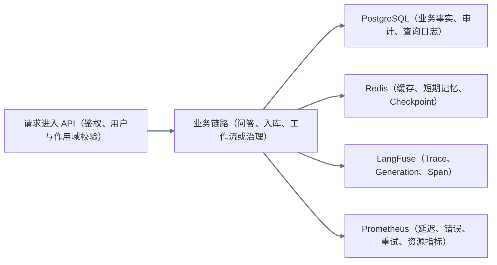

图例：灰色箭头为所有业务链路共享的状态收口，不代表每个请求都必然写入每一种存储。

## 一、总体架构

### 用户操作流程

1. 资料运营人员从文档后台上传资料，或发起受控公开资料采集。
2. 业务用户在「AI 智能问答」发起咨询，并选择 Simple、Auto 或 Agentic。
3. 管理员在「Agent 运营」查看运行、工作流、Artifact、质量与治理数据。
4. 用户发现答案错误时提交 Bad Case；运营人员审核、回灌并回归验证。

### 数据／状态流转

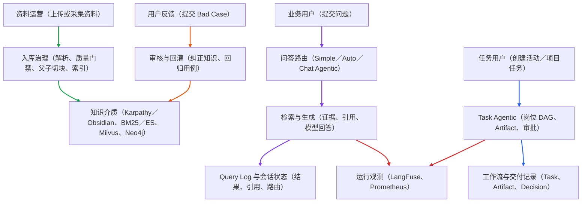

图例：绿色为知识供给；紫色为问答；蓝色为 Task Agentic；橙色为 Bad Case；红色为观测。Bad Case 回灌指向知识介质，表示后续查询可优先检索已审核纠正知识。

### 代码入口

`DocumentService`、`KarpathyRagService`、`ChatService`、`AgenticRagService`、`ProductionWorkflowService`、`RagFeedbackService`、`BadCaseFlywheelService`。

### 当前边界

本地能力可在现有服务与依赖启动后验证。真实企业 IAM、长期 SLA、生产告警值班、跨地域多副本与真实用户效果，需要部署环境和真实业务数据验收。

## 二、三条问答链路

### 2.1 路由总览

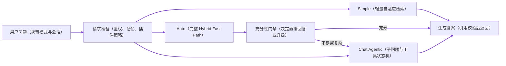

图例：紫色箭头为一次问答的完整路由。用户可显式选择模式；Auto 的升级由系统决定。Task Agentic 不属于问答路由，见第三章。

### 2.2 Simple：轻量自适应检索

#### 用户操作流程

1. 用户选择 `simple` 并提问，适合明确术语、活动 ID、字段、流程节点等问题。
2. 页面返回自然答案、引用、检索说明和联网来源（如果发生联网）。
3. 用户可继续追问；系统按会话记忆准备必要上下文，而不是把完整历史全部放进 Prompt。

#### 数据／状态流转

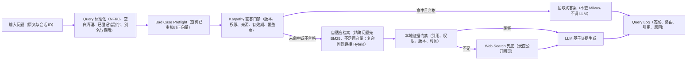

图例：紫色箭头为 Simple 问答。Query 标准化不是向量化；向量化仅发生在需要 Milvus 语义检索时。Karpathy 只在受治理条件齐全时直答，否则回到常规检索与生成。

#### 代码入口

`ChatService` 调用 `KarpathyRagService.answer`，携带 `adaptiveVectorSearch` 与 `karpathyDirectAnswer`。`normalizeQuery` 执行标准化；`tryKarpathyDirectAnswer` 执行直答门禁；`BadCaseFlywheelService.retrieveMatches` 执行纠正案例预检。

#### 当前边界

联网依赖 Bocha 等外部工具已配置且可用；未配置、超时或没有可用结果时，系统只能按受限模型兜底或提示证据不足，不能伪造来源。

### 2.3 Auto：完整 Hybrid Fast Path 与按需升级

#### 用户操作流程

1. 用户选择 `auto`，不需要自己判断问题复杂度。
2. 系统先跑一次完整混合检索；证据足够则直接回答。
3. 问题复杂、引用不足或任务需要多步推理时，系统升级为 Chat Agentic，并在页面展示最终路由。

#### 数据／状态流转

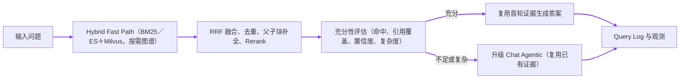

图例：紫色箭头为 Auto。它不是先跑 Simple，也不会在直接回答前重复跑一次检索。

#### 代码入口

路由与充分性判断在 `RagGatewayService`、`ChatService`、`AgenticRagService` 相关流程中完成；检索复用由 Fast Path 结果与检索选项承载。

### 2.4 Chat Agentic：复杂问答状态机

#### 用户操作流程

1. 用户选择 `agentic`，用于需要拆分、比较、多跳关联、方案分析或工具辅助的复杂问题。
2. 页面展示子问题、检索／工具进度和最终答案。
3. 高风险工具动作才进入人工确认；普通证据不足优先补检索、联网或提示待确认项。

#### 数据／状态流转

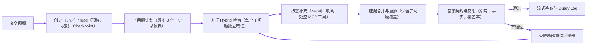

图例：紫色箭头为 Chat Agentic。局部重试回到缺证据的节点，不把整条链路无限重跑；最大步数、工具次数、超时和预算由 Runtime 限制。

#### 诊断 Artifact

Chat Agentic 可写入 `SubQuestion Plan`、`Evidence Bundle`、`Answer Contract` 等诊断交接物，供「Artifact 审计」排查。它们用于解释一次复杂问答，并不是 Task Agentic 的 PRD／代码交付物。

## 三、Task Agentic 产研运工作流

### 用户操作流程

1. 管理员在「Agent 运营→产研运工作流」创建活动或项目任务，填写目标、参与岗位、审批策略和插件组合。
2. 工作流依次或按依赖执行产品、设计、前端、后端、测试、运营岗位。
3. 管理员在工作流详情查看每个岗位的 Artifact、证据、风险与审批状态；可驳回、局部重跑或导出 Markdown／项目代码交付包。
4. 已完成工作流可在运行中心、协作编排与 Artifact 审计中按同一 Thread／Run 回放。

### 数据／状态流转

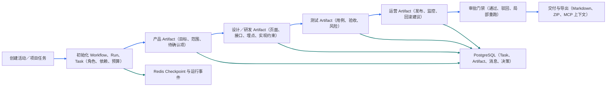

图例：蓝色箭头是岗位交付主线；青色箭头是任务运行状态与交付数据落库。Task 可使用共享 Hybrid RAG、Tool Registry、插件和 LangFuse，但普通 Chat 不会自动进入此岗位 DAG。

### 实际策略

- `sequential`：按岗位依赖批次推进。
- `hierarchical`：业务负责人／Manager 创建父任务并受控委派子任务，不允许无限自主委派。
- `conditional`：根据证据充分性、风险和审批状态创建补充检索或人工确认任务。

### 代码入口与边界

主入口为 `ProductionWorkflowService`、`AgentTasksService`、`ArtifactsService`、`AgentRuntimeEventsService`。Redis 不可用时存在进程内保护与恢复降级；真实多实例租约、独立 Worker 集群和跨机器故障演练属于生产验证项。

## 四、RAG 知识入库与检索

### 4.1 文档入库与版本治理

#### 用户操作流程

1. 管理员上传文件、URL、Obsidian 笔记或受控公开资料。
2. 在文档后台检查解析、切块、索引与版本状态；新规范可设置生效时间并替代旧版本。
3. 旧规范标记为 `deprecated` 后默认不进入当前检索；管理员仍可追溯来源和替代关系。

#### 数据／状态流转

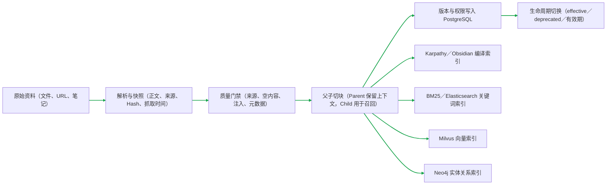

图例：绿色箭头为知识供给。父子切块不是重复存同一段文本：子块负责精确命中，父块在回答时补回章节上下文。

#### 代码入口

`DocumentService`、知识库 Profile、`KarpathyRagService`、向量／关键词／图谱 Provider。异步任务状态为 `queued → processing → completed／failed`，阶段可包含解析、Embedding、向量索引和元数据处理。

### 4.2 检索与证据组装

#### 用户操作流程

用户只输入问题；系统根据查询类型选择检索组合，返回时显示引用与原因，不把内部检索介质暴露为用户必须理解的步骤。

#### 数据／状态流转

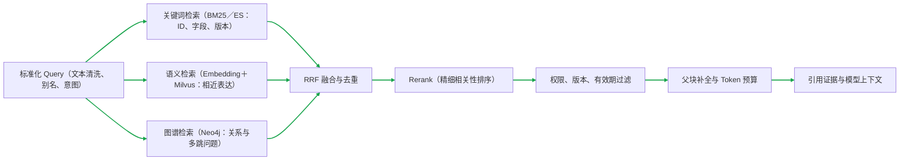

图例：绿色箭头是检索证据链。不是每次都调用所有检索器：Simple 精确查询可先 BM25，Auto 和 Chat Agentic 根据问题与充分性组合调用。

### 4.3 Karpathy／Obsidian 的位置

Karpathy 与 Obsidian 是知识编译和快速索引层，不替代 PostgreSQL 的权限／版本／来源治理。资料入库时先保存治理元数据，再编译知识卡；检索时仍由用户作用域、文档版本、有效期和来源策略过滤。因此，Karpathy 适合治理完备的确定性知识直答，也适合为常规检索提供快速候选。

### 当前边界

真实公开资料的持续采集、内容版权／来源治理、视觉向量、视频抽帧、以图搜图和企业级图谱实体消歧需要真实数据与生产策略，不能仅凭模拟资料证明效果。

## 五、Bad Case 质量闭环

### 用户操作流程

1. 用户在答案下点击「提交 Bad Case」，填写错误类型、说明、修正答案和是否加入回归。
2. 运营人员在「Agent 运营→Bad Case 审核」核对原问题、原答案、引用和检索快照，选择通过、驳回或撤销。
3. 通过后，用户再次询问相似问题；三条问答链路都会先执行纠正知识预检。
4. 运营人员在评测页面查看回归用例结果；撤销后纠正知识失效，后续回答回到正式知识检索。

### 数据／状态流转

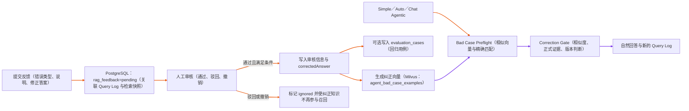

图例：橙色箭头为反馈审核与回灌；紫色箭头为后续问答预检。写入 PostgreSQL 发生在提交时；写入纠正向量发生在审核通过后，而不是提交后。

### 代码入口与边界

`RagFeedbackService`、`BadCaseFlywheelService`、`KarpathyRagService`。Bad Case 是纠错优先证据，不是替代正式文档治理的万能知识库；长期回归质量仍需真实业务问题、标准答案和人工审查。

## 六、会话记忆与 Redis Checkpoint

### 6.1 问答上下文管理

#### 用户操作流程

用户持续追问时，无需携带完整历史。系统优先使用短期工作记忆、压缩摘要与必要的长期记忆，再进入本次问答检索。

#### 数据／状态流转

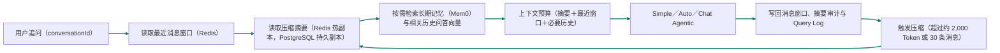

图例：青色箭头为会话记忆。最近窗口保存近期原文；摘要保存较早历史的结构化压缩结果，两者不是重复数据。压缩后摘要同步持久化到 PostgreSQL，Redis 只作为热副本。

#### 代码入口

`ShortTermMemoryService` 管理 Redis 窗口、摘要与压缩审计，压缩摘要写入会话持久字段；`MemoryService`／Mem0 存储跨会话事实与偏好；会话向量检索按当前问题补少量相关旧问答。

### 6.2 Chat Agentic／Task Agentic 的 Checkpoint

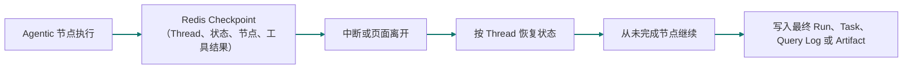

图例：青色箭头为运行恢复。Checkpoint 保存执行位置和状态，不等于完整用户记忆；问答记忆仍由上一节的窗口、摘要和长期记忆负责。

### 当前边界

本地支持 Redis Checkpoint 与恢复接口。跨实例事件顺序、SSE 断线续传、实例崩溃后的未知工具结果扫描和真实多副本演练仍需要部署环境验证。

## 七、Agent 运营、Artifact 与审计

### 用户操作流程

1. 「运行中心」按 Run 查看 Simple／Auto／Chat Agentic／Task Agentic 的运行总览、事件、指标、工具动作与最终结果。
2. 「产研运工作流」查看 Task Agentic 的任务列表、详情、岗位 Artifact 和审批；点击列表进入独立详情页，不和新建表单混在一起。
3. 「Artifact 审计」查看 Chat Agentic 的诊断 Artifact，或由运行中心跳转查看关联交付物。
4. 「协作编排」查看 Task、角色消息、依赖、决策记录、受控委派与局部重跑。

### 数据／状态流转

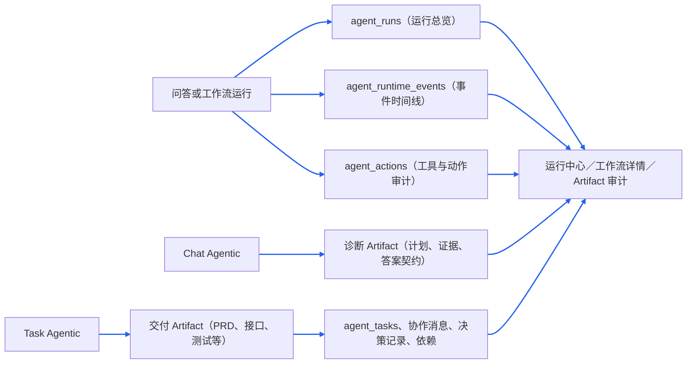

图例：蓝色箭头为运营审计主线。Chat 诊断 Artifact 与 Task 交付 Artifact 是两类不同对象，页面入口可关联，但不能把它们当成同一产物。

### 当前边界

已有本地运行回放、Artifact 关联与局部重跑。生产环境仍需完善按租户／岗位的 IAM、审计保留策略和跨服务事件一致性。

## 八、可观测、性能、成本与告警

### 用户操作流程

1. 开发／运营人员在 LangFuse 查看一次请求的 Trace、模型 Generation、检索／工具 Span 和成本信息。
2. 在 Prometheus／Grafana 看服务级指标：QPS、错误率、P95、首 Token 延迟、空召回、重试、工具成功率与循环限制命中。
3. 健康检查失败或指标越阈值时，告警适配层生成事件；企业微信、钉钉或飞书通知需填入对应 API 接入实现。
4. 质量、性能与成本脚本产出 Evidence 报告，人工决定是否灰度、回滚或继续排障。

### 数据／状态流转

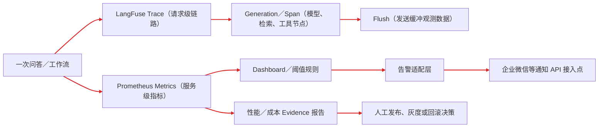

图例：红色箭头为观测和运行保障。LangFuse 负责单请求细节；Prometheus 负责长期聚合指标；两者都不等同于自动发布系统。

### 代码入口与边界

`LangfuseProvider`、`MetricsInterceptor`、`ObservabilityController`、LLM Gateway 的成本字段与运行指标服务。真实 Dashboard 布局、告警规则、采样／脱敏、通知凭证、值班与事故复盘需要生产配置，不应称为已验收的生产运营体系。

## 九、安全、工具、MCP 与插件

### 9.1 Prompt Injection 与工具执行

#### 用户操作流程

1. 用户或管理员启用适合当前链路的插件能力包，例如混合检索、联网研究或 MCP 编码上下文。
2. 系统只显示与当前模式兼容且已启用的插件；Simple 不应承载高风险写入型工具。
3. 对外部网页、上传文本等不可信内容，系统将其作为证据而非系统指令；对工具请求按注册表、参数、权限与风险策略校验。

#### 数据／状态流转

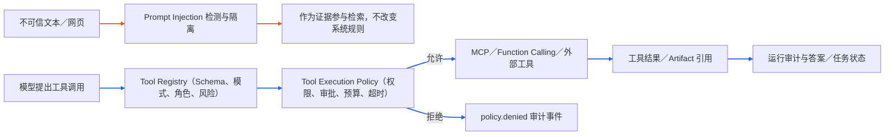

图例：橙色箭头为不可信证据防护；蓝色箭头为工具准入与审计。二者解决不同问题：前者防止文本篡改指令，后者防止未授权工具产生副作用。

### 9.2 插件的使用边界

插件是 Tool Registry 上已有工具的声明式组合，不支持上传或执行任意代码。管理员在「Agent 运营→平台治理」登记、启停和配置插件；问答或工作流选择插件后，后端把有效工具白名单写入请求快照、Checkpoint 和运行事件，并在执行前实际拦截未授权工具。

适用场景：联网研究、混合检索证据、MCP 编码上下文、产研运基础工作流。非适用场景：用插件绕过角色权限、在 Simple 中执行高风险写入、把外部网页当作可信指令。

### 当前边界

已有注册、策略、审计和白名单基础。企业凭证中心、细粒度 IAM、实时人工审批、隔离沙箱与 DLP 仍需真实企业基础设施接入。

## 十、版本、评测与发布治理

### 用户操作流程

1. 管理员在平台治理维护模型、工具、工作流模板、Prompt 版本、知识库 Profile 与评测集。
2. 更新规范时，先上传新版本、完成索引、设为 `effective`，再把旧版本设为 `deprecated`；不直接覆盖原始证据。
3. Bad Case 审核通过且勾选回归时，写入／更新评测用例。
4. 发布前运行回归、性能和成本脚本，人工查看 Evidence 后决定发布、灰度、回滚或继续修复。

### 数据／状态流转

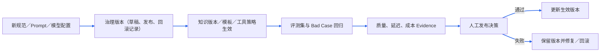

图例：蓝色箭头为治理与人工决策。评测脚本生成证据，不自动修改生产版本，也不自动发布。

### 当前边界

已有模型／工具／工作流／评测等治理基础与本地脚本。真实租户账单、完整审批流、发布平台、灰度流量和外部变更管理系统仍需接入。

## 十一、补充能力与真实生产边界

| 能力 | 当前本地能力 | 尚不能宣称已完成的生产能力 |
| --- | --- | --- |
| AG-UI／SSE | 生命周期事件、节点事件、Token 流、取消请求 | `Last-Event-ID` 断线续传、跨实例事件恢复 |
| 异步队列 | BullMQ 文档／Artifact 任务、进度、重试、退避 | 独立 Worker 集群、死信队列、跨服务补偿 |
| GraphRAG | Neo4j 实体关系查询、Graph Search、运营接口 | 大规模实体消歧、别名合并、增量冲突治理与回滚 |
| 多模态 | OCR、ASR、Vision Provider、sidecar 基础链路 | 真实视觉向量、视频理解、以图搜图、跨模态 Rerank |
| Web Search | 受控 Bocha 联网兜底、超时／失败降级 | 长期网页快照、来源质量治理、生产引用审计 |
| 数据合规 | ACL、用户隔离、注入防护、基础审计 | 企业 IAM、DLP、数据分级、删除请求、保留策略 |
| 成本与效果 | Token／成本字段、预算、模拟 Adoption 汇总 | 真实租户账单、长期采纳率、返工率、人工接管率、真实 SLA |
| 高可用 | Redis Checkpoint、进程内保护与恢复降级 | 真实多副本、崩溃恢复演练、分布式事件序号和租约验证 |

## 十二、参考项目归档与面试表达

### 参考项目记录

Dify、RAGFlow、AutoGPT、MetaGPT、CrewAI、AutoGen、DeepSeek Harness 的借鉴点、取舍与生产边界，统一见：[开源项目参考能力归档.md](/Users/monster/Documents/GitHub/code/RAG/docs/interview/开源项目参考能力归档.md)。该文档是调研归档，不作为当前实现状态的唯一证据。

### 面试可复述的项目主线

> 我把系统拆成两条 Agentic 业务线：面向用户的 Chat Agentic 负责复杂问题的子问题取证、工具补充与可引用答案；面向团队的 Task Agentic 负责活动／项目的岗位 DAG、结构化 Artifact 和审批交付。底层复用同一套 Hybrid RAG、权限版本过滤、Tool Registry、Redis Checkpoint、LangFuse 和 Prometheus。质量上用 Bad Case 审核回灌和评测回归纠错；所有生产能力都明确区分了本地实现与待部署验证的边界。

### 代码核对入口

| 能力 | 主要入口 |
| --- | --- |
| Simple／Auto／Chat Agentic | `backend/src/modules/chat/chat.service.ts`、`backend/src/rag/karpathy/karpathy-rag.service.ts`、`backend/src/rag/agentic/agentic-rag.service.ts` |
| Task Agentic | `backend/src/modules/workflow/production-workflow.service.ts` |
| 会话记忆 | `backend/src/modules/memory/short-term-memory.service.ts` |
| Checkpoint | `backend/src/providers/langgraph-checkpointer/redis-checkpointer.ts` |
| Bad Case | `backend/src/modules/chat/rag-feedback.service.ts`、`backend/src/rag/prompts/bad-case-flywheel.service.ts` |
| 工具与插件 | `backend/src/tools/`、`backend/src/modules/plugin-runtime/` |
| 运行审计 | `backend/src/modules/agent-runs/`、`backend/src/modules/agent-runtime-events/` |
