# 企业级 RAG／Agent 功能流程速查

> 版本：2026-09-21。目标不是背流程节点，而是把一个功能讲成「先说结论 → 问题场景 → 处理方案 → 为什么有效 → 边界与代价」。本文只记录仓库可定位的实现，不把参考方案、模拟数据或生产设想写成已完成功能。

## 怎么使用这份文档

| 使用场景  | 阅读方式                               |
| ----- | ---------------------------------- |
| 第一次阅读 | 只看「先记住这 12 句话」「一分钟项目介绍」和每章的「先说结论」  |
| 理解系统  | 顺着「一条问题如何得到答案」和「一份文档如何进入知识库」两条主线阅读 |
| 面试准备  | 先自己回答章节标题中的问题，再看问题场景、方案、取舍与代码证据    |
| 功能排障  | 根据流程图定位失败节点，再查看对应代码入口和状态字段         |
| 验收项目  | 核对“当前实现”和“生产边界”，不能把待接入能力说成已完成      |

不要从头到尾硬背。优先顺序建议：问答路由 → 检索证据 → 文档入库 → Agent 工作流 → 记忆／Checkpoint → 评测与可观测 → 安全治理。

## 快速导航

| 问题 | 对应章节 |
| --- | --- |
| 整个系统解决什么问题？ | [一、总体架构](#overall) |
| Simple、Auto、Agentic 有什么区别？ | [二、三种问答模式](#qa-chains) |
| 多岗位任务如何协作、审批和恢复？ | [三、Task Agentic](#task-agentic) |
| 文档如何变成可检索、可引用的知识？ | [四、RAG 入库与检索](#rag) |
| 错误答案如何纠正并避免再次发生？ | [五、Bad Case](#bad-case) |
| 如何使用历史上下文而不被错误历史污染？ | [六、记忆与 Checkpoint](#memory-checkpoint) |
| 如何审计 Agent 做过什么？ | [七、Agent 运营](#agent-ops) |
| 如何定位慢、贵、错和不稳定？ | [八、可观测性](#observability) |
| 如何防止提示注入和工具越权？ | [九、安全、工具与 MCP](#security-tools) |
| 文档、Prompt 和模型如何安全发布？ | [十、版本与发布治理](#governance) |
| 哪些能力还不能算生产完成？ | [十一、生产边界](#production-boundaries) |
| 面试时如何归纳项目？ | [十二、面试表达](#references) |

## 先认识这些高频词

| 术语              | 先这样理解                           |
| --------------- | ------------------------------- |
| RAG             | 先查可靠资料，再让模型依据资料回答               |
| Chunk           | 文档切分后的检索单元；小块负责命中，父块补完整上下文      |
| Hybrid Search   | 同时使用关键词与向量召回，再融合结果              |
| Rerank          | 对初步召回结果做更精确的相关性重排               |
| Evidence Bundle | 一次请求唯一的证据快照，包含原问题、候选证据、充分性和来源策略 |
| Citation Gate   | 检查答案中的关键结论是否真的被引用证据支持           |
| Agentic         | 模型在受控状态机中规划、取证、调用工具、校验和重试       |
| Artifact        | Agent 生成的可审计结构化产物，不是随意聊天文本      |
| Checkpoint      | 保存状态机快照；是否能继续取决于具体链路支持的恢复入口     |
| Bad Case        | 用户反馈的错误答案；必须经过审核才能影响后续回答        |
| Tool Registry   | 工具的能力、权限、风险、超时和降级规则清单           |
| Trace           | 一次请求从路由、检索、模型到工具的完整运行记录         |

## 先记住这 12 句话

| 主题    | 一句话结论                                                                       |
| ----- | --------------------------------------------------------------------------- |
| 系统定位  | 这是可运营、可评测、可追踪的企业知识库与受控 Agent 平台，不只是聊天页。                                     |
| 问答路由  | 产品保留三种模式，内部只有 Simple 线性引擎与 Agentic 状态图；Auto 是先看首轮证据再二选一的路由策略。 |
| 历史隔离  | 当前问题独立建 RequestContext；历史只作指代／偏好参考并标记不可信，不能覆盖客观事实。                   |
| 检索    | 关键词负责编号和精确词，向量负责相近表达；图谱由结构化检索计划按需调用，不能让普通问题也隐式探测 Neo4j。                    |
| 证据    | Auto 的首轮 Fast Path 产出 Evidence Bundle；升级到 Agentic 时复用它，显式 Agentic 只复用自身已完成的子问题取证，避免同一请求重复查询。                   |
| 幻觉治理  | 没有充分证据就补检索或降级；答案未通过 Citation Gate 时不能把检索残片直接当结论。                            |
| 文档入库  | 上传后先解析、质量检查、父子切块和必要索引写入；普通上传按配置决定草稿或直接生效，新版本固定先进入草稿。                        |
| 版本    | PostgreSQL 保存事实；版本治理创建的新版本先是草稿，生效后旧版本才变为废弃。                                 |
| Agent | Chat Agentic 解决复杂问答，Task Agentic 解决多岗位交付，两者不是同一条链路。                         |
| 恢复    | Chat 重试、Task 审批／修订继续、工具幂等是三种独立机制，不能统称为任意节点断点续跑。                             |
| 纠错    | Bad Case 先审核，再进入纠正层或晋升正式知识，并加入回归评测。                                         |
| 可观测   | LangFuse 看单次调用，Prometheus 看长期指标，运行中心看业务 Run、事件、工具和 Artifact。                |

## 一分钟项目介绍

> 我做的是一个企业级 Agentic RAG 知识协同平台。资料进入系统后经过解析、质量门禁、父子切块和多索引写入；用户提问时先隔离历史，并一次性得到意图、来源策略、权限范围和图谱计划。内部只有 Simple 线性引擎与 Agentic 状态图：Auto 根据首轮证据和复杂度规则二选一，升级时不丢弃已取到的证据。系统用 Evidence Bundle 统一证据，用 Bad Case 审核回灌持续纠错；Task Agentic 按岗位 DAG 生成可审批、可修订的结构化交付物。PostgreSQL 保存业务事实，Redis 保存热状态和 Checkpoint，LangFuse、Prometheus 与运行中心负责追踪质量、成本和失败节点。

## 名称统一口径

| 名称              | 准确定义                                                                                          | 不应混淆为                          |
| --------------- | --------------------------------------------------------------------------------------------- | ------------------------------ |
| Simple          | 轻量执行引擎：公共直答可提前结束；其他问题只做一轮受治理 Hybrid RAG 和生成，不进入多步 Agentic（智能体式执行）             | 永远只查 BM25（关键词相关性算法），或永远不查向量库   |
| Auto            | 默认路由策略：先处理澄清，再执行一次 Hybrid Fast Path；根据证据充分性和复杂度选择 Simple 或 Agentic，并复用快照    | 第三套执行引擎，或先做一次直答查询再做一次完整检索 |
| Chat Agentic    | 复杂问答状态机：规划子问题、并行取证、按需工具／联网、反思与受限重试                                                            | 必然走六岗位协作、必然生成 PRD              |
| Task Agentic    | 产研运任务状态机：产品、设计、前端、后端、测试、运营按依赖交付 Artifact                                                      | AI 问答的第四种模式                    |
| Karpathy 知识     | 从已治理资料编译出的知识卡和本地 BM25 索引，既服务于线性回答，也服务于 Fast Path 的受控取证与降级资产                              | 与统一 Hybrid RAG 并列的第四条在线检索链路    |
| Bad Case        | 用户提交的错误案例；只有审核通过并满足条件后才成为纠正知识                                                                 | 用户一提交就立即改变答案                   |
| Artifact（结构化产物） | Task Agentic 的结构化阶段产物，或 Chat Agentic 的诊断交接物                                                   | 任意聊天文本                         |

## 状态统一口径

| 对象 | 关键状态／字段 | 含义 |
| --- | --- | --- |
| `rag_feedback` | `pending` | 已提交，等待审核 |
| `rag_feedback` | `reviewed`／`resolved` | 审核确认并完成处理；满足条件时可参与纠正召回 |
| `rag_feedback` | `ignored` | 驳回、忽略或撤销，不参与纠正召回 |
| 文档 | `effective` | 当前可检索的生效版本 |
| 文档 | `deprecated` | 已被替代，默认不作为当前规范检索 |
| Chat Run | `running`／`waiting_approval`／`completed`／`failed`／`cancelled` | 问答运行状态；`waiting_approval` 代表图已暂停在可恢复 Checkpoint，不能当作已完成答案 |
| Task 工作流 | `running`／`pending_approval`／`revision_required`／`completed`／`failed` | 任务运行状态；当前实现没有 `paused`／`interrupted` 状态 |
| 文档任务 | `queued`／`processing`／`completed`／`failed` | 异步入库任务状态 |
| Agent 定时任务 | `enabled`／`disabled`；单次执行为 `running`／`completed`／`failed` | 任务调度状态与每次执行状态分开保存 |

## 所有链路共有的底座

**先说结论**：无论用户在问答、上传文档还是运行 Agent，身份与数据范围都必须先确定；业务事实、运行状态和观测数据由不同系统分别负责，不能混在一起。

**问题场景**：如果把业务数据、缓存和 Trace 都理解成“系统状态”，排障时很容易误判。例如 Redis 中没有 Checkpoint，不代表 PostgreSQL 中的任务已经丢失；LangFuse 有 Trace，也不代表业务事务已经提交。

**处理方案**：PostgreSQL 保存可追溯的业务事实；Redis 保存可丢失、可恢复的热状态；LangFuse 保存单次调用细节；Prometheus 聚合长期指标。

除非章节特别说明，所有请求均遵循以下公共规则：鉴权和作用域过滤先于业务处理；PostgreSQL 保存业务事实和审计；Redis 保存热状态、缓存、短期记忆与 Checkpoint；LangFuse 记录单次调用追踪；Prometheus 聚合服务指标。

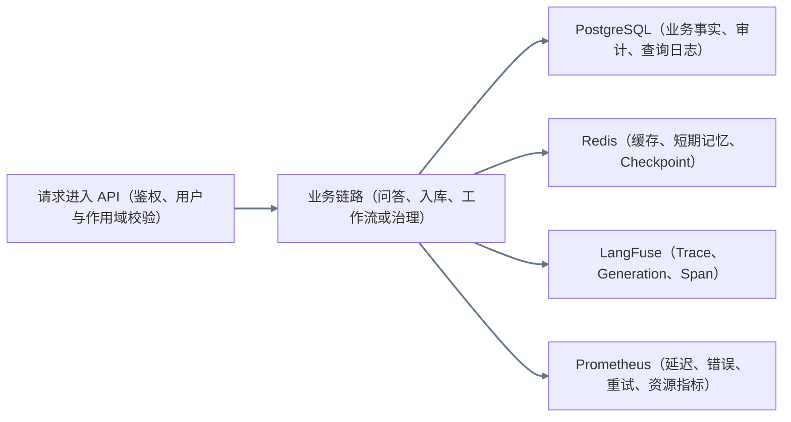

图例：灰色箭头为「请求进入 API → 业务链路 → PostgreSQL／Redis／LangFuse／Prometheus」的公共收口；不代表每个请求都必然写入每一种存储。

<a id="overall"></a>

## 一、整个系统解决什么问题？

**先说结论**：系统把“资料进入知识库、用户获得可信答案、团队完成 Agent 交付、错误答案持续纠正”连成一个闭环。

**问题场景**：普通聊天机器人只负责生成文字，遇到内部资料、版本冲突、错误反馈、复杂任务和生产排障时，没有统一的数据与状态依据。

**处理方案**：系统拆成四条业务线：知识入库、可信问答、Task Agentic 交付、Bad Case 纠错；底层共享权限、证据、版本、运行审计和观测能力。

**为什么有效**：每条链路职责清楚，但通过 `docId`、`conversationId`、`threadId`、`runId` 和 `queryLogId` 串起来，既能独立排障，也能回溯完整因果链。

### 用户操作流程

1. 资料运营人员从文档后台上传资料，或发起受控公开资料采集。
2. 业务用户在「AI 智能问答」发起咨询，并选择 Simple、Auto 或 Agentic。
3. 管理员在「Agent 运营」查看运行、工作流、Artifact、质量与治理数据。
4. 用户发现答案错误时提交 Bad Case；运营人员审核、回灌并回归验证。

### 数据／状态流转

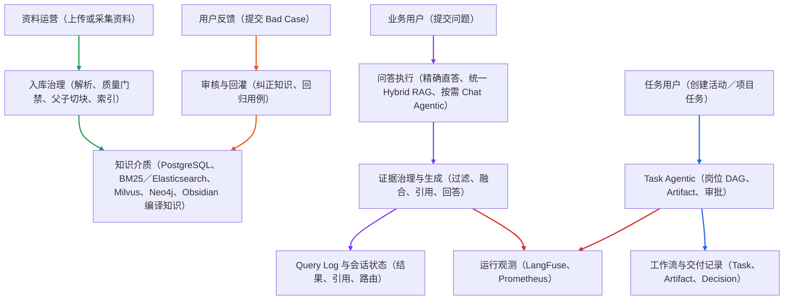

图例：绿色箭头为「资料运营 → 入库治理 → 知识介质」；紫色箭头为「业务用户 → 问答路由 → 检索与生成 → Query Log」；蓝色箭头为「任务用户 → Task Agentic → 工作流与交付记录」；橙色箭头为「用户反馈 → 审核与回灌 → 知识介质」；红色箭头为「检索与生成／Task Agentic → 运行观测」。Bad Case 回灌指向知识介质，表示后续查询可优先检索已审核纠正知识。

### 代码入口

`DocumentService`、`KarpathyRagService`、`ChatService`、`AgenticRagService`、`ProductionWorkflowService`、`RagFeedbackService`、`BadCaseFlywheelService`。

### 当前边界

本地能力可在现有服务与依赖启动后验证。真实企业 IAM、长期 SLA、生产告警值班、跨地域多副本与真实用户效果，需要部署环境和真实业务数据验收。

<a id="qa-chains"></a>

## 二、Simple、Auto、Agentic 有什么区别？

**先说结论**：三种模式不是三套知识库，也不是三条独立代码链。内部只有两个执行引擎：Simple 做受治理的单轮线性回答，Chat Agentic 跑可恢复状态图；Auto 不生成自己的答案，只先取得一轮共享证据，再决定调用其中一个引擎。默认使用 Auto；明确、单轮的问题适合 Simple；需要拆解、关系推理、实时补证或工具协作时选择 Agentic。

**问题场景**：所有问题都走 Agentic 会增加延迟、成本和失败节点；所有问题都走 Simple，又无法处理多跳关系、实时信息和需要工具的任务。

**处理方案**：`ChatService` 是 HTTP、SSE、AG-UI 与管理后台代理唯一的问答编排入口。它先构建一次 `RequestContext`：读取可见历史和短期记忆、完成一次 `QueryIntent`、再并发加载长期记忆／历史向量／运行计划／检索 Profile，统一冻结来源策略、权限范围、图谱计划、截止时间与预算。历史只用于消解指代或读取用户设定，不能覆盖客观事实。Simple 直接调用线性 RAG；Auto 必须先做一次 Fast Path；显式 Agentic 直接进入状态图。Auto 仍用对比、原因、关系、规划、联网等复杂度规则作为兜底，因此不能表述为完全由语义模型决定的纯路由。

**为什么有效**：简单问题保持稳定和低成本，复杂问题才获得规划、补检索、工具和反思能力；三种模式仍共享权限、版本、Evidence Bundle 和 Citation Gate。

### 2.1 路由总览

三种模式共用同一套权限、版本、作用域、来源策略、Evidence Bundle、引用门禁和结果收口。Simple（简单模式）是单次线性问答；Chat Agentic（对话智能体模式）是允许规划、补证、审批和受限重试的状态机；Auto（自动模式）只是路由策略，不维护第三套生成、落库或 SSE 收口。用户端默认 Auto，并以「极速／自动／深度」展示。Karpathy 不是第四条在线链路，而是共享的 Hybrid RAG、结构化事实抽取与线性回答能力。

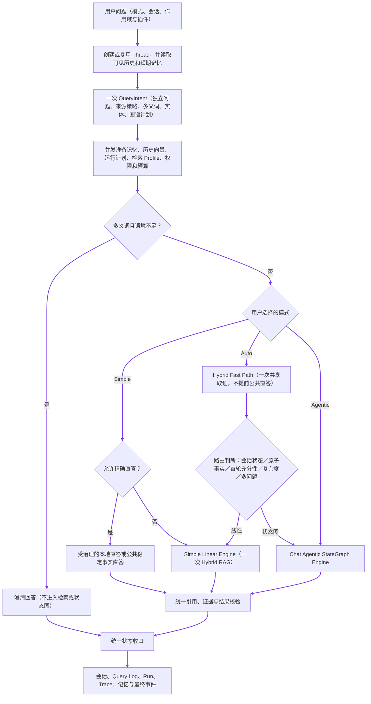

图例：内部资料、项目、业务、研发流程与已上传文档会把来源策略收紧为 `local_only`，三种模式都不能用公网或模型常识替代内部证据。澄清是三个模式共同的提前结束分支。只有显式 Simple 的受治理直答门禁可以跳过完整 Hybrid RAG；Auto 不在检索前做公共直答，显式 Agentic 也不降级为 Simple。Auto 升级时携带同一份首轮证据、来源限制和剩余预算；Task Agentic 不属于这条问答路由，见第三章。

#### 多入口统一与正文发布

普通 HTTP、SSE、AG-UI 与管理后台代理都以 `ChatService` 为唯一编排入口。入口层只负责鉴权、参数和事件协议，不能自行分类、直接调用 Agentic、再次读取会话上下文，或重复写入消息、记忆和 Trace。SSE／AG-UI 可先发送运行、路由、检索、充分性、工具和引用事件；模型产生的草稿 token 会被缓冲，只有最终答案通过引用／安全校验后才按最终正文发布。`final` 只在会话、Query Log、Run、Trace 与记忆完成统一收口后发送，避免用户看到草稿而数据库保存另一版答案。最终答案的引用、实际路由、检索状态和预算状态随助手消息元数据持久化，切换会话后可恢复“引用文档”。

| 模式 | Direct Answer Gate（精确直答门禁） | 检索策略 | 图谱／工具 | 是否循环 |
| --- | --- | --- | --- | --- |
| Simple（简单模式） | 已审核精确纠正、受治理的结构化本地事实，或允许的稳定公共事实 | 单次 Hybrid RAG；图谱仅在 `QueryIntent.requiresGraph` 为真时参与 | 非内部且 `web_allowed` 时最多一次网页补证 | 否 |
| Auto（自动模式） | 不在检索前直答；先 Fast Path 后由最终引擎处理 | 一次 Fast Path；正式 RAG／Base Case 快照复用，Obsidian 命中状态也复用 | 首轮按结构化计划查询图谱；升级后仅为新增缺口追加检索／工具 | 自身不循环；选 Simple 或 Agentic |
| Chat Agentic（对话智能体模式） | 多义词语境不足时先澄清；其余显式请求进入状态图 | 查询规划后并发检索、纠正层、正式 Hybrid RAG 与必要的 Obsidian | `web_allowed` 时受控网页补证；图谱按每个检索计划决定 | 是，受步骤、工具、超时与预算限制 |

### 2.2 Simple：精确直答与统一 Hybrid RAG

**内部资料边界**：凡涉及公司内部信息、内部业务链路、内部研发流程、内部系统、项目实现或已上传文档，必须走权限范围内的内部知识库检索（`local_only + retrieve`），目标覆盖 `company`、`project`、`documents`。模型通用知识和公网搜索不能替代内部资料；未命中时只能明确说明资料不足。

#### 用户操作流程

1. 用户选择 `simple` 并提问，适合明确术语、活动 ID（标识符）、字段、制度规则或单个流程节点等单轮问题。
2. 系统复用统一 RequestContext。命中已审核精确纠正，或命中版本、生效时间、权限、来源与字段覆盖度都通过的 Karpathy 结构化事实时，可以直接返回；未命中才进入完整单轮 Hybrid RAG。
3. 正式检索并发处理 Base Case、关键词／全文候选、向量候选和 Obsidian 命中。关键词与向量先 RRF 融合，再过滤权限、生命周期、版本、时间和业务作用域，按预算补父子块并 Rerank。正式 RAG 已充分时，Obsidian 不会抢占正式上下文；正式 RAG 不足时才作为兜底证据。
4. 若现有片段能组成薪资、OKR／绩效、版本、审批或 NestJS Provider 等结构化事实，优先生成跨片段且带当前引用的确定性答案；否则生成受约束的自然语言答案。
5. 页面返回答案、引用和可能的网页来源。本地与网页都没有可靠证据时，后端安全降级而不是生成无证据结论；内部检索原因默认折叠在「查看检索详情」。后续追问只带预算内的短期记忆、摘要和必要历史，不携带完整会话。

#### 数据／状态流转

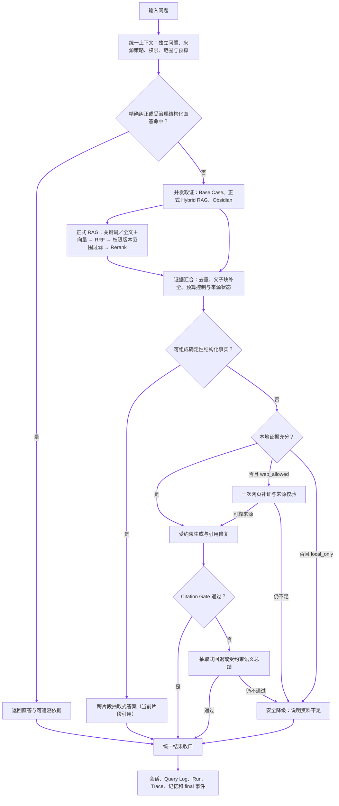

图例：Simple 的上限是“一轮证据处理”，不是“只查 BM25”。它不拆子问题、不进入 LangGraph 反思循环，也不因问题复杂而偷偷升级 Agentic。`retrieveDetailed` 只在结构化计划标记 `requiresGraph` 时查询图谱；非内部且 `web_allowed` 的问题在本地不足时最多一次网页补证。内部 `local_only` 问题只能说明资料不足，不能拿公网或模型常识补内部事实。

#### 代码入口

`ChatService` 调用 `KarpathyRagService.answer`。`answerDirect` 并发检查已审核精确 Bad Case 与受治理 Karpathy 编译知识；它只接受 lookup 类型、当前生效、有来源／版本、在有效期内且字段覆盖达到阈值的结构化片段。未命中后，Base Case、`retrieveDetailed` 和 `ObsidianKnowledgeService.search` 通过同一个 `Promise.all` 并发召回。`retrieveDetailed` 负责关键词／全文、Milvus（或 ES kNN 降级）向量、RRF、权限／版本／Scope、Rerank 与按计划图谱；`ContextBuilder` 控制证据预算；`buildEvidenceFirstAnswer` 负责结构化跨片段回答；`answerWithWebFallback` 负责单次联网补证；`assessCitationSupport` 与 `buildCitationSafeExtractiveAnswer` 负责引用校验和安全回退。

#### 当前边界

联网依赖 Bocha 等外部工具已配置且可用；未配置、超时或没有可靠结果时，系统进入安全降级，不能伪造来源或使用无证据模型知识补齐。用户可以补充版本、项目、时间范围或业务场景后重新提问。精确纠正答案可以不带文档引用，但必须来自已审核的精确 Bad Case；语义纠正候选必须作为 Base Case 证据返回引用。中文姓名误写只在「问题同长度、首字相同、且仅一个中文字符不同」时进入纠正候选，例如“韦永春是谁”可召回已审核的“韦水春是谁”；不同姓氏、数字版本差异和多字符差异不会自动合并。本地直答和常规答案继续受版本、权限、来源与引用门禁约束。

### 2.3 Auto：完整 Hybrid Fast Path 与按需升级

**Auto 不在检索前直答**：Auto 的职责是先用 Fast Path 看是否已有可靠本地证据，再在 Simple 与 Agentic 之间路由。识别到公司／项目／业务／研发内部语义时，来源策略先收紧为 `local_only`；即使首轮不足，也不会改用公网资料冒充内部事实。

#### 用户操作流程

1. 用户选择 `auto`，不需要自己判断问题复杂度。
2. 系统先按统一意图处理澄清；未澄清的问题一定执行一次 Hybrid Fast Path，不管它看起来像公共事实还是内部问题。
3. Fast Path 并发召回已审核 Base Case、正式 Hybrid RAG 和 Obsidian 命中。正式 RAG 内部完成关键词／全文、向量、RRF、权限／版本／Scope、Rerank 与按计划图谱。它产出一份包含已执行来源、无结果、超时和过滤条件的 Evidence Bundle；Obsidian 命中单独保留并由后续引擎按正式 RAG 是否充分决定是否纳入上下文。
4. 选择 Simple 的条件包括：会话状态回答／混合上下文、原子客观事实、首轮证据充分且不命中复杂度规则。多意图、首轮证据不足，或命中对比、原因、关系、规划、联网等复杂度规则时升级 Chat Agentic。
5. 升级后不重做已完成的首轮查询：Fast Path 的正式片段、Base Case、Obsidian 命中、来源限制和预算都传入状态图；只有新增子问题或新增证据缺口才追加检索。问题长度只影响上下文、Token（令牌）、时间与成本预算，不单独决定路由。

#### 数据／状态流转

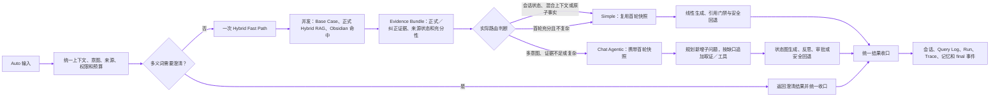

图例：Auto 不做“先查一遍 BM25 的直答探测，再查一次 Fast Path”，也不在 Fast Path 前公共直答。它只执行一次首轮取证，再把同一份快照交给 Simple 或 Agentic。Auto→Simple 主路径不额外联网；Auto→Agentic 只在 `web_allowed`、工具策略允许且本地仍不足时补充网页证据，`local_only` 明确禁止联网。最终仍无可靠证据时，两条分支都安全降级。

#### 代码入口

`ChatService` 只调用一次 `QueryIntentRouter`，并把结果放入 `retrievalOptions.queryIntent`；`AgenticRagService.run` 优先复用它，只有绕过 `ChatService` 的直接入口才自行分类。Auto 调用一次 `KarpathyRagService.assessFastPath`，其 `Promise.all` 并发启动 Base Case、正式 Hybrid RAG 和 Obsidian。`EvidenceBundle` 保存可复用的正式／纠正证据、充分性、过滤条件、诊断和各来源状态；Obsidian 命中作为独立快照提供给后续引擎。`resolveAutoRoute` 先判断首轮证据是否不足，再以 `shouldUseAgentic` 的复杂度规则决定升级；多意图、上下文状态和原子客观事实有显式优先规则。轻量分支和升级分支都复用同一请求快照，只有新增子问题才追加检索。

#### 路由门禁与边界

- 首轮「充分」由 Base Case、正式 RAG 和 Obsidian 命中统一评估；Evidence Bundle 会区分“执行成功但无结果”“未执行”“超时／失败”，不能把空数组混为一谈。结构化语义路由负责判断查询目标、来源策略、多问题、图谱计划和复杂度，但不能覆盖引用门禁。
- 轻量生成仍需通过 Citation Gate；因此“首轮充分”不等于“答案已经通过最终引用门禁”。
- Auto 已不再用 `text.length` 或固定实体词表直接决定是否检索，但是否升级 Agentic 仍使用对比、原因、关系、规划、联网等正则兜底。后续若要称为纯语义路由，需要把这部分替换为可评测的结构化分类器。
- 如果用户没有已索引的知识库片段，Auto 仍可进入 Agentic 状态机尝试 Web Search 等补证；内部资料缺失、无权限或问题含糊时，多跑几轮不会改变事实，应澄清或明确资料不足，而非无条件升级。
- 短实体或原子事实问句，例如「肯德基」「肯德基是什么」，升级后仍只保留原问题作为单个子问题；不会凭空扩写多个必须全部覆盖的验收项。

### 2.4 Chat Agentic：复杂问答状态机

#### 用户操作流程

1. 用户选择 `agentic`，用于需要拆分、比较、多跳关联、方案分析、实时信息或工具辅助的复杂问题。
2. 系统复用一次 QueryIntent 和 RequestContext。显式 Agentic 不运行 Auto Fast Path，也不为了省成本降级为 Simple；查询增强会生成检索表达和最多受预算限制的子问题，短实体／原子事实保留原题，避免状态机为了拆而拆。
3. `retrievalNode` 并发处理子问题的共享 Hybrid RAG、Base Case 与 Obsidian；正式 RAG 足够时，Obsidian 仅保留可观测状态而不挤占正式上下文。已存在的 Fast Path（仅 Auto 升级时）会直接复用，不重复读取同一来源。结构化事实实际引用的片段被优先保留，避免在截断时丢掉薪资、OKR、版本等关键证据。
4. 充分性节点先检查统一质量门禁与子问题覆盖；已有确定性结构化答案时，不会被不稳定的语义充分性模型误判为资料不足。只有来源策略允许、工具策略放行、预算未耗尽且本地仍不足时才调用 Bocha 网页检索；随后可 Rerank、生成受引证约束的答案并反思。
5. 普通问答默认不等待答案审批；只有用户显式启用答案审批时才暂停。暂停前状态机单独提交 `pending` Checkpoint，Chat 只保存原问题、Run ID、检查点和 `waiting_approval`，不把草稿写成正式助手消息、Query Log 或长期记忆；SSE／AG-UI 返回中断而不是完成。
6. 恢复入口先校验当前用户对会话和 Run 的归属，再从 Checkpoint 还原原始历史、权限／来源限制、检索选项和剩余预算。通过后走统一结果收口且不重复保存用户问题；拒绝会保存一条“未获批准”的审计说明和 Query Log，但不会把草稿伪装成正式答案。当前 Chat Agentic 工具均为只读；未来高风险副作用工具必须在执行前单独审批。

#### 数据／状态流转

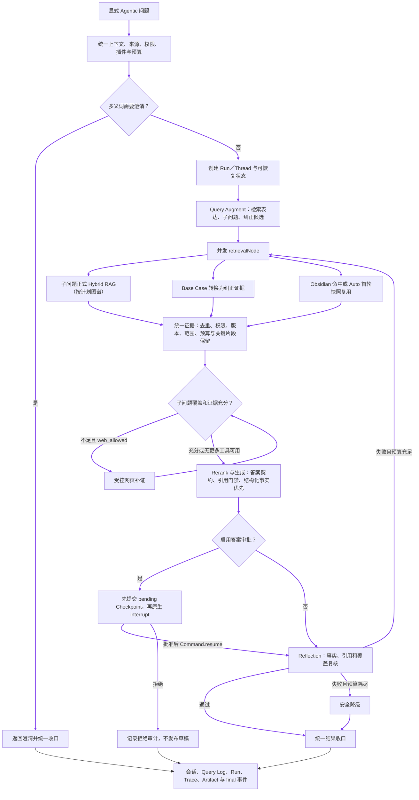

图例：显式 Agentic 即使面对公共事实也先进入状态机；内部资料、项目、业务和研发问题使用不可放宽的 `local_only`。Query Augment 形成子问题计划和纠正候选；`retrievalNode` 的共享 Hybrid RAG 按每个子问题的计划决定是否带图谱，避免原问题与子问题重复图谱查询。`approvalPending` 先把 `pending` 与预算快照写入 Checkpoint，再进入 LangGraph 原生 `interrupt()`；AG-UI 对外发布 `RUN_INTERRUPTED`，恢复只能由会话所属用户使用 `Command.resume` 发起并复用原上下文。每个状态机节点都会检查 Run 取消标记，取消后的迟到结果不能覆盖终态。当前联网补证工具是 Bocha 网页检索与引用校验；MCP 是外部接入面，不在这条服务内直接执行。反思仅重试失败部分，并受最大步数、工具次数、超时和预算限制。

#### Chat Agentic 内层 Agent Loop

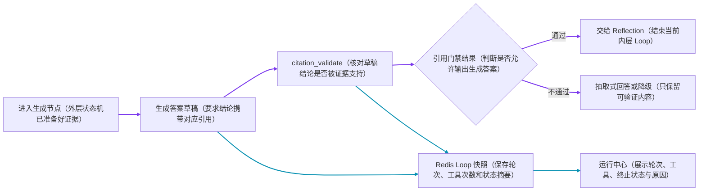

图例：紫色箭头为「LangGraph 生成节点 → 模型答案草稿 → 引用校验工具 → 通过后交给 Reflection，或不通过后基于已检索证据生成抽取式带引用回答」；结构化事实答案也在这里优先通过当前片段引用输出。只有抽取式回答和受约束语义总结都无法通过引用校验时才安全降级。青色箭头为「模型／工具动作 → Redis Loop 快照 → 运行中心审计」。外层 LangGraph 决定子问题、补检索、人工审批和反思重试；内层 Agent Loop 只执行当前节点允许的模型与只读工具，不能改写业务 DAG（有向无环依赖图）或绕过权限。

#### 诊断 Artifact（结构化产物）

Chat Agentic 可写入 `SubQuestion Plan`（子问题计划）、`Evidence Bundle`（证据包）、`Answer Contract`（答案契约）等诊断交接物，供 Artifact Audit（结构化产物审计）排查。它们用于解释一次复杂问答，并不是 Task Agentic 的 PRD（产品需求文档）或代码交付物。
<a id="task-agentic"></a>

## 三、多岗位任务如何协作、审批和恢复？

**先说结论**：Task Agentic 使用有依赖关系的岗位 DAG 推进交付，不让多个 Agent 自由聊天；每个岗位都生成结构化 Artifact，并经过审批、版本和 Checkpoint 管理。

**问题场景**：产品、设计、前后端、测试和运营并非全部可以并行。上游需求变化后，如果整条链路从头重跑，会浪费成本；如果直接复用旧产物，又可能让下游基于过期信息继续工作。

**处理方案**：系统按依赖批次执行岗位；审批驳回后暂停为 `revision_required`，标记旧产物与受影响下游，再由管理员触发局部重跑。Redis Checkpoint 保存执行位置，BullMQ 保存启动／恢复／修订 Job 并负责 Worker 接管与重试，PostgreSQL 保存长期任务事实与 Artifact；没有 Redis 时只保留本地开发的进程内降级执行。

**为什么有效**：DAG 保证依赖顺序，Artifact 让交接内容可校验，审批控制业务风险，局部重跑减少重复模型调用，Checkpoint 避免页面刷新或服务中断后从头开始。

### 用户操作流程

1. 管理员在「Agent 运营→产研运工作流」创建活动或项目任务，填写目标、参与岗位、审批策略和插件组合。
2. 工作流依次或按依赖执行产品、设计、前端、后端、测试、运营岗位。
3. 管理员在工作流详情查看每个岗位的 Artifact、证据、风险与审批状态。审批通过后进入下游；驳回时必须填写修改意见并选择需要修订的岗位。
4. 驳回只会将工作流暂停为 `revision_required`（待修订），在 Artifact metadata（产物元数据）保存 `rejected／stale`、修订号与驳回意见，并标记受影响下游，不会立即调用模型。管理员确认后点击「按意见重新生成」，系统才从被驳回岗位局部重跑。
5. 新版本重新进入审批，通过后才解锁下游；只有所有选中岗位都处于当前 `approved` 版本并通过交付门禁时，才可导出 Markdown／项目代码交付包。页面、ZIP 与 MCP 使用同一份 Handoff Manifest，其中包含 Markdown、Schema、RAG 引用、岗位版本、Artifact 状态和内容 Hash，可在运行中心、协作编排与 Artifact 审计中按同一 Thread／Run 回放。

### 数据／状态流转

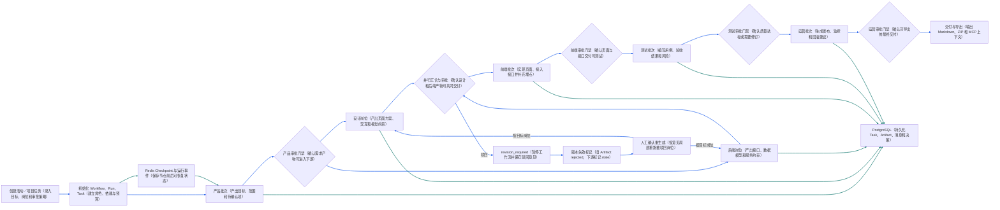

图例：蓝色箭头为「创建活动／项目任务 → 初始化 Workflow／Run／Task → 产品 → 设计与后端并行 → 前端 → 测试 → 运营 → 导出交付」，以及「审批驳回 → 暂停为待修订 → 保存旧版本并标记下游过期 → 人工确认 → 按目标岗位局部重新生成」。青色箭头为「初始化／各岗位 Artifact → Redis Checkpoint 或 PostgreSQL 任务、产物、消息与决策」。六个岗位均单独展示：产品、设计、后端、前端、测试、运营。驳回本身不触发模型，只有点击「按意见重新生成」才进入新修订轮次；新版本重新审批通过后才解锁下游。

### Task Agentic 的岗位内层 Agent Loop

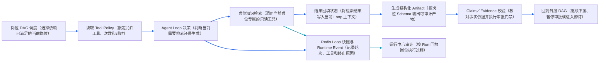

图例：蓝色箭头为「岗位 DAG → 岗位工具策略 → 内层 Agent Loop → 岗位检索 → 结果回填 → 结构化 Artifact → 证据与审批门禁 → 返回外层 DAG」；青色箭头为「Loop 决策／工具执行 → Redis 快照与运行事件 → 运行中心」。当前每个岗位只开放一个与职责匹配的只读知识检索工具，默认最多调用 1 次；通用 Loop 支持后续组合更多已注册工具，但仍受 Tool Registry、插件白名单、超时和审批限制。

### Task Agentic 的 Redis Checkpoint 操作流程

#### 用户操作流程

1. 管理员点击「启动工作流」后，系统创建 `Run` 和 `Thread`，LangGraph 通过 Redis Checkpointer 保存状态机快照。
2. 页面刷新或重新进入详情时，后台读取 PostgreSQL 中的任务、Artifact、审批事实，并读取当前 Checkpoint 展示执行状态。
3. 工作流进入 `pending_approval` 后，管理员调用继续接口；进入 `revision_required` 后，管理员提交修订意见并触发局部重跑。
4. 当前 Task 工作流不提供通用的 `paused`／`interrupted` 状态，也没有“从任意安全节点继续”的 UI；服务进程崩溃后的自动接管仍是生产待验证能力。

#### 数据／状态流转

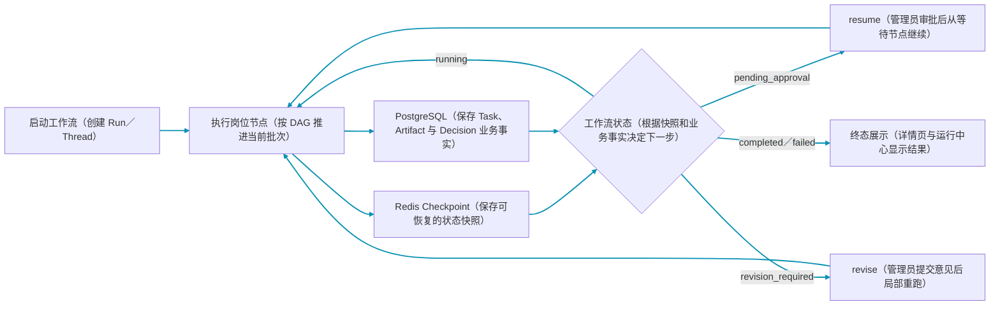

图例：Checkpoint 保存 LangGraph 状态快照；PostgreSQL 保存长期业务事实。`resume` 只处理 `pending_approval`，`revise` 只处理 `revision_required`。工具副作用的幂等与未知结果阻断属于通用工具执行服务，不应画成 Task Checkpoint 自带的恢复能力。

### 实际策略

- `sequential`：按岗位依赖批次推进。
- `hierarchical`：业务负责人／Manager 创建父任务并受控委派子任务，不允许无限自主委派。
- `conditional`：根据证据充分性、风险和审批状态创建补充检索或人工确认任务。

### 代码入口与边界

主入口为 `ProductionWorkflowService`、`AgentTasksService`、`ArtifactsService`、`AgentRuntimeEventsService`。Redis 不可用时存在进程内保护与恢复降级；真实多实例租约、独立 Worker 集群和跨机器故障演练属于生产验证项。

<a id="rag"></a>

## 四、文档如何变成可检索、可引用的知识？

**先说结论**：文件上传不等于知识已经可用。资料必须经过解析、质量门禁、父子切块和必要索引写入；普通上传是否直接生效由配置决定，版本治理创建的新版本固定先进入草稿。

**问题场景**：直接把上传文件送进向量库，会产生扫描件空文本、恶意提示、旧版本污染、权限泄漏和“检索命中了但回答缺上下文”等问题。

**处理方案**：原始资料与元数据先落库；子块负责精确召回，父块补完整章节；BM25／Elasticsearch、Milvus 和可选 Neo4j 分工建索引，Obsidian 作为附属知识编译资产；主检索候选先过滤权限、版本和有效期，再融合、重排并组装 Evidence Bundle。

**为什么有效**：入库阶段保证知识质量和可治理性，检索阶段保证相关性和作用域，生成阶段保证结论有引用，三层共同降低幻觉。

### 4.0 RAG 能力分层与当前实现

文档进入知识库后，不是“切一刀、算向量、直接回答”，而是经过以下五层处理。当前实现以权限、版本和证据可追溯为硬约束；未实现或未接入真实数据的高级算法只作为后续增强，不在运行时口径中冒充已具备能力。

| 层级 | 当前链路 | 作用与边界 |
| --- | --- | --- |
| 入库（Indexing） | 文件解析、质量／提示注入门禁、父子块切分、元数据、Embedding、Milvus、BM25／Elasticsearch、可选 Neo4j | Child 用于精准召回，Parent 用于补全上下文；版本、权限、来源和有效期随 Chunk 保存。语义切块、Late Chunking、RAPTOR 暂未作为默认在线链路。 |
| 检索前（Pre-Retrieval） | QueryIntent 语义分类、指代消解、独立 Query、`rewriteQueries`、子问题计划、知识库路由 | 先确定 `sourcePolicy`、目标知识库和 `requiresGraph`。公司内部信息、业务链路、研发流程、项目及上传文档固定 `local_only`，不能改走公网。 |
| 检索中（Retrieval） | BM25／Elasticsearch＋向量 Milvus 并行召回，RRF 融合，权限／版本／生命周期过滤，按需图谱与图片证据 | 关键词适合 ID、字段和版本，向量适合语义表达；图谱只按结构化意图启用，不用固定关键词隐式触发。 |
| 检索后（Post-Retrieval） | 去重、候选合并、可选 Rerank、父块／上下文补全、Token 预算、Evidence Bundle、Citation Gate | 命中不等于可用证据，必须通过来源、权限、版本、充分性和引用校验；历史对话不能替代事实证据。 |
| 回退与安全 | 非内部问题可按 `web_allowed` 受控联网；内部资料未命中返回资料不足／待确认 | 不用模型常识或公网内容冒充内部事实；网页、上传文本和纠正候选均按不可信证据处理。 |

#### 一次检索的最小闭环

1. 解析后的文档形成带 `docId`、版本、权限、来源和生命周期的 Chunk；同一版本的旧索引不会继续参与有效检索。
2. 用户问题先经过语义路由，生成独立 Query 和来源策略；多轮追问只补充必要实体与指代，不把完整历史拼入向量查询。
3. 关键词、向量、纠正层和附属知识并行召回，统一做 RRF、权限／版本过滤、去重和父块补全，形成唯一 Evidence Bundle。
4. Evidence Bundle 先做充分性评估，再交给 Simple、Auto 或 Chat Agentic；Auto 升级时复用首轮证据，Agentic 只为新增子问题追加检索。
5. 生成结果经过 Citation Gate；证据不足时优先抽取式回答、受控补证或安全降级，不能把低相关片段直接当结论。

### 4.1 文档入库与版本治理

### 4.1.1 管理后台文件上传

#### 用户操作流程

1. 管理员进入「文档管理」→「我的文档」，点击「批量上传」或空列表中的「上传文档」，可选择多个后端支持的文件。
2. 浏览器以 `multipart/form-data` 提交文件；不得手动指定 `Content-Type`，由浏览器附加 boundary（分隔边界）。
3. Admin Backend 校验登录态和 `admin:documents:write` 权限，接收 `file` 后附加当前登录用户的 `ownerUserId`，再用内部服务令牌转发给 RAG Backend。
4. RAG 内部上传路由校验服务令牌。Redis 队列启用时先创建任务并返回 `taskId`，再交给 Worker；队列未启用时同步完成解析和索引后才返回结果。
5. 任务按扩展名识别 Markdown／文本、PDF、Office、表格、演示文稿、JSON／HTML、图片、音频或视频，完成解析、质量门禁、切块和索引。
6. 前端每两秒查询任务状态；任务完成后刷新第一页列表，失败则展示明确原因。服务端和前端都按 `createdAt` 倒序展示，最新文档位于最上方。

#### 数据／状态流转

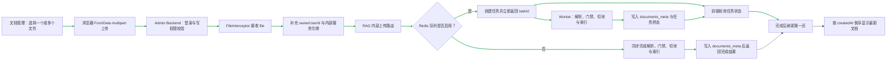

图例：绿色箭头为实际上传主链路。`ownerUserId` 必须由 Admin Backend 从已验证的登录态派生，浏览器提交的任意同名字段不作为归属依据。文件解析和向量索引可能明显长于普通 API；Admin Backend 对该上传转发使用 10 分钟专用超时，不复用默认的 2 秒管理 API 超时。

#### 代码入口

`admin/src/pages/documents/index.tsx`、`admin/src/pages/documents/service.ts`、`admin-backend/src/modules/admin-documents/admin-documents.controller.ts`、`admin-backend/src/modules/rag-client/rag-client.service.ts`、`backend/src/modules/rag-admin/rag-admin.controller.ts`、`RagAdminService.uploadDocumentAsync`、`DocumentQueueService`、`DocumentService`。

#### 当前边界

上传链路只接受解析器已支持的文件类型；不支持的扩展名返回明确错误。扫描版 PDF 的文本质量取决于 OCR 能力是否配置。Redis 队列启用时上传请求与解析任务解耦；队列未启用时仍保留同步兼容模式。无论使用哪条执行路径，都必须以任务状态和文档列表记录判断是否真正入库，不能仅凭浏览器请求成功推断索引已经完成。

### 4.1.2 文档版本治理

#### 用户操作流程

1. 管理员进入「文档管理」，在文档列表中找到需要更新的规范；如果列表较宽，横向滚动到底部，右侧「操作」列已固定。
2. 点击该行的「版本治理」按钮，查看版本链和当前 `effective`（生效）版本。
3. 在弹窗下方填写新版本号、文件名和正文，点击确定创建新版本。新版本立即显示为 `draft`（草稿），不会影响当前有效版本。
4. 等待新版本完成解析、质量门禁和切块；系统并行执行 PostgreSQL 元数据／Chunk／权限写入、Embedding→Milvus、Karpathy／BM25＋Elasticsearch。Obsidian 关联写入是尽力而为的附属分支，不是主入库成功的硬门槛；随后在 Neo4j 可用时异步发起图谱抽取。
5. 重新打开「版本治理」，确认新版本为 `draft`、入库任务已完成且 Chunk 数大于 0 后，点击该版本行的「设为生效」。图谱构建失败不阻塞该操作；它是可选补充索引，而不是版本切换的硬前置条件。
6. 切换成功后，新版本成为唯一 `effective`；同一版本链的旧版本自动变为 `deprecated`（已废弃），原始资料和历史版本仍保留。
7. 对不准备发布的草稿点击「废弃」；该操作只改变生命周期，不删除原始资料。
8. 发现新版本有问题时，在历史 `deprecated` 版本行点击「回滚到此版本」；系统使用同一套版本切换规则恢复旧版本。

#### 数据／状态流转

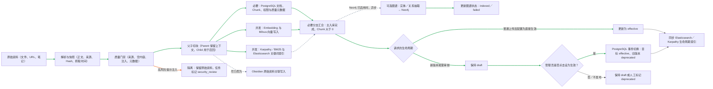

图例：绿色箭头为必要入库与生命周期主链路；灰色虚线为 Obsidian 尽力而为写入和 Neo4j 异步图谱构建，失败不阻塞主入库。普通上传默认生命周期由 `DOCUMENT_REQUIRE_APPROVAL` 等配置决定；版本治理创建的新版本明确使用 `draft`。任一必要索引分支失败时，系统保留业务事实供排障并补偿清理已成功的外部索引。高风险提示注入在切块前停止，任务标记为 `failed／security_review`。

#### 代码入口

`DocumentService`、`KarpathyObsidianIngestService`、知识库 Profile、`KarpathyRagService`、`GraphService`、向量／关键词／图谱 Provider。`DocumentService` 在质量门禁前检测提示注入：高风险命中保留原始资料并将任务写为 `failed／security_review`，不执行切块和索引；中风险只记录质量告警。必要分支是 PostgreSQL、Milvus、Karpathy／BM25＋Elasticsearch；Obsidian 回调自身捕获失败并返回状态，因此属于附属结果。随后若 Neo4j 可用，`GraphService` 异步抽取并写入图谱，状态记录为 `pending／indexed／failed／skipped`，失败不阻塞版本生效。必要索引分支失败时保留草稿供排障，并补偿清理已成功写入的外部索引；草稿不会进入有效检索。异步任务状态为 `queued → processing → completed／failed`，阶段可包含解析、Embedding、向量索引、元数据处理和 `security_review`。

### 4.2 检索与证据组装

**来源边界先于检索策略**：QueryIntent 先判定问题是否属于公司内部信息、业务链路或研发流程。属于内部范围时固定 `sourcePolicy=local_only`，仅在权限过滤后的 `company`、`project`、`documents` 知识库中做 Hybrid RAG；只有非内部问题才允许按策略使用通用模型或联网补证。内部资料未命中时返回“资料不足／待确认”，不得编造内部结论。

#### 用户操作流程

用户只输入问题；系统根据查询类型选择检索组合，返回时显示引用与原因，不把内部检索介质暴露为用户必须理解的步骤。

#### 数据／状态流转

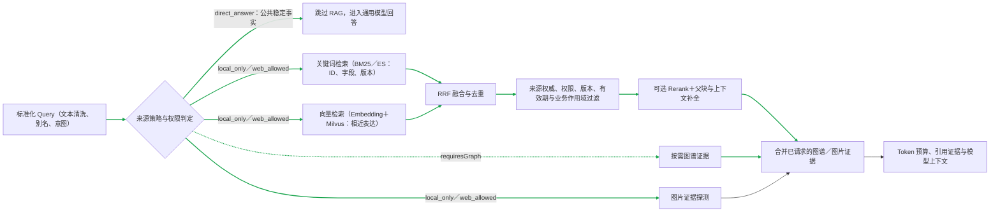

图例：绿色箭头为「标准化 Query → 来源策略与权限判定 → BM25／Elasticsearch 与 Milvus 并行召回 → RRF 融合 → 来源、权限、版本、有效期和业务作用域过滤 → Rerank／父块补全 → Evidence Bundle」。图谱和图片证据只在请求计划允许时追加；RRF 只融合关键词与向量候选，不把图谱结果直接混入倒数排名。`retrieveDetailed` 保持图片探测能力，图谱是否查询由结构化意图中的 `requiresGraph` 决定，不再用关键词正则隐式探测 Neo4j。Direct Answer Gate 命中时可跳过本链路；内部问题固定 `local_only`，不能用网页或模型常识替代内部证据。该方法被 Simple、Auto 和 Chat Agentic 共用。

### 4.3 独立文档全文检索与知识图谱检索

#### 用户操作流程

管理员进入「智能搜索」，选择「文档全文检索」或「知识图谱检索」，输入关键词后执行搜索。文档全文检索返回文档级结果和命中正文片段，并对命中的关键词做高亮；知识图谱检索返回匹配的实体节点和关系边。该入口用于查找和浏览知识，不等同于问答链路里的 Hybrid RAG 召回。

#### 数据／状态流转

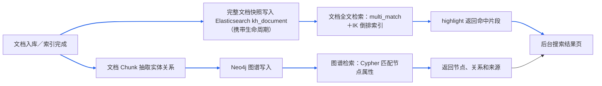

文档全文索引传递完整正文，不再通过消息截取前 1000 个字符；每篇文档以 `docId`（文档标识）作为 `kh_document` 的唯一键。全文检索只查询 `kh_document`，而 RAG 的关键词／向量混合检索继续查询分块索引 `rag_chunks`。默认仍过滤 `deprecated`（已废弃）版本，并复用现有文档生命周期更新。图谱检索复用 Neo4j 的节点属性、关系类型和来源 `docId`，图谱不可用时返回明确的不可用状态，不影响全文检索。

全文检索和问答检索不是同一条链路：前者面向管理后台的文档浏览与高亮，后者面向证据召回、上下文组装和答案生成。两者都必须复用权限、版本和有效期过滤；删除或废弃文档后，主索引、向量索引、图片索引和图谱来源都不能继续作为有效证据。图谱只保存实体关系与来源，不替代原文 Chunk；回答仍需回到可引用的文档证据。

### 4.4 多模态图片 chunk 绑定与受控访问

#### 用户操作流程

1. 用户在「文档管理」上传图片、PDF、PPTX 或视频资料。
2. 如果是图片，系统会生成「原始图片预览、OCR 文字、图片描述、标签」四类内容；如果是 PDF／PPTX，系统会把内嵌图片插入到对应页或幻灯片位置；如果是视频，系统会抽关键帧并写入时间点。
3. 用户在问答或检索结果中看到的是 Markdown 图片预览和文字证据，不需要直接访问对象存储地址。
4. 用户没有权限时，图片代理接口不会返回图片；删除文档时，图片向量索引和图谱来源也会同步清理。

#### 数据／状态流转

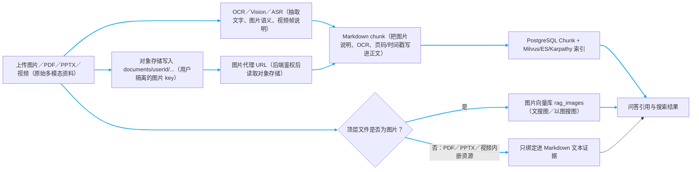

图例：所有多模态资料都会形成 Markdown 文本证据和受控资源地址；当前只有顶层上传文件本身是图片时才写入 `rag_images`。PDF／PPTX 内嵌图片和视频关键帧会绑定到 Markdown，但尚未逐张写入图片向量库。

#### 代码入口

`DocumentController` 负责上传入口、图片代理接口和用户隔离 key；`document-parser.util.ts` 负责 PDF/PPTX 内嵌图片和视频关键帧写入 Markdown；`ImageIndexService` 负责图片向量库写入、文搜图和文档删除同步清理；`ObjectStorageProvider` 负责本地对象存储或 MinIO。

### 4.5 RAG 证据如何进入 Task Agentic Schema

#### 用户操作流程

1. 用户在「Agent 运营 → 产研运工作流」输入活动名称、需求背景和参与岗位。
2. 系统按产品、设计、前端、后端、测试、运营生成岗位交付物；每个岗位除了 Markdown，还会生成一份机器可读的 Schema。
3. 用户进入工作流详情页，可以在每个岗位产物下面查看「低代码 / AI Coding Schema」。
4. 工作流完成后，详情页可以导出「交接包（Markdown＋Schema）」：`HANDOFF.md`、岗位 Markdown、`LOW_CODE_SCHEMAS.json`、`schemas/{role}.json`、`RAG_EVIDENCE.md` 与 `RAG_EVIDENCE.json`；生成可运行项目代码的 ZIP 同样包含这套交接包，并额外包含源码和交付验证结果。
5. AI Coding 工具可通过 MCP 的 `rag_production_workflow_handoff` 按活动名称读取相同交接包，返回 Markdown、Schema 与 RAG 引用证据，供 Codex、Claude、Cursor 在本地代码库实施。

#### 数据／状态流转

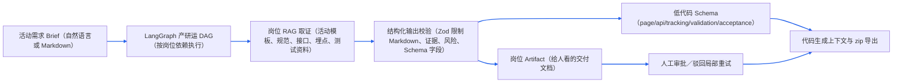

图例：蓝色箭头为「需求 → 多 Agent 岗位 DAG → RAG 取证 → Zod 结构化校验 → Markdown Artifact 和低代码 Schema 双产物 → 审批后进入代码生成」。Schema 的作用不是替代 PRD，而是把页面结构、接口契约、埋点事件、前置校验和验收项变成下游代码生成能稳定消费的 JSON。模型漏填 Schema 时，后端会按岗位生成兜底 Schema，避免后续 zip 导出缺机器可读输入。

#### 代码入口

`ProductionWorkflowService` 的 `roleSchema` 约束 `lowCodeSchemas`；`runRole()` 生成并规范化 Schema；`publishRoleArtifact()` 把 Schema 附加进岗位 Artifact；`codingContext()` 和 `generateProjectZip()` 把 Schema 带给代码生成与导出；后台 `workflow-detail` 页面负责展示。

### 4.6 索引同步与生命周期治理

#### 用户操作流程

1. 用户普通上传资料后，系统按部署配置保存为 `draft` 或 `effective`；版本治理创建的新版本固定保存为 `draft`。
2. 草稿需由管理员在「文档管理」审核或设为生效后才参与默认检索。
3. 如果新规范替代旧规范，管理员使用版本治理把新文档设为 `effective`，旧文档自动变为 `deprecated`。
4. 删除文档时，文档元数据、Chunk、权限、全文索引、向量索引、图片索引和图谱来源会一起清理或失效。

#### 数据／状态流转

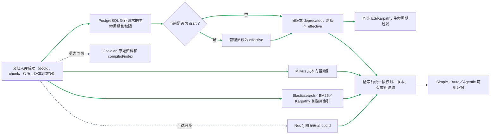

图例：绿色箭头为主数据与可治理索引，灰色虚线为 Obsidian 尽力而为写入和 Neo4j 异步构建。PostgreSQL、ES 和 Karpathy 参与生命周期同步；Milvus 在检索结果汇合后按允许文档 ID 过滤。Obsidian 检索已按 frontmatter 的 `allowed_users`／`allowed_roles` 做访问过滤；未声明 ACL 的笔记按公开资产处理。它仍是附属编译索引，生命周期与主文档的原子切换、删除补偿和多租户治理不能因此宣称完全一致。

#### 索引代码入口

`DocumentService.upload()` 写 PostgreSQL、Milvus、Elasticsearch、Karpathy 和 Obsidian；`scheduleOptionalGraphIndex()` 异步写 Neo4j；`updateLifecycle()` 和 `activateVersion()` 同步 PostgreSQL、ES 和 Karpathy 的生命周期；`delete()` 清理 Milvus、ES、Karpathy、图片向量库、图谱来源、Chunk、权限和资源记录。

#### 独立搜索入口与边界

后端由 `ElasticsearchProvider.indexDocument/searchDocuments` 负责完整文档索引与高亮，`RagAdminController` 提供 `/rag/admin/documents/search`，`RagAdminController` 的 `/rag/admin/graph/search` 提供图谱检索；管理后台通过 `/admin/search-ops/documents` 和 `/admin/search-ops/graph` 转发并鉴权，页面在「智能搜索」中展示两个入口。高亮片段仅用于展示，不直接拼接进模型 Prompt；该功能不替代问答链路的权限过滤、Rerank（精排）和证据门禁。

#### 热门搜索与搜索筛选

用户操作流程：

1. 用户点击「热门搜索」，查看按查询次数排序的热门关键词和搜索概览。
2. 点击某个热门关键词，系统自动回填搜索框并执行文档全文检索。
3. 用户点击「搜索筛选」，选择文件类型、更新时间、文档分类和权限范围。
4. 点击「应用并搜索」，系统把关键词和筛选条件一起提交；点击「清空」会移除筛选条件。

数据／状态流程：

```text
查询日志／Query Log（注：记录用户查询、命中数和响应耗时）
  → /search/queries/popular 聚合热门词（注：按查询次数排序）
  → 管理后台热门搜索视图（注：点击后复用同一全文检索入口）

用户筛选条件
  → admin/search-ops/documents
  → admin-backend 转发并鉴权
  → rag-backend SearchDocuments
  → Elasticsearch kh_document（注：文档级倒排索引和高亮）
  → 文件类型／更新时间／文档分类／权限范围过滤
  → 排除 draft、archived、deprecated（注：未生效、已归档、已废弃文档）
  → 返回文档标题、版本、来源和命中片段
```

热门搜索解决“大家最近都在查什么”，搜索筛选解决“在指定范围内找什么”。它们是管理后台的浏览和运营能力，不替代问答链路中的 Hybrid RAG（混合检索增强生成）、Rerank（精排）和引用门禁。

### 4.7 Karpathy／Obsidian 的位置（内部资产，不是独立路由）

Karpathy 与 Obsidian 是知识编译和本地索引资产，不替代 PostgreSQL 的权限／版本／来源治理，也不与 Hybrid RAG 并列成第四条在线链路。Karpathy 本地 BM25 用于受治理直答与降级；Obsidian 候选会进入证据汇合，检索接口接收用户与角色并执行 frontmatter ACL 过滤。它仍不具备主文档那样的统一生命周期事务，因此不能描述成与主索引完全原子对齐。

Obsidian 写入原始资料与笔记后触发索引刷新。进程内同时到达的刷新请求使用单飞锁合并；若刷新过程中又有新笔记落盘，当前批次结束后会补跑一轮，避免首次快照遗漏。`sources`／`tags` 索引、标签编译页、实体编译页、结论编译页和图谱种子是独立产物，可并发生成；页面写入固定每批最多 8 个。关联笔记需要回写原笔记，必须在上述索引产物完成后串行执行。

### 当前边界

真实公开资料的持续采集、内容版权／来源治理、视觉向量、视频抽帧、以图搜图和企业级图谱实体消歧需要真实数据与生产策略，不能仅凭模拟资料证明效果。

<a id="bad-case"></a>

## 五、错误答案如何纠正并避免再次发生？

**先说结论**：用户反馈不能直接改写知识库。Bad Case 必须经人工审核，才能保留为纠正知识、晋升正式知识或进入回归评测。

**处理方案**：提交时保存原问题、原答案、引用和检索快照；审核后选择纠正层、待晋升、正式入库或驳回。精确同题可以优先使用已审核纠正；相似问题仍需经过权限、版本、充分性和引用门禁。

### 用户操作流程

1. 用户在答案下提交 Bad Case，填写错误类型、说明、修正答案和是否加入回归。
2. 运营人员核对原答案、引用和检索快照，选择「保留纠正层」「标记待晋升」「晋升正式知识」或「驳回／撤销」。
3. 正式知识晋升后进入版本治理；用户再次提问时，纠正层与正式知识并行召回，由 Correction Gate 决定是否采用。

### 数据／状态流转

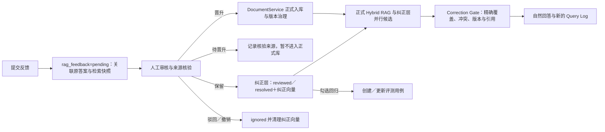

### 代码入口与边界

`RagFeedbackService`、`BadCaseFlywheelService`、`KarpathyRagService`、`DocumentService`。纠正层只对精确同题具有覆盖优先级；相似候选只能作为可引用证据，不能覆盖当前充分的正式知识。晋升后的知识退出纠正向量召回，进入主知识库的权限、版本和生命周期治理。`includeInRegression` 只控制是否创建评测用例，不控制纠正知识是否生效。

## 六、如何使用历史上下文而不被错误历史污染？

**先说结论**：记忆负责“理解用户正在接着说什么”，不能负责“决定客观事实是什么”；Checkpoint 负责恢复执行位置，也不是聊天记忆。

**问题场景**：用户曾说“React 是动物”或“1＋1＝5”，后续再次询问定义时，系统不能因为历史里出现过这些句子就当成事实。切换会话再回来时，也不能把历史检索残片当答案。

**处理方案**：`ChatService` 先为本次请求建立唯一 `RequestContext`，由语义路由识别 `contextMode`：会话设定、上下文追问、事实核验、混合或无。会话设定只写当前 thread 的消息元数据和短期状态，不写 Mem0 或会话向量；同一实体按最新有效设定回答。事实核验优先 Evidence Bundle／通用知识，混合问题明确区分两种范围。历史经过 `selectHistoryForQuery` 只保留必要轮次，并以“不可信上下文”注入；执行恢复则单独读取 Redis Checkpoint，不把 Checkpoint 当聊天记忆。

**为什么有效**：把“会话连续性”“事实证据”“执行恢复”拆成三个状态域，避免一个状态域污染另一个状态域。

### 6.1 问答上下文管理

#### 用户操作流程

用户持续追问时，无需携带完整历史。系统按 `threadId` 并发准备短期上下文；语义路由区分会话设定与事实核验，会话设定不进入长期记忆和会话向量，事实核验优先当前证据，再筛选、标记不可信并控制上下文预算后进入本次问答检索。

#### 数据／状态流转

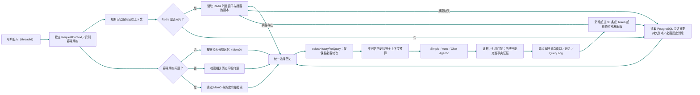

图例：短期会话设定、长期记忆和事实证据不是同一信任级别。会话设定及其追问只读当前 thread，并跳过 Mem0 与会话向量写入；同一实体冲突按最新有效陈述投影。事实核验由通用知识与当前 Evidence 决定；涉及公司、项目、业务、研发流程或上传文档时，内部 RAG 证据优先于历史设定。回答后的消息、记忆和 Query Log 使用独立异步写入，不能把图理解为严格事务顺序。

#### 代码入口

`ChatService` 由 `QueryIntentRouter` 生成 `contextMode`，再准备插件策略、会话 ID、短期上下文、运行计划和检索 Profile。会话设定／上下文追问／混合模式只保留 thread 状态，跳过 Mem0 与会话向量持久化；事实核验优先当前证据。Redis 不可用时回退 PostgreSQL；`selectHistoryForQuery` 对同一实体只保留最新有效用户陈述，`formatUntrustedHistoryContext` 明确历史线索的不可信身份。

### 6.2 Chat Agentic／Task Agentic 的 Checkpoint

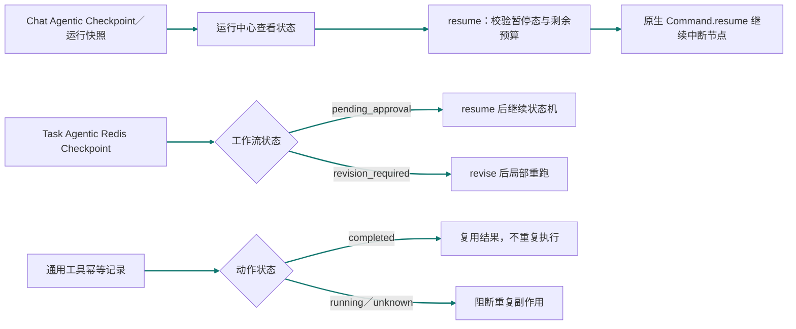

图例：Chat Agentic 与 Task Agentic 的审批恢复现在都校验 Checkpoint、暂停状态和剩余预算；Chat 使用 LangGraph 原生 `Command.resume` 从中断处继续，不重新提交普通输入。Task 的 `revise` 仍只处理 `revision_required` 并局部重跑；工具副作用由独立幂等记录阻止重复执行。恢复执行与历史记忆仍是两个独立状态域。

### 当前边界

本地支持 Redis Checkpoint 与恢复接口。跨实例事件顺序、SSE 断线续传、实例崩溃后的未知工具结果扫描和真实多副本演练仍需要部署环境验证。

### 并发执行原则

系统只并发执行无数据依赖的读取、检索和独立子任务：例如上下文读取、Obsidian 多目录枚举及文件内容读取（固定小批次）、Obsidian 独立索引产物生成（单飞合并、每批最多 8 个）、Agentic 子问题 Hybrid 检索和后台多卡片数据聚合。解析→质量门禁→切片→索引、审核→核验来源→晋升正式知识、版本切换，以及同一资源的删除／写入操作必须保持串行；Obsidian 的关联笔记回写也必须等待索引产物完成，避免出现状态竞争或索引不一致。

<a id="agent-ops"></a>

## 七、如何知道 Agent 做了什么？

**先说结论**：一次 Agent 执行必须能回答四个问题：为什么选这条路、查了什么证据、调用了什么工具、最后为何成功或失败。

**问题场景**：只保存最终回答，出现错误时无法判断是路由错、召回错、工具失败、模型生成错，还是审批与预算导致提前结束。

**处理方案**：运行中心以 `runId` 聚合 Run、事件、工具动作和指标；`threadId` 关联 Checkpoint 与 Artifact；Chat Agentic 保存诊断产物，Task Agentic 保存岗位交付物和审批记录。

**为什么有效**：运行状态、过程事件和交付产物各自持久化，既能看全局结果，也能定位最早失败节点并进行局部重跑。

### 用户操作流程

1. 「运行中心」按 Run 查看 Simple／Auto／Chat Agentic／Task Agentic 的运行总览、事件、指标、工具动作与最终结果。
2. 「产研运工作流」查看 Task Agentic 的任务列表、详情、岗位 Artifact 和审批；点击列表进入独立详情页，不和新建表单混在一起。
3. 「Artifact 审计」查看 Chat Agentic 的诊断 Artifact，或由运行中心跳转查看关联交付物。
4. 「协作编排」查看 Task、角色消息、依赖、决策记录、受控委派与局部重跑。

### 数据／状态流转

#### 7.1 运行时写入与状态收口

```mermaid
flowchart TB
  A[问答或任务工作流启动] --> B[创建 Run（runId、threadId、模式、预算）]
  B --> C[PostgreSQL：agent_runs（状态、路由、当前节点、成本、最终摘要）]
  B --> D[执行节点（检索、生成、岗位协作或工具调用）]
  D --> E[运行事件（节点、检索、路由、预算、审批、重试）]
  E --> F[PostgreSQL：agent_runtime_events（按 threadId 顺序号）]
  D --> G[工具／委派／审批动作]
  G --> H[PostgreSQL：agent_actions（输入输出、风险、审批要求、耗时）]
  G --> E
  D --> I[Chat Agentic 诊断 Artifact（子问题计划、证据包、答案契约）]
  I --> J[Redis Checkpoint（状态机、结构化交接物、可恢复快照）]
  I --> Q[PostgreSQL：结构化 Artifact 持久副本]
  D --> K[Task Agentic 交付 Artifact（PRD、接口、测试、运营）]
  K --> L[PostgreSQL：generated_artifacts（元数据、状态、threadId）]
  L --> M[对象存储：交付文件]
  D --> N[Task、协作消息、依赖与决策]
  N --> O[PostgreSQL：agent_tasks／协作记录]
  D --> P[完成／失败／等待审批]
  P --> C
  linkStyle 0,1,2,3,4,5,6,7,8,9,10,11,12,13,14,15,16,17 stroke:#2563eb,stroke-width:2px
```

图例：蓝色箭头为「运行启动 → 创建 Run → 节点执行 → 事件／动作／Artifact／Task 持久化 → 终态回写」。`runId` 关联运行总览、事件和动作；`threadId` 关联会话、Redis Checkpoint 与交付 Artifact。Chat Agentic 的诊断 Artifact 一份随状态机快照进入 Redis，用于恢复；另一份写入 PostgreSQL 结构化 Artifact 表，用于 Checkpoint 过期后的长期审计。Task Agentic 的文件交付物以 `generated_artifacts` 元数据入 PostgreSQL，文件本身进入对象存储。审批事件先进入事件时间线，是否允许执行由工具策略和工作流状态决定。

#### 7.2 运营后台按 Run 展开审计

```mermaid
flowchart TB
  A[Agent 运营后台] --> B[运行中心列表：GET run-center]
  B --> C[读取 agent_runs＋目标状态摘要]
  C --> D[列表展示：模式、状态、路由、成本、失败标记]
  A --> E[运行详情：GET run-center/:runId]
  E --> F[读取 agent_runs（总览、预算、最终结果）]
  E --> G[读取 agent_runtime_events（时间线）]
  E --> H[读取 agent_actions（工具输入输出与风险）]
  G --> I[派生指标、目标状态与 Failure Onset（失败起点）]
  F --> J[运行详情页]
  G --> J
  H --> J
  I --> J
  A --> K[Artifact 审计：GET run-center/:runId/artifacts]
  K --> L[并发读取 PostgreSQL：generated_artifacts]
  K --> M[读取 Chat Artifact：Redis Checkpoint＋PostgreSQL 持久副本]
  L --> N[Artifact 审计面板]
  M --> N
  A --> O[产研运工作流／协作编排]
  O --> P[读取 agent_tasks、消息、依赖、决策]
  P --> Q[工作流详情与局部重跑入口]
  linkStyle 0,1,2,3,4,5,6,7,8,9,10,11,12,13,14,15,16,17,18,19 stroke:#2563eb,stroke-width:2px
```

图例：蓝色箭头为「Agent 运营后台 → 列表／运行详情／Artifact 审计／工作流协作入口 → 对应运行数据 → 页面展示或局部重跑」。运行详情以 `runId` 聚合总览、事件和动作，并从事件时间线计算指标、目标状态和 Failure Onset（失败起点）；Artifact 审计并发读取文件型交付物和 Chat Artifact 聚合结果，后者优先读取 Redis Checkpoint，同时合并 PostgreSQL 持久副本，Checkpoint 过期后仍可审计。运行中心只读审计数据；重试或局部重跑必须经过原有预算、权限和审批门禁。

#### 代码入口

`AgentRunsService.start` 创建 `agent_runs` 并记录 `run.started`；节点、检索、审批和重试通过 `AgentRuntimeEventsService` 按 `threadId` 顺序写入 `agent_runtime_events`；工具动作写入 `agent_actions`；`AgentRunsService.finish` 回写运行终态。`AgentRunsService.get` 聚合运行、动作、事件、指标、目标状态与 Failure Onset。运营接口 `GET run-center/:id/artifacts` 并发读取 `ArtifactsService.listForRunAudit` 的文件型 Artifact 与 `AgenticRagService.getRunSnapshot` 的 Chat 结构化 Artifact／Checkpoint。

### 7.3 Agent 定时任务（版本化与复制）

#### 用户操作流程

1. 管理员进入「Agent 运营→定时任务」，直接输入自然语言，或读取一份本地 Markdown 任务说明。例如：“每天上午 9 点统计今天新增或生效的规则、问答质量和负反馈，给产品、研发、测试、运营部门提出建议。”
2. 点击「解析任务」。系统只做任务定义解析，提取任务名称、Cron（周期表达式）、统计窗口、数据范围、关注岗位和部门；此时不会创建或执行任务。
3. 管理员检查并修改解析结果，确认后点击「保存定时任务」。任务写入 PostgreSQL，并按启用状态注册到调度器，首次保存为 v1。
4. 规则变化时点击「复制新版本」，系统复制任务定义、数据范围和岗位配置，生成 v2；新版本默认停用，不影响当前 v1。
5. 在「版本历史」中查看版本和执行记录，确认后启用目标版本；系统停用同一版本组的其他版本，但保留旧版本和历史报告，便于回溯。
6. 到达执行时间后，系统自动采集规则文档、问答质量、负反馈代理指标和产研运工作流数据，形成可复核统计快照，再让 LLM（大语言模型）基于快照生成 Markdown 建议报告。管理员也可以点击「立即执行」做一次人工验证。
7. 在任务列表展开“最近一次报告”，或进入“执行历史”查看每次运行状态、耗时、结果和错误；可随时停用或重新启用任务。

#### 数据／状态流转

```mermaid
flowchart LR
  A[自然语言／Markdown（描述周期、数据、岗位与输出）] --> B[任务定义解析器（提取名称、Cron、窗口、范围）]
  B --> C[人工确认页（修改误识别结果，不自动执行）]
  C --> D[保存任务（taskKind=analysis）]
  D --> E[PostgreSQL scheduled_jobs（定义、启停、下次时间、最近结果）]
  E --> V[版本治理（versionGroupId、version、isCurrent、copiedFromId）]
  V --> F[Scheduler Registry（服务启动恢复已启用任务）]
  F --> G[到点触发／立即执行（同一任务禁止重入）]
  G --> H[PostgreSQL job_executions=running（创建本次执行）]
  H --> I[并行采集（规则文档、负反馈、Query Log、Agent Task）]
  I --> J[统计快照（时间范围、数量、分类、脱敏样例）]
  J --> K[LLM 报告生成（只能引用快照，数据不足须说明）]
  K --> L[回写 completed／failed（报告、错误、耗时、下次时间）]
  L --> M[管理后台任务列表／执行历史（Markdown 预览与审计）]
  L --> N[LangFuse／Prometheus（生成链路与调度运行指标）]
  linkStyle 0,1,2,3,4,5,6,7,8,9,10,11,12 stroke:#2563eb,stroke-width:2px
```

图例：蓝色箭头为「自然语言／Markdown → 解析任务 → 人工确认 → PostgreSQL 保存版本 → 复制新版本／启用版本切换 → 调度器按时触发 → 创建执行记录 → 采集数据 → 生成统计快照和建议 → 回写报告 → 后台审计／运行观测」。任务定义与每次执行分开保存，复制不会影响当前版本；启用新版本只停用同组旧版本，不删除旧版本和历史报告。规则、问答和工作流数据来自当前项目 PostgreSQL；“客户投诉”当前只统计 `rag_feedback` 负反馈代理指标，不能表述为真实客服工单总量，后续应在数据采集节点接入企业客服／工单 API。

#### 代码入口与边界

`ScheduledAnalysisPanel` 负责后台创建、启停、立即执行和报告预览；`JobsService` 负责持久化、Cron／固定间隔／单次调度、服务启动恢复、重入保护和执行历史；`ScheduledAnalysisService` 负责确定性解析、数据采集、统计快照和受约束报告生成。自然语言解析结果必须人工确认，避免把“每月 1 号 9 点”误排成其他时间。当前报告保存在后台；企业微信、钉钉、飞书或邮件通知需要在执行完成后接入对应通知 API 与凭证，未配置时不声称已发送。

### 当前边界

已有本地运行回放、Artifact 关联与局部重跑。生产环境仍需完善按租户／岗位的 IAM、审计保留策略和跨服务事件一致性。

<a id="observability"></a>

## 八、如何定位慢、贵、错和不稳定？

**先说结论**：LangFuse 回答“一次请求内部发生了什么”，Prometheus 回答“系统长期是否健康”，运行中心回答“这次业务任务最终怎么样”。

**问题场景**：平均耗时正常不代表 P95 正常；模型请求成功不代表答案有证据；Trace 存在也不代表业务状态已落库。

**处理方案**：记录路由、检索、模型、工具、重试、引用、Token、成本和终止原因；长期聚合 QPS、错误率、P95、空召回率与工具成功率；发布前结合质量、性能和成本 Evidence 人工决策。

**为什么有效**：单次 Trace 用于定位根因，聚合指标用于发现趋势，业务 Run 用于判断用户结果，三者互相补充而不互相替代。

### 用户操作流程

1. 开发／运营人员在 LangFuse 查看一次请求的 Trace、模型 Generation、检索／工具 Span 和成本信息。
2. 在 Prometheus／Grafana 看服务级指标：QPS、错误率、P95、首 Token 延迟、空召回、重试、工具成功率与循环限制命中。
3. 当前服务暴露 Prometheus 指标；仓库已提供 Prometheus 抓取配置、Recording Rules、Grafana 看板和 Alertmanager 分级告警模板，可用 `monitoring/docker-compose.monitoring.yml` 本地启动。企业微信、钉钉、飞书或邮件凭证仍需部署环境配置，后台通知接口也不等于已经由指标自动触发。
4. 质量、性能与成本脚本产出 Evidence 报告，人工决定是否灰度、回滚或继续排障。

### 数据／状态流转

```mermaid
flowchart LR
  A[一次问答／工作流] --> B[LangFuse Trace（请求级链路）]
  B --> C[Generation／Span（模型、检索、工具节点）]
  C --> D[Flush（发送缓冲观测数据）]
  A --> E[Prometheus Metrics（服务级指标）]
  E --> F[Grafana 看板／Recording Rules]
  F --> G[Alertmanager 分级告警]
  G -. 凭证配置 .-> H[企业微信／钉钉／邮件通知]
  E --> I[性能／成本 Evidence 报告]
  I --> J[人工发布、灰度或回滚决策]
  linkStyle 0,1,2,3,7,8 stroke:#dc2626,stroke-width:2px
  linkStyle 4,5 stroke:#dc2626,stroke-width:2px
  linkStyle 6 stroke:#64748b,stroke-width:2px,stroke-dasharray:5 5
```

图例：红色实线是当前代码和仓库配置已有的 Trace、Metrics、Grafana 看板、Recording Rules 与 Alertmanager 链；灰色虚线只表示通知出口仍需部署凭证。LangFuse 负责单请求细节，Prometheus 负责长期聚合指标，两者都不等同于自动发布系统。

### 代码入口与边界

`LangfuseProvider`、`MetricsInterceptor`、`ObservabilityController`、LLM Gateway 的成本字段与运行指标服务；`monitoring/prometheus/` 与 `monitoring/grafana/` 提供抓取、规则、看板和告警模板。采样／脱敏、通知凭证、值班与事故复盘仍需要生产配置，不应称为已验收的生产运营体系。

### 8.1 管理后台首页大盘

管理员进入「首页大盘」后，左侧菜单可按需切换「数据总览、访问分析、文档统计、用户统计、热门内容、系统公告」。各页面复用已有管理接口并在切换时单独读取数据：访问分析读取近七日查询趋势；文档统计读取可访问文档及分类；用户统计读取可见用户和状态；热门内容读取搜索热词；系统公告读取通知及未读数。菜单只负责展示汇总数据，不写入业务数据；数据范围仍由后台权限校验决定。

<a id="security-tools"></a>

## 九、如何防止资料注入和工具越权？

**先说结论**：外部文件和网页只能作为不可信证据；模型提出工具调用也不代表系统允许执行，必须继续经过注册表、权限、风险、预算和审批校验。

**问题场景**：文档中可能包含“忽略系统规则并泄漏数据”等提示注入；工具调用可能带来发送消息、改数据或发布内容等真实副作用。

**处理方案**：入库阶段隔离高风险内容，生成前再次清洗证据；工具先进入 Tool Registry 和执行策略，未授权调用直接拒绝并记录审计；MCP 作为外部客户端接入面单独鉴权，不等于 Chat Agentic 内部直接调用 MCP。

**为什么有效**：内容安全和动作安全分两层治理，恶意文本既不能提升为系统指令，也不能绕过工具权限产生副作用。

### 9.1 Prompt Injection 与工具执行

#### 用户操作流程

1. 用户或管理员启用适合当前链路的插件能力包，例如混合检索、联网研究或 MCP 编码上下文。
2. 系统只显示与当前模式兼容且已启用的插件；Simple 不应承载高风险写入型工具。
3. 对外部网页、上传文本等不可信内容，系统将其作为证据而非系统指令；入库时高风险内容先隔离，检索后又逐行清洗；对工具请求按注册表、参数、权限与风险策略校验。

#### 数据／状态流转

```mermaid
flowchart LR
  A[入库的不可信文件／网页] --> B{入库风险检测}
  B -->|高风险| C[隔离：保留原文，停止切块与索引]
  B -->|正常| D[通过入库风险门禁]
  B -->|中风险| P[保留原文并记录质量告警]
  D --> E[进入受治理知识库]
  P --> E
  F[检索到的不可信网页／文本] --> G[生成前逐行清洗]
  G --> H[风险行替换为标签，仅作证据]
  I[模型提出工具调用] --> J[Tool Registry（Schema、模式、角色、风险）]
  J --> K[Tool Execution Policy（权限、审批、预算、超时）]
  K -->|允许| L[已注册 Function／外部工具]
  K -->|拒绝| M[policy.denied 审计事件]
  L --> N[工具结果／Artifact 引用]
  N --> O[运行审计与答案／任务状态]
  linkStyle 0,1,2,3,4,5,6,7 stroke:#ea580c,stroke-width:2px
  linkStyle 8,9,10,11,12,13 stroke:#2563eb,stroke-width:2px
```

图例：橙色箭头是两阶段 Prompt Injection 防护；蓝色箭头是模型内部的已注册工具执行与策略审计。MCP 是外部客户端协议入口，见 9.3，不应混进这张模型工具调用图。

### 9.2 插件的使用边界

插件是 Tool Registry 上已有工具的声明式组合，不支持上传或执行任意代码。管理员在「Agent 运营→平台治理」登记、启停和配置插件；问答或工作流选择插件后，后端把有效工具白名单写入请求快照、Checkpoint 和运行事件，并在执行前实际拦截未授权工具。

适用场景：联网研究、混合检索证据、MCP 编码上下文、产研运基础工作流。非适用场景：用插件绕过角色权限、在 Simple 中执行高风险写入、把外部网页当作可信指令。

### 9.3 MCP／CLI 与当前运营能力对齐

#### 用户操作流程

1. 开发者在终端使用 CLI：`rag doc list／show／task` 查询自己可见文档、审核／版本／索引状态与异步入库进度；`rag workflow list／show／context` 查询自己可见的产研运工作流和已审批交接物。
2. 管理员可在 CLI 使用 `rag admin job list／versions／executions` 查询定时任务；只有管理员角色可执行 `run／copy／start／stop`，权限不足由后端拒绝。
3. Codex、Claude Code 等客户端通过 MCP 的配置身份访问后端。治理与状态工具以读取为主；`rag_ask`、`rag_agent_pipeline`、游戏方案和交接包工具会触发受控计算或生成，但不提供审批、删除、文档发布或定时任务启停。

#### 数据／状态流转

```mermaid
flowchart LR
  A[MCP 客户端：配置 Token／API Key／账号] --> B[Backend 身份与数据范围校验]
  B --> C[读取类：搜索、上下文、图谱、状态与审计]
  B --> D[计算类：rag_ask、Agent 管线、方案与交接包]
  C --> E[返回受控数据]
  D --> F[执行受预算约束的问答／生成]
  G[CLI 当前用户登录态] --> B
  G --> H[CLI 管理员写操作：run／copy／start／stop]
  H --> I{后端角色校验}
  I -->|admin| J[执行定时任务管理]
  I -->|非 admin| K[403 拒绝并审计]
  linkStyle 0,1,2,3,4,5 stroke:#2563eb,stroke-width:2px
  linkStyle 6,7,8,9 stroke:#ea580c,stroke-width:2px
```

图例：MCP 不继承浏览器当前用户身份，而是使用服务端配置的 Token、API Key 或账号登录。它既有读取类工具，也有会触发问答／Agent 生成的计算类工具；没有审批、删除、文档发布和任务启停接口。CLI 管理写操作继续由后端角色校验，CLI 与 MCP 都不直连数据库或向量库。

### 9.4 内部 Hook 与领域事件 Outbox

#### 用户操作流程

1. 管理员在平台治理配置事件订阅规则：选择事件类型（如文档生效、工作流待审批、任务失败）、目标通道和服务端配置键；不在页面保存企业微信 Webhook URL。
2. 文档审核／生效、工作流待审批／修订／完成／失败、定时任务完成／失败时，系统自动记录领域事件。
3. 管理员在事件审计列表查看 `pending`（待投递）、`delivered`（已投递）、`failed`（投递失败）或 `skipped`（没有匹配订阅）状态；失败事件可点击重试。
4. 真实企业微信地址由部署环境配置例如 `EVENT_WEBHOOK_ENTERPRISE_WECHAT_URL` 提供；未配置时不会泄漏地址，只记录可处理的失败原因。

#### 数据／状态流转

```mermaid
flowchart LR
  A[内部生命周期 Hook（文档／工作流／定时任务）] --> B[Domain Event（稳定业务事件）]
  B --> C[PostgreSQL Outbox（事件、幂等键、状态、重试次数）]
  C --> D[Outbox Worker（每 10 秒拉取待投递事件）]
  D --> E[订阅规则（事件类型＋通道＋endpointKey）]
  E --> F[服务端配置读取真实 Webhook URL]
  F --> G[企业微信／通用 Webhook]
  G -->|成功| H[Outbox=delivered]
  G -->|失败| I[指数退避重试，最多 3 次]
  I -->|耗尽| J[Outbox=failed，后台审计与人工重试]
  E -->|无订阅| K[Outbox=skipped]
  linkStyle 0,1,2,3,4,5,6,7,8,9 stroke:#2563eb,stroke-width:2px
```

图例：蓝色箭头为「内部 Hook → 稳定领域事件 → Outbox 持久化 → Worker 依据订阅规则投递 → 成功、重试或人工处理」。内部 Hook 只在服务端代码中执行，不允许上传任意脚本；对外只发送脱敏后的业务事件。订阅表保存 `endpointKey`（注：服务端配置名），不保存 URL、Token 或密码。

### 当前边界

已有注册、策略、审计和白名单基础。企业凭证中心、细粒度 IAM、实时人工审批、隔离沙箱与 DLP 仍需真实企业基础设施接入。

<a id="governance"></a>

## 十、文档、Prompt 和模型如何安全发布？

**先说结论**：文档已有草稿、审核、生效和回滚链路；模型、插件和工作流模板目前是登记、启停或直接发布接口，尚未实现统一的“草稿→自动评测门禁→灰度→配置回滚”平台。

**问题场景**：新文档可能解析失败，新 Prompt 可能让历史问题退化，新模型可能提高质量却显著增加延迟和成本。

**处理方案**：按两类能力分别描述：文档版本按现有生命周期治理；平台治理按当前模型登记、插件状态切换、工作流模板版本发布和评测用例管理来说明。评测门禁、灰度和配置回滚列为待建设能力。

**为什么有效**：把内容变化、配置变化和发布动作拆开，当前有效版本持续服务，新版本的问题不会直接污染线上结果。

### 用户操作流程

1. 管理员在平台治理维护模型登记、插件状态、工作流模板版本和评测用例；当前没有独立的 Prompt Registry 草稿发布链。
2. 更新正式规范时，进入「文档管理」，点击文档行的「版本治理」创建新版本；新版本先以 `draft`（注：已索引、尚未进入审核）入库并完成索引，当前 `effective`（注：当前生效）版本继续提供检索。
3. 管理员点击「提交审核」后状态变为 `pending_review`（注：待审核）；审核人点击「审核通过」后才显示「设为生效」。审核驳回会保留意见，运营人员补齐资料后创建修订版本重新提交，不会覆盖当前生效版本。
4. 只有 `reviewStatus=approved`（注：审核通过）且索引成功的版本可以点击「设为生效」；系统在 PostgreSQL 事务中将目标版本设为 `effective`，同链旧版本设为 `deprecated`（注：历史失效），再同步检索索引。
5. 文档入库失败时，管理员点击「重放失败任务」；系统用原 `taskId`（注：队列幂等键）重新排队，避免同一失败任务被重复创建。找不到或已过期的队列任务会返回原因，不会伪造成功。
6. 不发布的草稿可点击「废弃」；线上异常时在历史版本行点击「回滚到此版本」。两种操作都不删除原始证据。
7. Bad Case 审核通过且勾选回归时，写入／更新评测用例。
8. 回归、性能和成本脚本可以产出 Evidence 供人工参考，但当前不会自动阻断模型登记、插件状态切换或工作流模板发布。

### 数据／状态流转

#### 10.1 文档版本治理

```mermaid
flowchart LR
  A[当前 effective 文档] --> B[文档后台：创建新版本 draft]
  B --> C[完成 RAG 必要索引写入；Obsidian 为附属结果]
  C --> D{索引成功且 Chunk 大于 0？}
  D -->|是| E[提交审核：pending_review]
  E --> F{审核通过？}
  F -->|是| G[版本治理：设为生效]
  G --> H[PostgreSQL 事务：目标 effective，旧版本 deprecated]
  H --> I[同步关键词／Karpathy 生命周期索引]
  I --> J[当前规范可检索；历史版本可回滚]
  F -->|否| K[rejected：保留意见并创建修订版本]
  D -->|否| L[failed：原 taskId 重放或保持 draft]
  K --> M[不影响当前 effective]
  L --> M
  linkStyle 0,1,2,3,4,5,6,7,8,9,10,11,12 stroke:#2563eb,stroke-width:2px
```

图例：蓝色箭头为「当前有效文档 → 创建草稿 → 入库索引 → 提交审核 → 审核通过 → 人工设为生效 → PostgreSQL 原子切换 → 索引同步与可回滚」；驳回保留意见、失败用原 taskId 重放，均不影响当前 `effective` 版本。

#### 10.2 Prompt／模型／工具配置发布

```mermaid
flowchart LR
  A[平台治理后台] --> B[登记模型配置]
  A --> C[注册插件版本／切换状态]
  A --> D[创建工作流模板版本／直接发布指定版本]
  A --> E[维护评测用例与数据集]
  B --> F[PostgreSQL 治理记录]
  C --> F
  D --> F
  E --> G[独立执行评测／性能／成本脚本]
  G --> H[Evidence 供人工判断]
  H -. 尚未自动联动 .-> I[发布门禁／灰度／配置回滚平台]
  linkStyle 0,1,2,3,4,5,6,7,8 stroke:#7c3aed,stroke-width:2px
  linkStyle 9 stroke:#64748b,stroke-width:2px,stroke-dasharray:5 5
```

图例：紫色实线是当前平台治理已经实现的登记、状态切换、模板发布和评测数据管理；灰色虚线是尚未自动联动的统一发布门禁、灰度和配置回滚平台。不能把脚本生成 Evidence 描述为已经自动拦截发布。

### 当前边界

已有模型、插件、工作流模板和评测用例的治理基础与本地脚本；独立 Prompt Registry、统一审批门禁、灰度流量、配置回滚和外部变更管理系统仍需实现。

<a id="production-boundaries"></a>

## 十一、哪些能力还不能说成已生产完成？

**先说结论**：项目已经覆盖高级 AI 应用开发和 Agent 应用工程的主干能力，但“本地实现”“真实回放”和“生产规模验收”是三个不同层级。

**问题场景**：面试中最容易失分的不是功能少，而是把有接口、有 Mock 或有本地脚本的能力，说成已经经过真实企业流量、合规和高可用验证。

**处理方案**：下面按能力列出当前可展示的实现，以及仍需要真实环境完成的部分。回答时先说已经做了什么，再主动补一句边界和下一步。

| 能力 | 当前本地能力 | 尚不能宣称已完成的生产能力 |
| --- | --- | --- |
| AG-UI／SSE | 生命周期事件、节点事件、Token 流、取消请求 | `Last-Event-ID` 断线续传、跨实例事件恢复 |
| 异步队列 | BullMQ 文档／Artifact 任务、进度、重试、退避 | 独立 Worker 集群、死信队列、跨服务补偿 |
| GraphRAG | Neo4j 实体关系查询、Graph Search、运营接口 | 大规模实体消歧、别名合并、增量冲突治理与回滚 |
| 多模态 | OCR、ASR、Vision Provider、sidecar 基础链路 | 真实视觉向量、视频理解、以图搜图、跨模态 Rerank |
| Web Search | 受控 Bocha 联网兜底、超时／失败降级 | 长期网页快照、来源质量治理、生产引用审计 |
| 数据合规 | ACL、用户隔离、注入防护、基础审计 | 企业 IAM、DLP、数据分级、删除请求、保留策略 |
| 成本与效果 | Token／成本字段、预算、模拟 Adoption 汇总 | 真实租户账单、长期采纳率、返工率、人工接管率、真实 SLA |
| 高可用 | Redis Checkpoint、进程内保护与恢复降级 | 真实多副本、崩溃恢复演练、分布式事件序号和租约验证 |

<a id="references"></a>

## 十二、面试时如何把项目说清楚？

**先说结论**：先讲业务问题和两条 Agentic 主线，再讲统一 RAG 底座和治理闭环；不要从 Milvus、LangGraph、Redis 等技术名词开始堆栈。

### 回答顺序

1. 先用文首“一分钟项目介绍”说明业务问题和整体结果。
2. 面试官追问问答准确率时，讲历史隔离、结构化意图与当前复杂度规则、Hybrid Search、Evidence Bundle、Citation Gate 和 Bad Case。
3. 追问 Agent 时，区分 Chat Agentic 与 Task Agentic，再讲 DAG、工具策略、审批、Artifact 和 Checkpoint。
4. 追问生产化时，讲权限版本、运行审计、LangFuse／Prometheus，并主动说明真实 IAM、SLA 和灰度边界。

### 常见追问速答

| 追问 | 先这样回答 |
| --- | --- |
| 为什么不全部使用 Agentic？ | 简单问题进入 Agentic 会增加延迟、成本和失败节点，所以默认由 Auto 按首轮证据与复杂度规则按需升级。 |
| Auto 怎么判断是否检索？ | 先判断是否需要澄清与来源策略；未澄清的问题固定执行一次 Hybrid Fast Path，再结合证据充分性与当前复杂度规则决定走 Simple 还是升级 Agentic。 |
| 历史错误为什么不会污染答案？ | 当前问题先独立路由，相关历史只作不可信上下文；客观结论由当前问题对应的公共知识或 Evidence Bundle 决定。客观事实问句已跳过 Mem0／历史向量，但短期摘要仍是残余风险。 |
| 为什么同时使用 BM25 和向量检索？ | BM25 擅长编号、名称和精确词，向量擅长相近表达，两者通过融合提高覆盖率。 |
| 检索命中为什么还可能拒答？ | 命中只代表候选相关；还要通过权限、版本、证据充分性和 Citation Gate。 |
| 为什么需要父子切块？ | 小块提高召回精度，父块补回章节上下文，避免命中一句但无法完整回答。 |
| Bad Case 为什么不能直接生效？ | 用户反馈本身不可信，必须审核来源，再决定进入纠正层、正式知识或回归集。 |
| Checkpoint 和 Memory 有什么区别？ | Checkpoint 恢复执行位置，Memory 保持会话连续性，二者都不能替代事实证据。 |
| 多 Agent 是不是多个模型自由聊天？ | 当前实现是受控岗位 DAG，各岗位按依赖、工具白名单、预算和审批生成 Artifact。 |
| 如何定位一次错误回答？ | 用 runId／threadId 串联语义路由、Evidence Bundle、检索事件、工具动作、引用校验和终态。 |
| 如何发布新文档？ | 新版本先 draft 入库和审核，通过后原子切换为 effective，旧版本 deprecated 且可回滚。 |
| 项目最大的生产边界是什么？ | 真实 IAM／DLP、生产 SLA、灰度平台、多副本故障演练和长期真实用户效果仍需企业环境验收。 |

### 参考项目记录

Dify、RAGFlow、AutoGPT、MetaGPT、CrewAI、AutoGen、DeepSeek Harness 的借鉴点、取舍与生产边界，统一见：[开源项目参考能力归档.md](/Users/monster/Documents/GitHub/code/RAG/docs/interview/开源项目参考能力归档.md)。该文档是调研归档，不作为当前实现状态的唯一证据。

### 代码核对入口

| 能力                       | 主要入口                                                                                                                                           |
| ------------------------ | ---------------------------------------------------------------------------------------------------------------------------------------------- |
| Simple／Auto／Chat Agentic | `backend/src/modules/chat/chat.service.ts`、`backend/src/rag/karpathy/karpathy-rag.service.ts`、`backend/src/rag/agentic/agentic-rag.service.ts` |
| Task Agentic             | `backend/src/modules/workflow/production-workflow.service.ts`                                                                                  |
| 受控 Agent Loop          | `backend/src/modules/agent-loop/agent-loop.service.ts`、`backend/src/modules/agent-loop/agent-loop.types.ts`                                   |
| 文档审核／失败重放          | `backend/src/modules/rag-admin/rag-admin.service.ts`、`backend/src/modules/document/document-queue.service.ts`、`document_reviews` 表            |
| 会话记忆                     | `backend/src/modules/memory/short-term-memory.service.ts`                                                                                      |
| Checkpoint               | `backend/src/providers/langgraph-checkpointer/redis-checkpointer.ts`                                                                           |
| Bad Case                 | `backend/src/modules/chat/rag-feedback.service.ts`、`backend/src/rag/prompts/bad-case-flywheel.service.ts`                                      |
| 工具与插件                    | `backend/src/tools/`、`backend/src/modules/plugin-runtime/`                                                                                     |
| 运行审计                     | `backend/src/modules/agent-runs/`、`backend/src/modules/agent-runtime-events/`                                                                  |

## 面试最后一句

> 这个项目的核心不是堆叠 RAG 和 Agent 名词，而是把资料、证据、执行状态、人工审批和质量反馈拆成可治理的数据链路：简单问题低成本回答，复杂问题受控规划，错误答案可以追踪和纠正，生产边界也能够明确说明。
