# 功能步骤流程

> 版本：2026-09-10。本文是当前问答执行链路的唯一口径，只记录仓库可定位的功能流程、数据状态和明确边界；不把参考项目设计、模拟数据或生产设想写成已实现能力。

## 文档目的

用于面试复习、功能验收和后台排障。每章固定按以下顺序写：

1. 用户操作流程：用户或管理员在页面上怎么做。
2. 数据／状态流转：请求在服务端经过什么模块、写入什么状态。
3. 代码入口：便于核对实现，不要求面试逐个背出。
4. 当前边界：明确本地已有能力与仍需生产环境接入的能力。

## 阅读导航

- [一、总体架构](#overall)
- [二、三条问答链路](#qa-chains)
- [三、Task Agentic 产研运工作流](#task-agentic)
- [四、RAG 知识入库与检索](#rag)
- [五、Bad Case 质量闭环](#bad-case)
- [六、会话记忆与 Redis Checkpoint](#memory-checkpoint)
- [七、Agent 运营、Artifact 与审计](#agent-ops)
- [八、可观测、性能、成本与告警](#observability)
- [九、安全、工具、MCP 与插件](#security-tools)
- [十、版本、评测与发布治理](#governance)
- [十一、补充能力与真实生产边界](#production-boundaries)
- [十二、参考项目归档与面试表达](#references)

## 全文统一口径

| 名称 | 准确定义 | 不应混淆为 |
| --- | --- | --- |
| Simple | 轻量问答链路：先过 Direct Answer Gate（精确直答门禁），未命中则执行统一 Hybrid RAG（混合检索增强生成），不进入多步 Agentic（智能体式执行） | 永远只查 BM25（关键词相关性算法），或永远不查向量库 |
| Auto | 默认问答链路：先过 Direct Answer Gate（精确直答门禁），未命中则执行完整 Hybrid Fast Path（混合快速路径），再按证据充分性和问题复杂度决定轻量回答或升级 | 按问题长度选路由，或把 Fast Path 当成独立检索体系 |
| Chat Agentic | 复杂问答状态机：规划子问题、并行取证、按需工具／联网、反思与受限重试 | 必然走六岗位协作、必然生成 PRD |
| Task Agentic | 产研运任务状态机：产品、设计、前端、后端、测试、运营按依赖交付 Artifact | AI 问答的第四种模式 |
| Karpathy 知识 | 从已治理资料编译出的知识卡和本地 BM25 索引，是 Direct Answer Gate 的内部实现与可降级资产 | 与统一 Hybrid RAG 并列的第四条在线检索链路 |
| Bad Case | 用户提交的错误案例；只有审核通过并满足条件后才成为纠正知识 | 用户一提交就立即改变答案 |
| Artifact（结构化产物） | Task Agentic 的结构化阶段产物，或 Chat Agentic 的诊断交接物 | 任意聊天文本 |

## 状态统一口径

| 对象 | 关键状态／字段 | 含义 |
| --- | --- | --- |
| `rag_feedback` | `pending` | 已提交，等待审核 |
| `rag_feedback` | `reviewed`／`resolved` | 审核确认并完成处理；满足条件时可参与纠正召回 |
| `rag_feedback` | `ignored` | 驳回、忽略或撤销，不参与纠正召回 |
| 文档 | `effective` | 当前可检索的生效版本 |
| 文档 | `deprecated` | 已被替代，默认不作为当前规范检索 |
| Task 工作流 | `pending`／`running`／`pending_approval`／`completed`／`failed` | 任务运行状态 |
| 文档任务 | `queued`／`processing`／`completed`／`failed` | 异步入库任务状态 |
| Agent 定时任务 | `enabled`／`disabled`；单次执行为 `running`／`completed`／`failed` | 任务调度状态与每次执行状态分开保存 |

## 公共收口规则

除非章节特别说明，所有请求均遵循以下公共规则：鉴权和作用域过滤先于业务处理；PostgreSQL 保存业务事实和审计；Redis 保存热状态、缓存、短期记忆与 Checkpoint；LangFuse 记录单次调用追踪；Prometheus 聚合服务指标。

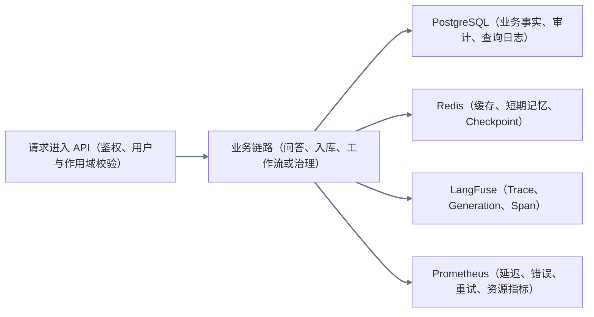

图例：灰色箭头为「请求进入 API → 业务链路 → PostgreSQL／Redis／LangFuse／Prometheus」的公共收口；不代表每个请求都必然写入每一种存储。

<a id="overall"></a>

## 一、总体架构

### 用户操作流程

1. 资料运营人员从文档后台上传资料，或发起受控公开资料采集。
2. 业务用户在「AI 智能问答」发起咨询，并选择 Simple、Auto 或 Agentic。
3. 管理员在「Agent 运营」查看运行、工作流、Artifact、质量与治理数据。
4. 用户发现答案错误时提交 Bad Case；运营人员审核、回灌并回归验证。

### 数据／状态流转

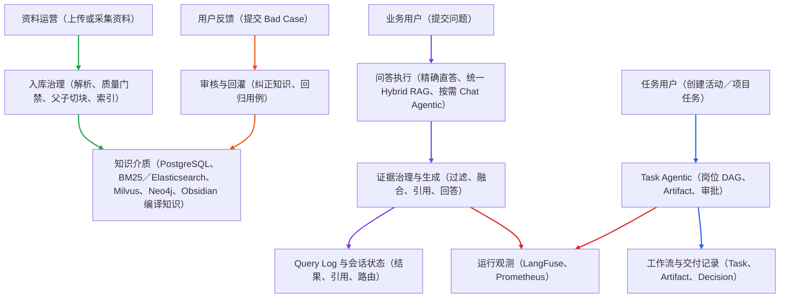

图例：绿色箭头为「资料运营 → 入库治理 → 知识介质」；紫色箭头为「业务用户 → 问答路由 → 检索与生成 → Query Log」；蓝色箭头为「任务用户 → Task Agentic → 工作流与交付记录」；橙色箭头为「用户反馈 → 审核与回灌 → 知识介质」；红色箭头为「检索与生成／Task Agentic → 运行观测」。Bad Case 回灌指向知识介质，表示后续查询可优先检索已审核纠正知识。

### 代码入口

`DocumentService`、`KarpathyRagService`、`ChatService`、`AgenticRagService`、`ProductionWorkflowService`、`RagFeedbackService`、`BadCaseFlywheelService`。

### 当前边界

本地能力可在现有服务与依赖启动后验证。真实企业 IAM、长期 SLA、生产告警值班、跨地域多副本与真实用户效果，需要部署环境和真实业务数据验收。

<a id="qa-chains"></a>

## 二、三种问答模式与执行链路

### 2.1 路由总览

三种模式共用同一套检索与证据治理底座，但执行策略不同：Simple（简单模式）是单次线性问答，Auto（自动模式）是根据首轮证据动态选路，Chat Agentic（对话智能体模式）是允许规划、工具补证和受限循环的状态机。用户端默认选择 Auto，并以「极速／自动／深度」展示三种模式；Karpathy 不作为独立在线链路，而是受治理本地直答的内部实现与降级资产。

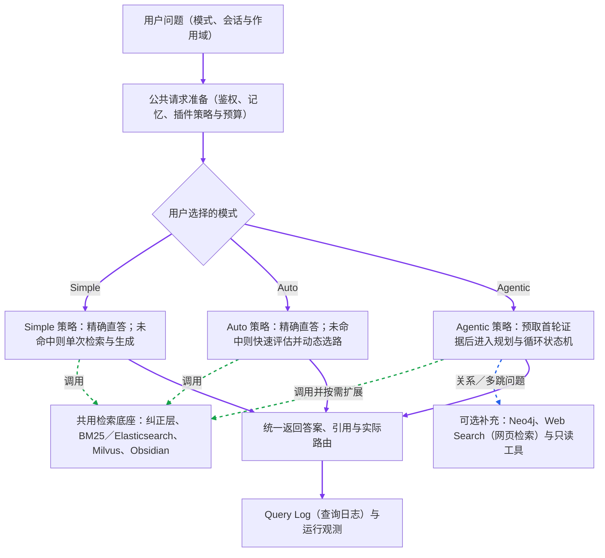

图例：三种模式只共用检索介质、权限版本过滤、引用治理和运行观测，不共用同一条执行链。Simple 固定单次执行；Auto 负责在轻量回答与 Agentic 之间动态选路；显式 Agentic 不执行精确直答捷径，而是先预取 Fast Path（快速路径）证据，再进入复杂问答状态机。Task Agentic（任务智能体模式）不属于问答路由，见第三章。

| 模式 | Direct Answer Gate（精确直答门禁） | 检索策略 | 图谱／工具 | 是否循环 |
| --- | --- | --- | --- | --- |
| Simple（简单模式） | 执行 | 单次 Hybrid RAG（混合检索增强生成） | 仅允许一次受控网页补证 | 否 |
| Auto（自动模式） | 执行 | Fast Path（快速路径）评估后选择轻量回答或升级 | 升级后按 Agentic 策略执行 | 仅升级后允许 |
| Chat Agentic（对话智能体模式） | 不走直答捷径 | 首轮证据预取＋子问题并发检索 | 按需 Neo4j、网页检索与只读工具 | 是，受预算限制 |

### 2.2 Simple：精确直答与统一 Hybrid RAG

#### 用户操作流程

1. 用户选择 `simple` 并提问，适合明确术语、活动 ID（标识符）、字段或流程节点等单轮问题。
2. 系统先检查已审核精确纠正和受治理本地直答；未命中再执行完整关键词、向量与 Obsidian 编译知识召回。
3. 页面返回自然答案、引用和联网来源（如果发生联网）；本地与网页都没有可靠证据时，后端进入安全降级而不是生成无证据结论，前端显示友好说明，并提供「补充问题信息」。内部检索原因默认折叠在「查看检索详情」。
4. 用户继续追问时，系统只准备预算内的短期记忆、摘要和必要历史，不携带完整会话。

#### 数据／状态流转

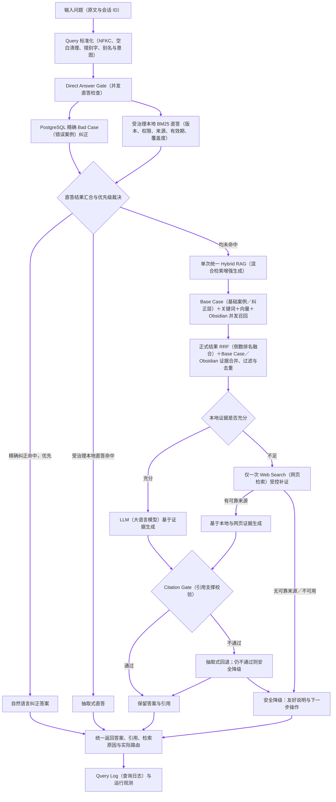

图例：Simple 是严格的单次线性链路。系统先并发检查 PostgreSQL 精确纠正和受治理本地 BM25 直答；未命中才执行一次统一 Hybrid RAG。Simple 不拆子问题、不查询 Neo4j、不进入反思重试循环；本地证据不足时最多进行一次受控 Web Search 补证。本地与网页都没有可靠证据时，后端拒绝无证据生成并进入安全降级，前端用友好提示和操作按钮承接，不向用户直接展示生硬的“拒答”。

#### 代码入口

`ChatService` 调用 `KarpathyRagService.answer`。精确 Bad Case 与受治理本地 BM25 直答构成 Direct Answer Gate；未命中后，Base Case 的精确／语义纠正候选、`retrieveDetailed` 的关键词／向量结果和 `ObsidianKnowledgeService.search` 通过同一个 `Promise.all` 并发召回。已审核且达到 `exact`（精确命中）或 `correction`（高可信纠正候选）门槛的 Base Case 会转换为可引用证据片段，与正式知识和 Obsidian 候选统一去重、控制预算并进入证据门禁，不再只作为生成提示词。`ContextBuilder` 负责证据预算，`answerWithWebFallback` 负责联网补证，`assessCitationSupport` 负责引用校验与抽取式回退。

#### 当前边界

联网依赖 Bocha 等外部工具已配置且可用；未配置、超时或没有可靠结果时，系统进入安全降级，不能伪造来源或使用无证据模型知识补齐。用户可以补充版本、项目、时间范围或业务场景后重新提问。精确纠正答案可以不带文档引用，但必须来自已审核的精确 Bad Case；语义纠正候选必须作为 Base Case 证据返回引用。中文姓名误写只在「问题同长度、首字相同、且仅一个中文字符不同」时进入纠正候选，例如“韦永春是谁”可召回已审核的“韦水春是谁”；不同姓氏、数字版本差异和多字符差异不会自动合并。本地直答和常规答案继续受版本、权限、来源与引用门禁约束。
### 2.3 Auto：完整 Hybrid Fast Path 与按需升级

#### 用户操作流程

1. 用户选择 `auto`，不需要自己判断问题复杂度。
2. 系统先执行与 Simple 共用的 Direct Answer Gate；精确纠正或受治理本地直答命中时直接返回。
3. 未命中时执行完整 Hybrid Fast Path：并发召回 Base Case、BM25／Elasticsearch 关键词结果、Milvus 向量结果和 Obsidian 编译知识；关键词与向量结果先做 RRF（倒数排名融合），再与 Base Case／Obsidian 证据统一执行权限／来源／版本过滤、去重、父子块上下文补全和候选排序。
4. Fast Path 只形成首轮证据并判断「当前证据是否足够」，不在首轮调用图谱、查询扩展或多 Agent 协作。证据充分且低复杂度时轻量生成；证据不足，或命中多步分析、对比、多跳关系、实时信息或工具需求时升级 Chat Agentic。
5. 问题长度只影响上下文、Token（令牌）、时间与成本预算，不单独决定路由。升级后复用原问题的 Fast Path 证据，新增子问题才追加检索。

#### 数据／状态流转

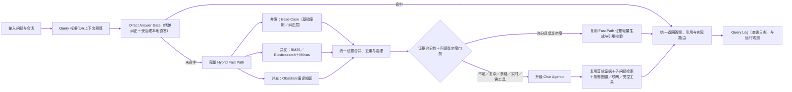

图例：Auto 与 Simple 共享精确直答和统一 Hybrid RAG，区别只在 Hybrid Fast Path 之后是否允许升级。无索引或首轮证据不足也进入 Agentic 补证，最终仍无可靠证据则进入安全降级。

#### 代码入口

`AgenticRagService.run` 在 `auto` 模式下先调用 `KarpathyRagService` 的受治理直答入口；未命中才调用 `assessFastPath`。`assessFastPath` 通过 `Promise.all` 同时启动 Base Case、正式 Hybrid RAG 和 Obsidian 召回，并把通过门槛的 Base Case 转成证据片段后再判断充分性。`resolveAutoRoute` 根据合并后的检索充分性和 `shouldUseAgentic` 的复杂度规则选择 `simple` 或 `agentic`。轻量分支通过 `prefetchedFastPath` 复用 Base Case、正式检索和 Obsidian 快照；证据不足的升级分支通过 `fastPathChunks` 把首轮合并片段交给 `retrievalNode`，原问题子查询复用这些片段，新增子问题再检索。

#### 路由门禁与边界

- 首轮「充分」由 Base Case、正式 RAG 和 Obsidian 三路证据分别评估后合并得出；复杂度规则是额外升级信号，不等同于引用覆盖率或最终答案校验。
- 轻量生成仍需通过 Citation Gate；因此“首轮充分”不等于“答案已经通过最终引用门禁”。
- Auto 使用规则型复杂度判断，不是独立的 LLM Router（大语言模型路由器）；问题长度只参与资源预算，不能覆盖证据不足、复杂、多跳、实时或工具需求等升级信号。
- 如果用户没有已索引的知识库片段，Auto 仍进入 Agentic 状态机尝试 Web Search 等补证；本地与网页都没有可靠证据时拒绝无证据生成，并由前端提供友好降级操作。
- 短实体或原子事实问句，例如「肯德基」「肯德基是什么」，升级后仍只保留原问题作为单个子问题；不会凭空扩写多个必须全部覆盖的验收项。
### 2.4 Chat Agentic：复杂问答状态机

#### 用户操作流程

1. 用户选择 `agentic`，用于需要拆分、比较、多跳关联、方案分析或工具辅助的复杂问题。
2. 系统不走精确直答捷径，先预取一次 Fast Path（快速路径）证据；复杂问题再进入查询增强和子问题规划，短实体／原子事实问句保留原问题，避免状态机重复检索或过度拆分。
3. 页面展示子问题、检索／工具进度和最终答案。
4. 普通问答默认不等待答案审批；只有用户显式启用答案审批时才暂停确认。任何未来新增的高风险副作用工具必须在执行前单独审批，当前 Chat Agentic 工具均为只读。

#### 数据／状态流转

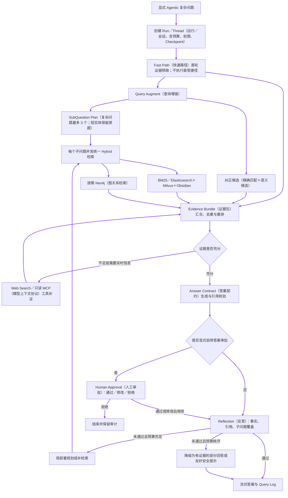

图例：显式 Agentic 先通过 Fast Path 预取原问题的首轮证据，但不会因为命中精确答案而提前结束；复杂问题才由 Query Augment 同时准备子问题计划和纠正候选，短实体／原子事实问句只保留原题。原问题复用首轮证据，新增子问题再并发执行统一 Hybrid 检索，并按需补充 Neo4j。证据不足时联网或调用只读工具补证，充分后再生成 Answer Contract。普通问答直接进入 Reflection；显式开启答案审批时才暂停。反思失败只局部重试，受最大步数、工具次数、超时和预算限制；本地与网页都无可靠证据时进入安全降级，不生成无证据结论。

#### Chat Agentic 内层 Agent Loop

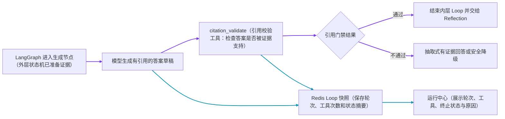

图例：紫色箭头为「LangGraph 生成节点 → 模型答案草稿 → 引用校验工具 → 通过后交给 Reflection，或不通过后基于已检索证据生成抽取式带引用回答」；只有抽取式回答也无法通过引用校验时才安全降级。青色箭头为「模型／工具动作 → Redis Loop 快照 → 运行中心审计」。外层 LangGraph 决定子问题、补检索、人工审批和反思重试；内层 Agent Loop 只执行当前节点允许的模型与只读工具，不能改写业务 DAG（有向无环依赖图）或绕过权限。

#### 诊断 Artifact（结构化产物）

Chat Agentic 可写入 `SubQuestion Plan`（子问题计划）、`Evidence Bundle`（证据包）、`Answer Contract`（答案契约）等诊断交接物，供 Artifact Audit（结构化产物审计）排查。它们用于解释一次复杂问答，并不是 Task Agentic 的 PRD（产品需求文档）或代码交付物。
<a id="task-agentic"></a>

## 三、Task Agentic 产研运工作流

### 用户操作流程

1. 管理员在「Agent 运营→产研运工作流」创建活动或项目任务，填写目标、参与岗位、审批策略和插件组合。
2. 工作流依次或按依赖执行产品、设计、前端、后端、测试、运营岗位。
3. 管理员在工作流详情查看每个岗位的 Artifact、证据、风险与审批状态。审批通过后进入下游；驳回时必须填写修改意见并选择需要修订的岗位。
4. 驳回只会将工作流暂停为 `revision_required`（待修订），在 Artifact metadata（产物元数据）保存 `rejected／stale`、修订号与驳回意见，并标记受影响下游，不会立即调用模型。管理员确认后点击「按意见重新生成」，系统才从被驳回岗位局部重跑。
5. 新版本重新进入审批，通过后才解锁下游；已完成工作流可导出 Markdown／项目代码交付包，并在运行中心、协作编排与 Artifact 审计中按同一 Thread／Run 回放。

### 数据／状态流转

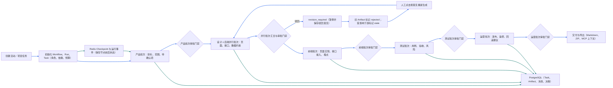

图例：蓝色箭头为「创建活动／项目任务 → 初始化 Workflow／Run／Task → 产品批次 → 设计与后端并行批次 → 前端 → 测试 → 运营 → 导出交付」，以及「审批驳回 → 暂停为待修订 → 保存旧版本并标记下游过期 → 人工确认 → 局部重新生成」。青色箭头为「初始化／各岗位 Artifact → Redis Checkpoint 或 PostgreSQL 任务、产物、消息与决策」。驳回本身不触发模型，只有点击「按意见重新生成」才进入新修订轮次；新版本重新审批通过后才解锁下游。

### Task Agentic 的岗位内层 Agent Loop

```mermaid
flowchart LR
  A[外层岗位 DAG 调度到当前岗位] --> B[读取岗位 Tool Policy（允许工具、最大调用数、超时）]
  B --> C[Agent Loop 决策当前动作]
  C --> D[岗位知识检索工具（产品／设计／前端／后端／测试／运营各自只读工具）]
  D --> E[工具结果回填 Loop 状态]
  E --> F[岗位结构化 LLM 生成 Artifact]
  F --> G[Claim／Evidence 校验与审批门禁]
  G --> H[回到外层 DAG：继续下游、暂停审批或进入修订]
  C --> I[Redis Loop 快照与 Runtime Event（轮次、工具、终止原因）]
  D --> I
  I --> J[运行中心审计]
  linkStyle 0,1,2,3,4,5,6,7 stroke:#2563eb,stroke-width:2px
  linkStyle 8,9,10 stroke:#0891b2,stroke-width:2px
```

图例：蓝色箭头为「岗位 DAG → 岗位工具策略 → 内层 Agent Loop → 岗位检索 → 结果回填 → 结构化 Artifact → 证据与审批门禁 → 返回外层 DAG」；青色箭头为「Loop 决策／工具执行 → Redis 快照与运行事件 → 运行中心」。当前每个岗位只开放一个与职责匹配的只读知识检索工具，默认最多调用 1 次；通用 Loop 支持后续组合更多已注册工具，但仍受 Tool Registry、插件白名单、超时和审批限制。

### Task Agentic 的 Redis Checkpoint 操作流程

#### 用户操作流程

1. 管理员点击「启动工作流」后，系统创建 `Run`（一次运行）和 `Thread`（可恢复会话），不需要管理员手动填写 Thread ID。
2. 工作流执行过程中，管理员可以切换页面；回到「产研运工作流」列表后，点击活动名称进入详情，查看当前岗位、执行步骤和最近一次保存时间。
3. 如果页面刷新、服务进程中断或某个岗位执行超时，工作流不会从产品阶段重新开始；管理员在详情页点击「继续运行」或「局部重跑」，系统先读取最新 Checkpoint。
4. 如果上一步是只读检索、模型生成或已确认的 Artifact 写入，系统从下一个安全节点继续；如果上一步是外部写入且结果未知，页面显示「待核验」，管理员确认外部结果后再继续，避免重复创建或重复发布。
5. 恢复完成后，岗位状态、Artifact、审批记录和运行事件继续写回列表、运行中心和 Artifact 审计页面。

#### 数据／状态流转

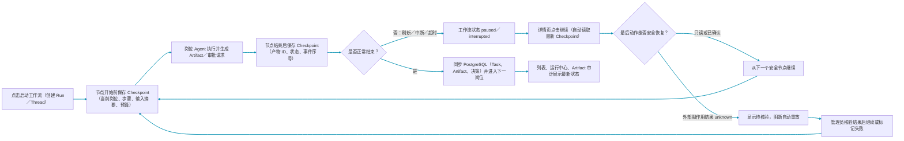

图例：青色箭头为「启动工作流 → 节点前保存 → 执行 → 节点后保存 → 正常进入下一岗位，或中断后从详情页读取最新 Checkpoint 恢复」。Checkpoint 保存的是可恢复的执行状态，不是完整聊天记录；完整 Task、Artifact、审批和决策仍保存到 PostgreSQL。每个节点恢复前都会经过安全判断，未知副作用不会自动重放；这就是“断点续跑”与“整条链路重跑”的区别。

### 实际策略

- `sequential`：按岗位依赖批次推进。
- `hierarchical`：业务负责人／Manager 创建父任务并受控委派子任务，不允许无限自主委派。
- `conditional`：根据证据充分性、风险和审批状态创建补充检索或人工确认任务。

### 代码入口与边界

主入口为 `ProductionWorkflowService`、`AgentTasksService`、`ArtifactsService`、`AgentRuntimeEventsService`。Redis 不可用时存在进程内保护与恢复降级；真实多实例租约、独立 Worker 集群和跨机器故障演练属于生产验证项。

<a id="rag"></a>

## 四、RAG 知识入库与检索

### 4.1 文档入库与版本治理

### 4.1.1 管理后台文件上传

#### 用户操作流程

1. 管理员进入「文档管理」→「我的文档」，点击「批量上传」或空列表中的「上传文档」，可选择多个后端支持的文件。
2. 浏览器以 `multipart/form-data` 提交文件；不得手动指定 `Content-Type`，由浏览器附加 boundary（分隔边界）。
3. Admin Backend 校验登录态和 `admin:documents:write` 权限，接收 `file` 后附加当前登录用户的 `ownerUserId`，再用内部服务令牌转发给 RAG Backend。
4. RAG 内部上传路由校验服务令牌，读取文件名、MIME 类型与内容，按扩展名识别 Markdown／文本、PDF、Office、表格、演示文稿、JSON／HTML、图片、音频或视频，并交给 `DocumentService` 解析、入库和索引。
5. 前端等待上传完成后刷新第一页列表；服务端和前端都按 `createdAt` 倒序展示，最新文档位于最上方。

#### 数据／状态流转


图例：绿色箭头为实际上传主链路。`ownerUserId` 必须由 Admin Backend 从已验证的登录态派生，浏览器提交的任意同名字段不作为归属依据。文件解析和向量索引可能明显长于普通 API；Admin Backend 对该上传转发使用 10 分钟专用超时，不复用默认的 2 秒管理 API 超时。

#### 代码入口

`admin/src/pages/documents/index.tsx`、`admin/src/pages/documents/service.ts`、`admin-backend/src/modules/admin-documents/admin-documents.controller.ts`、`admin-backend/src/modules/rag-client/rag-client.service.ts`、`backend/src/modules/rag-admin/rag-admin.controller.ts`、`RagAdminService.uploadDocument`、`DocumentService.upload`。

#### 当前边界

上传链路只接受解析器已支持的文件类型；不支持的扩展名返回明确错误。扫描版 PDF 的文本质量取决于 OCR 能力是否配置。当前上传链路同步等待解析和首轮索引完成，大文件会占用较长请求时间；超时后不能把“浏览器请求未完成”误认为“文档已完成入库”，应以文档任务和列表记录为准。

### 4.1.2 文档版本治理

#### 用户操作流程

1. 管理员进入「文档管理」，在文档列表中找到需要更新的规范；如果列表较宽，横向滚动到底部，右侧「操作」列已固定。
2. 点击该行的「版本治理」按钮，查看版本链和当前 `effective`（生效）版本。
3. 在弹窗下方填写新版本号、文件名和正文，点击确定创建新版本。新版本立即显示为 `draft`（草稿），不会影响当前有效版本。
4. 等待新版本完成解析、质量门禁、切块；系统随后并发创建 PostgreSQL 的 `draft`（草稿）元数据和 Chunk、执行 Embedding（向量化）→ Milvus、Karpathy／BM25＋Elasticsearch 与 Obsidian 关联写入。所有必要分支成功后，入库任务才完成；随后在 Neo4j 可用时异步发起图谱抽取，状态为 `pending`（等待中）、`indexed`（已完成）、`failed`（失败）或 `skipped`（未启用）。
5. 重新打开「版本治理」，确认新版本为 `draft`、入库任务已完成且 Chunk 数大于 0 后，点击该版本行的「设为生效」。图谱构建失败不阻塞该操作；它是可选补充索引，而不是版本切换的硬前置条件。
6. 切换成功后，新版本成为唯一 `effective`；同一版本链的旧版本自动变为 `deprecated`（已废弃），原始资料和历史版本仍保留。
7. 对不准备发布的草稿点击「废弃」；该操作只改变生命周期，不删除原始资料。
8. 发现新版本有问题时，在历史 `deprecated` 版本行点击「回滚到此版本」；系统使用同一套版本切换规则恢复旧版本。

#### 数据／状态流转

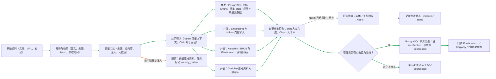

图例：绿色箭头为当前版本创建主链路：「原始资料 → 解析与快照 → 质量门禁 → 父子切块 → PostgreSQL、向量、关键词、Obsidian 四个独立分支并发写入 → 必要分支汇合 → 人工设为生效 → PostgreSQL 原子切换 → 生命周期索引同步」；灰色虚线为「主入库成功后异步图谱构建」，橙色箭头为「质量门禁 → 高风险提示注入隔离」。Embedding 必须先于 Milvus 写入，但与关键词、Obsidian、PostgreSQL 草稿元数据没有前后依赖。任一必要分支失败时，PostgreSQL 草稿保留供排障，Milvus、BM25、Elasticsearch 等已成功写入的外部索引会被补偿清理，草稿不会进入有效检索。Neo4j 启用时，系统以 `docId`（文档标识）为来源异步抽取实体和关系，并将状态记录为 `pending`、`indexed`、`failed` 或 `skipped`；失败不阻塞版本生效。共享实体和关系保存多个来源，删除某一文档时只移除该文档来源。高风险内容保留原始资料供人工复核，但任务标记为 `security_review` 并停止在切块之前，因此不会进入任何检索索引；中风险内容只记录质量告警，检索生成前再执行逐行清洗。父子切块不是重复存同一段文本：子块负责精确命中，父块在回答时补回章节上下文。

#### 代码入口

`DocumentService`、`KarpathyObsidianIngestService`、知识库 Profile、`KarpathyRagService`、`GraphService`、向量／关键词／图谱 Provider。`DocumentService` 在质量门禁前检测提示注入：高风险命中保留原始资料并将任务写为 `failed／security_review`，不执行切块和索引；中风险命中只进入质量告警。父子切块后，PostgreSQL 草稿、向量、关键词和 Obsidian 四路使用同一 `docId`（文档标识）并发写入；全部必要分支完成后才返回成功。随后若 Neo4j 可用，`GraphService` 异步抽取并写入图谱，`documents_meta` 保存图谱状态和失败原因。外部索引必要分支失败时，系统保留不可检索的草稿事实并补偿清理已完成的外部索引。异步任务状态为 `queued → processing → completed／failed`，阶段可包含解析、Embedding、向量索引、元数据处理和 `security_review`；文档版本只有在管理员调用生效操作后才进行 `effective／deprecated` 原子切换。

### 4.2 检索与证据组装

#### 用户操作流程

用户只输入问题；系统根据查询类型选择检索组合，返回时显示引用与原因，不把内部检索介质暴露为用户必须理解的步骤。

#### 数据／状态流转

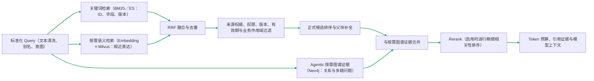

图例：绿色箭头为「标准化 Query → BM25／Elasticsearch 与 Milvus 并发召回 → RRF 融合 → 来源、权限、版本、有效期和业务作用域过滤 → 正式候选排序与父块补全 → Agentic 按需补充 Neo4j 图谱证据 → 可选 Rerank → Token 预算与引用上下文」。RRF 只融合关键词与向量候选；Neo4j 证据不进入这次 RRF，而是在 Agentic 子问题检索中按需追加。权限和生命周期过滤必须先于外部 Rerank 与模型上下文组装。Direct Answer Gate 命中时可以跳过该链路；未命中后，Simple 与 Auto 都执行完整关键词／向量混合召回，Chat Agentic 再根据子问题和工具策略补图谱证据。

### 4.3 独立文档全文检索与知识图谱检索

#### 用户操作流程

管理员进入「智能搜索」，选择「文档全文检索」或「知识图谱检索」，输入关键词后执行搜索。文档全文检索返回文档级结果和命中正文片段，并对命中的关键词做高亮；知识图谱检索返回匹配的实体节点和关系边。该入口用于查找和浏览知识，不等同于问答链路里的 Hybrid RAG 召回。

#### 数据／状态流转

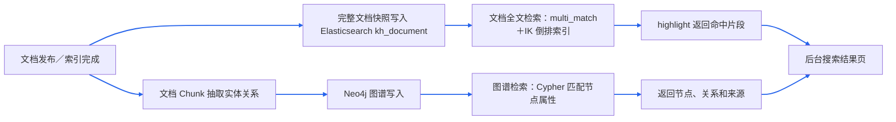

文档全文索引传递完整正文，不再通过消息截取前 1000 个字符；每篇文档以 `docId`（文档标识）作为 `kh_document` 的唯一键。全文检索只查询 `kh_document`，而 RAG 的关键词／向量混合检索继续查询分块索引 `rag_chunks`。默认仍过滤 `deprecated`（已废弃）版本，并复用现有文档生命周期更新。图谱检索复用 Neo4j 的节点属性、关系类型和来源 `docId`，图谱不可用时返回明确的不可用状态，不影响全文检索。

### 4.4 多模态图片 chunk 绑定与受控访问

#### 用户操作流程

1. 用户在「文档管理」上传图片、PDF、PPTX 或视频资料。
2. 如果是图片，系统会生成「原始图片预览、OCR 文字、图片描述、标签」四类内容；如果是 PDF／PPTX，系统会把内嵌图片插入到对应页或幻灯片位置；如果是视频，系统会抽关键帧并写入时间点。
3. 用户在问答或检索结果中看到的是 Markdown 图片预览和文字证据，不需要直接访问对象存储地址。
4. 用户没有权限时，图片代理接口不会返回图片；删除文档时，图片向量索引和图谱来源也会同步清理。

#### 数据／状态流转

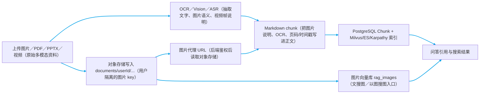

图例：青色箭头为「原始资料 → 对象存储隔离 key／视觉理解 → 图片代理 URL 与 Markdown chunk 绑定 → 文本索引和图片向量索引 → 问答或搜索返回可引用结果」。这里不是把图片裸 URL 暴露给前端，而是写成 `/api/v1/documents/assets/image?key=...`，后端用登录用户校验 `documents/{userId}/...` 前缀后再读取对象存储。面试可以说：图片先被转成可检索文本证据，同时保留原图代理地址；文本问答走 chunk，图片相似检索走 `rag_images`。

#### 代码入口

`DocumentController` 负责上传入口、图片代理接口和用户隔离 key；`document-parser.util.ts` 负责 PDF/PPTX 内嵌图片和视频关键帧写入 Markdown；`ImageIndexService` 负责图片向量库写入、文搜图和文档删除同步清理；`ObjectStorageProvider` 负责本地对象存储或 MinIO。

### 4.5 Agent 化页面 Schema 生成

#### 用户操作流程

1. 用户在「Agent 运营 → 产研运工作流」输入活动名称、需求背景和参与岗位。
2. 系统按产品、设计、前端、后端、测试、运营生成岗位交付物；每个岗位除了 Markdown，还会生成一份机器可读的 Schema。
3. 用户进入工作流详情页，可以在每个岗位产物下面查看「低代码 / AI Coding Schema」。
4. 工作流完成后，详情页可以导出「交接包（Markdown＋Schema）」：`HANDOFF.md`、岗位 Markdown、`LOW_CODE_SCHEMAS.json`、`schemas/{role}.json`、`RAG_EVIDENCE.md` 与 `RAG_EVIDENCE.json`；生成可运行项目代码的 ZIP 同样包含这套交接包，并额外包含源码和交付验证结果。
5. AI Coding 工具可通过 MCP 的 `rag_production_workflow_handoff` 按活动名称读取相同交接包，返回 Markdown、Schema 与 RAG 引用证据，供 Codex、Claude、Cursor 在本地代码库实施。

#### 数据／状态流转

```mermaid
flowchart LR
  A[活动需求 Brief（自然语言或 Markdown）] --> B[LangGraph 产研运 DAG（按岗位依赖执行）]
  B --> C[岗位 RAG 取证（活动模板、规范、接口、埋点、测试资料）]
  C --> D[结构化输出校验（Zod 限制 Markdown、证据、风险、Schema 字段）]
  D --> E[岗位 Artifact（给人看的交付文档）]
  D --> F[低代码 Schema（page/api/tracking/validation/acceptance）]
  E --> G[人工审批／驳回局部重试]
  F --> H[代码生成上下文与 zip 导出]
  G --> H
  linkStyle 0,1,2,3,4,5,6,7,8 stroke:#2563eb,stroke-width:2px
```

图例：蓝色箭头为「需求 → 多 Agent 岗位 DAG → RAG 取证 → Zod 结构化校验 → Markdown Artifact 和低代码 Schema 双产物 → 审批后进入代码生成」。Schema 的作用不是替代 PRD，而是把页面结构、接口契约、埋点事件、前置校验和验收项变成下游代码生成能稳定消费的 JSON。模型漏填 Schema 时，后端会按岗位生成兜底 Schema，避免后续 zip 导出缺机器可读输入。

#### 代码入口

`ProductionWorkflowService` 的 `roleSchema` 约束 `lowCodeSchemas`；`runRole()` 生成并规范化 Schema；`publishRoleArtifact()` 把 Schema 附加进岗位 Artifact；`codingContext()` 和 `generateProjectZip()` 把 Schema 带给代码生成与导出；后台 `workflow-detail` 页面负责展示。

### 4.6 索引同步与生命周期治理

#### 用户操作流程

1. 用户上传新资料后，系统先保存为 `draft`，不会立刻影响线上问答。
2. 管理员在「文档管理」审核或设为生效后，新版本才会参与检索。
3. 如果新规范替代旧规范，管理员使用版本治理把新文档设为 `effective`，旧文档自动变为 `deprecated`。
4. 删除文档时，文档元数据、Chunk、权限、全文索引、向量索引、图片索引和图谱来源会一起清理或失效。

#### 数据／状态流转

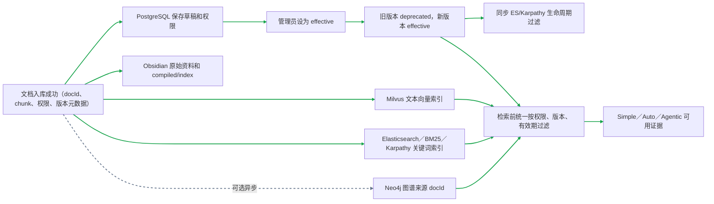

图例：绿色箭头为「入库成功 → 多索引写入 → 人工设为生效 → 生命周期同步 → 检索前过滤 → 三条问答链路取用」。灰色虚线为「图谱异步构建」，失败不阻塞文档版本生效。这个设计避免旧规范和新规范同时被模型拿去回答，也能解释为什么增量新数据不是覆盖原文件，而是走版本链、审核、生效和可回滚。

#### 代码入口

`DocumentService.upload()` 写 PostgreSQL、Milvus、Elasticsearch、Karpathy 和 Obsidian；`scheduleOptionalGraphIndex()` 异步写 Neo4j；`updateLifecycle()` 和 `activateVersion()` 同步 PostgreSQL、ES 和 Karpathy 的生命周期；`delete()` 清理 Milvus、ES、Karpathy、图片向量库、图谱来源、Chunk、权限和资源记录。

#### 代码入口与边界

后端由 `ElasticsearchProvider.indexDocument/searchDocuments` 负责完整文档索引与高亮，`RagAdminController` 提供 `/rag/admin/documents/search`，`RagAdminController` 的 `/rag/admin/graph/search` 提供图谱检索；管理后台通过 `/admin/search-ops/documents` 和 `/admin/search-ops/graph` 转发并鉴权，页面在「智能搜索」中展示两个入口。高亮片段仅用于展示，不直接拼接进模型 Prompt；该功能不替代问答链路的权限过滤、Rerank（精排）和证据门禁。

#### 热门搜索与搜索筛选

用户操作流程：

1. 用户点击「热门搜索」，查看按查询次数排序的热门关键词和搜索概览。
2. 点击某个热门关键词，系统自动回填搜索框并执行文档全文检索。
3. 用户点击「搜索筛选」，选择文件类型、更新时间、文档分类和权限范围。
4. 点击「应用并搜索」，系统把关键词和筛选条件一起提交；点击「清空」会移除筛选条件。

数据／状态流程：

```text
查询日志／Query Log（注：记录用户查询、命中数和响应耗时）
  → /search/queries/popular 聚合热门词（注：按查询次数排序）
  → 管理后台热门搜索视图（注：点击后复用同一全文检索入口）

用户筛选条件
  → admin/search-ops/documents
  → admin-backend 转发并鉴权
  → rag-backend SearchDocuments
  → Elasticsearch kh_document（注：文档级倒排索引和高亮）
  → 文件类型／更新时间／文档分类／权限范围过滤
  → 排除 draft、archived、deprecated（注：未生效、已归档、已废弃文档）
  → 返回文档标题、版本、来源和命中片段
```

热门搜索解决“大家最近都在查什么”，搜索筛选解决“在指定范围内找什么”。它们是管理后台的浏览和运营能力，不替代问答链路中的 Hybrid RAG（混合检索增强生成）、Rerank（精排）和引用门禁。

### 4.4 Karpathy／Obsidian 的位置（内部资产，不是独立路由）

Karpathy 与 Obsidian 是知识编译和本地索引资产，不替代 PostgreSQL 的权限／版本／来源治理，也不与 Hybrid RAG 并列成第四条在线链路。资料入库时先保存治理元数据，再编译知识卡；查询时，Karpathy 本地 BM25 只作为 Direct Answer Gate 的受治理直答与降级实现，Obsidian 候选进入统一 Hybrid 证据汇合，二者都继续接受用户作用域、文档版本、有效期和来源策略过滤。

Obsidian 写入原始资料与笔记后触发索引刷新。进程内同时到达的刷新请求使用单飞锁合并；若刷新过程中又有新笔记落盘，当前批次结束后会补跑一轮，避免首次快照遗漏。`sources`／`tags` 索引、标签编译页、实体编译页、结论编译页和图谱种子是独立产物，可并发生成；页面写入固定每批最多 8 个。关联笔记需要回写原笔记，必须在上述索引产物完成后串行执行。

### 当前边界

真实公开资料的持续采集、内容版权／来源治理、视觉向量、视频抽帧、以图搜图和企业级图谱实体消歧需要真实数据与生产策略，不能仅凭模拟资料证明效果。

<a id="bad-case"></a>

## 五、Bad Case 质量闭环

### 用户操作流程

1. 用户在答案下点击「提交 Bad Case」，填写错误类型、说明、修正答案和是否加入回归。
2. 运营人员在「Agent 运营→Bad Case 审核」核对原问题、原答案、引用和检索快照，选择「保留纠正层」「标记待晋升」「晋升正式知识」或「驳回／撤销」。
3. 「保留纠正层」的答案会进入独立的纠正向量库，可快速撤销；只有填写已核验来源后才能「晋升正式知识」，系统把它生成为带版本、来源和生效状态的正式文档。
4. 用户再次提问时，精确同题可直接采用纠正结论；非精确问题则让纠正层候选与正式知识并行召回，再由 Correction Gate 判断。运营人员在评测页面查看回归用例结果；正式知识的失效、替换和回滚在「文档管理→版本治理」执行。

### 数据／状态流转

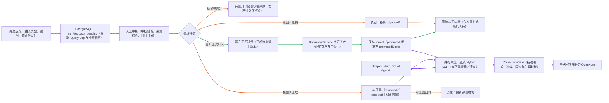

图例：橙色箭头为「提交反馈 → PostgreSQL pending → 审核 → 纠正层／待晋升／正式知识晋升」，以及「驳回／撤销 → 删除纠正向量」和「纠正层 → 可选回归用例」；绿色箭头为严格串行的「晋升正式知识 → DocumentService 完成正式入库 → 保存 formal／promoted 状态与 promotedDocId → 删除纠正向量」；紫色箭头为「Simple／Auto／Chat Agentic → 正式 Hybrid RAG 与纠正层候选并行 → Correction Gate → 新 Query Log」。写入 PostgreSQL 发生在提交时；写入纠正向量发生在审核通过并选择纠正层后；只有正式文档上传和晋升状态保存成功后才删除纠正向量，避免晋升失败造成两层知识同时不可用。`includeInRegression` 只创建或更新评测用例，不决定纠正知识是否生效。

### 代码入口与边界

`RagFeedbackService`、`BadCaseFlywheelService`、`KarpathyRagService`、`DocumentService`。纠正层只对精确同题具有覆盖优先级；达到纠正门槛的相似 Bad Case 会转换为可引用证据，不能覆盖当前充分的正式知识。受限中文姓名单字纠错只扩展候选，不会把不同姓氏、数字版本或多个字符差异自动视为同一实体。晋升后的知识不再参与纠正向量召回，而是进入主知识库的权限、版本和生命周期治理。`includeInRegression` 只控制是否创建评测用例，不控制纠正层是否生效。

<a id="memory-checkpoint"></a>

## 六、会话记忆与 Redis Checkpoint（检查点）

### 6.1 问答上下文管理

#### 用户操作流程

用户持续追问时，无需携带完整历史。系统并发准备短期工作记忆、必要的长期记忆和相关历史问答，再统一合并、控制上下文预算后进入本次问答检索。

#### 数据／状态流转

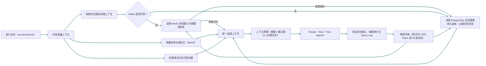

图例：青色箭头为「用户追问 → 并发准备上下文 → 短期记忆／长期记忆／相关历史问答向量 → 短期记忆优先读取 Redis，缺失时回退 PostgreSQL → 统一组装上下文 → Token 预算 → 问答链路 → 消息窗口与审计 → 压缩后同步更新摘要」。短期记忆服务优先读 Redis 的最近窗口和摘要热副本；摘要缺失或 Redis 不可用时，才从 PostgreSQL 的会话摘要持久副本与必要历史消息恢复，然后统一返回短期上下文，不会重新进入一次短期记忆流程。最近窗口保存近期原文，摘要保存较早历史的结构化压缩结果，两者不是重复数据。三类上下文读取互不阻塞，均完成后才进入问答链路。

#### 代码入口

`ChatService` 先并发准备插件策略与会话 ID；随后通过 `Promise.all` 并发调用 `ShortTermMemoryService.getContext`、`MemoryService.searchMemory`、会话历史向量检索、运行计划生成和知识库检索 Profile 解析。`ShortTermMemoryService` 内部管理 Redis 窗口、摘要与压缩审计，压缩摘要写入会话持久字段；`MemoryService`／Mem0 存储跨会话事实与偏好；会话向量检索按当前问题补少量相关旧问答。各结果统一组装后，再注入问答链路。

### 6.2 Chat Agentic／Task Agentic 的 Checkpoint

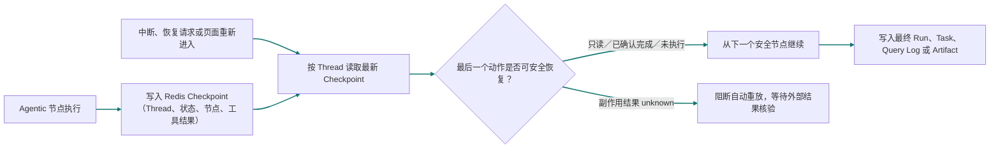

图例：青色箭头为「Agentic 节点执行 → 写入 Redis Checkpoint（检查点）」「中断或恢复请求 → 按 Thread（线程）读取 Checkpoint → 判断最后动作是否可安全恢复 → 从下一个安全节点继续或阻断自动重放」。Checkpoint 保存执行位置和状态，不等于完整用户记忆；问答记忆仍由上一节的窗口、摘要和长期记忆负责。只读节点或已确认结果可以继续；副作用工具结果为 `unknown` 时不能直接重跑，当前实现会阻断，自动扫描外部结果仍属于生产待接入能力。

### 当前边界

本地支持 Redis Checkpoint 与恢复接口。跨实例事件顺序、SSE 断线续传、实例崩溃后的未知工具结果扫描和真实多副本演练仍需要部署环境验证。

### 并发执行原则

系统只并发执行无数据依赖的读取、检索和独立子任务：例如上下文读取、Obsidian 多目录枚举及文件内容读取（固定小批次）、Obsidian 独立索引产物生成（单飞合并、每批最多 8 个）、Agentic 子问题 Hybrid 检索和后台多卡片数据聚合。解析→质量门禁→切片→索引、审核→核验来源→晋升正式知识、版本切换，以及同一资源的删除／写入操作必须保持串行；Obsidian 的关联笔记回写也必须等待索引产物完成，避免出现状态竞争或索引不一致。

<a id="agent-ops"></a>

## 七、Agent 运营、Artifact 与审计

### 用户操作流程

1. 「运行中心」按 Run 查看 Simple／Auto／Chat Agentic／Task Agentic 的运行总览、事件、指标、工具动作与最终结果。
2. 「产研运工作流」查看 Task Agentic 的任务列表、详情、岗位 Artifact 和审批；点击列表进入独立详情页，不和新建表单混在一起。
3. 「Artifact 审计」查看 Chat Agentic 的诊断 Artifact，或由运行中心跳转查看关联交付物。
4. 「协作编排」查看 Task、角色消息、依赖、决策记录、受控委派与局部重跑。

### 数据／状态流转

#### 7.1 运行时写入与状态收口

```mermaid
flowchart TB
  A[问答或任务工作流启动] --> B[创建 Run（runId、threadId、模式、预算）]
  B --> C[PostgreSQL：agent_runs（状态、路由、当前节点、成本、最终摘要）]
  B --> D[执行节点（检索、生成、岗位协作或工具调用）]
  D --> E[运行事件（节点、检索、路由、预算、审批、重试）]
  E --> F[PostgreSQL：agent_runtime_events（按 threadId 顺序号）]
  D --> G[工具／委派／审批动作]
  G --> H[PostgreSQL：agent_actions（输入输出、风险、审批要求、耗时）]
  G --> E
  D --> I[Chat Agentic 诊断 Artifact（子问题计划、证据包、答案契约）]
  I --> J[Redis Checkpoint（状态机、结构化交接物、可恢复快照）]
  I --> Q[PostgreSQL：结构化 Artifact 持久副本]
  D --> K[Task Agentic 交付 Artifact（PRD、接口、测试、运营）]
  K --> L[PostgreSQL：generated_artifacts（元数据、状态、threadId）]
  L --> M[对象存储：交付文件]
  D --> N[Task、协作消息、依赖与决策]
  N --> O[PostgreSQL：agent_tasks／协作记录]
  D --> P[完成／失败／等待审批]
  P --> C
  linkStyle 0,1,2,3,4,5,6,7,8,9,10,11,12,13,14,15,16,17 stroke:#2563eb,stroke-width:2px
```

图例：蓝色箭头为「运行启动 → 创建 Run → 节点执行 → 事件／动作／Artifact／Task 持久化 → 终态回写」。`runId` 关联运行总览、事件和动作；`threadId` 关联会话、Redis Checkpoint 与交付 Artifact。Chat Agentic 的诊断 Artifact 一份随状态机快照进入 Redis，用于恢复；另一份写入 PostgreSQL 结构化 Artifact 表，用于 Checkpoint 过期后的长期审计。Task Agentic 的文件交付物以 `generated_artifacts` 元数据入 PostgreSQL，文件本身进入对象存储。审批事件先进入事件时间线，是否允许执行由工具策略和工作流状态决定。

#### 7.2 运营后台按 Run 展开审计

```mermaid
flowchart TB
  A[Agent 运营后台] --> B[运行中心列表：GET run-center]
  B --> C[读取 agent_runs＋目标状态摘要]
  C --> D[列表展示：模式、状态、路由、成本、失败标记]
  A --> E[运行详情：GET run-center/:runId]
  E --> F[读取 agent_runs（总览、预算、最终结果）]
  E --> G[读取 agent_runtime_events（时间线）]
  E --> H[读取 agent_actions（工具输入输出与风险）]
  G --> I[派生指标、目标状态与 Failure Onset（失败起点）]
  F --> J[运行详情页]
  G --> J
  H --> J
  I --> J
  A --> K[Artifact 审计：GET run-center/:runId/artifacts]
  K --> L[并发读取 PostgreSQL：generated_artifacts]
  K --> M[读取 Chat Artifact：Redis Checkpoint＋PostgreSQL 持久副本]
  L --> N[Artifact 审计面板]
  M --> N
  A --> O[产研运工作流／协作编排]
  O --> P[读取 agent_tasks、消息、依赖、决策]
  P --> Q[工作流详情与局部重跑入口]
  linkStyle 0,1,2,3,4,5,6,7,8,9,10,11,12,13,14,15,16,17,18,19 stroke:#2563eb,stroke-width:2px
```

图例：蓝色箭头为「Agent 运营后台 → 列表／运行详情／Artifact 审计／工作流协作入口 → 对应运行数据 → 页面展示或局部重跑」。运行详情以 `runId` 聚合总览、事件和动作，并从事件时间线计算指标、目标状态和 Failure Onset（失败起点）；Artifact 审计并发读取文件型交付物和 Chat Artifact 聚合结果，后者优先读取 Redis Checkpoint，同时合并 PostgreSQL 持久副本，Checkpoint 过期后仍可审计。运行中心只读审计数据；重试或局部重跑必须经过原有预算、权限和审批门禁。

#### 代码入口

`AgentRunsService.start` 创建 `agent_runs` 并记录 `run.started`；节点、检索、审批和重试通过 `AgentRuntimeEventsService` 按 `threadId` 顺序写入 `agent_runtime_events`；工具动作写入 `agent_actions`；`AgentRunsService.finish` 回写运行终态。`AgentRunsService.get` 聚合运行、动作、事件、指标、目标状态与 Failure Onset。运营接口 `GET run-center/:id/artifacts` 并发读取 `ArtifactsService.listForRunAudit` 的文件型 Artifact 与 `AgenticRagService.getRunSnapshot` 的 Chat 结构化 Artifact／Checkpoint。

### 7.3 Agent 定时任务（版本化与复制）

#### 用户操作流程

1. 管理员进入「Agent 运营→定时任务」，直接输入自然语言，或读取一份本地 Markdown 任务说明。例如：“每天上午 9 点统计今天新增或生效的规则、问答质量和负反馈，给产品、研发、测试、运营部门提出建议。”
2. 点击「解析任务」。系统只做任务定义解析，提取任务名称、Cron（周期表达式）、统计窗口、数据范围、关注岗位和部门；此时不会创建或执行任务。
3. 管理员检查并修改解析结果，确认后点击「保存定时任务」。任务写入 PostgreSQL，并按启用状态注册到调度器，首次保存为 v1。
4. 规则变化时点击「复制新版本」，系统复制任务定义、数据范围和岗位配置，生成 v2；新版本默认停用，不影响当前 v1。
5. 在「版本历史」中查看版本和执行记录，确认后启用目标版本；系统停用同一版本组的其他版本，但保留旧版本和历史报告，便于回溯。
4. 到达执行时间后，系统自动采集规则文档、问答质量、负反馈代理指标和产研运工作流数据，形成可复核统计快照，再让 LLM（大语言模型）基于快照生成 Markdown 建议报告。管理员也可以点击「立即执行」做一次人工验证。
5. 在任务列表展开“最近一次报告”，或进入“执行历史”查看每次运行状态、耗时、结果和错误；可随时停用或重新启用任务。

#### 数据／状态流转

```mermaid
flowchart LR
  A[自然语言／Markdown（描述周期、数据、岗位与输出）] --> B[任务定义解析器（提取名称、Cron、窗口、范围）]
  B --> C[人工确认页（修改误识别结果，不自动执行）]
  C --> D[保存任务（taskKind=analysis）]
  D --> E[PostgreSQL scheduled_jobs（定义、启停、下次时间、最近结果）]
  E --> V[版本治理（versionGroupId、version、isCurrent、copiedFromId）]
  V --> F[Scheduler Registry（服务启动恢复已启用任务）]
  F --> G[到点触发／立即执行（同一任务禁止重入）]
  G --> H[PostgreSQL job_executions=running（创建本次执行）]
  H --> I[并行采集（规则文档、负反馈、Query Log、Agent Task）]
  I --> J[统计快照（时间范围、数量、分类、脱敏样例）]
  J --> K[LLM 报告生成（只能引用快照，数据不足须说明）]
  K --> L[回写 completed／failed（报告、错误、耗时、下次时间）]
  L --> M[管理后台任务列表／执行历史（Markdown 预览与审计）]
  L --> N[LangFuse／Prometheus（生成链路与调度运行指标）]
  linkStyle 0,1,2,3,4,5,6,7,8,9,10,11,12 stroke:#2563eb,stroke-width:2px
```

图例：蓝色箭头为「自然语言／Markdown → 解析任务 → 人工确认 → PostgreSQL 保存版本 → 复制新版本／启用版本切换 → 调度器按时触发 → 创建执行记录 → 采集数据 → 生成统计快照和建议 → 回写报告 → 后台审计／运行观测」。任务定义与每次执行分开保存，复制不会影响当前版本；启用新版本只停用同组旧版本，不删除旧版本和历史报告。规则、问答和工作流数据来自当前项目 PostgreSQL；“客户投诉”当前只统计 `rag_feedback` 负反馈代理指标，不能表述为真实客服工单总量，后续应在数据采集节点接入企业客服／工单 API。

#### 代码入口与边界

`ScheduledAnalysisPanel` 负责后台创建、启停、立即执行和报告预览；`JobsService` 负责持久化、Cron／固定间隔／单次调度、服务启动恢复、重入保护和执行历史；`ScheduledAnalysisService` 负责确定性解析、数据采集、统计快照和受约束报告生成。自然语言解析结果必须人工确认，避免把“每月 1 号 9 点”误排成其他时间。当前报告保存在后台；企业微信、钉钉、飞书或邮件通知需要在执行完成后接入对应通知 API 与凭证，未配置时不声称已发送。

### 当前边界

已有本地运行回放、Artifact 关联与局部重跑。生产环境仍需完善按租户／岗位的 IAM、审计保留策略和跨服务事件一致性。

<a id="observability"></a>

## 八、可观测、性能、成本与告警

### 用户操作流程

1. 开发／运营人员在 LangFuse 查看一次请求的 Trace、模型 Generation、检索／工具 Span 和成本信息。
2. 在 Prometheus／Grafana 看服务级指标：QPS、错误率、P95、首 Token 延迟、空召回、重试、工具成功率与循环限制命中。
3. 健康检查失败或指标越阈值时，告警适配层生成事件；企业微信、钉钉或飞书通知需填入对应 API 接入实现。
4. 质量、性能与成本脚本产出 Evidence 报告，人工决定是否灰度、回滚或继续排障。

### 数据／状态流转

```mermaid
flowchart LR
  A[一次问答／工作流] --> B[LangFuse Trace（请求级链路）]
  B --> C[Generation／Span（模型、检索、工具节点）]
  C --> D[Flush（发送缓冲观测数据）]
  A --> E[Prometheus Metrics（服务级指标）]
  E --> F[Dashboard／阈值规则]
  F --> G[告警适配层]
  G --> H[企业微信等通知 API 接入点]
  E --> I[性能／成本 Evidence 报告]
  I --> J[人工发布、灰度或回滚决策]
  linkStyle 0,1,2,3,4,5,6,7,8 stroke:#dc2626,stroke-width:2px
```

图例：红色箭头为「一次问答／工作流 → LangFuse Trace → Generation／Span → Flush」，以及「一次问答／工作流 → Prometheus Metrics → Dashboard／阈值 → 告警适配层 → 通知 API」和「Metrics → Evidence 报告 → 人工发布决策」。LangFuse 负责单请求细节；Prometheus 负责长期聚合指标；两者都不等同于自动发布系统。

### 代码入口与边界

`LangfuseProvider`、`MetricsInterceptor`、`ObservabilityController`、LLM Gateway 的成本字段与运行指标服务。真实 Dashboard 布局、告警规则、采样／脱敏、通知凭证、值班与事故复盘需要生产配置，不应称为已验收的生产运营体系。

### 8.1 管理后台首页大盘

管理员进入「首页大盘」后，左侧菜单可按需切换「数据总览、访问分析、文档统计、用户统计、热门内容、系统公告」。各页面复用已有管理接口并在切换时单独读取数据：访问分析读取近七日查询趋势；文档统计读取可访问文档及分类；用户统计读取可见用户和状态；热门内容读取搜索热词；系统公告读取通知及未读数。菜单只负责展示汇总数据，不写入业务数据；数据范围仍由后台权限校验决定。

<a id="security-tools"></a>

## 九、安全、工具、MCP 与插件

### 9.1 Prompt Injection 与工具执行

#### 用户操作流程

1. 用户或管理员启用适合当前链路的插件能力包，例如混合检索、联网研究或 MCP 编码上下文。
2. 系统只显示与当前模式兼容且已启用的插件；Simple 不应承载高风险写入型工具。
3. 对外部网页、上传文本等不可信内容，系统将其作为证据而非系统指令；入库时高风险内容先隔离，检索后又逐行清洗；对工具请求按注册表、参数、权限与风险策略校验。

#### 数据／状态流转

```mermaid
flowchart LR
  A[入库的不可信文件／网页] --> B{入库风险检测}
  B -->|高风险| C[隔离：保留原文，停止切块与索引]
  B -->|正常| D[通过入库风险门禁]
  B -->|中风险| P[保留原文并记录质量告警]
  D --> E[进入受治理知识库]
  P --> E
  F[检索到的不可信网页／文本] --> G[生成前逐行清洗]
  G --> H[风险行替换为标签，仅作证据]
  I[模型提出工具调用] --> J[Tool Registry（Schema、模式、角色、风险）]
  J --> K[Tool Execution Policy（权限、审批、预算、超时）]
  K -->|允许| L[MCP／Function Calling／外部工具]
  K -->|拒绝| M[policy.denied 审计事件]
  L --> N[工具结果／Artifact 引用]
  N --> O[运行审计与答案／任务状态]
  linkStyle 0,1,2,3,4,5,6,7 stroke:#ea580c,stroke-width:2px
  linkStyle 8,9,10,11,12,13 stroke:#2563eb,stroke-width:2px
```

图例：橙色箭头为两阶段 Prompt Injection 防护：入库高风险资料隔离且不进入索引；中风险资料保留原文，只记录质量告警；正常资料通过门禁。检索到的不可信证据在生成前才逐行清洗，高风险行只保留风险标签，原指令不进入模型上下文。蓝色箭头为「模型工具请求 → Tool Registry → 执行策略 → MCP／外部工具或 policy.denied → 工具结果／审计」。二者解决不同问题：前者防止文本篡改指令，后者防止未授权工具产生副作用。

### 9.2 插件的使用边界

插件是 Tool Registry 上已有工具的声明式组合，不支持上传或执行任意代码。管理员在「Agent 运营→平台治理」登记、启停和配置插件；问答或工作流选择插件后，后端把有效工具白名单写入请求快照、Checkpoint 和运行事件，并在执行前实际拦截未授权工具。

适用场景：联网研究、混合检索证据、MCP 编码上下文、产研运基础工作流。非适用场景：用插件绕过角色权限、在 Simple 中执行高风险写入、把外部网页当作可信指令。

### 9.3 MCP／CLI 与当前运营能力对齐

#### 用户操作流程

1. 开发者在终端使用 CLI：`rag doc list／show／task` 查询自己可见文档、审核／版本／索引状态与异步入库进度；`rag workflow list／show／context` 查询自己可见的产研运工作流和已审批交接物。
2. 管理员可在 CLI 使用 `rag admin job list／versions／executions` 查询定时任务；只有管理员角色可执行 `run／copy／start／stop`，权限不足由后端拒绝。
3. Codex、Claude Code 等 AI 编程工具通过 MCP 调用工作流状态、文档治理、入库任务和定时任务执行记录；MCP 仅做只读发现与审计，不提供审批、发布、删除或任务启停。

#### 数据／状态流转

```mermaid
flowchart LR
  A[CLI／MCP 请求（携带当前用户 Token）] --> B[Backend JWT／角色与数据范围校验]
  B --> C[文档治理：版本／审核／索引／入库 Task]
  B --> D[工作流：状态／Artifact／已审批交接物]
  B --> E[定时任务：定义／版本／执行报告]
  C --> F[PostgreSQL／索引状态]
  D --> G[PostgreSQL Artifact＋Redis Checkpoint]
  E --> H[PostgreSQL Job＋Execution]
  F --> I[CLI／MCP 只读结果]
  G --> I
  H --> I
  J[CLI 管理员写操作：任务运行／复制／启停] --> B
  B --> K{是否 admin 角色？}
  K -->|是| E
  K -->|否| L[403 权限拒绝并保留审计]
  linkStyle 0,1,2,3,4,5,6,7,8 stroke:#2563eb,stroke-width:2px
  linkStyle 9,10,11,12 stroke:#ea580c,stroke-width:2px
```

图例：蓝色箭头为「CLI／MCP → 后端鉴权与数据范围校验 → 文档／工作流／定时任务状态 → 对应存储 → 只读结果」。橙色箭头为「CLI 管理员写操作 → 后端角色校验 → 允许执行或 403 拒绝」。MCP 没有写操作路径，不能绕过 Agent 运营后台；CLI 也不直连 PostgreSQL、Redis、Milvus 或 `.env`。

### 9.4 内部 Hook 与领域事件 Outbox

#### 用户操作流程

1. 管理员在平台治理配置事件订阅规则：选择事件类型（如文档生效、工作流待审批、任务失败）、目标通道和服务端配置键；不在页面保存企业微信 Webhook URL。
2. 文档审核／生效、工作流待审批／修订／完成／失败、定时任务完成／失败时，系统自动记录领域事件。
3. 管理员在事件审计列表查看 `pending`（待投递）、`delivered`（已投递）、`failed`（投递失败）或 `skipped`（没有匹配订阅）状态；失败事件可点击重试。
4. 真实企业微信地址由部署环境配置例如 `EVENT_WEBHOOK_ENTERPRISE_WECHAT_URL` 提供；未配置时不会泄漏地址，只记录可处理的失败原因。

#### 数据／状态流转

```mermaid
flowchart LR
  A[内部生命周期 Hook（文档／工作流／定时任务）] --> B[Domain Event（稳定业务事件）]
  B --> C[PostgreSQL Outbox（事件、幂等键、状态、重试次数）]
  C --> D[Outbox Worker（每 10 秒拉取待投递事件）]
  D --> E[订阅规则（事件类型＋通道＋endpointKey）]
  E --> F[服务端配置读取真实 Webhook URL]
  F --> G[企业微信／通用 Webhook]
  G -->|成功| H[Outbox=delivered]
  G -->|失败| I[指数退避重试，最多 3 次]
  I -->|耗尽| J[Outbox=failed，后台审计与人工重试]
  E -->|无订阅| K[Outbox=skipped]
  linkStyle 0,1,2,3,4,5,6,7,8,9 stroke:#2563eb,stroke-width:2px
```

图例：蓝色箭头为「内部 Hook → 稳定领域事件 → Outbox 持久化 → Worker 依据订阅规则投递 → 成功、重试或人工处理」。内部 Hook 只在服务端代码中执行，不允许上传任意脚本；对外只发送脱敏后的业务事件。订阅表保存 `endpointKey`（注：服务端配置名），不保存 URL、Token 或密码。

### 当前边界

已有注册、策略、审计和白名单基础。企业凭证中心、细粒度 IAM、实时人工审批、隔离沙箱与 DLP 仍需真实企业基础设施接入。

<a id="governance"></a>

## 十、版本、评测与发布治理

### 用户操作流程

1. 管理员在平台治理维护模型、工具、工作流模板、Prompt 版本、知识库 Profile 与评测集。
2. 更新正式规范时，进入「文档管理」，点击文档行的「版本治理」创建新版本；新版本先以 `draft`（注：已索引、尚未进入审核）入库并完成索引，当前 `effective`（注：当前生效）版本继续提供检索。
3. 管理员点击「提交审核」后状态变为 `pending_review`（注：待审核）；审核人点击「审核通过」后才显示「设为生效」。审核驳回会保留意见，运营人员补齐资料后创建修订版本重新提交，不会覆盖当前生效版本。
4. 只有 `reviewStatus=approved`（注：审核通过）且索引成功的版本可以点击「设为生效」；系统在 PostgreSQL 事务中将目标版本设为 `effective`，同链旧版本设为 `deprecated`（注：历史失效），再同步检索索引。
5. 文档入库失败时，管理员点击「重放失败任务」；系统用原 `taskId`（注：队列幂等键）重新排队，避免同一失败任务被重复创建。找不到或已过期的队列任务会返回原因，不会伪造成功。
6. 不发布的草稿可点击「废弃」；线上异常时在历史版本行点击「回滚到此版本」。两种操作都不删除原始证据。
7. Bad Case 审核通过且勾选回归时，写入／更新评测用例。
8. 发布前运行回归、性能和成本脚本，人工查看 Evidence 后决定发布、灰度、回滚或继续修复。

### 数据／状态流转

#### 10.1 文档版本治理

```mermaid
flowchart LR
  A[当前 effective 文档] --> B[文档后台：创建新版本 draft]
  B --> C[完成 RAG 主入库与 Obsidian 关联写入]
  C --> D{索引成功且 Chunk 大于 0？}
  D -->|是| E[提交审核：pending_review]
  E --> F{审核通过？}
  F -->|是| G[版本治理：设为生效]
  G --> H[PostgreSQL 事务：目标 effective，旧版本 deprecated]
  H --> I[同步关键词／Karpathy 生命周期索引]
  I --> J[当前规范可检索；历史版本可回滚]
  F -->|否| K[rejected：保留意见并创建修订版本]
  D -->|否| L[failed：原 taskId 重放或保持 draft]
  K --> M[不影响当前 effective]
  L --> M
  linkStyle 0,1,2,3,4,5,6,7,8,9,10,11,12 stroke:#2563eb,stroke-width:2px
```

图例：蓝色箭头为「当前有效文档 → 创建草稿 → 入库索引 → 提交审核 → 审核通过 → 人工设为生效 → PostgreSQL 原子切换 → 索引同步与可回滚」；驳回保留意见、失败用原 taskId 重放，均不影响当前 `effective` 版本。

#### 10.2 Prompt／模型／工具配置发布

```mermaid
flowchart LR
  A[Prompt／模型／工具策略草稿] --> B[评测集与 Bad Case 回归]
  B --> C[质量、延迟、成本 Evidence（证据报告）]
  C --> D[人工发布决策]
  D -->|通过| E[灰度／发布新配置]
  E --> F[持续观测]
  D -->|不通过| G[保留草稿并修复]
  F -->|异常| H[回滚上一配置]
  linkStyle 0,1,2,3,4,5,6 stroke:#7c3aed,stroke-width:2px
```

图例：紫色箭头为「配置草稿 → 评测与 Evidence → 人工发布 → 灰度／观测或修复／回滚」。这条配置发布链路独立于文档版本生效，评测脚本不会自动发布。

### 当前边界

已有模型／工具／工作流／评测等治理基础与本地脚本。真实租户账单、完整审批流、发布平台、灰度流量和外部变更管理系统仍需接入。

<a id="production-boundaries"></a>

## 十一、补充能力与真实生产边界

| 能力 | 当前本地能力 | 尚不能宣称已完成的生产能力 |
| --- | --- | --- |
| AG-UI／SSE | 生命周期事件、节点事件、Token 流、取消请求 | `Last-Event-ID` 断线续传、跨实例事件恢复 |
| 异步队列 | BullMQ 文档／Artifact 任务、进度、重试、退避 | 独立 Worker 集群、死信队列、跨服务补偿 |
| GraphRAG | Neo4j 实体关系查询、Graph Search、运营接口 | 大规模实体消歧、别名合并、增量冲突治理与回滚 |
| 多模态 | OCR、ASR、Vision Provider、sidecar 基础链路 | 真实视觉向量、视频理解、以图搜图、跨模态 Rerank |
| Web Search | 受控 Bocha 联网兜底、超时／失败降级 | 长期网页快照、来源质量治理、生产引用审计 |
| 数据合规 | ACL、用户隔离、注入防护、基础审计 | 企业 IAM、DLP、数据分级、删除请求、保留策略 |
| 成本与效果 | Token／成本字段、预算、模拟 Adoption 汇总 | 真实租户账单、长期采纳率、返工率、人工接管率、真实 SLA |
| 高可用 | Redis Checkpoint、进程内保护与恢复降级 | 真实多副本、崩溃恢复演练、分布式事件序号和租约验证 |

<a id="references"></a>

## 十二、参考项目归档与面试表达

### 参考项目记录

Dify、RAGFlow、AutoGPT、MetaGPT、CrewAI、AutoGen、DeepSeek Harness 的借鉴点、取舍与生产边界，统一见：[开源项目参考能力归档.md](/Users/monster/Documents/GitHub/code/RAG/docs/interview/开源项目参考能力归档.md)。该文档是调研归档，不作为当前实现状态的唯一证据。

### 面试可复述的项目主线

> 我把系统拆成两条 Agentic 业务线：面向用户的 Chat Agentic 负责复杂问题的子问题取证、工具补充与可引用答案；面向团队的 Task Agentic 负责活动／项目的岗位 DAG、结构化 Artifact 和审批交付。底层复用同一套 Hybrid RAG、权限版本过滤、Tool Registry、Redis Checkpoint、LangFuse 和 Prometheus。质量上用 Bad Case 审核回灌和评测回归纠错；所有生产能力都明确区分了本地实现与待部署验证的边界。

### 代码核对入口

| 能力                       | 主要入口                                                                                                                                           |
| ------------------------ | ---------------------------------------------------------------------------------------------------------------------------------------------- |
| Simple／Auto／Chat Agentic | `backend/src/modules/chat/chat.service.ts`、`backend/src/rag/karpathy/karpathy-rag.service.ts`、`backend/src/rag/agentic/agentic-rag.service.ts` |
| Task Agentic             | `backend/src/modules/workflow/production-workflow.service.ts`                                                                                  |
| 受控 Agent Loop          | `backend/src/modules/agent-loop/agent-loop.service.ts`、`backend/src/modules/agent-loop/agent-loop.types.ts`                                   |
| 文档审核／失败重放          | `backend/src/modules/rag-admin/rag-admin.service.ts`、`backend/src/modules/document/document-queue.service.ts`、`document_reviews` 表            |
| 会话记忆                     | `backend/src/modules/memory/short-term-memory.service.ts`                                                                                      |
| Checkpoint               | `backend/src/providers/langgraph-checkpointer/redis-checkpointer.ts`                                                                           |
| Bad Case                 | `backend/src/modules/chat/rag-feedback.service.ts`、`backend/src/rag/prompts/bad-case-flywheel.service.ts`                                      |
| 工具与插件                    | `backend/src/tools/`、`backend/src/modules/plugin-runtime/`                                                                                     |
| 运行审计                     | `backend/src/modules/agent-runs/`、`backend/src/modules/agent-runtime-events/`                                                                  |
