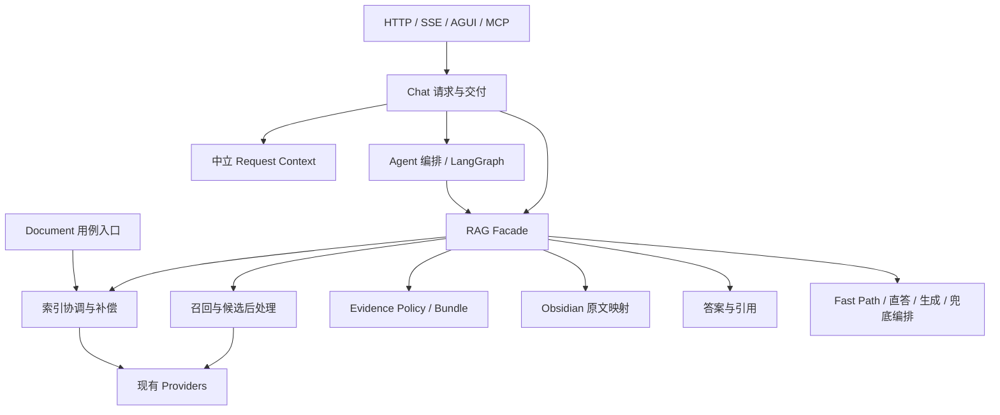

# 目标依赖与迁移决定

以现存模块为基础渐进迁移。共享候选类型、Evidence、Retrieval、Generation 已从线性 RAG 服务中迁出；Chat、Agentic、gRPC、Gateway、Admin、Ops、Document、Workflow 通过窄能力 token 使用 RAG，不再直接依赖旧 Facade。Document 保留 PG 元数据/ACL/版本业务，索引协调承接派生状态及原有补偿。

Session、Memory、Checkpoint、Artifact、Trace 分别负责会话、可复用偏好、恢复位置、可追溯产物、审计证据，不能统一成一个状态容器。Context 复用既有短期记忆与预算组件，明确来源并保留不可信内容处理。阶段实施结果以 progress.md 为准；Batch 9 已完成 Facade 到窄服务的拆分，剩余仅真实外部环境验收。
