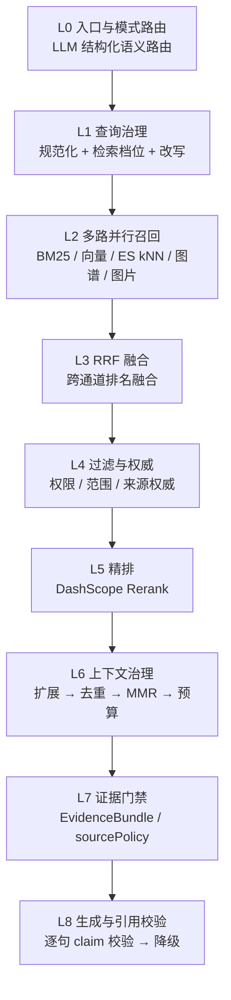
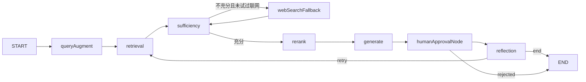

# RAG 检索链路分层

> 主题：本仓库后端检索（retrieval）管线的层次划分、每层职责与实现方式。
> 结论基于当前代码，行号对应 `backend/src/`，随代码演进可能漂移，以代码为准。

## 一句话结论

检索管线自下而上分 **9 层（L0–L8）**。主轴在 `rag/karpathy/karpathy-rag.service.ts:596 retrieveDetailed()` 里串起来；`simple / auto / agentic` 三种模式**共用同一检索底座**，只在编排深度上不同。

## 分层总览

| 层 | 职责 | 关键落点 | 核心参数 |
|---|---|---|---|
| L0 | 入口与模式路由 | `modules/chat/chat.service.ts:102`、`rag/prompts/query-intent-router.ts:104` | 20s 路由超时 |
| L1 | 查询治理 | `retrieveDetailed:596`、`rag/karpathy/context-builder.ts:31` | 4 档 profile |
| L2 | 多路并行召回 | `searchLocalBm25:2398`、`:659` Milvus、`probeGraph:806`、`probeImages:842` | 探针 1.2s 超时 |
| L3 | RRF 融合 | `fuseByRrf:2561` | k=60，BM25 0.3 / 向量 0.7 |
| L4 | 过滤与权威 | `:714` 权限、`applySourceAuthority:718`、`matchesScope:719` | 权限命中时候选×3 |
| L5 | 精排 | `applyRerank:2742` | TopN 默认 20，10s 超时 |
| L6 | 上下文治理 | `expandContextChunks:2853`、`ContextBuilder.build`（`context-builder.ts:86`） | MMR λ=0.72 |
| L7 | 证据门禁 | `rag/evidence/evidence-bundle.ts` | `canUseWebFallback:46` |
| L8 | 生成与引用校验 | `answer:990`、`assessCitationSupport:3046`、`synthesizeEvidenceAnswer:2078` | 逐句 claim 校验 |

---

## 逐层详解

### L0 入口与模式路由 — 决定"谁来回答"

- 入口：`POST /api/chat`（`modules/chat/chat.controller.ts:64`）与 `GET /api/chat/stream`（SSE，`:84`）。
- `chat.service.ts:102` 读 `mode`（`simple` / `auto` / `agentic`，默认 `simple`）。
- `query-intent-router.ts:104 classify()` 用 LLM 做**结构化语义路由**，单次输出 zod 校验的 JSON：`intent / confidence / action / sourcePolicy / needsSynthesis / rewriteQueries / multiIntent / subQueries / targetKbs / queryType / entities / filters / ambiguity`（schema 见 `:6-70`，prompt 见 `:80`）。
- 关键约束：`sourcePolicy`（`direct_answer` / `local_only` / `web_allowed`）是**唯一的证据来源决策**，业务链路不得再按关键词猜；解析失败或超时走 `safeFallback:159`，安全收敛到 `local_only`（`normalizeDecision:171-180`）。
- 路由是 LLM 判断而非规则匹配。`requiresKnowledgeRetrieval:75` 已是空实现，仅为兼容旧调用方保留。

### L1 查询治理 — 决定"怎么问、问多深"

`retrieveDetailed:596` 开头三件事：

1. `normalizeQuery:602` 查询规范化。
2. `detectRetrievalProfile:603` 用正则选检索档位（`context-builder.ts:70-83`）。
3. 权限候选深度放大：有 `allowedDocIds` 时 `candidateDepth = profile.candidateDepth × 3`（`:612-614`），避免受限文档挤占可见结果。

四档 profile（`context-builder.ts:31-68`）：

| 档位 | 触发正则 | candidateDepth | finalTopK | neighborWindow | 字符预算 | 每文档上限 |
|---|---|---|---|---|---|---|
| `lookup` | 默认兜底 | 8 | 4 | 0 | 3,500 | 2 |
| `procedure` | 流程/步骤/如何/验收/测试/上线/排查 | 12 | 6 | 1 | 6,000 | 4 |
| `comparison` | 对比/比较/差异/区别/历史版本/地区差异 | 16 | 8 | 1 | 8,000 | 3 |
| `generation` | 生成/设计/方案/矩阵/完整清单/技术拆解 | 20 | 8 | 1 | 10,000 | 5 |

Agentic 额外有 `queryAugment` 节点做查询扩展，受 `AGENTIC_MAX_AUGMENTED_QUERIES`（默认 3）约束，并用语义相似度过滤掉改写后偏离原问题的查询。

### L2 多路并行召回 — 决定"从哪捞"

同一轮并发发起多路，互不阻塞（图谱/图片探针在方法开头就 `Promise` 出去，`:605-606`）：

| 通道 | 实现 | 说明 |
|---|---|---|
| 本地 BM25 | `searchLocalBm25:2398` | jieba 分词，k1=1.5 / b=0.75，按 userId 分实例，落盘 `workspace/bm25-index.json` |
| ES 全文 | `:621-628` | IK 中文分词；与本地结果经 `mergeRankedHits:2429` 按 chunk id 去重合并 |
| Milvus 向量 | `:659` | 主向量通道，HNSW；chunk metadata 带 `userId/docId` 做过滤 |
| ES kNN 向量 | `:637-700` | `RAG_ES_KNN_MODE` = `off` / `fallback`（默认）/ `always` |
| 图谱探针 | `probeGraph:806` | Neo4j 实体关系，1.2s 超时，失败静默丢弃 |
| 图片探针 | `probeImages:842` | 多模态图片集合，1.2s 超时 |
| Obsidian | `modules/obsidian/obsidian-knowledge.service.ts` | 作为独立知识源参与 `assessFastPath:1474` |
| Bad Case 回归集 | `prompts/bad-case-flywheel.service.ts` | 仅人工审核通过且进回归集的样本，最多召回 2 条 |

ES kNN 三种模式的实际语义（`:649-705`）：

- `off`：完全不启用 ES 向量通道。
- `fallback`（默认）：Milvus 运行时不可用时**直接跳过 Milvus**（不浪费一次注定失败的调用），改走 ES kNN。
- `always`：Milvus 正常时也并行拉 ES kNN，两路按 chunk id 去重后合并进同一余弦池。

`RAG_ES_KNN_MODE=fallback` 下若 Milvus 不可用，会打一条 `Milvus runtime unavailable, switching vector channel to ES kNN` 的 warn（`:655`）。

### L3 RRF 融合 — 决定"怎么合"

`fuseByRrf:2561` 用 Reciprocal Rank Fusion 消除 BM25 分与余弦分的**量纲差异**：

- 排名分 `rankScore(index) = (k + 1) / (k + index + 1)`，其中 `rrfK = 60`。
- 权重 `bm25Weight = 0.3`、`cosineWeight = 0.7`（`:315-317`）。
- 同一 chunk 两路都命中则 `totalScore` 累加；同时保留 `bm25Score` / `cosineScore` 归一化分供诊断。
- 注释明确：**RRF 只调顺序，不改变后面的版本、权限和范围门禁**。

### L4 过滤与权威 — 决定"谁有资格进"

按序三道闸：

1. **权限**：`.filter(chunk => !allowedDocIds || allowedDocIds.has(chunk.docId))`（`:714-716`）。
2. **来源权威**：`applySourceAuthority:718`，由 `RAG_SOURCE_AUTHORITY_RULES` 按 docId / chunk 内容匹配权重。
3. **范围**：`matchesScope(chunk, options.scope)`（`:719`），过滤 project / activity / region / channel / documentType / lifecycle；默认过滤 deprecated，历史对比显式放开。

过滤后按 `totalScore` 降序排序，才进入精排。

### L5 精排 — 决定"谁排前面"

`applyRerank:2742` 调 DashScope Rerank（qwen3-rerank）：

- 防护：`chunks.length < 2`、`RAG_RERANK_ENABLED === 'false'`、服务未启用，三者任一直接返回原序不调远端（`:2746-2752`）。
- 只重排前 `RAG_RERANK_TOP_N`（默认 20，夹取到 [1, 50]）个候选，尾部原样保留。
- 10s 硬超时（`tools/dashscope-rerank.service.ts:51 AbortSignal.timeout(10_000)`）。
- **失败保持原序**，只打 warn，不阻断链路（`:2785`）。
- 远端短路时会原样返回同一数组，代码用 `reranked === candidates` 识别并标记为"未生效"（`:2762`）。

### L6 上下文治理 — 决定"给模型看什么"

两段接力：

**① 片段扩展** `expandContextChunks:2853`
按 profile 的 `neighborWindow` / `sameSectionLimit` 做相邻块与同 section 扩展，扩展出来的片段标记 `retrievalSource = 'expansion'`；随后条件合并图谱片段与图片片段（`shouldMergeGraphEvidence` / `shouldMergeImageEvidence`，`:739-740`）。

**② 上下文构建** `ContextBuilder.build`（`context-builder.ts:86-160`），严格按序：

1. **内容去重** — `normalizeForDedup:249` 先剥掉"章节路径/内容类型"元信息行再比对，避免同内容不同元数据重复入池。
2. **每文档限额** — `maxChunksPerDocument`（2~5，随 profile）。
3. **词法 MMR 多样性** — `applyLexicalMmr:167`，λ = 0.72；relevance = 0.5×归一化 totalScore + 0.5×与 query 的 Jaccard，redundancy = 与已选片段的最大 Jaccard。候选没保留原始 embedding，所以用分词集合估计冗余。
4. **TopK + 字符预算** — 受 `finalTopK` 与 `contextCharacterBudget` 双约束，估算长度 `content.length + 32`。
5. **长片段压缩** — `compressChunk:222`，>900 字的片段按 query 词做句子级过滤；命中率 0 或 100% 时放弃压缩。
6. **首尾交错排布** — `arrangeForLongContext:238`，偶数位前插、奇数位前推，缓解长上下文的中间遗忘。

最终拼成 `[片段 N｜role]` 格式，`---` 分隔（`:142-147`）。同时产出 `stats`（去重数/限额数/预算裁剪数/上下文字符数）供诊断。

### L7 证据门禁 — 决定"够不够、能不能联网"

`rag/evidence/evidence-bundle.ts` 定义 **EvidenceBundle**（`:25-31`）：`query` / `chunks` / `assessment` / `sourcePolicy` / `diagnostics`。
一次用户请求只构建一个权威证据快照，Simple / Auto / Agentic 都传这个对象，而不是各自以不同问题文本重复做互相矛盾的充分性判断。

- `createEvidenceBundle:33` — 按 chunk id 保留最高分去重（`:55-64`），按 totalScore 降序。
- `canUseWebFallback:46` — **只有** `!sufficient && sourcePolicy === 'web_allowed'` 才允许联网。`local_only` 永远不出网。
- `appliesToQuery:51` — 充分性结论针对 `evaluatedQuery` 判定；原问题的结论只能由原问题复用，**子问题必须独立补证**。这条直接对应"Agent 改写了子问题就把已充分证据降级为资料不足"那类事故。

充分性来源是三源门禁的或运算（`assessFastPath:1474`）：`Base Case / RAG 质量 / Obsidian`，任一通过即视为充分（`:1540-1546`）。

### L8 生成与引用校验 — 决定"怎么答"

`answer:990` 的收口逻辑：

1. LLM 生成回答。
2. `assessCitationSupport:3046` 做**逐句 claim 级引用支撑校验**。
3. 不合格先 `attachMissingClaimCitations` 补引。
4. 仍不合格 → `synthesizeEvidenceAnswer:2078` 降级为结构化证据摘要（可切 qwen 重生成）。
5. 无证据时明确拒答（`unsupportedAnswer:316`），**不做无引用模型兜底**。

即用户不会看到裸片段堆砌，也不会看到没有引用支撑的项目结论。

---

## 编排层：Agentic 不是第 10 层

`rag/agentic/agentic-rag.service.ts:183-270` 的 LangGraph 状态机：

*（实际边定义：`sufficiency` 条件边 `:227-240`，`humanApprovalNode` 条件边 `:246-257`，`reflection` 条件边 `:258-268`。）*

它是**外挂的编排循环**，每次召回复用的正是 L1–L7 同一底座，不存在另一套检索实现。成本边界由 `config/configuration.ts:218-249` 统一控制：

| 环境变量 | 默认值 |
|---|---|
| `AGENTIC_CONFIDENCE_THRESHOLD` | 0.7 |
| `AGENTIC_MAX_RETRIES` | 2 |
| `AGENTIC_MAX_AUGMENTED_QUERIES` | 3 |
| `AGENTIC_MAX_RETRIEVAL_QUERIES` | 4 |
| `AGENTIC_MAX_SUB_QUESTIONS` | 3 |
| `AGENTIC_MAX_RETRIEVED_CHUNKS` | 5 |
| `AGENTIC_MAX_WEB_SEARCH_RESULTS` | 5 |
| `AGENTIC_MAX_RERANK_TOP_N` | 5 |
| `AGENTIC_RERANK_ENABLED` / `AGENTIC_GRAPH_SEARCH_ENABLED` | true |

**三种模式的分流点**：

- `simple`：`chat.service.ts:299-331`。multiIntent / 系统能力 / 客观事实 / 低置信歧义 → 走 agentic；否则走 `karpathyRagService.answer`（带 `karpathyDirectAnswer: true`，即"先精确直答，未命中再 Hybrid"）。
- `auto`：`agentic-rag.service.ts:2435 resolveAutoRoute`。Fast Path 证据不足**直接升级 agentic**；证据充分时再看 `shouldUseAgentic:2443` 的正则规则决定。
- `agentic`：直接进图。

`shouldUseAgentic:2443-2455` 是**纯正则**（对比/为什么/多跳/规划/联网等），不调模型。

---

## 横切机制

### 降级与熔断

| 机制 | 行为 | 落点 |
|---|---|---|
| Milvus 熔断 | 800ms search 超时，连续 2 次失败熔断 30s；熔断期向量通道失效 | `config/configuration.ts:38-55`、`isCircuitOpen:617` |
| 向量失败降级 | catch 后 warn `fallback to BM25 only`，链路继续 | `:667-673` |
| ES kNN 兜底 | `fallback` 模式跳过不可用的 Milvus 直接走 ES | `:649-705` |
| Rerank 失败 | 保持原序 | `:2785` |
| 图谱/图片探针 | 1.2s 超时后静默丢弃，不影响主链 | `:825`、`:861` |
| 联网兜底 | 仅 `sourcePolicy === 'web_allowed'` 且不充分时放行 | `evidence-bundle.ts:46` |

所有超时阈值均可通过环境变量配置（`MILVUS_SEARCH_TIMEOUT_MS` / `MILVUS_CIRCUIT_OPEN_MS` / `MILVUS_CIRCUIT_FAILURE_THRESHOLD` 等）。

### 多租户隔离

`userId` 是唯一隔离边界，贯穿每一层：PostgreSQL 按 `userId` 过滤、Redis key 含用户/会话维度、Milvus metadata 过滤、BM25 按用户文档有效集合过滤、GraphRAG 按 `userId` 过滤。L4 的权限闸是对抗"跨租户越权召回"的兜底。

### 可观测

`rag_retrieval_context_chunks`、`rag_retrieval_context_characters`、`rag_retrieval_expanded_chunks_total` 三个上下文治理指标，加上检索命中数（按来源/模式打标签，`:630-634`、`:707-711`）和 `RetrievalDiagnostics`（`:754-772`）快照。

---

## 已知缺口

- **图谱影子模式未实现**。`specs/005-graph-shadow-routing` 尚无对应代码，当前只有 `AGENTIC_GRAPH_SEARCH_ENABLED` 真/假开关，没有影子比对。这是分层口径上目前唯一的缺口。
- **Milvus search 偶发 timeout** 仍是主链最大不确定性，当前靠快速失败 + 短期熔断 + BM25 降级兜住，但没有根治。
- `rag/router/` 目录为空目录（`ls rag/router` 无输出），路由职责实际落在 `rag/prompts/query-intent-router.ts` 和 `agentic-rag.service.ts` 里，目录结构与代码现状不一致。

## 关键文件索引

| 文件 | 行数 | 职责 |
|---|---|---|
| `rag/karpathy/karpathy-rag.service.ts` | 3332 | 主检索管线 + 生成 + 引用校验 + 降级 |
| `rag/karpathy/context-builder.ts` | 256 | 检索档位 profile + 上下文治理 |
| `rag/karpathy/bm25.util.ts` / `bm25-store.ts` | — | jieba BM25 与持久化 |
| `rag/evidence/evidence-bundle.ts` | 68 | 证据包模型与来源策略 |
| `rag/agentic/agentic-rag.service.ts` | 2819 | LangGraph 编排 |
| `rag/agentic/agentic-rag.state.ts` | — | 图状态与结构化交接物定义 |
| `rag/prompts/query-intent-router.ts` | 299 | LLM 语义路由 |
| `tools/dashscope-rerank.service.ts` | — | Rerank 通道 |
| `tools/graph-search.service.ts` / `image-search.service.ts` / `bocha-search.service.ts` | — | 图谱 / 图片 / 联网工具 |
| `modules/chat/chat.service.ts` | — | 问答入口与模式分流 |
| `providers/vector-store/milvus.vector-store.ts` | — | 向量通道 |
| `modules/obsidian/obsidian-knowledge.service.ts` | — | Obsidian 知识源 |
| `config/configuration.ts` | — | Milvus 超时/熔断与 Agentic 成本边界 |
